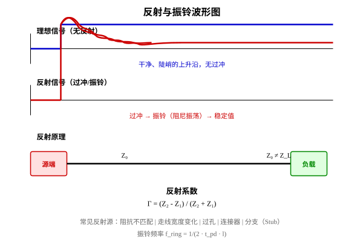
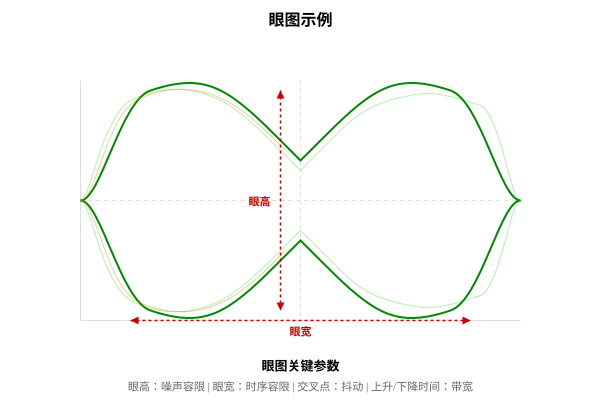
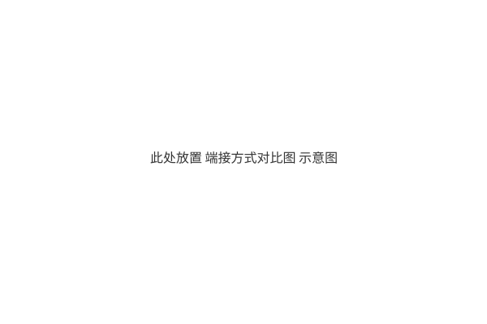

# 9.1 信号完整性

## 1. 引言

信号完整性（Signal Integrity, SI）是指在高速数字系统中，信号从发送端到接收端保持其正确波形和时序的能力。随着数字系统时钟频率突破 GHz 大关和上升/下降沿进入亚纳秒范围，信号完整性问题已成为高速 PCB 设计的首要挑战。反射、串扰、地弹、码间干扰等问题如果处理不当，轻则降低系统可靠性，重则导致系统完全失效。

## 2. 信号完整性的基本概念

### 2.1 信号完整性的三大维度

**时序（Timing）**：
- 建立时间（Setup Time）：数据在时钟沿到达前必须稳定的最小时间
- 保持时间（Hold Time）：数据在时钟沿到达后必须保持的最小时间
- 时钟抖动（Jitter）与时钟偏移（Skew）

**噪声（Noise）**：
- 电源噪声、地弹、串扰、反射
- 噪声容限（Noise Margin）：

$$NM_H = V_{OH(min)} - V_{IH(min)}$$

$$NM_L = V_{IL(max)} - V_{OL(max)}$$

**电磁干扰（EMI）**：
- 高速信号辐射的电磁能量
- 传导发射与辐射发射

### 2.2 何时需要考虑信号完整性

当信号上升时间 $t_r$ 满足以下条件时，需要关注信号完整性：

$$t_r < 6 \cdot t_{pd}$$

其中 $t_{pd}$ 为传输线延迟。或者说，当互连长度超过：

$$l > \frac{t_r}{2 \cdot t_{pd\_unit}}$$

在 FR-4 中，典型 $t_{pd\_unit} \approx 55\text{–}70$ ps/cm。对于 1 ns 上升沿，临界长度约 7–9 cm。

## 3. 反射与振铃

### 3.1 反射的产生机制

当信号沿传输线传播遇到阻抗不连续点时，部分能量被反射回来。反射系数：

$$\Gamma = \frac{Z_2 - Z_1}{Z_2 + Z_1}$$

其中 $Z_1$ 为传输线特征阻抗，$Z_2$ 为不连续点的阻抗。

常见反射源：
- 接收端阻抗不匹配（高阻输入 → $\Gamma \approx +1$）
- 走线宽度变化
- 过孔、连接器
- 分支（Stub）

### 3.2 振铃（Ringing）

当源端和负载端均不匹配时，信号在两端之间来回反射，形成振铃。

振铃频率由传输线往返延迟决定：

$$f_{ring} = \frac{1}{2 \cdot t_{pd} \cdot l}$$

振铃幅度取决于反射系数和线路损耗。

### 3.3 反弹图（Bounce Diagram）

反弹图是分析反射的直观工具，纵轴为时间，横轴为距离。通过追踪每次反射的幅度和延迟，可以构造接收端的波形。

## 4. 串扰（Crosstalk）

### 4.1 串扰的产生机制

当两条走线平行布线时，电磁耦合导致一条线上的信号干扰另一条线。耦合机制包括：
- **容性耦合**（电场耦合）：通过互电容 $C_m$
- **感性耦合**（磁场耦合）：通过互感 $L_m$

### 4.2 近端串扰（NEXT）

近端串扰出现在干扰源驱动端附近（"近端"）。近端串扰系数：

$$NEXT = \frac{V_{near}}{V_{source}}$$

近端串扰脉冲宽度约为 $2 \cdot t_{pd}$（往返时间）。

近似公式：

$$V_{near} \approx \frac{1}{4}\left(\frac{C_m}{C} + \frac{L_m}{L}\right) \cdot V_s$$

### 4.3 远端串扰（FEXT）

远端串扰出现在干扰源负载端附近（"远端"）。远端串扰系数：

$$FEXT = \frac{V_{far}}{V_{source}}$$

远端串扰脉冲幅度较小但具有更高的频率成分。

近似公式：

$$V_{far} \approx \frac{1}{2}\left(\frac{C_m}{C} - \frac{L_m}{L}\right) \cdot \frac{t_r}{t_{pd}} \cdot V_s$$

在均匀介质中（如带状线），$\frac{C_m}{C} = \frac{L_m}{L}$，FEXT ≈ 0。在非均匀介质中（如微带线），FEXT 不可忽略。

### 4.4 减小串扰的措施

- 增加走线间距（3W 规则：间距 ≥ 3 倍线宽）
- 减小并行长度
- 插入地线隔离（Guard Trace）
- 使用差分信号
- 降低信号上升/下降时间

## 5. 地弹与同步开关噪声

### 5.1 地弹（Ground Bounce）

当多个输出同时从高电平切换到低电平时，大量电流瞬间流过芯片封装电感（$L_{pkg}$），在地引脚上产生电压尖峰：

$$V_{gb} = n \cdot L_{pkg} \cdot \frac{di}{dt}$$

其中 $n$ 为同时切换的输出数量。

### 5.2 同步开关噪声（SSN）

SSN（Simultaneous Switching Noise）是地弹的广义概念，包括地弹和电源弹（Vcc Sag）。SSN 会导致：
- 芯片内部参考地偏移
- 输出信号抖动
- 误触发

### 5.3 减小 SSN 的措施

- 增加电源/地引脚数量
- 降低封装电感（BGA 优于 QFP）
- 使用片上去耦电容
- 控制同时开关的输出数量
- 使用差分信号（SSN 为共模噪声）

## 6. 码间干扰与眼图

### 6.1 码间干扰（ISI）

ISI（Inter-Symbol Interference）是由于信道带宽限制和色散效应，导致前一个码元的拖尾干扰后续码元。ISI 限制了数字通信系统的最大数据传输速率。

奈奎斯特准则（无 ISI 条件）：

$$\sum_{k=-\infty}^{\infty} h(t - kT) = \begin{cases} 1 & t = 0 \\ 0 & t = nT, n \neq 0 \end{cases}$$

### 6.2 眼图（Eye Diagram）

眼图是评估信号质量的最直观工具，通过将多个码元周期叠加显示。

眼图的关键参数：
- **眼高（Eye Height）**：垂直张开度，反映噪声容限
- **眼宽（Eye Width）**：水平张开度，反映时序容限
- **眼图交叉点**：反映抖动
- **上升/下降时间**：反映带宽

眼图张开度与误码率（BER）的关系：

$$BER \propto \operatorname{erfc}\left(\frac{EyeHeight}{2\sigma_n}\right)$$

## 7. 传输线端接技术

### 7.1 为什么需要端接

端接的目的：消除/减少反射，改善信号质量。选择端接方案需综合考虑功耗、驱动能力、PCB 面积等因素。

### 7.2 串联端接（Series Termination）

在源端串联电阻 $R_s$，使 $R_s + R_{driver} = Z_0$。

- 优点：功耗低、单电阻、适用于点对点拓扑
- 缺点：上升沿变缓，不适合多负载总线

### 7.3 并联端接（Parallel Termination）

在接收端并联电阻 $R_p = Z_0$ 到地。

- 优点：匹配效果好、信号质量高
- 缺点：功耗大（$P = V_{OH}^2/R_p$），直流偏置变化

### 7.4 戴维南端接（Thevenin Termination）

在接收端用两个电阻分压到 $V_{cc}$ 和 GND，等效电阻 $R_{eq} = Z_0$。

$$R_{eq} = R_1 \parallel R_2 = Z_0$$

$$V_{eq} = \frac{R_2}{R_1 + R_2} \cdot V_{cc}$$

- 优点：提供偏置电压，适合非 50% 占空比信号
- 缺点：静态功耗较大

### 7.5 AC 端接

在接收端串联 RC 网络到地，$R = Z_0$，$C$ 选择：

$$C \gg \frac{t_{pulse}}{R}$$

- 优点：无直流功耗
- 缺点：大电容占用面积，仅适用于平衡信号

### 7.6 端接方案对比

| 端接方式 | 功耗 | 元件数 | 信号质量 | 适用场景 |
|----------|------|--------|---------|---------|
| 串联端接 | 低 | 1 | 良好 | 点对点 |
| 并联端接 | 高 | 1 | 优秀 | 短距离高速 |
| 戴维南端接 | 中 | 2 | 优秀 | 高速总线 |
| AC 端接 | 极低 | 2 | 良好 | 时钟信号 |

## 8. 差分信号与共模抑制

### 8.1 差分信号的优势

差分信号使用两条线传输互补信号：
- 抗共模噪声能力强
- 辐射 EMI 低（磁场相互抵消）
- 对地弹不敏感
- 可实现更低的电压摆幅

### 8.2 差分阻抗

差分阻抗 $Z_{diff}$ 取决于两条线之间的耦合：

$$Z_{diff} = 2Z_{odd}$$

其中 $Z_{odd}$ 为奇模阻抗。当线间距很小时，$Z_{diff} < 2Z_0$；当间距很大时，$Z_{diff} \approx 2Z_0$。

### 8.3 共模抑制

共模抑制比（CMRR）衡量差分接收器抑制共模噪声的能力：

$$CMRR = 20\log_{10}\left(\frac{A_{diff}}{A_{cm}}\right) \quad \text{(dB)}$$

良好的差分接收器 CMRR > 60 dB。

## 9. 小结

1. 信号完整性关注时序、噪声和 EMI 三大维度
2. 反射源于阻抗不连续，通过端接消除
3. 串扰分近端（NEXT）和远端（FEXT），3W 规则是有效的预防措施
4. 地弹/SSN 源于封装电感上的瞬态电流
5. 眼图是评估信号质量最直观的工具
6. 端接技术（串联、并联、戴维南、AC）各有适用场景
7. 差分信号是高速接口的首选方案