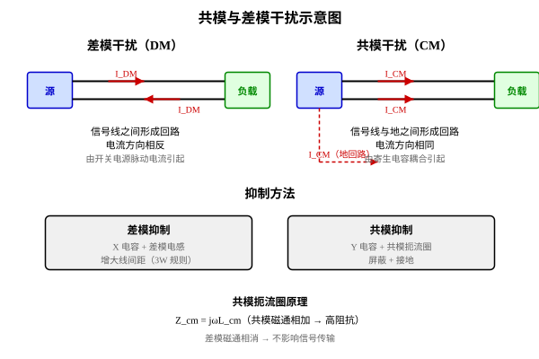
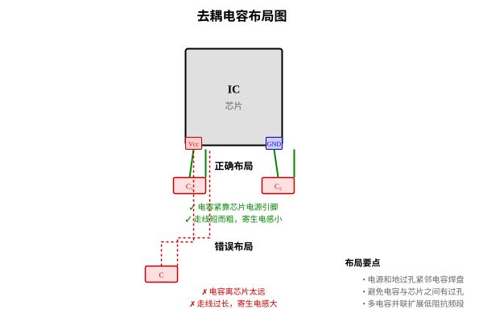
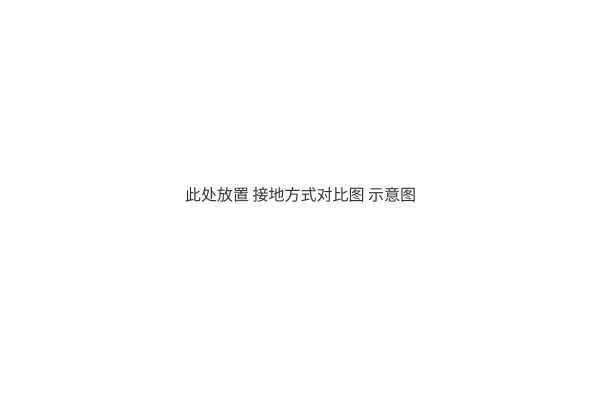

# 9.2 电磁兼容

## 1. 引言

电磁兼容性（EMC，Electromagnetic Compatibility）是指电子设备在电磁环境中能正常工作且不产生不可接受的电磁干扰的能力。EMC 包含两个方面：电磁干扰（EMI）和电磁抗扰度（EMS）。随着电子设备密度增加和频率不断攀升，EMC 设计已成为产品能否通过认证、成功上市的关键因素。

## 2. EMC 基本概念

### 2.1 EMI 与 EMS

**EMI（Electromagnetic Interference，电磁干扰）**：
设备对外界产生的电磁骚扰：
- 传导发射（Conducted Emission）：通过电源线、信号线传导
- 辐射发射（Radiated Emission）：通过空间电磁波辐射

**EMS（Electromagnetic Susceptibility，电磁抗扰度）**：
设备抵抗外界电磁骚扰的能力：
- 静电放电（ESD）
- 电快速瞬变脉冲群（EFT/B）
- 浪涌（Surge）
- 射频场感应的传导骚扰（CS）
- 射频电磁场辐射抗扰度（RS）

### 2.2 EMC 三要素

任何 EMI 问题都包含三个要素：

1. **干扰源（Source）**：产生电磁能量的源头
2. **耦合路径（Coupling Path）**：干扰传播的通道
3. **敏感设备（Victim）**：受干扰影响的设备

EMC 设计的目标就是削弱其中至少一个要素。

### 2.3 传导发射与辐射发射

**传导发射**（150 kHz–30 MHz）：
- 通过电源线、信号线传导
- 分为差模（DM）和共模（CM）干扰

**辐射发射**（30 MHz–1 GHz 及以上）：
- 通过空间电磁场传播
- 远场辐射电场强度（对于短偶极子天线模型）：

$$E = \frac{1.26 \times 10^{-4} \cdot I \cdot l \cdot f^2}{r} \quad \text{(V/m)}$$

其中 $I$ 为电流（A），$l$ 为天线长度（m），$f$ 为频率（MHz），$r$ 为距离（m）。

## 3. 差模干扰与共模干扰

### 3.1 差模干扰（DM）

差模干扰电流在两条信号线之间形成回路，方向相反。主要由开关电源的脉动电流、数字电路的瞬态电流引起。

### 3.2 共模干扰（CM）

共模干扰电流在信号线和地之间流动，方向相同。主要由以下原因产生：
- 电路中的寄生电容耦合
- 地电位差
- 非对称电路结构

共模干扰比差模干扰更难抑制，且更容易产生辐射发射。

### 3.3 共模转差模

由于电路不对称，共模干扰会转化为差模干扰，影响信号质量。共模抑制的重要手段是**共模扼流圈**：

$$Z_{cm} = j\omega L_{cm}$$

其中 $L_{cm}$ 为共模电感（绕在同一磁芯上的两个绕组，共模磁通相加）。

## 4. 去耦电容

### 4.1 去耦电容的作用

去耦电容（Decoupling Capacitor）为芯片提供本地电荷存储，减小电源分配网络（PDN）的阻抗，抑制电源噪声。

### 4.2 电容的等效模型

实际电容的等效电路：理想电容 $C$ + 等效串联电阻 $ESR$ + 等效串联电感 $ESL$。

阻抗频率特性：

$$Z(f) = ESR + j\left(2\pi f \cdot ESL - \frac{1}{2\pi f \cdot C}\right)$$

自谐振频率（SRF）：

$$f_{SRF} = \frac{1}{2\pi\sqrt{ESL \cdot C}}$$

- $f < f_{SRF}$：电容呈容性
- $f = f_{SRF}$：阻抗最小，$Z = ESR$
- $f > f_{SRF}$：电容呈感性

### 4.3 电容的选择

**容量选择**：

$$C = \frac{I \cdot \Delta t}{\Delta V}$$

其中 $I$ 为瞬态电流，$\Delta t$ 为电流脉宽，$\Delta V$ 为允许的电压波动。

**多电容并联策略**：
- 大电容（10–100 μF）：提供低频能量，覆盖 kHz–MHz 频率
- 中电容（0.1–1 μF）：覆盖 MHz–数十 MHz
- 小电容（1–10 nF）：覆盖数十 MHz–数百 MHz

不同容值电容并联可扩展低阻抗频率范围。

### 4.4 PCB 布局要点

- 去耦电容应尽可能靠近芯片电源引脚
- 走线短而粗，减小寄生电感
- 电源和地过孔紧邻电容焊盘
- 避免电容与芯片之间有过孔
- 典型布局：电容 → 短走线 → 电源引脚 → 芯片

### 4.5 旁路电容与去耦电容的区别

| 特性 | 去耦电容 | 旁路电容 |
|------|---------|---------|
| 目的 | 为芯片提供本地电荷 | 将高频噪声旁路到地 |
| 位置 | 靠近芯片电源引脚 | 靠近噪声源或电源入口 |
| 容量 | 较大（μF 级） | 较小（nF 级） |
| 关注的频率 | 中低频（PDN 阻抗） | 高频（噪声滤波） |

两者在实践中常混用，但从原理上有区别。

## 5. 接地设计

### 5.1 接地的目的

- 为信号提供参考电位
- 为电流提供回流通路
- 实现电磁屏蔽
- 安全保护

### 5.2 单点接地

所有电路的地线在一个物理点汇聚。分为：
- **串联单点接地**：各电路地线串联，简单但存在共阻抗耦合
- **并联单点接地**：各电路地线独立汇聚，避免共阻抗耦合但布线复杂

适用于低频电路（< 1 MHz）。

### 5.3 多点接地

各电路就近连接到地平面。地平面提供低阻抗回流通路，适用于高频电路（> 10 MHz）。

### 5.4 混合接地

不同频率范围使用不同接地方式：低频用单点接地，高频用电容耦合到地平面，实现宽频带接地。

### 5.5 接地设计原则

- 保持地平面完整性，避免分割（除非隔离需要）
- 避免"地环路"（Ground Loop）
- 数字地和模拟地分开，在 ADC/DAC 下方单点连接
- 高速信号回流路径应紧邻信号走线（最小化环路面积）

## 6. 屏蔽技术

### 6.1 电场屏蔽

使用导电材料（铜、铝）包围敏感电路或干扰源，利用静电感应原理：

- 屏蔽体接地时，外部电场终止于屏蔽体表面
- 屏蔽效能取决于材料的导电性和接地质量

### 6.2 磁场屏蔽

低频磁场（< 100 kHz）屏蔽：
- 使用高磁导率材料（坡莫合金、铁氧体）
- 通过磁分路效应将磁场限制在屏蔽体内

高频磁场屏蔽：
- 利用涡流效应（良导体如铜、铝）
- 涡流产生的反向磁场抵消入射磁场

### 6.3 电磁屏蔽

同时屏蔽电场和磁场，屏蔽效能（SE）：

$$SE = R + A + B \quad \text{(dB)}$$

其中：
- $R$：反射损耗（与阻抗失配相关）
- $A$：吸收损耗（与材料厚度和趋肤深度相关）
- $B$：多次反射修正（薄材料时不可忽略）

吸收损耗：

$$A = 131.4 \cdot t \cdot \sqrt{f \cdot \mu_r \cdot \sigma_r} \quad \text{(dB)}$$

其中 $t$ 为材料厚度（m），$f$ 为频率（Hz），$\mu_r$ 为相对磁导率，$\sigma_r$ 为相对电导率。

### 6.4 缝隙与开口的影响

屏蔽体的缝隙和开口会严重降低屏蔽效能：

- 缝隙相当于缝隙天线，长度为 $\lambda/2$ 时辐射最强
- 缝隙长度应小于 $\lambda/20$（对应所需屏蔽的最高频率）
- 使用导电衬垫填充缝隙
- 通风孔使用蜂窝波导结构

## 7. PCB 布局中的 EMC 设计原则

### 7.1 层叠设计

- 高速信号层应紧邻完整地平面
- 关键信号（时钟、高速总线）走内层，两侧有地平面
- 电源层和地层紧邻（平面电容效应）
- 推荐的 4 层板层叠：信号–地–电源–信号

### 7.2 走线原则

- 避免 90° 拐角，使用 45° 或圆弧
- 关键信号走线长度尽量短
- 信号环路面积最小化
- 差分信号保持等长、等间距
- 时钟走线远离 I/O 接口和板边

### 7.3 20H 规则

电源层边缘比地层边缘内缩 20 倍介质厚度（$20H$），减少边缘辐射：

$$d_{edge} = 20 \times h$$

其中 $h$ 为电源层与地层之间的介质厚度。

### 7.4 I/O 区域隔离

- 在 PCB 上划分"安静区"和"噪声区"
- 数字电路、开关电源放在远离 I/O 接口的位置
- I/O 接口区域使用滤波、隔离措施
- 板边使用地线包围（Guard Ring）

## 8. 小结

1. EMC 包含 EMI（发射）和 EMS（抗扰度）两个方面
2. 差模干扰和共模干扰需要不同的抑制手段
3. 去耦电容是控制 PDN 阻抗的关键，需合理选择容值和布局
4. 接地方式（单点、多点、混合）需根据频率选择
5. 屏蔽效能取决于材料、厚度、频率和结构完整性
6. PCB EMC 设计的关键是层叠、走线、20H 规则和 I/O 隔离
7. EMC 设计应在产品开发早期介入，后期修改成本极高