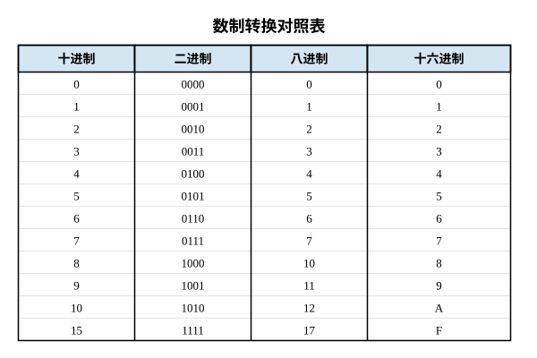
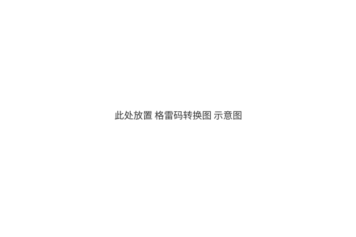

# 5.1 数制与编码

## 1. 常用数制

### 1.1 二进制（Binary）

二进制是数字电路中最基本的数制，只使用两个数码：0 和 1。基数为 2，逢二进一。

任意二进制数可以表示为按权展开式：

$$(N)_2 = \sum_{i=-m}^{n-1} a_i \times 2^i$$

其中 $a_i \in \{0, 1\}$，$n$ 为整数位数，$m$ 为小数位数。

**示例**：$(1011.01)_2 = 1 \times 2^3 + 0 \times 2^2 + 1 \times 2^1 + 1 \times 2^0 + 0 \times 2^{-1} + 1 \times 2^{-2}$

### 1.2 八进制（Octal）

八进制使用 0~7 共 8 个数码，基数为 8，逢八进一。

$$(N)_8 = \sum_{i=-m}^{n-1} a_i \times 8^i, \quad a_i \in \{0,1,...,7\}$$

### 1.3 十进制（Decimal）

十进制是日常使用最广泛的数制，使用 0~9 共 10 个数码，基数为 10。

$$(N)_{10} = \sum_{i=-m}^{n-1} a_i \times 10^i, \quad a_i \in \{0,1,...,9\}$$

### 1.4 十六进制（Hexadecimal）

十六进制使用 0~9 和 A~F（A=10, B=11, C=12, D=13, E=14, F=15）共 16 个数码，基数为 16，逢十六进一。

$$(N)_{16} = \sum_{i=-m}^{n-1} a_i \times 16^i, \quad a_i \in \{0,1,...,9,A,B,...,F\}$$

## 2. 数制转换

### 2.1 其他进制转十进制

按权展开求和即可。

**示例**：$(1101.101)_2 = 1 \times 2^3 + 1 \times 2^2 + 0 \times 2^1 + 1 \times 2^0 + 1 \times 2^{-1} + 0 \times 2^{-2} + 1 \times 2^{-3} = 8 + 4 + 0 + 1 + 0.5 + 0 + 0.125 = (13.625)_{10}$

### 2.2 十进制转其他进制

**整数部分**：除基取余法（短除法），将十进制整数不断除以目标进制基数，取余数，从最后一次余数开始排列。

**小数部分**：乘基取整法，将十进制小数不断乘以目标进制基数，取整数部分，按顺序排列。

**示例**：将 $(13.625)_{10}$ 转换为二进制

整数部分 13：
$$13 \div 2 = 6 \cdots 1$$
$$6 \div 2 = 3 \cdots 0$$
$$3 \div 2 = 1 \cdots 1$$
$$1 \div 2 = 0 \cdots 1$$
从下往上读：$1101$

小数部分 0.625：
$$0.625 \times 2 = 1.25 \rightarrow 1$$
$$0.25 \times 2 = 0.5 \rightarrow 0$$
$$0.5 \times 2 = 1.0 \rightarrow 1$$
从上往下读：$101$

结果：$(13.625)_{10} = (1101.101)_2$

### 2.3 二进制与八进制、十六进制的相互转换

**二进制转八进制**：从小数点开始，每三位二进制一组，转换为对应的八进制数码。

**二进制转十六进制**：从小数点开始，每四位二进制一组，转换为对应的十六进制数码。

**示例**：$(1101101.1011)_2$

- 转八进制：$001\ 101\ 101\ .\ 101\ 100 \rightarrow (155.54)_8$
- 转十六进制：$0110\ 1101\ .\ 1011 \rightarrow (6D.B)_{16}$

## 3. 二进制算术运算

### 3.1 加法

二进制加法规则：
- $0 + 0 = 0$
- $0 + 1 = 1$
- $1 + 0 = 1$
- $1 + 1 = 0$（进位 1）
- $1 + 1 + 1 = 1$（进位 1）

### 3.2 减法

二进制减法规则：
- $0 - 0 = 0$
- $1 - 0 = 1$
- $1 - 1 = 0$
- $0 - 1 = 1$（借位 1）

### 3.3 乘法

二进制乘法与十进制类似，但更简单——只有 $0 \times 0 = 0$，$0 \times 1 = 0$，$1 \times 1 = 1$。

### 3.4 除法

二进制除法与十进制长除法类似。

## 4. 原码、反码与补码

### 4.1 原码

最高位为符号位（0 表示正数，1 表示负数），其余位为数值的绝对值。

$$[X]_{\text{原}} = \begin{cases} X, & 0 \le X \le 2^{n-1}-1 \\ 2^{n-1} + |X|, & -(2^{n-1}-1) \le X \le 0 \end{cases}$$

**示例**（8 位二进制）：
- $[+5]_{\text{原}} = 00000101$
- $[-5]_{\text{原}} = 10000101$

原码的缺点：存在 $+0$ 和 $-0$ 两种表示，且加减运算复杂。

### 4.2 反码

正数的反码与原码相同；负数的反码是原码除符号位外按位取反。

$$[X]_{\text{反}} = \begin{cases} X, & 0 \le X \le 2^{n-1}-1 \\ (2^{n-1} - 1) - |X|, & -(2^{n-1}-1) \le X \le 0 \end{cases}$$

**示例**：
- $[+5]_{\text{反}} = 00000101$
- $[-5]_{\text{反}} = 11111010$

### 4.3 补码

正数的补码与原码相同；负数的补码是反码加 1。

$$[X]_{\text{补}} = \begin{cases} X, & 0 \le X \le 2^{n-1}-1 \\ 2^n + X, & -2^{n-1} \le X \le 0 \end{cases}$$

**示例**：
- $[+5]_{\text{补}} = 00000101$
- $[-5]_{\text{补}} = 11111011$

补码的重要性质：$[X]_{\text{补}} + [Y]_{\text{补}} = [X + Y]_{\text{补}}$（模 $2^n$ 运算），因此加减法可统一为加法实现。

**补码运算规则**：
$$[X - Y]_{\text{补}} = [X]_{\text{补}} + [-Y]_{\text{补}}$$

其中 $[-Y]_{\text{补}}$ 通过对 $[Y]_{\text{补}}$ 连同符号位取反加 1 得到。

## 5. 常用编码

### 5.1 BCD 码（Binary-Coded Decimal）

BCD 码用 4 位二进制数表示 1 位十进制数。

**8421 BCD 码**（最常用）：

| 十进制 | 8421 BCD |
|--------|----------|
| 0      | 0000     |
| 1      | 0001     |
| 2      | 0010     |
| 3      | 0011     |
| 4      | 0100     |
| 5      | 0101     |
| 6      | 0110     |
| 7      | 0111     |
| 8      | 1000     |
| 9      | 1001     |

例如：$(369)_{10} = (0011\;0110\;1001)_{\text{BCD}}$

### 5.2 格雷码（Gray Code）

格雷码的特点是相邻两个码字之间只有一位不同，常用于降低数字电路中的毛刺和错误。

**二进制转格雷码**：
$$G_n = B_n$$
$$G_i = B_i \oplus B_{i+1} \quad (i = 0,1,...,n-1)$$

其中 $\oplus$ 表示异或运算。

**格雷码转二进制**：
$$B_n = G_n$$
$$B_i = G_i \oplus B_{i+1} \quad (i = 0,1,...,n-1)$$

### 5.3 ASCII 码

ASCII（American Standard Code for Information Interchange）用 7 位二进制编码表示 128 个字符，包括数字、字母、标点符号和控制字符。

### 5.4 奇偶校验码

在数据位后添加一位校验位，使得整个码字中 1 的个数为奇数（奇校验）或偶数（偶校验）。

**奇校验**：数据位中 1 的个数为奇数时，校验位为 0；为偶数时，校验位为 1。
**偶校验**：数据位中 1 的个数为偶数时，校验位为 0；为奇数时，校验位为 1。

### 5.5 余 3 码（Excess-3 Code）

余 3 码是 8421 BCD 码加 3 得到的编码，属于无权码，具有自补特性。

| 十进制 | 余 3 码 |
|--------|---------|
| 0      | 0011    |
| 1      | 0100    |
| 2      | 0101    |
| 3      | 0110    |
| 4      | 0111    |
| 5      | 1000    |
| 6      | 1001    |
| 7      | 1010    |
| 8      | 1011    |
| 9      | 1100    |

## 6. 带符号数的表示

**原码表示**：符号位 + 绝对值，范围 $[-(2^{n-1}-1), +(2^{n-1}-1)]$

**补码表示**：符号位 + 数值位（正数同原码，负数为反码+1），范围 $[-2^{n-1}, +(2^{n-1}-1)]$

**移码表示**：在补码基础上将符号位取反，常用于浮点数的阶码表示。

$$[X]_{\text{移}} = 2^{n-1} + X, \quad -2^{n-1} \le X < 2^{n-1}$$

**8 位二进制数的表示范围对比**：

| 编码方式 | 范围 |
|---------|------|
| 原码 | $-127 \sim +127$ |
| 反码 | $-127 \sim +127$ |
| 补码 | $-128 \sim +127$ |
| 移码 | $-128 \sim +127$ |