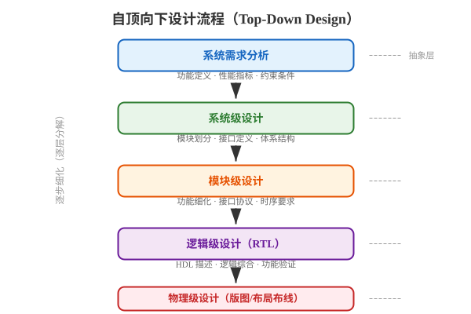

# 5.10 数字系统设计基础

## 1. 数字系统设计方法论

### 1.1 自顶向下设计（Top-Down Design）

自顶向下设计从系统级功能描述开始，逐步细化到模块级、电路级实现。

**设计流程**：
1. **系统需求分析**：明确系统功能、性能指标和约束条件
2. **系统级设计**：将系统划分为若干功能模块
3. **模块级设计**：细化每个模块的功能和接口
4. **逻辑级设计**：实现模块的详细逻辑电路
5. **物理级设计**：布局布线，生成版图

**优点**：
- 从全局出发，把握整体架构
- 便于团队协作
- 可复用性强
- 便于测试和验证

### 1.2 自底向上设计（Bottom-Up Design）

自底向上设计从基本电路单元开始，逐步组合成更大的功能模块。

**优点**：
- 底层单元经过验证，可靠性高
- 适合小规模设计

**缺点**：
- 缺乏全局优化
- 不适合复杂系统

### 1.3 混合设计方法

现代数字系统设计通常采用自顶向下的设计流程，同时结合自底向上的 IP 复用策略。

## 2. 层次化与模块化设计

### 2.1 层次化设计

层次化设计将系统按功能分解为多个层次，每个层次负责不同的抽象级别。

**层次结构**：
- **系统层**：整体功能描述
- **子系统层**：主要功能模块
- **寄存器传输级（RTL）**：寄存器和组合逻辑
- **门级**：基本逻辑门
- **晶体管级**：MOS 管实现

### 2.2 模块化设计

模块化设计将系统划分为功能独立的模块，每个模块有明确的接口定义。

**模块划分原则**：
- 高内聚：模块内部功能紧密相关
- 低耦合：模块间依赖关系简单
- 接口清晰：模块的输入输出定义明确
- 功能单一：每个模块完成一个明确的功能

## 3. 数据通路与控制单元设计

### 3.1 数据通路（Datapath）

数据通路负责数据的运算和传输，包括：
- **寄存器文件**：存储数据
- **算术逻辑单元（ALU）**：执行算术和逻辑运算
- **多路选择器**：选择数据源
- **总线**：数据传输通道

### 3.2 控制单元（Control Unit）

控制单元根据指令和状态产生控制信号，协调数据通路的操作。

**控制单元实现方式**：
- **硬布线控制**：用组合逻辑实现
- **微程序控制**：用 ROM 存储微指令序列

### 3.3 数据通路与控制单元的交互

控制单元根据当前状态和外部输入产生控制信号，控制数据通路的操作；数据通路将状态标志反馈给控制单元。

## 4. 有限状态机设计

### 4.1 Moore 型状态机

Moore 型状态机的输出仅取决于当前状态，与输入无关。

**结构模型**：
- 次态逻辑：$S_{next} = F(S_{current}, X)$
- 状态寄存器：$S_{current} = S_{next}$（时钟沿触发）
- 输出逻辑：$Y = G(S_{current})$

**特点**：
- 输出与时钟同步变化
- 输出稳定，无毛刺
- 可能需要更多状态（相比 Mealy 型）

### 4.2 Mealy 型状态机

Mealy 型状态机的输出取决于当前状态和当前输入。

**结构模型**：
- 次态逻辑：$S_{next} = F(S_{current}, X)$
- 状态寄存器：$S_{current} = S_{next}$（时钟沿触发）
- 输出逻辑：$Y = G(S_{current}, X)$

**特点**：
- 输出对输入变化即时响应
- 状态数通常比 Moore 型少
- 输出可能有毛刺

### 4.3 Moore 型与 Mealy 型的比较

| 特性 | Moore 型 | Mealy 型 |
|------|---------|---------|
| 输出依赖 | 仅当前状态 | 当前状态 + 输入 |
| 状态数 | 较多 | 较少 |
| 输出时序 | 时钟同步 | 输入变化可能立即影响输出 |
| 抗毛刺 | 较好 | 较差 |
| 输入响应速度 | 慢（需等待时钟沿） | 快（组合逻辑直接输出） |

## 5. 状态编码

### 5.1 二进制编码

用最少的触发器数量表示状态数。

$$n = \lceil \log_2 M \rceil$$

其中 $M$ 为状态数，$n$ 为触发器数。

**缺点**：可能产生毛刺，因为多 bit 同时变化时路径延迟不同。

### 5.2 格雷码编码

相邻状态之间只有一位不同，消除多 bit 同时变化的问题。

**优点**：减少毛刺，降低功耗
**缺点**：状态转换复杂时编码困难

### 5.3 独热码（One-Hot Encoding）

每个状态对应一个触发器，只有一个触发器为 1。

$$n = M$$

**优点**：
- 译码逻辑简单（只需判断对应位是否为 1）
- 速度最快
- 无毛刺

**缺点**：
- 需要更多触发器（$M$ 个）
- 适合状态数较少（通常 $M < 16$）的设计

## 6. 数字系统设计实例

### 6.1 交通灯控制器

**需求**：主干道和支路交叉口的交通灯控制。

**状态定义**：
- S0：主干道绿灯，支路红灯（30秒）
- S1：主干道黄灯，支路红灯（5秒）
- S2：主干道红灯，支路绿灯（20秒）
- S3：主干道红灯，支路黄灯（5秒）

**计数器设计**：每个状态对应不同的计时值。

### 6.2 UART 收发器

**UART（Universal Asynchronous Receiver Transmitter）**：通用异步收发器。

**帧格式**：
- 起始位（1位，低电平）
- 数据位（5~8位）
- 校验位（可选）
- 停止位（1~2位，高电平）

**波特率**：每秒传输的位数，如 9600、115200 等。

### 6.3 数字频率计

**工作原理**：
1. 在固定的闸门时间（如 1秒）内对输入信号计数
2. 计数值即为信号频率

$$f = \frac{N}{T_{gate}}$$

其中 $N$ 为计数值，$T_{gate}$ 为闸门时间。

## 7. 可测试性设计（DFT）

### 7.1 测试的重要性

随着集成电路集成度的提高，测试成本和难度越来越大。可测试性设计（Design for Testability, DFT）旨在提高电路的可控性和可观测性。

### 7.2 扫描链（Scan Chain）

将普通触发器替换为扫描触发器，连接成移位寄存器链。

**扫描触发器结构**：
- 正常工作模式：$D$ 输入
- 扫描模式：$SD$（扫描输入）

**测试过程**：
1. 扫描输入：将测试向量串行移入扫描链
2. 捕获：一个时钟周期捕获电路响应
3. 扫描输出：将响应串行移出，与预期结果比较

### 7.3 边界扫描（Boundary Scan）

**JTAG（Joint Test Action Group）标准（IEEE 1149.1）**：在芯片 I/O 端口添加边界扫描单元，实现板级测试。

**JTAG 接口信号**：
- TCK：测试时钟
- TMS：测试模式选择
- TDI：测试数据输入
- TDO：测试数据输出
- TRST（可选）：测试复位

### 7.4 内建自测试（BIST）

在芯片内部集成测试电路，使其能够自我测试。

**BIST 结构**：
- **测试向量生成器（TPG）**：生成测试向量（如 LFSR）
- **输出响应分析器（ORA）**：压缩和分析响应（如 MISR）
- **BIST 控制器**：控制测试流程

**优点**：
- 减少对外部测试设备的依赖
- 可进行在线测试
- 降低测试成本

### 7.5 测试覆盖率

$$\text{测试覆盖率} = \frac{\text{可检测到的故障数}}{\text{总故障数}} \times 100\%$$

**故障模型**：
- 固定故障（Stuck-at Fault）：节点固定为 0 或 1
- 桥接故障（Bridging Fault）：两个节点短路
- 延迟故障（Delay Fault）：路径延迟超过时钟周期