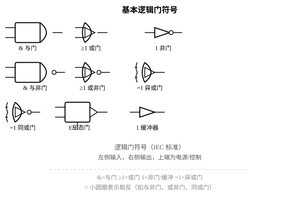
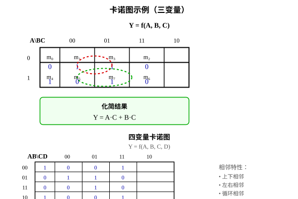

# 5.2 逻辑代数基础

## 1. 基本逻辑运算

### 1.1 与运算（AND）

与运算表示所有输入条件同时满足时，输出才为真。

**逻辑表达式**：$Y = A \cdot B = AB$

**真值表**：

| A | B | Y = A·B |
|---|---|---------|
| 0 | 0 | 0 |
| 0 | 1 | 0 |
| 1 | 0 | 0 |
| 1 | 1 | 1 |

### 1.2 或运算（OR）

或运算表示至少有一个输入条件满足时，输出为真。

**逻辑表达式**：$Y = A + B$

**真值表**：

| A | B | Y = A+B |
|---|---|---------|
| 0 | 0 | 0 |
| 0 | 1 | 1 |
| 1 | 0 | 1 |
| 1 | 1 | 1 |

### 1.3 非运算（NOT）

非运算对输入取反。

**逻辑表达式**：$Y = \overline{A} = A'$

**真值表**：

| A | Y = ¬A |
|---|--------|
| 0 | 1 |
| 1 | 0 |



## 2. 复合逻辑运算

### 2.1 与非运算（NAND）

$$Y = \overline{A \cdot B}$$

与非门是通用门，可以构成任何逻辑电路。

### 2.2 或非运算（NOR）

$$Y = \overline{A + B}$$

或非门也是通用门。

### 2.3 异或运算（XOR）

$$Y = A \oplus B = \overline{A}B + A\overline{B}$$

**真值表**：

| A | B | Y = A⊕B |
|---|---|---------|
| 0 | 0 | 0 |
| 0 | 1 | 1 |
| 1 | 0 | 1 |
| 1 | 1 | 0 |

异或的性质：
- $A \oplus 0 = A$
- $A \oplus 1 = \overline{A}$
- $A \oplus A = 0$
- $A \oplus \overline{A} = 1$
- $A \oplus B = B \oplus A$（交换律）
- $(A \oplus B) \oplus C = A \oplus (B \oplus C)$（结合律）

### 2.4 同或运算（XNOR）

$$Y = A \odot B = \overline{A \oplus B} = AB + \overline{A}\,\overline{B}$$

## 3. 逻辑代数基本定律与规则

### 3.1 基本定律

**0-1 律**：
$$A \cdot 0 = 0, \quad A + 1 = 1$$

**自等律**：
$$A \cdot 1 = A, \quad A + 0 = A$$

**互补律**：
$$A \cdot \overline{A} = 0, \quad A + \overline{A} = 1$$

**重叠律**：
$$A \cdot A = A, \quad A + A = A$$

**双重否定律**：
$$\overline{\overline{A}} = A$$

**交换律**：
$$A \cdot B = B \cdot A, \quad A + B = B + A$$

**结合律**：
$$A \cdot (B \cdot C) = (A \cdot B) \cdot C$$
$$A + (B + C) = (A + B) + C$$

**分配律**：
$$A \cdot (B + C) = A \cdot B + A \cdot C$$
$$A + B \cdot C = (A + B) \cdot (A + C)$$

**吸收律**：
$$A + A \cdot B = A$$
$$A \cdot (A + B) = A$$
$$A + \overline{A} \cdot B = A + B$$
$$A \cdot (\overline{A} + B) = A \cdot B$$

### 3.2 德·摩根定律（De Morgan's Laws）

$$\overline{A \cdot B} = \overline{A} + \overline{B}$$
$$\overline{A + B} = \overline{A} \cdot \overline{B}$$

推广到 n 个变量：
$$\overline{A_1 \cdot A_2 \cdot ... \cdot A_n} = \overline{A_1} + \overline{A_2} + ... + \overline{A_n}$$
$$\overline{A_1 + A_2 + ... + A_n} = \overline{A_1} \cdot \overline{A_2} \cdot ... \cdot \overline{A_n}$$

### 3.3 三个重要规则

**代入规则**：任何逻辑等式，若将等式两边所有出现某一变量的位置都代之以同一个逻辑函数，则等式仍然成立。

**反演规则**：对任意逻辑函数 $Y$，将 $\cdot$ 换为 $+$，$+$ 换为 $\cdot$，0 换为 1，1 换为 0，原变量换为反变量，反变量换为原变量，即可得到 $\overline{Y}$。

**对偶规则**：对任意逻辑函数 $Y$，将 $\cdot$ 换为 $+$，$+$ 换为 $\cdot$，0 换为 1，1 换为 0（变量不变），即可得到 $Y$ 的对偶式 $Y^D$。

## 4. 逻辑函数表示方法

### 4.1 真值表

真值表列出所有输入组合对应的输出值。对于 $n$ 个输入变量，共有 $2^n$ 种组合。

### 4.2 逻辑表达式

**标准与或式（最小项之和）**：

$$Y = \sum m_i$$

其中 $m_i$ 是最小项。最小项是 $n$ 个变量的乘积项，每个变量以原变量或反变量形式出现一次。

**标准或与式（最大项之积）**：

$$Y = \prod M_i$$

其中 $M_i$ 是最大项。最大项是 $n$ 个变量的和项，每个变量以原变量或反变量形式出现一次。

### 4.3 卡诺图（Karnaugh Map）

卡诺图是真值表的图形化表示，利用相邻单元格只有一个变量不同的特性，用于逻辑函数化简。

**二变量卡诺图**：
```
     B=0  B=1
A=0  m0   m1
A=1  m2   m3
```

**三变量卡诺图**：
```
       BC=00  BC=01  BC=11  BC=10
A=0     m0     m1     m3     m2
A=1     m4     m5     m7     m6
```



### 4.4 逻辑图

逻辑图是用基本逻辑门符号连接而成的电路图，直观反映电路的逻辑关系。

## 5. 逻辑函数化简

### 5.1 代数化简法

利用逻辑代数基本定律对表达式进行化简。

**常用方法**：
1. **并项法**：$AB + A\overline{B} = A$
2. **吸收法**：$A + AB = A$
3. **消项法**：$AB + \overline{A}C + BC = AB + \overline{A}C$
4. **配项法**：$A = A(B + \overline{B})$

**示例**：化简 $Y = \overline{A}B + \overline{A}B\overline{C} + A\overline{B}\overline{C} + A\overline{B}C$

$$\begin{aligned} Y &= \overline{A}B(1 + \overline{C}) + A\overline{B}(\overline{C} + C) \\ &= \overline{A}B + A\overline{B} \\ &= A \oplus B \end{aligned}$$

### 5.2 卡诺图化简法

**化简步骤**：
1. 将逻辑函数填入卡诺图
2. 圈出所有相邻的 1（矩形组，大小为 $2^k$）
3. 每个圈对应一个乘积项
4. 将所有乘积项相加得到最简与或式

**卡诺图化简原则**：
- 圈要尽可能大（$2^k$ 个相邻 1）
- 圈的个数要尽可能少
- 每个 1 至少被圈一次
- 卡诺图是循环相邻的（上下相邻、左右相邻）

### 5.3 具有无关项的逻辑函数化简

无关项（Don't Care）是指某些输入组合在实际中不会出现，或输出值无关紧要。在卡诺图中，无关项用 $\times$ 或 $d$ 表示，化简时可以根据需要将其视为 0 或 1，以得到更简化的表达式。

$$Y = \sum m_i + \sum d_j \quad (\text{约束条件})$$

### 5.4 Q-M 化简法（Quine-McCluskey）

Q-M 化简法是一种系统化的逻辑函数化简算法，适用于计算机实现，可以处理多变量逻辑函数的化简。

**基本步骤**：
1. 列出所有最小项及其二进制表示
2. 按 1 的个数分组
3. 逐组合并相邻项（仅一位不同），生成质蕴含项
4. 构建质蕴含表，选择覆盖所有最小项的最少质蕴含项集
5. 得到最简表达式

**优点**：系统化、适合计算机实现、能处理多变量
**缺点**：随着变量数增加，计算复杂度呈指数增长