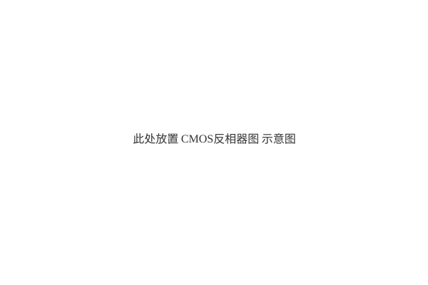
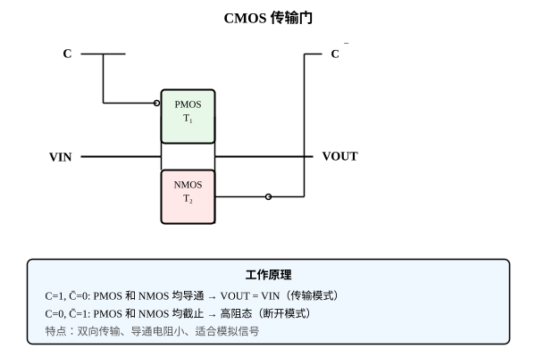

# 5.3 基本逻辑门电路

## 1. 二极管逻辑门电路

### 1.1 二极管与门

二极管与门利用二极管的单向导电性实现与逻辑功能。

当 $V_{CC}$ 通过电阻 $R$ 连接到两个二极管 $D_1$、$D_2$ 的阳极。输入 $A$、$B$ 接阴极。

- 当 $A$ 或 $B$ 为低电平（0V）时，对应二极管导通，输出 $Y$ 为低电平
- 只有当 $A$ 和 $B$ 均为高电平（$V_{CC}$）时，两个二极管均截止，输出 $Y$ 为高电平

### 1.2 二极管或门

二极管或门中，两个二极管的阴极通过电阻接地，输入接阳极。

- 当 $A$ 或 $B$ 为高电平时，对应二极管导通，输出为高电平
- 只有当 $A$ 和 $B$ 均为低电平时，输出才为低电平

## 2. 三极管非门

三极管非门（反相器）利用三极管的开关特性实现逻辑非功能。

**工作原理**：
- 输入为高电平时，三极管饱和导通，输出为低电平
- 输入为低电平时，三极管截止，输出为高电平（通过集电极电阻上拉至 $V_{CC}$）

## 3. TTL 逻辑门电路

### 3.1 TTL 与非门电路结构

TTL（Transistor-Transistor Logic）与非门是 TTL 电路的基本单元。

**典型 TTL 与非门结构**：
- **输入级**：多发射极三极管 $T_1$，实现与逻辑
- **中间级**：$T_2$ 和 $R_2$、$R_3$ 构成分相器
- **输出级**：$T_3$、$T_4$、$D$ 和 $R_4$ 构成推挽输出（图腾柱结构）

**推挽输出级**由 $T_3$（上管）和 $T_4$（下管）组成：
- 输出高电平时，$T_3$ 导通，$T_4$ 截止
- 输出低电平时，$T_3$ 截止，$T_4$ 导通

### 3.2 TTL 电压传输特性

TTL 反相器的电压传输特性曲线描述输入电压 $v_I$ 与输出电压 $v_O$ 的关系。

**特性曲线分段**：
1. **AB 段（截止区）**：$v_I < 0.6V$，输出保持高电平
2. **BC 段（线性区）**：$0.6V < v_I < 1.3V$，输出线性下降
3. **CD 段（转折区）**：$v_I \approx 1.4V$，输出急剧下降
4. **DE 段（饱和区）**：$v_I > 1.4V$，输出保持低电平

### 3.3 TTL 输入与输出特性

**输入特性**：
- 输入低电平电流 $I_{IL}$：输入为低电平时，电流从门电路流出
- 输入高电平电流 $I_{IH}$：输入为高电平时，电流流入门电路

**输出特性**：
- 输出高电平 $V_{OH} \approx 3.6V$
- 输出低电平 $V_{OL} \approx 0.2V$
- 高电平输出电流 $I_{OH}$：拉电流
- 低电平输出电流 $I_{OL}$：灌电流

### 3.4 TTL 主要参数

**扇出系数（Fan-out）**：一个门电路能驱动同类门电路的最大数目。

$$N = \min\left(\frac{I_{OL}}{I_{IL}}, \frac{I_{OH}}{I_{IH}}\right)$$

**噪声容限（Noise Margin）**：保证电路正常工作时允许的最大噪声电压。

$$V_{NH} = V_{OH(min)} - V_{IH(min)}$$
$$V_{NL} = V_{IL(max)} - V_{OL(max)}$$

**传输延迟（Propagation Delay）**：信号从输入到输出所需的时间。

$$t_{pd} = \frac{t_{PLH} + t_{PHL}}{2}$$

其中 $t_{PLH}$ 为输出从低到高的延迟，$t_{PHL}$ 为输出从高到低的延迟。

**功耗**：门电路消耗的功率，通常 $P = V_{CC} \times I_{CC}$。

### 3.5 OC 门（Open Collector Gate）

OC 门输出级集电极开路，使用时需外接上拉电阻 $R_L$。

**特点**：
- 可以将多个 OC 门的输出直接相连，实现"线与"功能
- 需要外接上拉电阻
- 输出高电平由上拉电阻和外部电源决定
- 适合驱动 LED、继电器等负载

**线与连接**：$Y = \overline{AB} \cdot \overline{CD} = \overline{AB + CD}$

### 3.6 三态门（Tri-state Gate）

三态门有三种输出状态：高电平、低电平、高阻态（Z）。

**控制信号 EN 的作用**：
- EN = 1 时，正常逻辑输出
- EN = 0 时，输出高阻态

三态门广泛应用于总线结构，允许多个设备分时共享同一数据总线。

## 4. CMOS 逻辑门电路

### 4.1 CMOS 反相器

CMOS 反相器由 PMOS 管（上拉网络）和 NMOS 管（下拉网络）组成。

**工作原理**：
- $V_{IN} = V_{DD}$（高电平）：NMOS 导通，PMOS 截止，$V_{OUT} = 0V$
- $V_{IN} = 0V$（低电平）：PMOS 导通，NMOS 截止，$V_{OUT} = V_{DD}$

**电压传输特性**：
- 理想特性：在 $V_{DD}/2$ 处发生跳变
- 实际特性：有较陡峭的过渡区

### 4.2 CMOS 与非门

CMOS 与非门由两个串联的 NMOS 管和两个并联的 PMOS 管组成。

**电路结构**：
- 下拉网络：两个 NMOS 管串联
- 上拉网络：两个 PMOS 管并联

$$Y = \overline{A \cdot B}$$

### 4.3 CMOS 或非门

CMOS 或非门由两个并联的 NMOS 管和两个串联的 PMOS 管组成。

$$Y = \overline{A + B}$$

### 4.4 CMOS 传输门

CMOS 传输门（Transmission Gate, TG）由一对互补的 NMOS 和 PMOS 管并联构成。

**工作原理**：
- 控制信号 $C = 1$，$\overline{C} = 0$：传输门导通，$v_O = v_I$
- 控制信号 $C = 0$，$\overline{C} = 1$：传输门截止，高阻态

**特点**：
- 双向传输特性
- 导通电阻小（NMOS 和 PMOS 互补）
- 适合模拟信号传输

## 5. TTL 与 CMOS 电平匹配

### 5.1 电平标准

| 参数 | TTL | CMOS（5V） |
|------|-----|-----------|
| $V_{OH(min)}$ | 2.4V | 4.9V |
| $V_{OL(max)}$ | 0.4V | 0.1V |
| $V_{IH(min)}$ | 2.0V | 3.5V |
| $V_{IL(max)}$ | 0.8V | 1.5V |

### 5.2 TTL 驱动 CMOS

当 TTL 输出高电平时，$V_{OH} \approx 2.4V$，低于 CMOS 要求的 $V_{IH} \approx 3.5V$。解决方法：
- 在 TTL 输出端加上拉电阻至 $V_{DD}$
- 使用电平转换芯片

### 5.3 CMOS 驱动 TTL

CMOS 输出电平可以直接满足 TTL 输入要求，但 CMOS 驱动能力较弱，需检查扇出系数。

## 6. 逻辑门动态特性

### 6.1 传输延迟

信号通过逻辑门需要时间，包括：
- $t_{PLH}$：输出从低电平到高电平的延迟
- $t_{PHL}$：输出从高电平到低电平的延迟

### 6.2 上升时间和下降时间

- **上升时间** $t_r$：输出从 10% 上升到 90% 所需时间
- **下降时间** $t_f$：输出从 90% 下降到 10% 所需时间

### 6.3 功耗与速度的权衡

- CMOS 电路的静态功耗极低，但动态功耗随频率增加而增加
- 动态功耗公式：$P = f \cdot C_L \cdot V_{DD}^2$
- 高速电路通常需要更多功耗，存在功耗-速度折衷