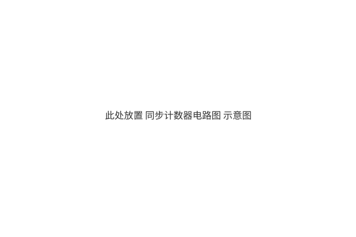
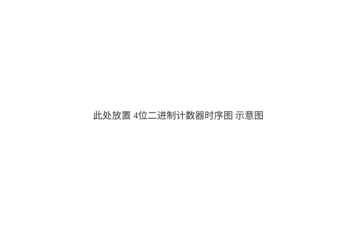
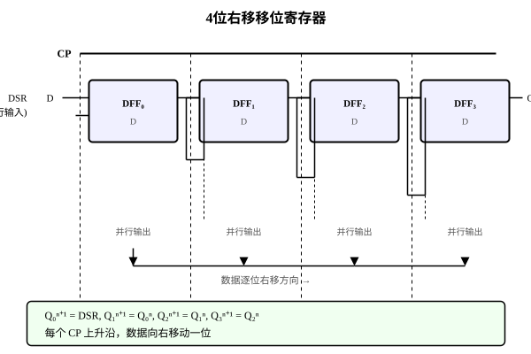

# 5.6 时序逻辑电路

## 1. 时序逻辑电路概述

时序逻辑电路的特点是输出不仅取决于当前输入，还取决于电路的历史状态（具有记忆功能）。

**时序电路的一般结构**：
$$Y(t_n) = F[X(t_n), Q(t_n)]$$
$$Q(t_{n+1}) = G[X(t_n), Q(t_n)]$$

其中 $X$ 为输入，$Y$ 为输出，$Q$ 为状态。

**分类**：
- **同步时序电路**：所有触发器共用一个时钟信号
- **异步时序电路**：触发器使用不同的时钟信号

## 2. 时序逻辑电路分析方法

### 2.1 分析步骤

1. **写出驱动方程**：根据逻辑图写出每个触发器输入端的逻辑表达式
2. **写出状态方程**：将驱动方程代入触发器的特性方程，得到状态方程
3. **写出输出方程**：根据逻辑图写出输出表达式
4. **列状态表**：列出所有现态和输入组合下的次态和输出
5. **画状态图**：用圆圈和箭头表示状态转换关系
6. **画时序图**：画出时钟、输入、输出和状态的波形图
7. **分析逻辑功能**：总结电路的功能描述

### 2.2 分析示例

**示例**：分析一个由两个 JK 触发器构成的同步时序电路。

**驱动方程**：
$$J_0 = 1, \quad K_0 = 1$$
$$J_1 = Q_0, \quad K_1 = Q_0$$

**状态方程**（代入 JK 触发器特性方程 $Q_{n+1} = J\overline{Q_n} + \overline{K}Q_n$）：

$$Q_0^{n+1} = 1 \cdot \overline{Q_0^n} + \overline{1} \cdot Q_0^n = \overline{Q_0^n}$$

$$Q_1^{n+1} = Q_0^n \cdot \overline{Q_1^n} + \overline{Q_0^n} \cdot Q_1^n = Q_0^n \oplus Q_1^n$$

**状态表**：

| $Q_1^n$ | $Q_0^n$ | $Q_1^{n+1}$ | $Q_0^{n+1}$ |
|---------|---------|------------|------------|
| 0 | 0 | 0 | 1 |
| 0 | 1 | 1 | 0 |
| 1 | 0 | 1 | 1 |
| 1 | 1 | 0 | 0 |

这是一个 4 进制计数器（模 4 计数器）。

## 3. 状态图与状态表

**状态图**：用图形表示状态之间的转换关系。
- 圆圈表示状态
- 箭头表示状态转换方向
- 箭头旁标注输入/输出

**状态表**：用表格形式列出所有状态转换关系。

## 4. 同步时序电路设计方法

### 4.1 设计步骤

1. **逻辑抽象**：确定输入、输出变量和状态数
2. **画原始状态图/状态表**：根据设计要求画出状态图
3. **状态化简**：合并等价状态，减少状态数
4. **状态编码**：为每个状态分配二进制代码
5. **选择触发器类型**：通常选用 JK 或 D 触发器
6. **求驱动方程和输出方程**：根据状态表和触发器特性
7. **画逻辑图**：根据驱动方程和输出方程画出电路
8. **验证**：检查设计是否正确

### 4.2 状态化简

**等价状态**：两个状态在相同输入下，输出相同且次态等价（或相同），则这两个状态等价，可以合并。

## 5. 计数器

### 5.1 同步计数器

同步计数器中所有触发器共用同一时钟脉冲。

**4 位二进制同步加法计数器**状态方程：
$$Q_0^{n+1} = \overline{Q_0^n}$$
$$Q_1^{n+1} = Q_0^n \oplus Q_1^n$$
$$Q_2^{n+1} = (Q_0^n \cdot Q_1^n) \oplus Q_2^n$$
$$Q_3^{n+1} = (Q_0^n \cdot Q_1^n \cdot Q_2^n) \oplus Q_3^n$$

### 5.2 异步计数器

异步计数器中，部分触发器的时钟不是共用的，前级触发器的输出作为后级触发器的时钟。

**异步二进制计数器**特点：
- 结构简单
- 传输延迟累积，速度较慢
- 存在毛刺

### 5.3 二进制计数器

**n 位二进制计数器**的计数范围：$0 \sim 2^n - 1$

**4 位二进制计数器时序图**：

### 5.4 十进制计数器

十进制计数器（BCD 计数器）从 0000 计数到 1001，然后回到 0000。

### 5.5 任意进制计数器

利用集成计数器构成任意进制计数器的方法：

1. **置零法（复位法）**：当计数到 $M$ 时，通过异步清零端立即复位到 0
2. **置数法（置位法）**：当计数到某个值时，将数据预置端的数据加载到计数器

### 5.6 集成计数器

**74LS160**：同步十进制计数器（异步清零、同步置数）
**74LS161**：同步 4 位二进制计数器（异步清零、同步置数）
**74LS163**：同步 4 位二进制计数器（同步清零、同步置数）
**74LS193**：同步 4 位二进制加/减计数器（双时钟）

**74LS161 功能表**：

| $\overline{CR}$ | LD | CT$_P$ | CT$_T$ | CP | 功能 |
|----------------|----|--------|--------|----|------|
| 0 | × | × | × | ↑ | 异步清零 |
| 1 | 0 | × | × | ↑ | 同步置数 |
| 1 | 1 | 1 | 1 | ↑ | 计数 |
| 1 | 1 | 0 | × | × | 保持（CO=0） |
| 1 | 1 | × | 0 | × | 保持 |

## 6. 寄存器和移位寄存器

### 6.1 寄存器

寄存器由多个 D 触发器构成，用于存储多位二进制数据。

**n 位寄存器**由 n 个 D 触发器组成，共用时钟和清零信号。

### 6.2 移位寄存器

移位寄存器不仅能存储数据，还能在时钟作用下将数据逐位左移或右移。

**4 位右移移位寄存器**：
$$Q_0^{n+1} = D_{SR}$$
$$Q_1^{n+1} = Q_0^n$$
$$Q_2^{n+1} = Q_1^n$$
$$Q_3^{n+1} = Q_2^n$$

**74LS164**：8 位串入并出移位寄存器
**74LS165**：8 位并入串出移位寄存器
**74LS194**：4 位双向移位寄存器（具有左移、右移、并行置数、保持功能）

### 6.3 移位寄存器型计数器

**环形计数器**：将移位寄存器的最后一位输出反馈到第一位输入。

**扭环形计数器**（约翰逊计数器）：将移位寄存器的最后一位反相后反馈到第一位输入。

## 7. 序列信号发生器

序列信号发生器产生周期性的二进制序列。

**设计方法**：
1. 确定序列长度 $M$，选择 $n$ 位移位寄存器（$2^{n-1} < M \le 2^n$）
2. 画出状态转换图
3. 确定反馈逻辑
4. 画逻辑图

**m 序列（最长线性反馈移位寄存器序列）**：周期为 $2^n - 1$ 的伪随机序列。

## 8. 顺序脉冲发生器

顺序脉冲发生器产生一组在时间上依次出现的脉冲信号。

**实现方式**：
- 计数器 + 译码器
- 移位寄存器（环形计数器）

## 9. 时序分析

### 9.1 建立时间约束

数据从发送触发器到接收触发器必须满足建立时间要求：

$$T_{clk} \ge t_{CO} + t_{logic} + t_{su}$$

其中 $T_{clk}$ 为时钟周期，$t_{CO}$ 为触发器时钟到输出的延迟，$t_{logic}$ 为组合逻辑延迟，$t_{su}$ 为建立时间。

### 9.2 保持时间约束

$$t_{CO(min)} + t_{logic(min)} \ge t_h$$

其中 $t_h$ 为保持时间，$t_{CO(min)}$ 和 $t_{logic(min)}$ 分别为最小延迟。

### 9.3 最高工作频率

$$f_{max} = \frac{1}{T_{clk(min)}} = \frac{1}{t_{CO(max)} + t_{logic(max)} + t_{su}}$$