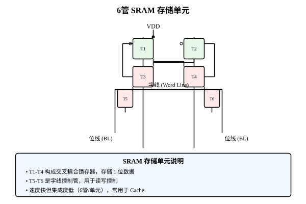
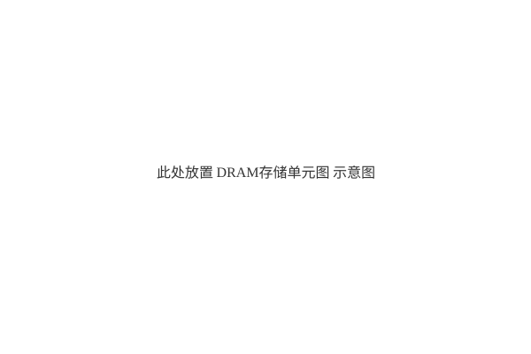
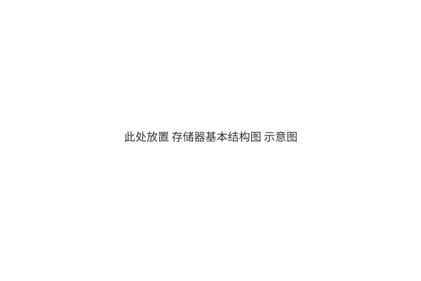

# 5.7 半导体存储器

## 1. 半导体存储器概述

半导体存储器是数字系统中用于存储数据和程序的重要部件。

**分类**：
- **ROM（Read-Only Memory）**：只读存储器，断电后数据不丢失
- **RAM（Random Access Memory）**：随机存取存储器，断电后数据丢失

## 2. 只读存储器（ROM）

### 2.1 掩模 ROM（Mask ROM）

掩模 ROM 在芯片制造过程中由掩模版决定存储内容，出厂后不可更改。

**优点**：生产成本低，适合大批量生产
**缺点**：不可编程，灵活性差

### 2.2 PROM（Programmable ROM）

PROM 出厂时所有存储单元均为 0（或 1），用户可通过编程器一次性写入数据。

**编程原理**：通过大电流熔断存储单元中的熔丝。

### 2.3 EPROM（Erasable Programmable ROM）

EPROM 可多次编程，写入后通过紫外线照射擦除（擦除时间约 15-20 分钟）。

**存储单元**：浮栅 MOS 管（FAMOS 或 SIMOS 结构）

### 2.4 EEPROM（Electrically Erasable Programmable ROM）

EEPROM 可电擦除和重新编程，可逐字节擦写。

**特点**：
- 可在线编程（不需要从电路板上取下）
- 擦写次数有限（约 10 万次）
- 擦写速度较慢（毫秒级）

### 2.5 Flash Memory

Flash Memory 结合了 EPROM 的高密度和 EEPROM 的电擦除特性。

**特点**：
- 以块（Block）为单位擦除
- 高密度、低成本
- 读取速度快，但写入速度较慢
- 广泛应用于 U 盘、SSD、嵌入式系统

**NAND Flash** 和 **NOR Flash** 是两种主要类型：
- NAND Flash：高密度、快擦写、适合大容量存储
- NOR Flash：随机读取快、适合代码执行

## 3. 随机存取存储器（RAM）

### 3.1 SRAM（Static RAM）

SRAM 用触发器（锁存器）存储数据，只要不断电，数据就能保持。

**6 管 SRAM 存储单元**：
- 由两个交叉耦合的反相器（四个晶体管）构成锁存器
- 两个字线控制管控制读写

**特点**：
- 速度快
- 不需要刷新
- 集成度低（每个单元需要 6 个晶体管）
- 功耗较高
- 常用于 Cache

### 3.2 DRAM（Dynamic RAM）

DRAM 用电容存储电荷来代表数据，需要定期刷新。

**1 管 DRAM 存储单元**：
- 一个 MOS 管 + 一个电容
- 电容充电表示 1，放电表示 0

**特点**：
- 集成度高（每个单元只需 1 个晶体管 + 1 个电容）
- 功耗低
- 需要定期刷新（通常每 64ms 刷新一次）
- 速度较 SRAM 慢
- 常用于主存

**SDRAM（Synchronous DRAM）**：同步 DRAM，与系统时钟同步工作。
**DDR SDRAM（Double Data Rate SDRAM）**：双倍数据传输速率，在时钟上升沿和下降沿均传输数据。

## 4. 存储器基本结构

存储器基本结构包括：
1. **存储阵列**：由存储单元组成的矩阵
2. **地址译码器**：将地址信号转换为字线选择信号
3. **读写控制电路**：控制数据的读写操作
4. **数据缓冲器**：暂存输入/输出数据
5. **片选控制**：使能存储器芯片

**地址译码方式**：
- **单译码**：所有地址线通过一个译码器
- **双译码**：行地址和列地址分别译码，可减少译码器规模

## 5. 存储器容量扩展

### 5.1 位扩展

当存储芯片的位数不足时，将多个芯片的对应地址线并联，数据线分别引出。

**示例**：用 8 片 1M×1 位的芯片扩展为 1M×8 位的存储器。

### 5.2 字扩展

当存储芯片的容量不足时，通过片选信号选择不同的芯片，扩展地址空间。

**示例**：用 4 片 256K×8 位的芯片扩展为 1M×8 位的存储器。

### 5.3 字位同时扩展

同时进行位扩展和字扩展。

**芯片数计算**：
$$\text{芯片数} = \frac{\text{总容量}}{\text{单片容量}} = \frac{\text{总字数}}{\text{单片字数}} \times \frac{\text{总位数}}{\text{单片位数}}$$

## 6. 用 ROM 实现组合逻辑

ROM 的存储阵列可以看作是一个查表系统，输入地址对应输出数据。

**用 ROM 实现组合逻辑的步骤**：
1. 将逻辑函数的真值表写入 ROM
2. 输入变量作为地址线
3. 输出函数作为数据线

**示例**：用 8×4 位 ROM 实现全加器。

ROM 的地址输入 $A_2A_1A_0$ 对应全加器的 $C_i\;A\;B$，数据输出 $D_3D_2D_1D_0$ 对应 $C_{i+1}\;S$。

## 7. 新型存储器

### 7.1 FRAM（Ferroelectric RAM）

利用铁电材料的极化反转来存储数据。

**特点**：
- 非易失性
- 读写速度快
- 功耗低
- 擦写次数高（$10^{12}$ 次以上）

### 7.2 MRAM（Magnetoresistive RAM）

利用磁隧道结（MTJ）的磁阻效应存储数据。

**特点**：
- 非易失性
- 读写速度快（接近 SRAM）
- 抗辐射能力强
- 擦写次数无限

### 7.3 RRAM（Resistive RAM）

利用电阻材料的电阻值变化来存储数据。

**特点**：
- 结构简单
- 高密度
- 低功耗
- 速度快

### 7.4 PCRAM（Phase Change RAM）

利用硫系化合物在晶态（低阻）和非晶态（高阻）之间转变来存储数据。

**特点**：
- 非易失性
- 高密度
- 与 CMOS 工艺兼容
- 速度介于 Flash 和 DRAM 之间

## 8. 存储器主要性能指标

| 指标 | 说明 |
|------|------|
| 存储容量 | 存储器的最大存储单元数，如 $2^{20} \times 8$ |
| 存取时间 | 从发出读命令到数据稳定输出的时间 |
| 存取周期 | 连续两次独立存取操作之间的最小时间间隔 |
| 功耗 | 工作功耗和待机功耗 |
| 数据保持时间 | 断电后数据保持的时间 |
| 擦写次数 | 存储器可擦写编程的次数 |