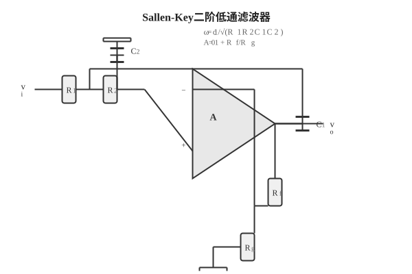
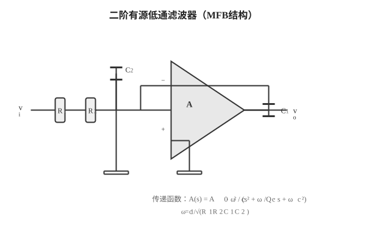

# 4.10 信号处理电路

## 1. 有源滤波电路

有源滤波器（Active Filter）由运放和RC网络组成，克服了无源滤波器通带增益小、带负载能力差的缺点。

### 一阶低通滤波器

传递函数：

$$
A(s) = \frac{A_0}{1 + \frac{s}{\omega_c}}
$$

其中 $A_0$ 为通带增益，$\omega_c = 1/RC$ 为截止角频率。

### 一阶高通滤波器

传递函数：

$$
A(s) = \frac{A_0}{1 + \frac{\omega_c}{s}}
$$

### 带通滤波器

由低通和高通级联而成，通带位于两个截止频率之间。

### 带阻滤波器

抑制特定频率范围的信号，由低通和高通并联组合而成。

## 2. 二阶有源滤波器设计

### 二阶低通滤波器的一般形式

传递函数：

$$
A(s) = \frac{A_0 \omega_c^2}{s^2 + \frac{\omega_c}{Q} s + \omega_c^2}
$$

其中 $Q$ 为品质因数，决定滤波器在截止频率附近的响应特性：
- $Q = 0.707$：巴特沃斯响应（最平坦）
- $Q = 0.5$：临界阻尼
- $Q > 0.707$：出现峰值

### Sallen-Key结构

Sallen-Key结构（压控电压源型）是常用的二阶有源滤波器拓扑。

二阶Sallen-Key低通滤波器：

$$
\omega_c = \frac{1}{\sqrt{R_1 R_2 C_1 C_2}}
$$

$$
Q = \frac{\sqrt{R_1 R_2 C_1 C_2}}{R_1 C_1 + R_2 C_1 + R_1 C_2 (1 - A_0)}
$$

### MFB（多重反馈）结构

MFB结构利用运放的反相输入，具有更好的高频特性。

## 3. 开关电容滤波器

开关电容滤波器（Switched-Capacitor Filter）利用MOS开关和电容模拟电阻，实现集成化滤波。

等效电阻：

$$
R_{eq} = \frac{T}{C} = \frac{1}{f_{clk} C}
$$

其中 $f_{clk}$ 为开关时钟频率。

开关电容滤波器的截止频率与时钟频率成正比，通过改变时钟频率即可方便地调整滤波特性。

## 4. 精密整流与峰值检测

### 精密整流电路

利用运放消除二极管死区电压的影响，实现微小信号的整流。

**精密半波整流**：当 $v_i > 0$ 时，输出 $v_o = -v_i$；当 $v_i < 0$ 时，输出 $v_o = 0$。

**精密全波整流**（绝对值电路）：

$$
v_o = |v_i|
$$

### 峰值检测电路

由二极管、电容和运放组成，检测并保持输入信号的峰值：

$$
v_o = \max(v_i(t))
$$

## 5. 采样保持电路

采样保持电路（Sample and Hold）在指定时刻对输入信号采样，并保持采样值直到下一次采样。

基本结构：模拟开关 + 保持电容 + 电压跟随器。

**采样模式**：开关闭合，电容快速充电至输入电压。

**保持模式**：开关断开，电容保持电压不变。

重要的性能参数：
- **采集时间**：从采样指令到输出达到指定精度所需时间
- **保持时间**：保持模式下输出电压的下降速率
- **孔径时间**：从保持指令到开关实际断开的时间延迟

## 6. 电压-频率转换电路

电压-频率转换器（V/F Converter）将输入电压转换为频率与电压成正比的脉冲信号。

基本关系：

$$
f_{out} = K \cdot V_{in}
$$

### 应用

- 模数转换（V/F 再计数）
- 长距离传输模拟信号（频率信号抗干扰能力强）
- 锁相环频率合成

### 常用电路

- 电荷平衡型V/F转换器
- 多谐振荡器型V/F转换器
- 集成V/F转换器（如LM331、AD650）