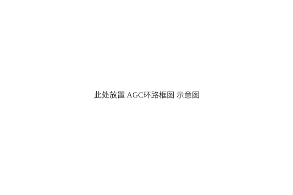
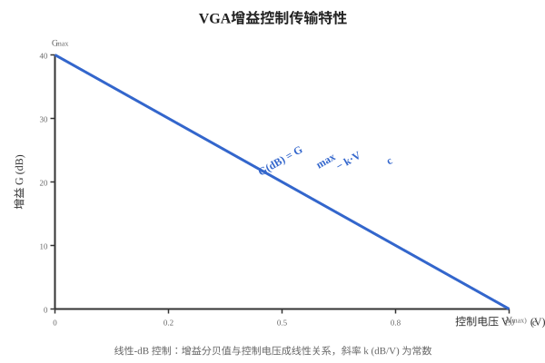

# 4.16 自动增益控制

## 1. AGC 的基本概念

### 1.1 定义与目的

自动增益控制（Automatic Gain Control, AGC）是一种闭环反馈系统，能根据输入信号幅度自动调节放大器的增益，使输出信号幅度保持相对恒定。

AGC 的核心目标：当输入信号幅度在大范围内变化时，输出信号幅度维持在一个预设的稳定值附近。

### 1.2 应用场景

- **通信接收机**：克服信号衰落（Fading），使解调器输入电平稳定
- **音频处理**：录音时的自动电平控制、助听器中的动态范围压缩
- **测量仪器**：自动量程切换
- **雷达系统**：防止近距离目标使接收机饱和

### 1.3 基本性能指标

**动态范围**：AGC 能正常工作的输入信号幅度范围。

$$
DR_{in} = 20 \log_{10} \frac{V_{in(max)}}{V_{in(min)}} \quad (\text{dB})
$$

**压缩比**：输入变化量与输出变化量之比：

$$
CR = \frac{\Delta V_{in} / V_{in}}{\Delta V_{out} / V_{out}}
$$

**建立时间**（Attack Time）：输入信号幅度阶跃增大后，AGC 将增益调整到稳态值所需的时间。

**释放时间**（Release Time / Decay Time）：输入信号幅度阶跃减小后，AGC 恢复增益所需的时间。

## 2. AGC 环路组成

### 2.1 环路框图

AGC 系统由四个基本模块组成：

1. **可变增益放大器（VGA）**：增益由控制电压 $V_c$ 调节
2. **峰值检测器（Peak Detector）**：检测输出信号幅度，产生与幅度成正比的直流电压
3. **环路滤波器（Loop Filter）**：滤除高频纹波，决定 AGC 的动态响应特性
4. **参考电压比较器**（可选）：将检测电压与参考电压 $V_{ref}$ 比较，产生误差信号

### 2.2 工作原理

负反馈使输出幅度稳定在设定值：

1. 输出信号经峰值检测器提取幅度信息 $V_{det}$
2. $V_{det}$ 与参考电压 $V_{ref}$ 比较
3. 误差信号经环路滤波器平滑后得到控制电压 $V_c$
4. $V_c$ 调节 VGA 的增益
5. 若输出幅度过大，增益减小；若输出幅度过小，增益增大

### 2.3 稳态增益

稳态时，输出幅度 $V_{out}$ 满足：

$$
V_{out} \cdot G(V_c) = V_{out} \cdot G_0 \cdot f(V_c) = \text{constant}
$$

其中 $G_0$ 为 VGA 的最大增益，$f(V_c)$ 为增益控制函数。

## 3. 可变增益放大器（VGA）

### 3.1 压控放大器（VCA）

压控放大器的增益由外部控制电压 $V_c$ 连续调节：

$$
G = G(V_c)
$$

**实现方式**：

- **基于模拟乘法器**：将输入信号与直流控制电压相乘，增益正比于控制电压
- **基于 OTA（跨导运算放大器）**：通过调节偏置电流改变跨导 $g_m$，从而调节增益
- **基于 FET 可变电阻**：利用 JFET 在可变电阻区的特性，将 FET 作为压控电阻，改变反馈网络

**OTA 增益控制**：

$$
A_v = g_m R_L = \frac{I_{ABC}}{2V_T} R_L
$$

其中 $I_{ABC}$ 为放大器偏置电流（Amplifier Bias Current），可通过外部电压控制。

### 3.2 程控增益放大器（PGA）

程控增益放大器（Programmable Gain Amplifier）的增益通过数字编码或外部电阻选择，离散跳变。

**实现方式**：

- **电阻网络 + 模拟开关**：通过切换反馈电阻 $R_f$ 或输入电阻 $R_{in}$ 改变增益
- **精密电阻梯形网络**：内部集成多个精密电阻比，通过数字控制选择增益档位
- **多路复用器 + 固定增益级**：选择不同增益的放大通路

常见 PGA 集成芯片：
- PGA204/PGA205：增益 1/10/100/1000
- AD8250/AD8251/AD8253：数控增益仪表放大器
- LTC6910 系列：SPI 接口数控增益放大器

### 3.3 VGA 的传输特性

理想的 VGA 增益控制函数：

$$
G(dB) = G_{max} - k \cdot V_c
$$

其中 $k$ 为增益控制斜率（dB/V）。

实际中最常用的增益控制规律是**线性 dB 控制**（Linear-in-dB），即增益分贝值与控制电压成线性关系：

$$
G(dB) = G_{max}(dB) - \alpha \cdot V_c
$$

例如 AD603 的增益控制范围：$-10 \sim +30\text{ dB}$，控制电压范围 $0 \sim 1\text{ V}$，增益斜率 $40\text{ dB/V}$。

## 4. 对数放大器在 AGC 中的应用

### 4.1 对数放大器的基本原理

对数放大器（Logarithmic Amplifier）的输出电压与输入电压的对数成正比：

$$
V_{out} = V_Y \cdot \log_{10}\left(\frac{V_{in}}{V_X}\right)
$$

其中 $V_Y$ 为斜率电压（V/decade），$V_X$ 为截距电压。

### 4.2 对数放大器在 AGC 中的优势

- **对数压缩**：将大动态范围的输入信号压缩为小动态范围的输出，便于后续处理
- **直接 dB 读数**：输出直接表示输入信号的 dB 值，简化 AGC 环路设计
- **级联对数放大器**：多级对数放大器级联可覆盖 80~100 dB 的动态范围

### 4.3 解调型对数放大器

在通信接收机中，解调型对数放大器（Demodulating Log Amp）将 RF 信号逐级放大、限幅和检波，输出与输入功率 dB 值成正比的电压，常用于 RSSI（Received Signal Strength Indicator）检测。

## 5. AGC 的建立时间与动态范围

### 5.1 建立时间分析

建立时间主要由环路滤波器的电容 $C_{filter}$ 和充放电电流决定。

**快充慢放**策略：在大多数 AGC 应用中，希望快速响应信号增大（防止过载），但缓慢恢复增益（避免信号低谷时增益过度增加引入噪声）。

- 建立时间（Attack Time）：$t_{attack} \approx \frac{C_{filter} \cdot \Delta V}{I_{charge}}$
- 释放时间（Release Time）：$t_{release} \approx \frac{C_{filter} \cdot \Delta V}{I_{discharge}}$

通常 $t_{attack} \ll t_{release}$。

### 5.2 动态范围扩展

AGC 系统的总动态范围：

$$
DR_{total} = DR_{VGA} + DR_{detector}
$$

其中：
- $DR_{VGA}$ 为 VGA 的增益调节范围（如 80 dB）
- $DR_{detector}$ 为峰值检测器可检测的最小信号电平

### 5.3 稳定性分析

AGC 环路是一个负反馈系统，需注意稳定性设计：

- 环路滤波器引入的主极点应远低于信号频率
- 相位裕度应大于 45° 以避免振荡
- 避免增益控制函数 $G(V_c)$ 的斜率过大导致环路增益过高

## 6. AGC 在通信接收机中的应用

### 6.1 超外差接收机中的 AGC

在超外差接收机中，AGC 通常在中频（IF）级实现：

- 中频信号经检波器提取幅度
- 误差信号控制中频放大器增益
- 有时也控制射频前端（LNA）增益，以扩展动态范围

**延迟式 AGC**：只有当输入信号超过阈值时才启动增益控制，避免将弱信号进一步衰减。

### 6.2 音频处理中的 AGC

- **压缩器（Compressor）**：当信号超过阈值时，按一定比例压缩动态范围（如 2:1、4:1）
- **限幅器（Limiter）**：极端压缩比（$\infty:1$），防止信号超过预设上限
- **噪声门（Noise Gate）**：当信号低于阈值时，大幅衰减输出（或静音），抑制背景噪声

### 6.3 AGC 环路设计实例

典型 AGC 接收机设计参数：

- 输入动态范围：$-100 \sim -10\text{ dBm}$（90 dB）
- 输出电平：$0\text{ dBm} \pm 1\text{ dB}$
- 中频频率：$10.7\text{ MHz}$（FM 广播）
- VGA 增益范围：$80\text{ dB}$
- 建立时间：$1\text{ ms}$
- 释放时间：$100\text{ ms}$