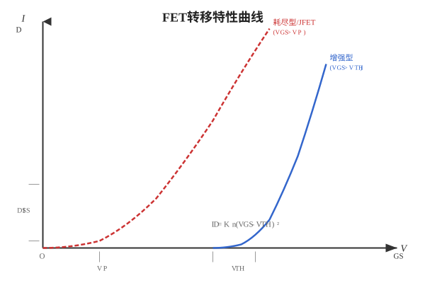
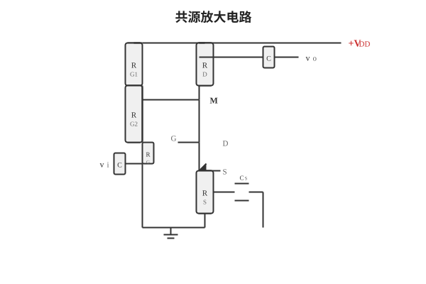

# 4.4 场效应管

## 1. JFET结构与工作原理

结型场效应管（Junction Field Effect Transistor, JFET）是一种利用电场效应控制电流的半导体器件。JFET分为N沟道和P沟道两种类型。

N沟道JFET的结构：在N型半导体两侧制作两个P型区，形成两个PN结。三个电极分别为：漏极（D）、源极（S）和栅极（G）。

工作原理：在漏源之间施加电压 $V_{DS}$，电子从源极流向漏极形成漏极电流 $I_D$。栅源电压 $V_{GS}$ 反向偏置PN结，改变导电沟道宽度，从而控制 $I_D$。

当 $V_{GS}$ 负向增大时，耗尽层展宽，沟道变窄，$I_D$ 减小。当 $V_{GS}$ 达到**夹断电压** $V_P$ 时，沟道被完全夹断，$I_D = 0$。

## 2. 耗尽型MOSFET

耗尽型MOSFET（Metal-Oxide-Semiconductor FET）在制造时已在二氧化硅绝缘层中掺入正离子，使P型衬底表面感应出N型导电沟道。

即使在 $V_{GS} = 0$ 时也存在导电沟道。当 $V_{GS}$ 为负时，沟道变窄，$I_D$ 减小；当 $V_{GS}$ 为正时，沟道变宽，$I_D$ 增大。

## 3. 增强型MOSFET

增强型MOSFET在 $V_{GS} = 0$ 时没有导电沟道，$I_D = 0$。

当 $V_{GS}$ 大于**阈值电压** $V_{TH}$ 时，衬底表面感应出反型层形成导电沟道，$I_D$ 开始流通。$V_{GS}$ 越大，沟道越宽，$I_D$ 越大。

N沟道增强型MOSFET的工作条件：
- $V_{GS} > V_{TH}$（形成导电沟道）
- $V_{DS} > 0$（产生漏极电流）

## 4. FET的伏安特性与转移特性

### 输出特性

FET的输出特性描述 $V_{GS}$ 固定时 $I_D$ 与 $V_{DS}$ 的关系，分为三个区域：

- **可变电阻区（线性区）**：$V_{DS}$ 较小，$I_D$ 随 $V_{DS}$ 线性增加，FET表现为压控电阻
- **饱和区（恒流区/放大区）**：$V_{DS}$ 增大到一定值后，$I_D$ 基本不变，仅受 $V_{GS}$ 控制
- **截止区**：$V_{GS} < V_{TH}$（增强型）或 $V_{GS} < V_P$（耗尽型），$I_D \approx 0$

### 转移特性

转移特性描述 $V_{DS}$ 固定时 $I_D$ 与 $V_{GS}$ 的关系。

**增强型MOSFET**：

$$
I_D = K_n (V_{GS} - V_{TH})^2
$$

其中 $K_n = \frac{1}{2} \mu_n C_{ox} \frac{W}{L}$，$\mu_n$ 为电子迁移率，$C_{ox}$ 为单位面积栅氧化层电容，$W/L$ 为沟道宽长比。

**JFET/耗尽型MOSFET**：

$$
I_D = I_{DSS} \left(1 - \frac{V_{GS}}{V_P}\right)^2
$$

其中 $I_{DSS}$ 为 $V_{GS} = 0$ 时的饱和漏极电流。

## 5. FET的小信号模型

FET的小信号等效模型参数：

跨导（Transconductance）：

$$
g_m = \frac{\partial I_D}{\partial V_{GS}} = \sqrt{2K_n I_{DQ}} = 2\sqrt{K_n I_{DQ}}
$$

$$
g_m = \frac{2I_{DSS}}{|V_P|} \left(1 - \frac{V_{GS}}{V_P}\right) \quad (\text{JFET/耗尽型})
$$

输出电阻：

$$
r_{ds} = \frac{1}{\lambda I_{DQ}} \quad \text{或} \quad r_{ds} = \frac{|V_A|}{I_{DQ}}
$$

其中 $\lambda$ 为沟道长度调制系数，$V_A$ 为厄尔利电压。

## 6. 共源/共漏/共栅放大电路

### 共源放大电路

电压增益：

$$
A_v = -g_m (R_D \parallel R_L \parallel r_{ds}) \approx -g_m R_D'
$$

输入电阻极高（MOSFET可达 $10^{12}\Omega$ 以上），输出电阻 $\approx R_D$。

### 共漏放大电路（源极跟随器）

电压增益：

$$
A_v = \frac{g_m R_S'}{1 + g_m R_S'} \approx 1
$$

输入电阻高，输出电阻低（$R_o \approx 1/g_m$）。

### 共栅放大电路

电压增益：

$$
A_v = g_m R_D'
$$

输入电阻低，输出电阻高，高频特性好。

## 7. BJT与FET性能比较

| 性能参数 | BJT | FET |
|---------|-----|-----|
| 控制方式 | 电流控制（$I_B \to I_C$） | 电压控制（$V_{GS} \to I_D$） |
| 输入电阻 | 中（kΩ级） | 极高（$10^8 \sim 10^{15}\Omega$） |
| 噪声 | 较大 | 较小 |
| 温度稳定性 | 较差 | 较好 |
| 增益 | 高（$\beta$ 几十~几百） | 较低（$g_m$ 几~几十 mS） |
| 功耗 | 较大 | 较小 |
| 高频特性 | 较好 | 较好 |
| 制造工艺 | 较简单 | 较复杂（CMOS工艺成熟） |
| 抗辐射能力 | 较弱 | 较强 |

## 8. VMOS功率管

VMOS（Vertical MOSFET）是一种垂直沟道结构的功率MOSFET，具有以下特点：

- **垂直结构**：源极在上表面，漏极在下表面，电流垂直流动
- **高耐压**：可达数百伏
- **大电流**：可达数十安培
- **开关速度快**：无少子存储效应，开关频率可达 MHz 级
- **安全工作区宽**：无二次击穿问题

VMOS功率管广泛应用于开关电源、电机驱动、功率放大器等大功率场合。

VMOS管的转移特性仍遵循平方律关系：

$$
I_D = K (V_{GS} - V_{TH})^2
$$

但 $K$ 值远大于普通MOSFET，因为沟道宽长比（$W/L$）极大。