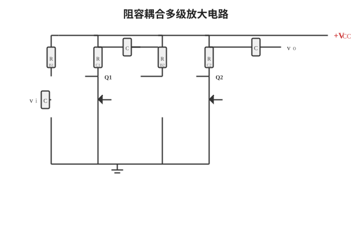

# 4.5 多级放大电路

## 1. 多级放大电路的耦合方式

当单级放大电路的增益不足以满足要求时，需将多个放大级级联构成多级放大电路。级间连接方式称为**耦合**。

### 阻容耦合

利用电容和电阻实现级间连接，电容隔直流通交流。

特点：
- 各级静态工作点相互独立，互不影响
- 电容耦合仅传递交流信号，隔离直流分量
- 低频特性差，不能放大直流和缓慢变化信号
- 不便于集成化（电容占用面积大）

### 直接耦合

前后级直接连接，无隔直元件。

特点：
- 可放大直流和缓慢变化信号
- 频率特性好，从直流到高频均有增益
- 便于集成化
- 各级静态工作点相互影响，存在**零点漂移**问题
- 需要电平移位电路

### 变压器耦合

利用变压器实现级间耦合和阻抗变换。

特点：
- 实现阻抗匹配，使功率传输最大
- 各级静态工作点独立
- 频率特性差，体积大，不便于集成
- 主要用于功率放大电路和射频电路

## 2. 总增益计算

多级放大电路的总电压增益为各级增益的乘积（用分贝表示为加法）：

$$
A_v = A_{v1} \cdot A_{v2} \cdot A_{v3} \cdots A_{vn}
$$

用分贝表示：

$$
A_v(\text{dB}) = A_{v1}(\text{dB}) + A_{v2}(\text{dB}) + \cdots + A_{vn}(\text{dB})
$$

其中：

$$
A_v(\text{dB}) = 20 \log_{10} |A_v|
$$

计算时需考虑级间负载效应：后级的输入电阻是前级的负载，影响前级的电压增益。

## 3. 频率响应

多级放大电路的总频率响应为各级频率响应的叠加。总带宽小于单级带宽：

设每级的上限频率为 $f_H$，下限频率为 $f_L$，则n级相同放大电路的总频率特性：

$$
f_{H(total)} = f_H \sqrt{2^{1/n} - 1}
$$

$$
f_{L(total)} = \frac{f_L}{\sqrt{2^{1/n} - 1}}
$$

可见，级数增多，上限频率下降，下限频率升高，总带宽变窄。

## 4. 直接耦合电路的零点漂移问题

### 零点漂移

直接耦合放大电路输入端短路时，输出端电压缓慢偏离零点，随时间上下波动，这种现象称为零点漂移（Zero Drift），简称**零漂**。

### 产生原因

- 温度变化引起晶体管参数（$V_{BE}$、$\beta$、$I_{CBO}$）变化
- 电源电压波动
- 元器件老化

### 抑制措施

- 引入直流负反馈（如分压式偏置电路）
- 采用差动放大电路（最有效的方法）
- 采用温度补偿电路
- 选用高稳定度电源

### 温度漂移的衡量

将输出漂移电压折算到输入端：

$$
V_{id} = \frac{\Delta V_O}{A_V}
$$

温度漂移系数：

$$
\frac{dV_{id}}{dT}
$$

单位通常为 $\mu\text{V}/^\circ\text{C}$，表示温度每变化1°C等效到输入端的漂移电压。