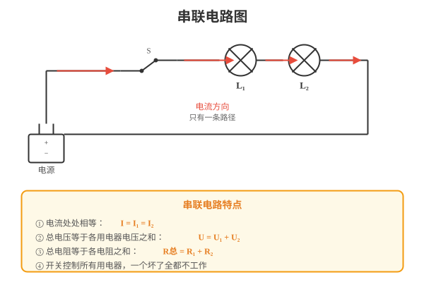
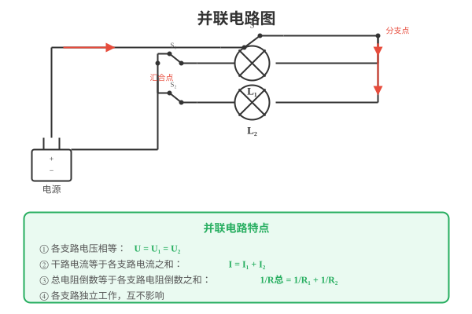
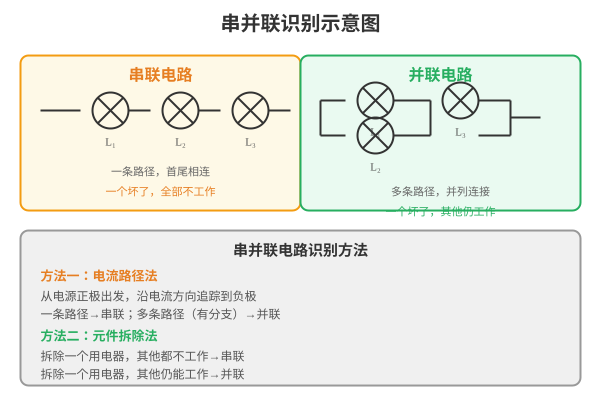

# 1.5 串联与并联电路

## 一、串联电路

### 串联电路的定义

将电路元件**逐个依次连接**起来组成的电路称为串联电路。串联电路中电流只有一条路径，没有分支。

### 串联电路的特点

#### 1. 电流特点——电流处处相等

串联电路中，通过各元件的电流处处相等：

$$
I = I_1 = I_2 = \cdots = I_n
$$

#### 2. 电压特点——总电压等于各用电器电压之和

串联电路两端的总电压等于各用电器两端电压之和：

$$
U = U_1 + U_2 + \cdots + U_n
$$

#### 3. 电阻特点——总电阻等于各电阻之和

$$
R_{\text{总}} = R_1 + R_2 + \cdots + R_n
$$

#### 4. 分压规律

串联电路中，各电阻两端的电压与电阻成正比：

$$
\frac{U_1}{U_2} = \frac{R_1}{R_2}
$$

### 串联电路应用

- 节日小彩灯（一个坏了整串不亮）
- 开关控制整个电路（开关位置不影响控制效果）

## 二、并联电路

### 并联电路的定义

将电路元件**并列连接**在电路两点之间组成的电路称为并联电路。并联电路中有多条电流路径，有分支点和汇合点。

### 并联电路的特点

#### 1. 电压特点——各支路电压相等

并联电路中，各支路两端的电压相等：

$$
U = U_1 = U_2 = \cdots = U_n
$$

#### 2. 电流特点——干路电流等于各支路电流之和

$$
I = I_1 + I_2 + \cdots + I_n
$$

#### 3. 电阻特点——总电阻的倒数等于各电阻倒数之和

$$
\frac{1}{R_{\text{总}}} = \frac{1}{R_1} + \frac{1}{R_2} + \cdots + \frac{1}{R_n}
$$

两个电阻并联的简化公式：

$$
R_{\text{总}} = \frac{R_1 R_2}{R_1 + R_2}
$$

#### 4. 分流规律

并联电路中，通过各支路的电流与电阻成反比：

$$
\frac{I_1}{I_2} = \frac{R_2}{R_1}
$$

### 并联电路应用

- 家庭电路中的各用电器（一个坏了不影响其他）
- 各支路有独立开关控制

## 三、串并联电路的识别与简化

### 识别方法

**方法一：电流路径法**

从电源正极出发，沿着电流方向追踪到电源负极：
- 若只有一条路径，则为串联。
- 若有两条或以上路径（有分支 → 汇合），则为并联。

**方法二：元件拆除法**

拆除一个用电器：
- 若其他用电器都不工作，则为串联。
- 若其他用电器仍能工作，则为并联。

**方法三：节点法**

- 在电路中找出各元件的连接点。
- 若元件首尾相连（无分支），则为串联。
- 若元件两端分别连接在相同的两个节点上，则为并联。

### 电路简化原则

1. **导线视为可伸缩**：同一导线上的各点电势相同，可合并为一点。
2. **电流表视为导线**（内阻极小）。
3. **电压表视为断路**（内阻极大）。
4. **开关闭合视为导线**，断开视为断路。

## 四、串并联电路的对比总结

| 特征 | 串联电路 | 并联电路 |
|------|---------|---------|
| **连接方式** | 首尾相连 | 并列连接 |
| **电流路径** | 一条 | 多条 |
| **电流关系** | $I = I_1 = I_2 = \cdots$ | $I = I_1 + I_2 + \cdots$ |
| **电压关系** | $U = U_1 + U_2 + \cdots$ | $U = U_1 = U_2 = \cdots$ |
| **电阻关系** | $R = R_1 + R_2 + \cdots$ | $\frac{1}{R} = \frac{1}{R_1} + \frac{1}{R_2} + \cdots$ |
| **分压/分流** | 分压：$U \propto R$ | 分流：$I \propto 1/R$ |
| **开关作用** | 控制所有用电器 | 干路开关控制整体，支路开关控制支路 |

## 五、电路图绘制规范

绘制电路图时应注意：
1. 使用统一的电路元件符号。
2. 导线要横平竖直，拐弯处画成直角。
3. 元件不能画在拐角处。
4. 合理安排元件位置，使电路图简洁、美观、易于识别。