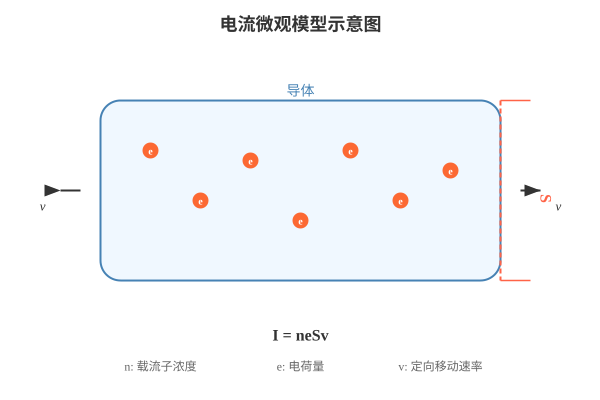
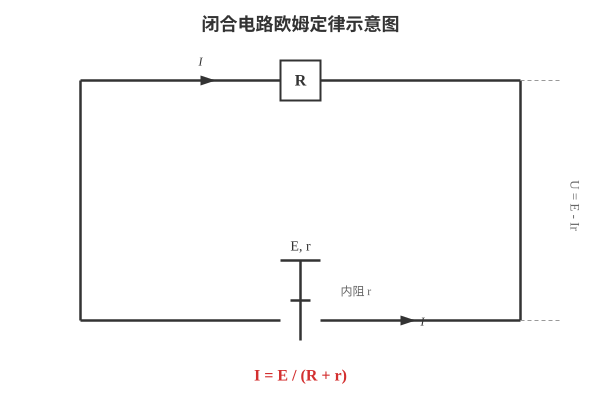
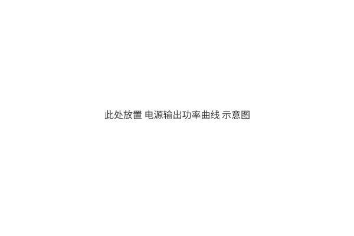

# 2.1 恒定电流

## 一、电流的微观表达式

### 1. 电流的形成

电荷的定向移动形成电流。当导体两端存在电势差时，导体内部就会产生电场，自由电荷在电场力作用下做定向移动，形成电流。

### 2. 电流的微观表达式

设导体的横截面积为 $S$，单位体积内的自由电荷数为 $n$，每个自由电荷的电荷量为 $e$，自由电荷定向移动的平均速率为 $v$，则：

在时间 $t$ 内，通过导体横截面的自由电荷数为 $N = n \cdot S \cdot v \cdot t$，通过的总电荷量为 $Q = Ne = nS v t e$。

根据电流的定义 $I = \dfrac{Q}{t}$，得到电流的微观表达式：

$$
I = neSv
$$

其中：
- $n$ — 单位体积内的自由电荷数（载流子浓度）
- $e$ — 每个电荷的电荷量
- $S$ — 导体的横截面积
- $v$ — 自由电荷定向移动的平均速率（注意：这不是电场的传播速度，也不是自由电荷热运动的速率）

> **注意**：自由电荷定向移动的速率 $v$ 非常小（约 $10^{-4}$ m/s 量级），但电场的传播速度是光速（$3 \times 10^8$ m/s），所以开关一闭合，用电器几乎立即有电流。

---

## 二、电阻定律

### 1. 电阻定律的内容

同种材料的导体，其电阻 $R$ 与它的长度 $L$ 成正比，与它的横截面积 $S$ 成反比，导体电阻还与构成它的材料有关。

$$
R = \rho \frac{L}{S}
$$

其中 $\rho$ 为材料的电阻率，单位是 $\Omega \cdot \text{m}$。

### 2. 电阻率与温度的关系

电阻率 $\rho$ 反映了材料导电性能的优劣，它与温度有关：

- **金属导体**：温度升高，电阻率增大（正温度系数）
  $$
  \rho = \rho_0 (1 + \alpha t)
  $$
  其中 $\alpha$ 为电阻温度系数，$t$ 为摄氏温度。

- **半导体**：温度升高，电阻率显著减小（负温度系数）

- **超导体**：当温度降低到某一临界温度 $T_c$ 以下时，电阻率突变为零。

---

## 三、闭合电路欧姆定律

### 1. 电路组成

闭合电路由两部分组成：
- **内电路**：电源内部的电路，内阻为 $r$
- **外电路**：电源外部的电路，外电阻为 $R$

### 2. 闭合电路欧姆定律

闭合电路中的电流 $I$ 与电源电动势 $E$ 成正比，与内外电路的总电阻 $(R + r)$ 成反比：

$$
I = \frac{E}{R + r}
$$

### 3. 路端电压与负载的关系

路端电压 $U$ 是外电路两端的电压（即电源两端的输出电压）：

$$
U = E - Ir = E - \frac{E}{R + r} \cdot r = \frac{E}{1 + \frac{r}{R}}
$$

分析：
- **断路**（$R \to \infty$）：$I = 0$，$U = E$
- **短路**（$R = 0$）：$I = \dfrac{E}{r}$（短路电流很大），$U = 0$
- **负载增大**（$R \uparrow$）：$I \downarrow$，$U \uparrow$

由 $U = E - Ir$ 可知，$U$-$I$ 图像是一条斜率为 $-r$ 的直线，纵截距为 $E$。

---

## 四、电源的电动势与内阻

### 1. 电动势

电动势 $E$ 是描述电源将其他形式的能转化为电能的本领的物理量。其定义为：非静电力将单位正电荷从负极通过电源内部搬运到正极所做的功。

$$
E = \frac{W_{\text{非}}}{q}
$$

电动势由电源本身的性质决定，与外电路无关。

### 2. 内阻

电源内部也有电阻，称为内阻 $r$。电流通过内阻时也会产生电压降 $Ir$。

---

## 五、电源的功率和效率

### 1. 电源的总功率

电源提供的总功率：

$$
P_{\text{总}} = EI
$$

### 2. 电源的输出功率

电源输出给外电路的功率（即外电路消耗的功率）：

$$
P_{\text{出}} = UI = I^2 R = \frac{E^2 R}{(R + r)^2}
$$

### 3. 电源内阻消耗的功率

$$
P_{\text{内}} = I^2 r
$$

### 4. 电源的效率

$$
\eta = \frac{P_{\text{出}}}{P_{\text{总}}} = \frac{U}{E} = \frac{R}{R + r}
$$

### 5. 最大输出功率

当 $R = r$ 时，电源的输出功率最大：

$$
P_{\text{出,max}} = \frac{E^2}{4r}
$$

> **推导**：$P_{\text{出}} = \dfrac{E^2 R}{(R + r)^2} = \dfrac{E^2}{\left(\sqrt{R} + \dfrac{r}{\sqrt{R}}\right)^2}$，由均值不等式，当 $R = r$ 时分母最小，功率最大。

---

## 知识小结

| 概念 | 公式 | 说明 |
|------|------|------|
| 电流微观表达式 | $I = neSv$ | 微观本质 |
| 电阻定律 | $R = \rho \dfrac{L}{S}$ | 决定式 |
| 闭合电路欧姆定律 | $I = \dfrac{E}{R + r}$ | 适用于纯电阻电路 |
| 路端电压 | $U = E - Ir$ | 一般表达式 |
| 电源输出功率 | $P_{\text{出}} = \dfrac{E^2 R}{(R + r)^2}$ | 当 $R = r$ 时最大 |
| 电源效率 | $\eta = \dfrac{R}{R + r}$ | 纯电阻电路 |