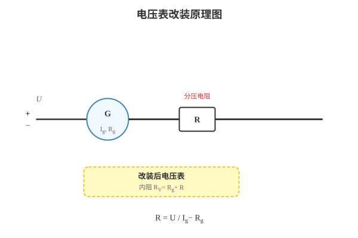

# 2.2 多用电表

## 一、表头（灵敏电流计）

### 1. 表头的基本原理

灵敏电流计（表头）是磁电式仪表，其核心结构包括永久磁铁、线圈、游丝和指针。

当线圈中有电流通过时，线圈在磁场中受到安培力作用而转动，带动指针偏转。指针偏转的角度 $\theta$ 与通过线圈的电流 $I$ 成正比：

$$
\theta = kI
$$

其中 $k$ 为比例常数，由表头的结构决定。

### 2. 表头的主要参数

- **满偏电流 $I_g$**：指针偏转到最大刻度时的电流值
- **满偏电压 $U_g$**：指针偏转到最大刻度时，表头两端的电压，$U_g = I_g R_g$
- **内阻 $R_g$**：表头线圈的电阻

---

## 二、改装成电压表

### 原理

将灵敏电流计串联一个较大的分压电阻 $R$，就可以改装成电压表。串联电阻的作用是分去大部分电压，使表头只承受小部分电压。

### 计算

设表头满偏电流为 $I_g$，内阻为 $R_g$，欲改装成量程为 $U$ 的电压表，需要串联的电阻值为：

$$
R = \frac{U}{I_g} - R_g = \frac{U - U_g}{I_g}
$$

改装后的电压表总内阻为：

$$
R_V = R_g + R = \frac{U}{I_g}
$$

> **推导**：当改装后的电压表两端电压为 $U$ 时，流过表头的电流应恰好为 $I_g$，由欧姆定律 $U = I_g(R_g + R)$，解得 $R = \dfrac{U}{I_g} - R_g$。

---

## 三、改装成电流表

### 原理

将灵敏电流计并联一个较小的分流电阻 $R$，就可以改装成大量程的电流表。并联电阻的作用是分去大部分电流，使表头只流过小部分电流。

### 计算

设表头满偏电流为 $I_g$，内阻为 $R_g$，欲改装成量程为 $I$ 的电流表，需要并联的电阻值为：

$$
R = \frac{I_g R_g}{I - I_g}
$$

改装后的电流表总内阻为：

$$
R_A = \frac{R_g R}{R_g + R} = \frac{I_g R_g}{I}
$$

> **推导**：当改装后的电流表总电流为 $I$ 时，流过表头的电流应恰好为 $I_g$，此时并联电阻两端的电压为 $U = I_g R_g$，流过并联电阻的电流为 $I - I_g$，故 $R = \dfrac{U}{I - I_g} = \dfrac{I_g R_g}{I - I_g}$。

---

## 四、欧姆表原理

### 1. 欧姆表电路结构

欧姆表由表头、电源、可变电阻（调零电阻）和红黑表笔组成。

### 2. 测量原理

欧姆表依据闭合电路欧姆定律工作。设电源电动势为 $E$，内阻为 $r$，表头内阻为 $R_g$，调零电阻为 $R_0$，待测电阻为 $R_x$。

- **短接调零**（红黑表笔直接接触）：调节 $R_0$ 使指针满偏

  $$
  I_g = \frac{E}{R_g + R_0 + r}
  $$

  此时欧姆表的总内阻为 $R_{\Omega} = R_g + R_0 + r$。

- **接入待测电阻 $R_x$**：

  $$
  I = \frac{E}{R_{\Omega} + R_x}
  $$

  可见 $I$ 与 $R_x$ 一一对应，且 $R_x$ 越大，$I$ 越小，所以欧姆表的刻度是**不均匀的**（右密左疏）。

### 3. 中值电阻

当 $R_x = R_{\Omega}$ 时，$I = \dfrac{E}{2R_{\Omega}} = \dfrac{I_g}{2}$，指针指在中央刻度处，此时的 $R_x$ 称为中值电阻。

### 4. 欧姆表的特点

- 刻度不均匀，右侧为 $0$，左侧为 $\infty$
- 测量前需要调零
- 电池用久后电动势降低，测量值会偏大

---

## 五、多用电表的使用与读数

### 1. 多用电表的结构

多用电表通过转换开关，可以分别实现电压表、电流表和欧姆表的功能。其内部通过多个电阻的串并联组合，实现不同量程的切换。

### 2. 使用步骤

1. **机械调零**：使用前检查指针是否在左端零刻度，否则用螺丝刀调整
2. **选挡**：根据测量对象选择合适的挡位和量程
3. **欧姆调零**：测电阻时，每次换挡后都要短接红黑表笔，调节欧姆调零旋钮使指针满偏
4. **测量**：将表笔接触被测点
5. **读数**：根据所选挡位读取对应刻度值
6. **归位**：使用完毕后将开关拨到 OFF 挡或交流电压最高挡

### 3. 读数规则

- **电压/电流挡**：读数 = 刻度值 × 量程 / 满偏刻度
- **欧姆挡**：读数 = 指针示数 × 倍率
- 读数时视线应正对表盘

### 4. 注意事项

- 测电阻时，被测电阻应与其他电路断开
- 不能用欧姆挡测量微安表头等精密元件的内阻
- 测电压时，多用电表与被测电路并联；测电流时，与被测电路串联
- 注意红黑表笔的极性：红表笔接正极，黑表笔接负极（欧姆挡时，黑表笔接内部电源正极）

---

## 知识小结

| 改装类型 | 连接方式 | 公式 | 等效内阻 |
|---------|---------|------|---------|
| 电压表 | 串联分压电阻 | $R = \dfrac{U}{I_g} - R_g$ | $R_V = \dfrac{U}{I_g}$ |
| 电流表 | 并联分流电阻 | $R = \dfrac{I_g R_g}{I - I_g}$ | $R_A = \dfrac{I_g R_g}{I}$ |
| 欧姆表 | 内部电源+调零电阻 | $I = \dfrac{E}{R_{\Omega} + R_x}$ | 中值电阻 $R_{\Omega}$ |