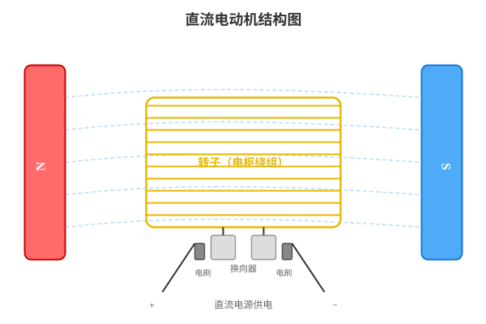

# 2.9 电动机与发电机

## 一、电动机原理

### 1. 基本工作原理

电动机是将电能转换为机械能的装置。其基本原理是**通电导体在磁场中受到安培力**的作用。

安培力公式：

$$
F = BIL\sin\theta
$$

其中 $\theta$ 为电流方向与磁场方向之间的夹角。当 $I \perp B$ 时，$F = BIL$。

### 2. 安培力方向的判断——左手定则

伸开左手，使拇指与其余四指垂直，让磁感线穿入手心，四指指向电流方向，则拇指所指方向即为安培力方向。

---

## 二、直流电动机

### 1. 基本结构

直流电动机主要由以下部件组成：

- **定子**：产生恒定磁场，可以是永磁体或电磁铁
- **转子（电枢）**：装有线圈，在磁场中转动，输出机械能
- **换向器**：由两个半圆形铜片组成的圆环，随转子一起转动
- **电刷**：固定不动，与换向器接触，将外部直流电源引入转子线圈

### 2. 换向器原理

换向器是直流电动机的核心部件，其作用是保证转子线圈中电流方向的周期性切换，使线圈在磁场中受到的安培力矩始终沿同一方向，从而维持转子的持续转动。

**换向过程**：
- 当线圈平面转到与磁场方向垂直（中性面）时，电刷从换向器的一个半环切换到另一个半环
- 线圈中的电流方向随之反转
- 安培力的方向保持不变，力矩方向不变

### 3. 转矩

直流电动机的电磁转矩为：

$$
T = K_T \Phi I_a
$$

其中：
- $T$ — 电磁转矩（N·m）
- $K_T$ — 转矩常数（由电机结构决定）
- $\Phi$ — 每极磁通量（Wb）
- $I_a$ — 电枢电流（A）

### 4. 转速特性

直流电动机的转速方程为：

$$
n = \frac{U - I_a R_a}{K_E \Phi}
$$

其中：
- $n$ — 转速（r/min）
- $U$ — 电枢电压（V）
- $I_a$ — 电枢电流（A）
- $R_a$ — 电枢电阻（Ω）
- $K_E$ — 电动势常数
- $\Phi$ — 每极磁通量（Wb）

**调速方法**：
- **改变电枢电压 $U$**：调压调速，平滑性好
- **改变磁通量 $\Phi$**：弱磁调速，转速升高
- **改变电枢回路电阻 $R_a$**：串电阻调速，效率低

### 5. 直流电动机的类型

| 类型 | 励磁方式 | 特点 |
|------|---------|------|
| 串励电动机 | 励磁绕组与电枢串联 | 启动转矩大，转速随负载变化大 |
| 并励电动机 | 励磁绕组与电枢并联 | 转速基本恒定，调速方便 |
| 复励电动机 | 串励 + 并励 | 兼具两者优点 |
| 永磁电动机 | 永磁体励磁 | 结构简单，体积小 |

---

## 三、发电机原理

### 1. 基本工作原理

发电机是将机械能转换为电能的装置。其基本原理是**电磁感应**——导体在磁场中做切割磁感线运动，产生感应电动势。

直流发电机和交流发电机的基本原理相同，区别在于输出端的结构：直流发电机通过**换向器**将交流电转换为直流电输出；交流发电机通过**滑环**直接输出交流电。

### 2. 交流发电机结构

交流发电机主要由以下部件组成：

- **定子**：通常为电枢绕组（产生感应电动势的部分）
- **转子**：通常为磁极（产生旋转磁场）
- **滑环与电刷**：将转子励磁电流引入，或将定子产生的交流电引出

### 3. 正弦交流电的产生

设线圈在匀强磁场中以角速度 $\omega$ 匀速转动，其中 $N$ 匝线圈的面积为 $S$，磁感应强度为 $B$：

穿过线圈的磁通量：

$$
\Phi = NBS\cos\omega t
$$

根据法拉第电磁感应定律，感应电动势为：

$$
e = -\frac{d\Phi}{dt} = NBS\omega\sin\omega t = E_m\sin\omega t
$$

其中 $E_m = NBS\omega$ 为电动势的最大值。

这就是正弦交流电的产生原理。

### 4. 交流发电机的电动势有效值

$$
E = \frac{E_m}{\sqrt{2}} = \frac{NBS\omega}{\sqrt{2}}
$$

### 5. 交流发电机的频率

发电机的输出频率与转速和磁极对数有关：

$$
f = \frac{pn}{60}
$$

其中：
- $f$ — 频率（Hz）
- $p$ — 磁极对数
- $n$ — 转子转速（r/min）

例如，中国电网频率为 50 Hz，对于一对磁极（$p=1$）的发电机，转速为 3000 r/min；对于 $p=2$ 的发电机，转速为 1500 r/min。

---

## 四、直流电动机与交流电动机的区别

| 比较项目 | 直流电动机 | 交流电动机 |
|---------|-----------|-----------|
| 电源类型 | 直流电源 | 交流电源 |
| 换向方式 | 机械换向器 + 电刷 | 电子换向或无换向 |
| 结构复杂度 | 有换向器和电刷，结构较复杂 | 异步电机结构简单 |
| 维护成本 | 电刷磨损，需定期维护 | 无刷，维护简单 |
| 调速性能 | 调速性能优良、范围宽 | 传统调速较困难，变频调速发展迅速 |
| 启动转矩 | 大 | 异步电机启动转矩较小 |
| 效率 | 中等 | 较高 |
| 典型应用 | 电动工具、电动汽车、精密伺服 | 工业驱动、家电、风机水泵 |

---

## 五、步进电机与无刷直流电机

### 1. 步进电机

步进电机是一种将电脉冲信号转换为角位移的执行元件。每输入一个脉冲，电机转子就转动一个固定的角度（步距角）。

**步距角**：

$$
\theta_s = \frac{360^\circ}{N_r \cdot m}
$$

其中 $N_r$ 为转子齿数，$m$ 为运行拍数。

**特点**：
- 位置控制精确，无需反馈系统
- 转速与脉冲频率成正比
- 低速时转矩大
- 广泛应用于 3D 打印机、数控机床、机器人等

### 2. 无刷直流电机（BLDC）

无刷直流电机（Brushless DC Motor）使用电子换向取代机械换向器，消除了电刷和换向器带来的磨损、火花和噪声问题。

**基本结构**：
- **定子**：多相绕组（通常为三相）
- **转子**：永磁体
- **位置传感器**：检测转子位置，控制电子换向
- **电子控制器**：根据转子位置控制各相绕组的通电顺序

**工作原理**：

控制器根据转子位置信息，依次导通对应的定子绕组，产生旋转磁场，拖动永磁转子同步旋转。

**BLDC 的转速方程**：

$$
n = \frac{U - I R}{K_E}
$$

其中 $K_E$ 为反电动势常数。

**优点**：
- 高效率、长寿命
- 无电刷火花，电磁干扰小
- 转速范围宽、动态响应好
- 广泛应用：无人机、电动车、家电、工业伺服

---

## 六、反电动势

### 1. 概念

当电动机转动时，转子线圈在磁场中旋转，切割磁感线，线圈中会产生感应电动势。根据楞次定律，这个感应电动势与外加电压方向相反，因此称为**反电动势**（Back EMF）。

### 2. 反电动势的计算

$$
E_b = K_E \Phi n
$$

其中：
- $E_b$ — 反电动势（V）
- $K_E$ — 电动势常数
- $\Phi$ — 每极磁通量（Wb）
- $n$ — 转速（r/min）

### 3. 反电动势的作用

反电动势是电动机能够将电能转换为机械能的关键。电动机稳定运行时，电枢回路的电压平衡方程为：

$$
U = E_b + I_a R_a
$$

即：

$$
I_a = \frac{U - E_b}{R_a}
$$

### 4. 反电动势的物理意义

- **启动瞬间**：转速 $n = 0$，$E_b = 0$，启动电流 $I_a = U/R_a$ 很大（可达额定电流的 5~10 倍），因此大功率电动机需要降压启动
- **正常运行时**：$E_b \approx U$（$E_b$ 略小于 $U$），电枢电流较小
- **负载增大时**：转速下降 $\to$ $E_b$ 减小 $\to$ $I_a$ 增大 $\to$ 转矩增大，自动平衡
- **突然断电时**：如果电动机惯性很大，转子继续转动，$E_b$ 仍然存在，可能损坏电源设备

### 5. 反电动势与能量转换

电动机的输入电功率：

$$
P_{in} = UI_a = E_b I_a + I_a^2 R_a
$$

其中 $E_b I_a$ 即为转换为机械功率的部分，$I_a^2 R_a$ 为铜损。

---

## 七、电动机与发电机的可逆性

电动机和发电机在原理上是可逆的：
- 给电动机通电，它输出机械能；外力拖动电动机转动，它就成为发电机
- 电动汽车在制动时，驱动电机可切换为发电机模式，将动能转化为电能回馈给电池（**再生制动**）

---

## 知识小结

| 概念 | 公式 | 说明 |
|------|------|------|
| 安培力 | $F = BIL\sin\theta$ | 左手定则判断方向 |
| 直流电机转矩 | $T = K_T \Phi I_a$ | 与磁通和电枢电流成正比 |
| 直流电机转速 | $n = \dfrac{U - I_a R_a}{K_E \Phi}$ | 三种调速方法 |
| 电机电动势 | $e = NBS\omega\sin\omega t$ | 正弦交流电的产生 |
| 发电机频率 | $f = \dfrac{pn}{60}$ | 与磁极对数和转速有关 |
| 反电动势 | $E_b = K_E \Phi n$ | 与转速成正比 |
| 电压平衡方程 | $U = E_b + I_a R_a$ | 电动机正常运行条件 |
| 步距角 | $\theta_s = \dfrac{360^\circ}{N_r \cdot m}$ | 步进电机精度 |