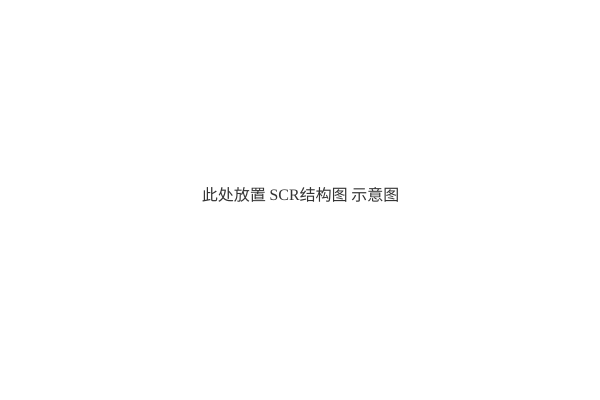
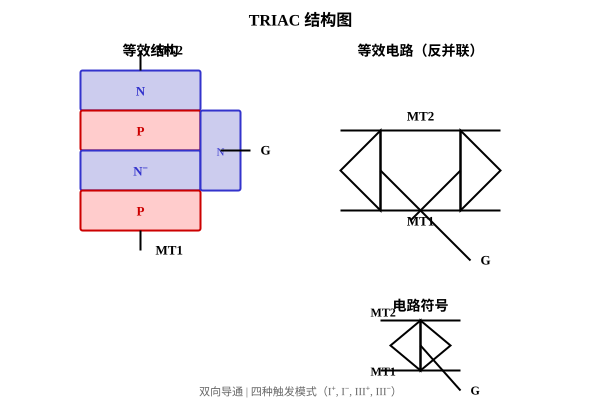
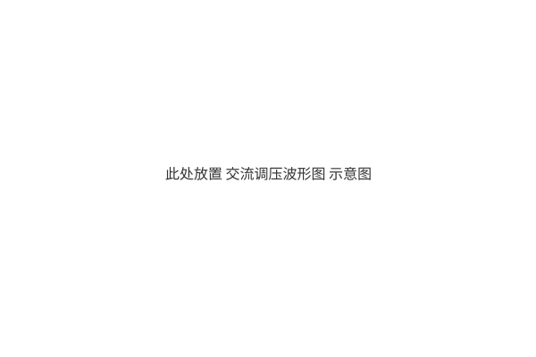

# 8.1 晶闸管

## 1. 引言

晶闸管（Thyristor）是一种半控型功率半导体器件，自 1957 年问世以来，在电力电子领域扮演着核心角色。它能够通过门极信号控制导通，但关断需要外部电路条件配合。晶闸管家族包括 SCR、TRIAC、GTO 等多种类型，广泛应用于交流调压、可控整流、电机调速等领域。

## 2. 晶闸管（SCR）的结构与工作原理

### 2.1 四层 PNPN 结构

SCR（Silicon Controlled Rectifier，可控硅整流器）由四层交替的 P 型和 N 型半导体材料组成，形成三个 PN 结：$J_1$、$J_2$、$J_3$。

三个端子：
- **阳极（Anode, A）**：连接最外层 P 区
- **阴极（Cathode, K）**：连接最外层 N 区
- **门极（Gate, G）**：连接内层 P 区

### 2.2 双晶体管等效模型

SCR 可以等效为两个互连的双极型晶体管：
- **PNP 晶体管**（$Q_1$）：由 P⁺-N-P 构成
- **NPN 晶体管**（$Q_2$）：由 N-P-N⁺ 构成

两个晶体管的集电极电流分别为：

$$I_{C1} = \alpha_1 I_A + I_{CBO1}$$

$$I_{C2} = \alpha_2 I_K + I_{CBO2}$$

其中 $\alpha_1$、$\alpha_2$ 为共基极电流增益，$I_{CBO1}$、$I_{CBO2}$ 为集基结反向饱和电流。

阳极电流 $I_A$ 与门极电流 $I_G$ 的关系：

$$I_A = \frac{\alpha_2 I_G + I_{CBO1} + I_{CBO2}}{1 - (\alpha_1 + \alpha_2)}$$

### 2.3 触发导通条件

当 $(\alpha_1 + \alpha_2) \to 1$ 时，$I_A \to \infty$，SCR 进入导通状态。导通条件：

1. **正向阳极电压**：$V_{AK} > 0$（阳极正偏）
2. **门极触发电流**：$I_G > 0$（注入电流使 $\alpha_2$ 增大）

触发后，正反馈过程使 SCR 迅速进入导通状态，此后即使撤去门极信号，SCR 仍保持导通（**自锁效应**）。

### 2.4 触发导通的其他方式

- **过电压触发**：阳极电压超过正向转折电压 $V_{BO}$
- **高温触发**：温度升高使漏电流增大，触发导通
- **dv/dt 触发**：阳极电压快速上升，通过结电容耦合触发导通

## 3. SCR 的伏安特性与关断

### 3.1 伏安特性

SCR 的伏安特性分为三个区域：

**正向阻断区**（$V_{AK} > 0$，未触发）：
- 结 $J_1$ 和 $J_3$ 正偏，$J_2$ 反偏
- 仅有微小的正向漏电流

**正向导通区**（已触发）：
- 三个结均正偏
- 导通压降约 1–2 V，类似于单个 PN 结

**反向阻断区**（$V_{AK} < 0$）：
- 结 $J_1$ 和 $J_3$ 反偏，承受反向电压
- 反向漏电流极小

### 3.2 关断条件

SCR 一旦导通，门极失去控制能力。关断必须满足：
- **阳极电流降至维持电流 $I_H$ 以下**：$I_A < I_H$
- 维持足够的关断时间 $t_q$（数十 μs 至数百 μs）

### 3.3 换流（Commutation）

在交流电路中，电流自然过零实现关断（**自然换流**）。在直流电路中，需要**强制换流**电路，通过辅助电路产生反向电流迫使 SCR 关断。

## 4. 双向晶闸管（TRIAC）

### 4.1 结构与原理

TRIAC（TRIode for Alternating Current）由两个反并联的 SCR 集成在同一芯片上，可以实现双向导通控制。

三个端子：
- **MT1**（主端子 1）
- **MT2**（主端子 2）
- **G**（门极）

### 4.2 四种触发模式

TRIAC 可在四种象限工作：

| 象限 | MT2 极性 | 门极极性 | 灵敏度 |
|------|----------|----------|--------|
| I⁺ | + | + | 高 |
| I⁻ | + | − | 中等 |
| III⁺ | − | + | 较低 |
| III⁻ | − | − | 高 |

实际应用中，通常避免使用 III⁺ 象限（灵敏度最低）。

### 4.3 TRIAC 的局限性

- $dv/dt$ 能力较差，容易误触发
- 关断时间较长
- 电流容量通常小于同等等级 SCR

## 5. 门极可关断晶闸管（GTO）

### 5.1 基本原理

GTO（Gate Turn-Off Thyristor）是 SCR 的改进型，通过在门极施加**负脉冲**可以关断器件。

关断增益：

$$\beta_{off} = \frac{I_A}{I_{G(off)}}$$

典型 $\beta_{off}$ 约为 3–5，意味着关断需要较大的门极反向电流。

### 5.2 GTO 的特点

**优点**：
- 可通过门极关断，简化换流电路
- 适用于大功率逆变器（MW 级）

**缺点**：
- 关断增益低，需要复杂的门极驱动
- 开关速度较慢
- 需要 snubber 电路保护

### 5.3 其他派生器件

- **IGCT**（集成门极换流晶闸管）：GTO 与门极驱动集成
- **MCT**（MOS 控制晶闸管）：MOSFET 与 SCR 结合

## 6. SCR 触发电路

### 6.1 RC 触发电路

最简单的触发方式，通过 RC 移相网络控制触发角：

- 交流电源经 $R$ 和 $C$ 移相
- 当 $C$ 两端电压达到 DIAC 或 SCR 门极触发电压时导通
- 调节 $R$ 可改变触发角 $\alpha$，从而控制输出功率

$$P_{out} = \frac{V_{rms}^2}{R_L} \cdot \frac{1}{2\pi}\left(2\pi - 2\alpha + \sin 2\alpha\right)$$

### 6.2 DIAC 触发

DIAC（双向触发二极管）与 TRIAC 组合：
- DIAC 在电压达到击穿电压（约 30 V）时导通
- 提供对称的正负触发脉冲
- 广泛用于调光器和电机调速器

### 6.3 脉冲变压器触发

使用脉冲变压器隔离主电路和控制电路，提供隔离保护。

## 7. 晶闸管应用

### 7.1 交流调压（调光器）

使用 TRIAC 和 DIAC 构成最简单的交流调压电路，通过改变触发角控制输出功率。

输出电压有效值：

$$V_{o(rms)} = V_{in(rms)} \cdot \sqrt{\frac{1}{\pi}\left(\pi - \alpha + \frac{\sin 2\alpha}{2}\right)}$$

### 7.2 可控整流

**单相半波可控整流**：

$$V_{dc} = \frac{V_m}{2\pi}(1 + \cos\alpha)$$

**单相全波可控整流**（桥式）：

$$V_{dc} = \frac{V_m}{\pi}(1 + \cos\alpha)$$

**三相全控桥**：

$$V_{dc} = \frac{3\sqrt{3}V_m}{\pi}\cos\alpha$$

其中 $\alpha$ 为触发延迟角（0° ≤ $\alpha$ ≤ 180°）。

### 7.3 其他应用

- **静态开关**：替代机械继电器，无触点、无火花
- **HVDC 输电**：高压直流输电的换流阀
- **无功补偿**：TCR（晶闸管控制电抗器）

## 8. 小结

1. SCR 是四层 PNPN 半控器件，门极控制导通，需外部电路关断
2. TRIAC 实现双向导通，广泛用于交流调压
3. GTO 可通过门极关断，适用于大功率逆变器
4. 触发电路（RC、DIAC、脉冲变压器）是 SCR 应用的关键
5. 晶闸管在可控整流和交流调压中应用广泛