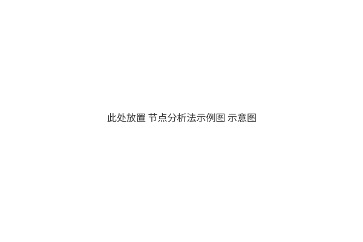
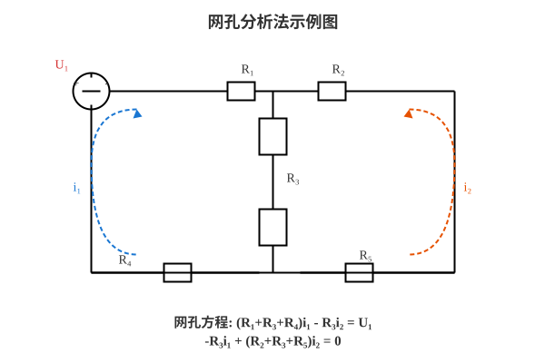
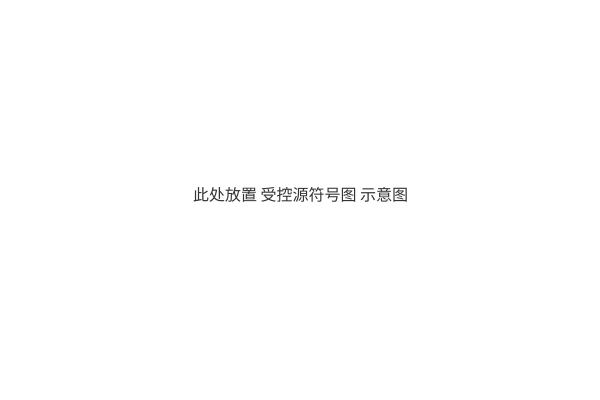
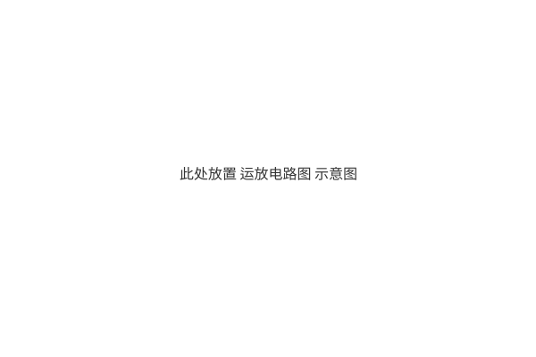

# 3.2 电阻电路的一般分析方法

## 1. 节点电压法（节点分析）

节点电压法是以节点电压为求解变量，根据KCL建立方程组的方法。

**基本步骤**：

1. 选取参考节点（地节点），电位设为零
2. 对其他 $(n-1)$ 个独立节点列写KCL方程
3. 用节点电压表示各支路电流
4. 求解节点电压方程组

对于具有 $n$ 个节点的电路，节点电压方程的矩阵形式为：

$$
\begin{bmatrix}
G_{11} & G_{12} & \cdots & G_{1(n-1)} \\
G_{21} & G_{22} & \cdots & G_{2(n-1)} \\
\vdots & \vdots & \ddots & \vdots \\
G_{(n-1)1} & G_{(n-1)2} & \cdots & G_{(n-1)(n-1)}
\end{bmatrix}
\begin{bmatrix}
u_{n1} \\
u_{n2} \\
\vdots \\
u_{n(n-1)}
\end{bmatrix}
=
\begin{bmatrix}
i_{s11} \\
i_{s22} \\
\vdots \\
i_{s(n-1)(n-1)}
\end{bmatrix}
$$

其中：
- $G_{ii}$：节点 $i$ 的自电导，等于连接到节点 $i$ 的所有电导之和
- $G_{ij}$（$i \neq j$）：节点 $i$ 与节点 $j$ 的互电导，等于连接在节点 $i$ 和节点 $j$ 之间的电导之和的负值
- $u_{ni}$：节点 $i$ 的节点电压
- $i_{sii}$：流入节点 $i$ 的电流源电流的代数和

## 2. 网孔电流法（网孔分析）

网孔电流法是以网孔电流为求解变量，根据KVL建立方程组的方法。

**基本步骤**：

1. 确定每个网孔及其绕行方向
2. 对每个网孔列写KVL方程
3. 用网孔电流表示各支路电压
4. 求解网孔电流方程组

网孔电流方程的矩阵形式：

$$
\begin{bmatrix}
R_{11} & R_{12} & \cdots & R_{1m} \\
R_{21} & R_{22} & \cdots & R_{2m} \\
\vdots & \vdots & \ddots & \vdots \\
R_{m1} & R_{m2} & \cdots & R_{mm}
\end{bmatrix}
\begin{bmatrix}
i_{m1} \\
i_{m2} \\
\vdots \\
i_{mm}
\end{bmatrix}
=
\begin{bmatrix}
u_{s11} \\
u_{s22} \\
\vdots \\
u_{smm}
\end{bmatrix}
$$

其中：
- $R_{ii}$：网孔 $i$ 的自电阻，等于网孔 $i$ 中所有电阻之和
- $R_{ij}$（$i \neq j$）：网孔 $i$ 与网孔 $j$ 的互电阻，等于两个网孔公共支路上的电阻之和（方向相同时取正，相反时取负）
- $i_{mi}$：网孔 $i$ 的网孔电流
- $u_{sii}$：网孔 $i$ 中电压源电压升的代数和

## 3. 回路电流法（回路分析）

回路电流法是网孔电流法的推广，适用于非平面电路。它选择一组独立回路（不一定是网孔）作为求解变量。

**独立回路的选择**：对于具有 $n$ 个节点、$b$ 条支路的电路，独立回路数为 $l = b - n + 1$。

回路电流方程的形式与网孔电流法类似，但互电阻的符号需要根据两个回路在公共支路上的方向关系确定。

## 4. 含受控源的电路分析

受控源是输出电压或电流受电路中其他支路电压或电流控制的电源。常见的受控源有四种类型：

| 类型 | 符号 | 控制关系 |
|-----|------|---------|
| 电压控制电压源（VCVS） | $u_2 = \mu u_1$ | 输出电压受电压控制 |
| 电流控制电压源（CCVS） | $u_2 = r i_1$ | 输出电压受电流控制 |
| 电压控制电流源（VCCS） | $i_2 = g u_1$ | 输出电流受电压控制 |
| 电流控制电流源（CCCS） | $i_2 = \beta i_1$ | 输出电流受电流控制 |

**含受控源电路的节点分析法**：

将受控源视为独立源处理，列出方程后，将控制量用节点电压表示，整理成标准形式。

**含受控源电路的网孔分析法**：

将受控源视为独立源处理，列出方程后，将控制量用网孔电流表示，整理成标准形式。

## 5. 含运算放大器的电阻电路

运算放大器（运放）是一种高增益、高输入阻抗、低输出阻抗的集成电路。

**理想运放的两个重要特性**：

- **虚短**：同相输入端与反相输入端电压相等，$u_+ = u_-$
- **虚断**：流入同相输入端和反相输入端的电流为零，$i_+ = i_- = 0$

**典型运放电路分析**：

**反相比例放大器**：

$$
u_o = -\frac{R_f}{R_1} u_i
$$

**同相比例放大器**：

$$
u_o = \left(1 + \frac{R_f}{R_1}\right) u_i
$$

**求和电路**：

$$
u_o = -\left(\frac{R_f}{R_1} u_1 + \frac{R_f}{R_2} u_2 + \frac{R_f}{R_3} u_3\right)
$$

## 小结

- 节点电压法以节点电压为变量，基于KCL建立方程，适用于节点数较少的电路
- 网孔电流法以网孔电流为变量，基于KVL建立方程，适用于网孔数较少的电路
- 回路电流法是网孔法的推广，可用于非平面电路
- 含受控源电路分析时，先将其视为独立源，再将控制量用变量表示
- 理想运放满足"虚短"和"虚断"特性，可简化分析