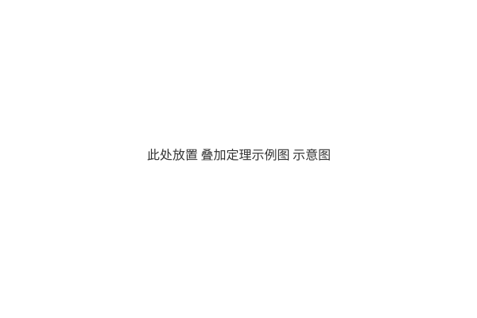
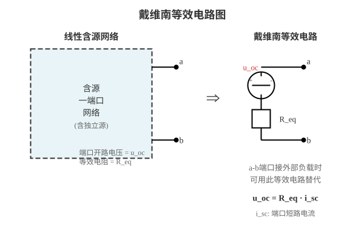
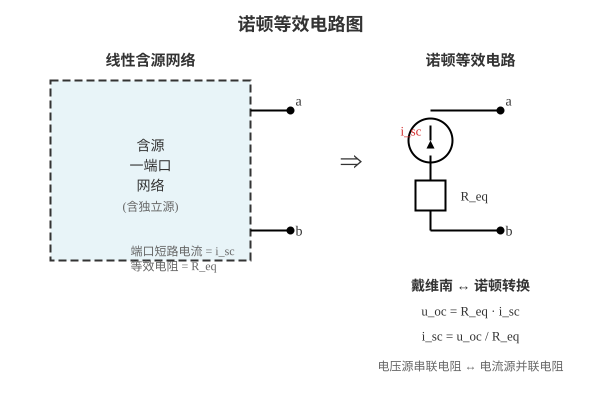
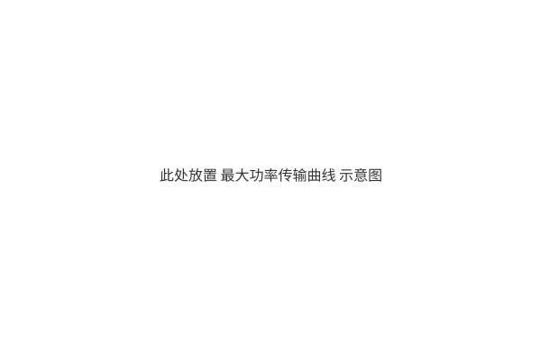

# 3.3 电路定理

## 1. 叠加定理

**叠加定理**：在线性电路中，任一电压或电流都是电路中各个独立电源单独作用时，在该处产生的电压或电流的叠加。

数学表达式：

$$
u = \sum_{k=1}^{n} u_k, \quad i = \sum_{k=1}^{n} i_k
$$

其中 $u_k$ 和 $i_k$ 是第 $k$ 个独立源单独作用时产生的响应。

**使用叠加定理的注意事项**：
- 当某个独立源单独作用时，其他独立源置零（电压源短路，电流源开路）
- 受控源不能单独作用，必须保留在电路中
- 功率不能叠加，因为功率是电压和电流的二次函数

**含受控源的叠加**：

受控源在叠加过程中必须始终保留在原电路中，不能像独立源一样置零。这是因为受控源反映的是电路中的控制关系，不是独立激励。

## 2. 替代定理

**替代定理**：在任意电路中，若某支路的电压 $u_k$ 和电流 $i_k$ 已知，则可用一个电压为 $u_k$ 的电压源或电流为 $i_k$ 的电流源替代该支路，而不影响电路中其他部分的电压和电流。

## 3. 戴维南定理与诺顿定理

### 戴维南定理

**戴维南定理**：任何一个线性含源一端口网络，对外电路而言，可以用一个电压源 $u_{oc}$ 与电阻 $R_{eq}$ 串联的支路等效替代。

其中：
- $u_{oc}$：端口开路电压
- $R_{eq}$：端口内所有独立源置零（电压源短路、电流源开路）后的等效电阻

### 诺顿定理

**诺顿定理**：任何一个线性含源一端口网络，对外电路而言，可以用一个电流源 $i_{sc}$ 与电阻 $R_{eq}$ 并联的支路等效替代。

其中：
- $i_{sc}$：端口短路电流
- $R_{eq}$：端口内所有独立源置零后的等效电阻（与戴维南等效电阻相同）

**戴维南等效与诺顿等效的转换关系**：

$$
u_{oc} = R_{eq} \cdot i_{sc}
$$

## 4. 最大功率传输定理

### 直流电路

对于直流电路，当负载电阻 $R_L$ 等于戴维南等效电阻 $R_{eq}$ 时，负载获得最大功率。

最大功率为：

$$
P_{L\max} = \frac{u_{oc}^2}{4R_{eq}}
$$

### 交流电路

对于交流电路，当负载阻抗 $Z_L$ 等于戴维南等效阻抗 $Z_{eq}$ 的共轭复数时，负载获得最大功率，即：

$$
Z_L = Z_{eq}^*
$$

最大功率为：

$$
P_{L\max} = \frac{|U_{oc}|^2}{4R_{eq}}
$$

其中 $R_{eq}$ 是等效阻抗的实部（电阻部分）。

## 5. 互易定理

**互易定理**：在线性无源（不含独立源和受控源）电路中，在端口1施加激励，在端口2产生的响应，等于在端口2施加相同激励，在端口1产生的响应。

**互易定理的三种形式**：

1. **电压源-电流响应**：$u_{s1}$ 在端口2产生的短路电流 $i_2$，等于 $u_{s2}$ 在端口1产生的短路电流 $i_1$
2. **电流源-电压响应**：$i_{s1}$ 在端口2产生的开路电压 $u_2$，等于 $i_{s2}$ 在端口1产生的开路电压 $u_1$
3. **混合形式**：$i_{s1}$ 在端口2产生的短路电流或电压响应关系

## 6. 补偿定理

**补偿定理**：在线性电路中，若某支路的电流为 $i_k$，电阻为 $R_k$，当该支路电阻变化 $\Delta R_k$ 时，该支路电流的变化量 $\Delta i_k$ 等于电路中所有独立源置零后，在变化支路中串联一个电压为 $i_k \cdot \Delta R_k$ 的电压源所产生的响应。

$$
\Delta i_k = -\frac{i_k \cdot \Delta R_k}{R_k + \Delta R_k + R_{eq}}
$$

其中 $R_{eq}$ 是从该支路看进去的等效电阻。

## 7. 对偶原理

**对偶原理**：如果两个电路（或电路中的两组关系）在数学形式上相似，则它们构成对偶关系。对偶原理指出，如果电路中的一个关系式成立，则其对偶关系式也成立。

常见的对偶量：

| 原量 | 对偶量 | 原量 | 对偶量 |
|-----|-------|-----|-------|
| 电压 $u$ | 电流 $i$ | 电阻 $R$ | 电导 $G$ |
| 电感 $L$ | 电容 $C$ | 电压源 | 电流源 |
| 串联 | 并联 | 开路 | 短路 |
| KVL | KCL | 网孔 | 节点 |

## 小结

- 叠加定理将多激励问题分解为单激励问题的叠加
- 戴维南和诺顿定理将复杂含源网络简化为简单等效电路
- 最大功率传输定理给出了负载获得最大功率的条件
- 互易定理反映了线性无源网络的对称性
- 补偿定理用于分析电阻变化对电路的影响
- 对偶原理揭示了电路理论中的对称性结构