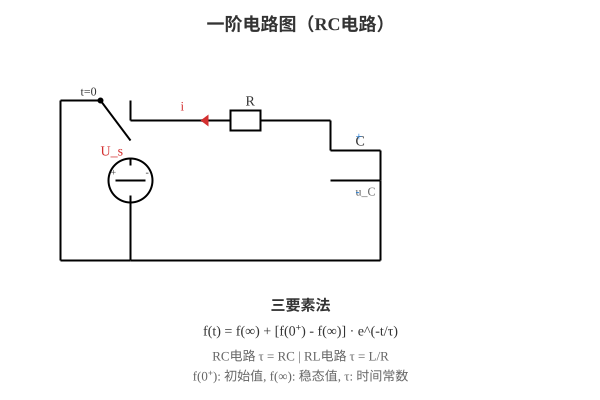
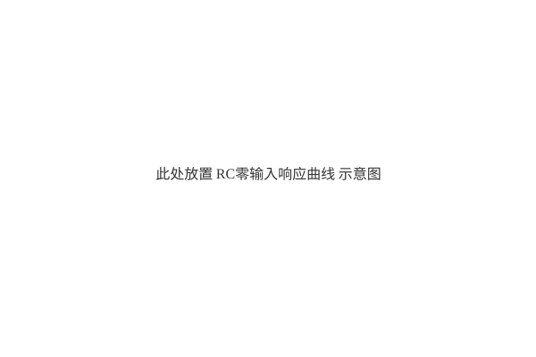
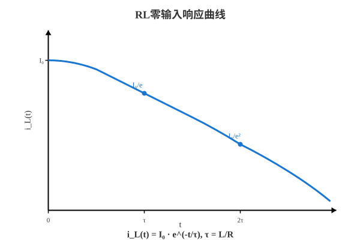
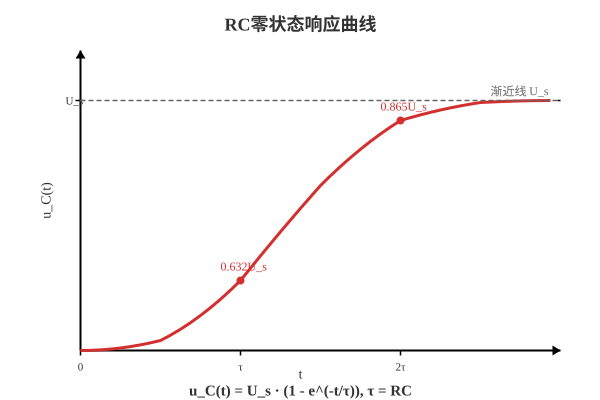

# 3.4 一阶电路暂态分析

## 1. 换路定律与初始条件确定

**换路定律**：在换路瞬间（$t = 0$），电容电压和电感电流不能跃变。

数学表述：

$$
u_C(0^+) = u_C(0^-)
$$
$$
i_L(0^+) = i_L(0^-)
$$

其中 $0^-$ 表示换路前的瞬间，$0^+$ 表示换路后的瞬间。

**初始条件确定步骤**：
1. 计算换路前 $t = 0^-$ 时刻的 $u_C(0^-)$ 和 $i_L(0^-)$
2. 根据换路定律确定 $u_C(0^+)$ 和 $i_L(0^+)$
3. 用电压为 $u_C(0^+)$ 的电压源替代电容、电流为 $i_L(0^+)$ 的电流源替代电感
4. 求解 $t = 0^+$ 时刻电路中其他电压电流的初始值

## 2. RC电路的零输入响应

零输入响应是指电路中没有独立电源激励，仅由储能元件的初始储能引起的响应。

对于RC电路，电容初始电压为 $u_C(0^+) = U_0$，零输入响应为：

$$
u_C(t) = U_0 e^{-\frac{t}{RC}}, \quad t \geq 0
$$

时间常数 $\tau = RC$，反映了响应衰减的快慢。

电流响应：

$$
i_C(t) = C\frac{du_C}{dt} = -\frac{U_0}{R} e^{-\frac{t}{RC}}, \quad t \geq 0
$$

## 3. RL电路的零输入响应

对于RL电路，电感初始电流为 $i_L(0^+) = I_0$，零输入响应为：

$$
i_L(t) = I_0 e^{-\frac{R}{L}t}, \quad t \geq 0
$$

时间常数 $\tau = \frac{L}{R}$。

电感电压响应：

$$
u_L(t) = L\frac{di_L}{dt} = -RI_0 e^{-\frac{R}{L}t}, \quad t \geq 0
$$

## 4. RC电路的零状态响应

零状态响应是指电路中储能元件的初始储能为零，仅由独立电源激励引起的响应。

对于RC电路，电容初始电压为零，施加直流电压源 $U_s$，零状态响应为：

$$
u_C(t) = U_s(1 - e^{-\frac{t}{RC}}), \quad t \geq 0
$$

电流响应：

$$
i_C(t) = C\frac{du_C}{dt} = \frac{U_s}{R} e^{-\frac{t}{RC}}, \quad t \geq 0
$$

## 5. RL电路的零状态响应

对于RL电路，电感初始电流为零，施加直流电压源 $U_s$，零状态响应为：

$$
i_L(t) = \frac{U_s}{R}(1 - e^{-\frac{R}{L}t}), \quad t \geq 0
$$

电感电压响应：

$$
u_L(t) = L\frac{di_L}{dt} = U_s e^{-\frac{R}{L}t}, \quad t \geq 0
$$

## 6. 一阶电路的全响应（三要素法）

全响应是零输入响应和零状态响应的叠加：

$$
f(t) = f(\infty) + [f(0^+) - f(\infty)] e^{-\frac{t}{\tau}}, \quad t \geq 0
$$

**三要素法**：一阶电路的全响应由三个要素完全确定：

1. **初始值** $f(0^+)$：响应在 $t = 0^+$ 时的值
2. **稳态值** $f(\infty)$：响应在 $t \to \infty$ 时的值
3. **时间常数** $\tau$：对于RC电路 $\tau = RC$，对于RL电路 $\tau = L/R$

三要素公式：

$$
f(t) = f(\infty) + [f(0^+) - f(\infty)] e^{-\frac{t}{\tau}}, \quad t \geq 0
$$

## 7. 阶跃响应与冲激响应

### 阶跃响应

当电路激励为单位阶跃函数 $\varepsilon(t)$ 时，电路的响应称为单位阶跃响应 $s(t)$。

对于一阶RC电路，单位阶跃响应为：

$$
s(t) = (1 - e^{-\frac{t}{\tau}})\varepsilon(t)
$$

### 冲激响应

当电路激励为单位冲激函数 $\delta(t)$ 时，电路的响应称为单位冲激响应 $h(t)$。

冲激响应与阶跃响应的关系：

$$
h(t) = \frac{ds(t)}{dt}
$$

对于一阶RC电路，单位冲激响应为：

$$
h(t) = \frac{1}{\tau} e^{-\frac{t}{\tau}}\varepsilon(t)
$$

## 小结

- 换路定律指出电容电压和电感电流不能跃变，是暂态分析的起点
- 零输入响应是储能元件初始储能释放的过程，按指数规律衰减
- 零状态响应是电源对储能元件的充电过程，按指数规律趋近稳态
- 三要素法提供了一阶电路暂态分析的统一方法
- 阶跃响应和冲激响应是描述电路动态特性的重要响应函数