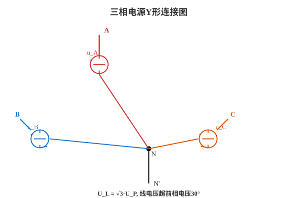
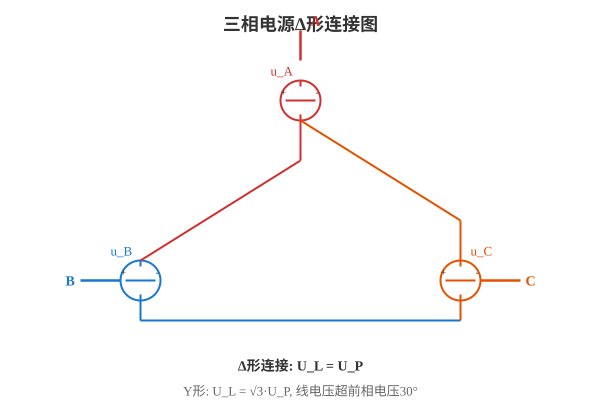

# 3.8 三相电路

## 1. 三相电源的连接

三相电源由三个频率相同、幅值相等、相位互差 $120^\circ$ 的正弦电压源组成。

三个相电压为：

$$
u_A = U_m \cos(\omega t)
$$
$$
u_B = U_m \cos(\omega t - 120^\circ)
$$
$$
u_C = U_m \cos(\omega t - 240^\circ) = U_m \cos(\omega t + 120^\circ)
$$

相量形式：

$$
\dot{U}_A = U \angle 0^\circ, \quad \dot{U}_B = U \angle -120^\circ, \quad \dot{U}_C = U \angle 120^\circ
$$

### Y形（星形）连接

Y形连接将三个电源的末端连接在一起，形成中性点 $N$。从三个首端引出三条火线（相线）。

**线电压与相电压的关系**：

$$
\dot{U}_{AB} = \dot{U}_A - \dot{U}_B = \sqrt{3}U \angle 30^\circ
$$
$$
\dot{U}_{BC} = \sqrt{3}U \angle -90^\circ
$$
$$
\dot{U}_{CA} = \sqrt{3}U \angle 150^\circ
$$

线电压有效值是相电压的 $\sqrt{3}$ 倍，相位超前对应相电压 $30^\circ$。

### Δ形（三角形）连接

Δ形连接将三个电源首尾相连，形成一个闭合三角形。

Δ形连接中，线电压等于相电压：

$$
U_L = U_P
$$

## 2. 三相负载的连接

### Y形负载

Y形负载可以接成三相三线制（无中性线）或三相四线制（有中性线）。

**对称Y形负载**：三个阻抗相等 $Z_A = Z_B = Z_C = Z$。

线电流等于相电流：

$$
I_L = I_P
$$

### Δ形负载

Δ形负载将三个阻抗接成三角形。

**对称Δ形负载**：

线电流与相电流的关系：

$$
\dot{I}_A = \dot{I}_{AB} - \dot{I}_{CA} = \sqrt{3}I_P \angle -30^\circ
$$

线电流有效值是相电流的 $\sqrt{3}$ 倍，相位滞后对应相电流 $30^\circ$。

## 3. 对称三相电路的计算

对称三相电路的特点是：三相电源对称、三相负载对称、线路阻抗相等。

**对称Y-Y电路的计算**：

中性点电压 $\dot{U}_{NN'} = 0$，因此各相可以独立计算。

取A相计算：

$$
\dot{I}_A = \frac{\dot{U}_A}{Z_L + Z}
$$

B相和C相的电流分别为：

$$
\dot{I}_B = \dot{I}_A \angle -120^\circ, \quad \dot{I}_C = \dot{I}_A \angle 120^\circ
$$

**对称Y-Δ电路的等效转换**：

将Δ形负载转换为等效Y形负载：

$$
Z_Y = \frac{Z_\Delta}{3}
$$

然后按Y-Y电路计算。

## 4. 不对称三相电路的分析

当三相负载不对称时，中性点电压不为零，即出现**中性点位移**。

**中性点位移电压**：

$$
\dot{U}_{NN'} = \frac{\dot{U}_A Y_A + \dot{U}_B Y_B + \dot{U}_C Y_C}{Y_A + Y_B + Y_C}
$$

其中 $Y_A = 1/Z_A$，$Y_B = 1/Z_B$，$Y_C = 1/Z_C$。

各相负载电压：

$$
\dot{U}_{A'} = \dot{U}_A - \dot{U}_{NN'}
$$
$$
\dot{U}_{B'} = \dot{U}_B - \dot{U}_{NN'}
$$
$$
\dot{U}_{C'} = \dot{U}_C - \dot{U}_{NN'}
$$

## 5. 三相电路的功率测量

### 对称三相电路的功率

**有功功率**：

$$
P = 3U_P I_P \cos\theta = \sqrt{3} U_L I_L \cos\theta
$$

**无功功率**：

$$
Q = 3U_P I_P \sin\theta = \sqrt{3} U_L I_L \sin\theta
$$

**视在功率**：

$$
S = 3U_P I_P = \sqrt{3} U_L I_L
$$

### 二瓦计法

二瓦计法用于测量三相三线制电路的总功率，无论负载是否对称。

两个瓦特表的读数之和等于三相总功率：

$$
P = P_1 + P_2
$$

其中：

$$
P_1 = U_{AB} I_A \cos(\varphi_{u_{AB}} - \varphi_{i_A})
$$
$$
P_2 = U_{CB} I_C \cos(\varphi_{u_{CB}} - \varphi_{i_C})
$$

对于对称负载，两个瓦特表的读数与功率因数角的关系为：

$$
P_1 = U_L I_L \cos(30^\circ - \theta)
$$
$$
P_2 = U_L I_L \cos(30^\circ + \theta)
$$

## 小结

- 三相电源有Y形和Δ形两种连接方式，线电压与相电压关系不同
- 对称三相电路可以简化为单相电路计算
- 不对称三相电路会出现中性点位移，需逐相分析
- 三相功率包括有功功率、无功功率和视在功率
- 二瓦计法可测量三相三线制电路的总功率