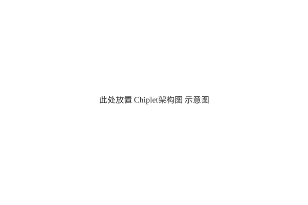
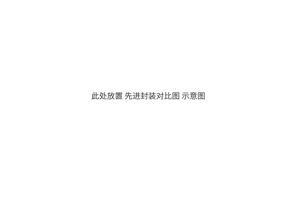

# 6.14 先进技术专题

## 1. 概述

随着摩尔定律的放缓，半导体行业正在探索多种先进技术来延续集成电路的性能提升。本章将介绍FinFET与GAA器件、先进工艺节点、EUV光刻、3D IC、Chiplet、先进封装、低功耗技术、AI for EDA、开源芯片生态和硬件安全等前沿技术。

## 2. FinFET与GAA器件结构

### 2.1 FinFET结构

FinFET（鳍式场效应晶体管）是3D晶体管结构，栅极包裹在垂直的鳍状沟道周围，提供更好的沟道控制能力。


FinFET的关键参数：

- **鳍高（Hfin）**：典型值30~50nm
- **鳍宽（Wfin）**：典型值5~10nm
- **鳍间距**：决定器件密度
- **栅极长度**：7nm节点Lg≈20nm

FinFET的电流公式：

$$I_{DS} = \mu \cdot C_{ox} \cdot N_{fin} \cdot \frac{W_{fin}}{L} \cdot (V_{GS} - V_{TH})^2$$

其中$N_{fin}$为并联的鳍数。

### 2.2 FinFET vs 平面MOSFET

| 特性 | 平面MOSFET | FinFET |
|------|-----------|--------|
| 沟道控制 | 弱 | 强（三面栅极） |
| 短沟道效应 | 严重 | 显著改善 |
| 漏电流 | 高 | 低 |
| 驱动电流 | 受限于沟道宽度 | 可通过多鳍扩展 |
| 工艺复杂度 | 低 | 高 |

### 2.3 GAA（Gate-All-Around）器件

GAA是FinFET的下一代技术，栅极完全包裹纳米片（Nanosheet）或纳米线（Nanowire）沟道：

- **纳米片FET（NSFET）**：水平堆叠的纳米片
- **纳米线FET（NWFET）**：水平或垂直纳米线
- **CFET（Complementary FET）**：垂直堆叠NMOS和PMOS

GAA器件的优势：

$$SS = \left(1 + \frac{C_{dep}}{C_{ox}}\right)^{-1} \cdot \frac{kT}{q} \cdot \ln 10$$

GAA器件中，栅极完全包围沟道，$C_{dep}$影响更小，SS更接近理想值60mV/decade。

## 3. 先进工艺节点

### 3.1 工艺节点现状

| 节点 | 量产 | 器件结构 | 关键特征 |
|------|------|---------|---------|
| 7nm | 2018 | FinFET | EUV引入，193nm+SAQP |
| 5nm | 2020 | FinFET | 全面EUV，高密度SRAM |
| 3nm | 2022 | FinFET/GA | 3nm FinFET (TSMC) / GAA (Samsung) |
| 2nm | 2024~2025 | GAA | 纳米片，背面供电 |
| 1.4nm | 2026~2027 | GAA | CFET，先进互连 |

### 3.2 工艺缩放的挑战

$$P = \frac{1}{2}\alpha CV^2f + VI_{leak}$$

随着尺寸缩小：
- 漏电流增加（$I_{leak}$ 指数增长）
- 互连延迟占比增大
- 功耗密度增加
- 量子效应显著

## 4. EUV光刻

### 4.1 EUV技术原理

EUV（Extreme Ultraviolet）光刻使用13.5nm波长的极紫外光：

- **光源**：激光等离子体（LPP），CO₂激光轰击锡液滴
- **反射式光学**：由于EUV被所有材料吸收，使用多层膜反射镜
- **真空环境**：EUV在空气中被吸收，需在真空中工作

### 4.2 EUV优势

- 更高分辨率：$R = k_1 \frac{\lambda}{NA} \approx 13\text{nm}$
- 简化工艺：单次曝光替代多次图形化
- 降低缺陷率：减少工艺步骤

## 5. 3D IC与TSV技术

### 5.1 3D IC概念

3D IC将多个芯片层垂直堆叠，通过硅通孔（TSV）实现层间互连：

- 减小芯片面积
- 缩短互连长度
- 降低功耗
- 异质集成

### 5.2 TSV技术

TSV（Through Silicon Via）是3D IC的关键技术：

- 深宽比：典型10:1~20:1
- 直径：2~10μm
- 深度：20~100μm
- 填充材料：铜/多晶硅/钨

TSV寄生参数：

$$R_{TSV} \approx \rho \cdot \frac{4h}{\pi d^2}$$
$$C_{TSV} \approx \frac{2\pi\varepsilon h}{\ln(D/d)}$$

其中$h$为TSV深度，$d$为TSV直径，$D$为TSV间距。

## 6. Chiplet与异构集成

### 6.1 Chiplet概念

Chiplet是一种将大型SoC分解为多个小芯片（Die）的设计方法，通过先进封装技术集成。



### 6.2 Chiplet优势

- **良率提升**：小芯片良率更高
- **成本降低**：使用成熟工艺节点
- **设计复用**：不同项目复用Chiplet
- **异构集成**：混合不同工艺节点
- **快速迭代**：局部更新替代全芯片重新设计

### 6.3 Chiplet互连标准

- **UCIe（Universal Chiplet Interconnect Express）**：开放的Chiplet互连标准
- **BoW（Bridge of Wires）**：简单的芯片间互连
- **OpenHBI**：高带宽存储器接口

## 7. 先进封装



### 7.1 封装技术演进

| 封装技术 | 类型 | 特点 |
|---------|------|------|
| Wire Bond | 传统 | 低密度，成本低 |
| Flip Chip | 先进 | 高密度，良好电气性能 |
| Fan-Out | 晶圆级 | 减少厚度，提高带宽 |
| 2.5D IC | 中介层 | 硅中介层连接多个芯片 |
| 3D IC | 堆叠 | 垂直堆叠，最高密度 |

### 7.2 CoWoS（Chip-on-Wafer-on-Substrate）

CoWoS是台积电的2.5D封装技术：

- 使用硅中介层（Silicon Interposer）
- 高密度芯片间互连
- 适合HBM与GPU/CPU集成

### 7.3 InFO（Integrated Fan-Out）

InFO是台积电的扇出型封装技术：

- 无需硅中介层
- 减小封装厚度
- 降低功耗
- 广泛应用于移动SoC

## 8. 低功耗技术

### 8.1 DVFS（动态电压频率缩放）

DVFS根据工作负载动态调整电压和频率：

$$P \propto V^2 \cdot f$$

- 高性能需求：高电压+高频率
- 低负载：低电压+低频率
- 节能效果：可降低40%~60%功耗

### 8.2 Power Gating（电源门控）

使用开关晶体管切断模块电源：

- 漏电降低：接近100%（关断模式下）
- 唤醒时间：微秒级
- 需要保留寄存器和隔离单元

### 8.3 Clock Gating（时钟门控）

时钟门控关闭非活跃模块的时钟树：

- 动态功耗降低：20%~50%
- 逻辑简单，实现成本低
- 自动集成在综合工具中

### 8.4 Adaptive Voltage Scaling（AVS）

AVS根据芯片实际PVT条件自动调整电压：

- 好芯片用低电压
- 差芯片用高电压
- 节省平均功耗10%~30%

### 8.5 近阈值计算（Near-Threshold Computing）

在$V_{DD} \approx V_{TH}$附近工作：

$$P_{NTC} \propto V_{DD}^2 \propto V_{TH}^2$$

- 功耗降低：10倍以上
- 性能损失：10倍
- 适用场景：IoT、可穿戴设备

## 9. AI for EDA

### 9.1 AI在EDA中的应用

- **布局优化**：强化学习自动布局
- **布线优化**：ML预测拥塞
- **时序预测**：ML加速时序分析
- **功耗优化**：ML指导低功耗设计
- **设计空间探索**：贝叶斯优化PPA

### 9.2 代表性工具

- **Google的Floorplanning RL**：基于强化学习的布图规划
- **DREAMPlace**：基于GPU的加速布局
- **NVCell**：自动标准单元生成

## 10. 开源芯片生态

### 10.1 RISC-V生态

- **指令集**：开源免费
- **处理器实现**：Rocket、BOOM、CVA6、VexRiscv
- **SoC平台**：Chipyard、OpenPiton
- **软件开发**：GCC、LLVM、Linux支持

### 10.2 OpenROAD

OpenROAD是开源的RTL-to-GDSII设计流程：

```
RTL → 逻辑综合 → 布图规划 → 布局 → CTS → 布线 → GDSII
```

- 工具链：Yosys + OpenROAD + KLayout
- 目标：24小时内完成芯片设计
- 支持：SkyWater 130nm PDK

### 10.3 SkyWater PDK

SkyWater 130nm开源工艺设计套件：

- 第一个完全开源的商用PDK
- 包含标准单元库、I/O库
- 支持Google的免费MPW流片

## 11. 硬件安全

### 11.1 硬件安全威胁

- **硬件木马**：恶意修改电路
- **侧信道攻击**：通过功耗/电磁泄漏获取密钥
- **故障注入**：通过电压/时钟扰动诱发错误
- **逆向工程**：通过芯片解剖获取设计

### 11.2 PUF（物理不可克隆函数）

PUF利用芯片制造过程中不可避免的工艺差异生成唯一标识：

- **SRAM PUF**：利用SRAM上电时的随机初始值
- **环形振荡器PUF**：利用RO频率差异
- **Arbiter PUF**：利用路径延迟差异

PUF的关键指标：

- 唯一性：$H_{inter} = \frac{2}{k(k-1)}\sum_{i=1}^{k-1}\sum_{j=i+1}^{k}\frac{HD(R_i, R_j)}{n}$
- 可靠性：$P_{bit} = 1 - \frac{1}{m}\sum_{j=1}^{m}\frac{HD(R_i, R_{i,j})}{n}$

### 11.3 侧信道攻击与防护

**攻击方法**：

- **SPA（简单功耗分析）**：直接观察功耗轨迹
- **DPA（差分功耗分析）**：统计分析功耗轨迹
- **CPA（相关性功耗分析）**：基于相关系数的分析

**防护方法**：

- **掩码技术**：随机化中间值
- **隐藏技术**：恒定功耗逻辑
- **噪声注入**：增加功耗噪声
- **去同步化**：随机化操作时序

## 12. 容错与可靠性

### 12.1 软错误

软错误由宇宙射线/α粒子引起：

$$SER = F \cdot A \cdot \exp\left(-\frac{Q_{crit}}{Q_s}\right)$$

其中：
- $F$：粒子通量
- $A$：敏感面积
- $Q_{crit}$：临界电荷
- $Q_s$：收集电荷

### 12.2 容错技术

- **TMR（三模冗余）**：三个模块多数表决
- **ECC（纠错码）**：SEC-DED（单纠错-双检错）
- **双核锁步（Dual-core Lockstep）**：两个核比较运行结果
- **看门狗定时器**：检测系统挂起

### 12.3 老化效应

- **NBTI（负偏置温度不稳定性）**：PMOS阈值电压漂移
- **HCI（热载流子注入）**：载流子注入栅氧化层
- **TDDB（经时介质击穿）**：栅氧化层随时间退化

## 总结

本章介绍了半导体行业的前沿技术，涵盖器件结构（FinFET/GAA）、先进制造（EUV/3nm）、先进封装（CoWoS/InFO/Chiplet）、低功耗技术、AI for EDA、开源芯片生态和硬件安全等方向。这些技术将继续推动集成电路行业的发展，为未来计算、通信和智能应用提供基础。