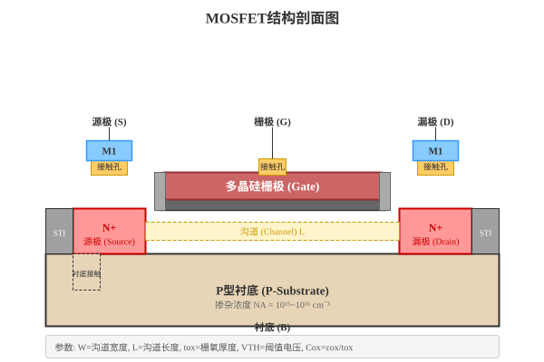
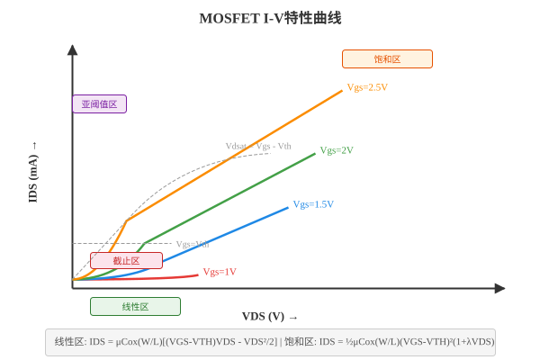
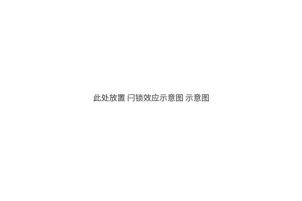

# 6.3 CMOS器件物理

## 1. 概述

CMOS（Complementary Metal-Oxide-Semiconductor）器件是数字集成电路的基本构建单元。理解MOSFET的物理原理对于电路设计、性能优化和工艺理解至关重要。本章从器件物理角度深入分析MOSFET的结构、工作原理和特性。

## 2. MOSFET结构与工作原理

### 2.1 基本结构

MOSFET是一种四端器件，包含以下端口：

- **栅极（Gate）**：控制沟道导电性
- **源极（Source）**：载流子来源
- **漏极（Drain）**：载流子流出
- **衬底（Bulk/Body）**：器件主体

NMOS器件结构：P型衬底上形成N型源漏区域，栅极位于P型衬底上方。

PMOS器件结构：N型衬底上形成P型源漏区域，栅极位于N型衬底上方。

### 2.2 工作原理

MOSFET的工作原理基于场效应——通过栅极电压控制沟道导电性。

**阈值电压条件**：当栅源电压$V_{GS}$达到阈值电压$V_{TH}$时，沟道表面发生反型，形成导电沟道。

对于NMOS：

$$V_{GS} > V_{TH} \quad \text{形成N型沟道（反型层）}$$

对于PMOS：

$$V_{GS} < V_{TH} \quad \text{形成P型沟道（反型层）}$$

## 3. I-V特性

### 3.1 工作区域

MOSFET的I-V特性分为三个主要区域：

### 3.2 截止区（Cut-off Region）

当$V_{GS} < V_{TH}$（NMOS）时，沟道未形成，漏极电流近似为零：

$$I_{DS} \approx 0$$

### 3.3 线性区（Linear/Triode Region）

当$V_{GS} > V_{TH}$且$V_{DS} < V_{GS} - V_{TH}$时，沟道连续，漏极电流与$V_{DS}$近似线性关系：

$$I_{DS} = \mu_n C_{ox} \frac{W}{L} \left[(V_{GS} - V_{TH})V_{DS} - \frac{1}{2}V_{DS}^2\right]$$

对于小$V_{DS}$（$V_{DS} \ll V_{GS} - V_{TH}$），可以简化为：

$$I_{DS} \approx \mu_n C_{ox} \frac{W}{L} (V_{GS} - V_{TH})V_{DS}$$

此时MOSFET表现为一个压控电阻，其导通电阻为：

$$R_{on} = \frac{1}{\mu_n C_{ox} \frac{W}{L} (V_{GS} - V_{TH})}$$

### 3.4 饱和区（Saturation Region）

当$V_{GS} > V_{TH}$且$V_{DS} \geq V_{GS} - V_{TH}$时，沟道在漏极附近被夹断，电流基本饱和：

$$I_{DS} = \frac{1}{2}\mu_n C_{ox} \frac{W}{L} (V_{GS} - V_{TH})^2 (1 + \lambda V_{DS})$$

其中：
- $\mu_n$：电子迁移率
- $C_{ox}$：单位面积栅氧化层电容，$C_{ox} = \varepsilon_{ox}/t_{ox}$
- $W$：沟道宽度
- $L$：沟道长度
- $\lambda$：沟道长度调制系数

### 3.5 跨导

跨导$g_m$是衡量栅压控制漏极电流能力的重要参数：

$$g_m = \frac{\partial I_{DS}}{\partial V_{GS}} = \mu_n C_{ox} \frac{W}{L} (V_{GS} - V_{TH}) = \sqrt{2\mu_n C_{ox} \frac{W}{L} I_{DS}}$$

## 4. 阈值电压与体效应

### 4.1 阈值电压公式

MOSFET的阈值电压由以下因素决定：

$$V_{TH} = V_{FB} + 2\phi_F + \frac{\sqrt{2\varepsilon_s q N_A(2\phi_F + V_{SB})}}{C_{ox}}$$

其中：
- $V_{FB}$：平带电压，$V_{FB} = \phi_{MS} - \frac{Q_f}{C_{ox}} - \frac{Q_{it}}{C_{ox}}$
- $\phi_{MS}$：栅极与衬底功函数差
- $\phi_F$：费米势，$\phi_F = \frac{kT}{q}\ln\left(\frac{N_A}{n_i}\right)$
- $\varepsilon_s$：硅介电常数
- $q$：电子电荷
- $N_A$：衬底掺杂浓度
- $V_{SB}$：源衬偏压
- $Q_f$：固定氧化层电荷
- $Q_{it}$：界面陷阱电荷

### 4.2 体效应（Body Effect）

体效应指衬底偏压对阈值电压的影响。当源极与衬底之间存在电压差$V_{SB}$时，阈值电压发生变化：

$$V_{TH} = V_{TH0} + \gamma\left(\sqrt{2\phi_F + V_{SB}} - \sqrt{2\phi_F}\right)$$

其中$\gamma$为体效应系数：

$$\gamma = \frac{\sqrt{2\varepsilon_s q N_A}}{C_{ox}}$$

体效应导致：
- NMOS：$V_{SB} > 0$时，$V_{TH}$增大
- PMOS：$V_{SB} < 0$时，$|V_{TH}|$增大

## 5. 沟道长度调制效应

在饱和区，随着$V_{DS}$增大，夹断点向源极移动，有效沟道长度减小，导致漏极电流增加。

考虑沟道长度调制效应的饱和区电流：

$$I_{DS} = \frac{1}{2}\mu_n C_{ox} \frac{W}{L} (V_{GS} - V_{TH})^2 (1 + \lambda V_{DS})$$

其中$\lambda$与沟道长度$L$成反比：

$$\lambda \propto \frac{1}{L}$$

输出电阻为：

$$r_o = \frac{\partial V_{DS}}{\partial I_{DS}} = \frac{1}{\lambda I_{DS}}$$

## 6. 短沟道效应

随着工艺节点缩小，沟道长度缩短到与耗尽层宽度可比拟时，出现一系列短沟道效应。

### 6.1 阈值电压滚降（VTH Roll-off）

短沟道器件中，源漏耗尽区对沟道电荷共享的影响导致阈值电压降低：

$$\Delta V_{TH} \propto \exp\left(-\frac{L}{2l_t}\right)$$

其中$l_t$为特征长度：

$$l_t = \sqrt{\frac{\varepsilon_s t_{ox} x_j}{\varepsilon_{ox}}}$$

$x_j$为源漏结深。

### 6.2 DIBL（漏致势垒降低）

DIBL（Drain Induced Barrier Lowering）是短沟道器件中，漏极电压通过降低源端势垒导致阈值电压降低的现象。

$$\Delta V_{TH(DIBL)} = -\sigma V_{DS}$$

其中$\sigma$为DIBL系数，取决于工艺和器件尺寸。

### 6.3 速度饱和

在短沟道器件中，载流子速度达到饱和速度$v_{sat}$，不再随电场线性增加。速度饱和后的饱和电流为：

$$I_{DS(sat)} = v_{sat} C_{ox} W (V_{GS} - V_{TH})$$

### 6.4 热载流子效应

高电场下，载流子获得足够能量成为热载流子，可能注入栅氧化层，导致：

- 阈值电压漂移
- 跨导退化
- 器件可靠性降低

## 7. 亚阈值特性

### 7.1 亚阈值电流

当$V_{GS} < V_{TH}$时，MOSFET并未完全关断，存在亚阈值漏电流：

$$I_{DS(sub)} = I_0 \exp\left(\frac{V_{GS} - V_{TH}}{n \cdot V_T}\right) \left[1 - \exp\left(-\frac{V_{DS}}{V_T}\right)\right]$$

其中：
- $V_T = kT/q$：热电压（300K时约26mV）
- $n = 1 + C_{dep}/C_{ox}$：亚阈值斜率因子
- $I_0$：$V_{GS}=V_{TH}$时的漏极电流

### 7.2 亚阈值摆幅（Subthreshold Swing）

亚阈值摆幅SS定义为漏极电流变化一个数量级所需的栅压变化：

$$SS = \frac{\partial V_{GS}}{\partial (\log_{10} I_{DS})} = n \cdot V_T \cdot \ln 10 = n \cdot \frac{kT}{q} \cdot \ln 10$$

在室温（300K）下，理想最小SS为：

$$SS_{min} = \frac{kT}{q} \cdot \ln 10 \approx 60 \text{ mV/decade}$$

实际器件中，SS通常大于60 mV/decade。更小的SS意味着更好的开关特性。

## 8. CMOS工艺寄生效应

### 8.1 寄生电容

MOSFET的主要寄生电容包括：

- 栅-源重叠电容：$C_{gs} = C_{ox} \cdot W \cdot L_{ov}$
- 栅-漏重叠电容：$C_{gd} = C_{ox} \cdot W \cdot L_{ov}$
- 栅-衬底电容：$C_{gb} = C_{ox} \cdot W \cdot L$
- 源-衬底结电容：$C_{sb} = C_j \cdot Area_{source} + C_{jsw} \cdot Perimeter_{source}$
- 漏-衬底结电容：$C_{db} = C_j \cdot Area_{drain} + C_{jsw} \cdot Perimeter_{drain}$

### 8.2 寄生电阻

源漏区域存在寄生电阻：

$$R_{sd} = R_{contact} + R_{diffusion} + R_{LDD}$$

## 9. 闩锁效应（Latch-up）

### 9.1 闩锁效应原理

闩锁效应是CMOS电路中特有的寄生效应，由寄生NPN和PNP双极型晶体管形成的PNPN结构（SCR）引起。

### 9.2 触发条件

闩锁效应需要满足以下条件：

1. 寄生NPN和PNP晶体管的电流增益乘积$\beta_{NPN} \cdot \beta_{PNP} > 1$
2. 衬底和阱电阻上的压降足以正向偏置发射结
3. 外部电流注入或电压过冲提供触发

### 9.3 预防措施

- 使用保护环（Guard Ring）
- 增加衬底接触和阱接触密度
- 降低阱和衬底电阻
- 使用SOI（Silicon on Insulator）技术
- 限制电流注入

## 10. 工艺角（Process Corner）与PVT变化

### 10.1 工艺角

工艺角表示制造过程中工艺参数波动的极端情况：

| 工艺角 | NMOS | PMOS | 描述 |
|-------|------|------|------|
| TT | Typical | Typical | 典型工艺 |
| FF | Fast | Fast | 快-快，$V_{TH}$低，$I_{DS}$大 |
| SS | Slow | Slow | 慢-慢，$V_{TH}$高，$I_{DS}$小 |
| FS | Fast | Slow | 快-慢，NMOS快，PMOS慢 |
| SF | Slow | Fast | 慢-快，NMOS慢，PMOS快 |

### 10.2 PVT变化

PVT（Process-Voltage-Temperature）变化是影响芯片性能的三个主要因素：

- **工艺（Process）**：掺杂浓度、氧化层厚度、CD变化等
- **电压（Voltage）**：电源电压波动（通常±5%~±10%）
- **温度（Temperature）**：芯片工作温度变化（-40°C~125°C）

温度对迁移率的影响：

$$\mu(T) = \mu(T_0) \left(\frac{T}{T_0}\right)^{-k_\mu}$$

其中$k_\mu$约为1.5~2.0。

温度对阈值电压的影响：

$$V_{TH}(T) = V_{TH}(T_0) - \alpha(T - T_0)$$

其中$\alpha$约为0.5~3 mV/K。

## 总结

本章深入分析了CMOS器件物理的核心内容，包括MOSFET结构、I-V特性、阈值电压、短沟道效应、亚阈值特性等关键知识。理解这些器件物理原理对于数字电路设计、模拟电路设计和工艺开发都具有重要意义。