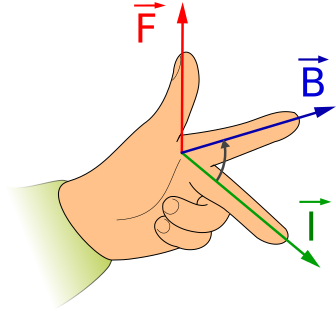
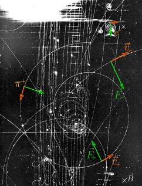
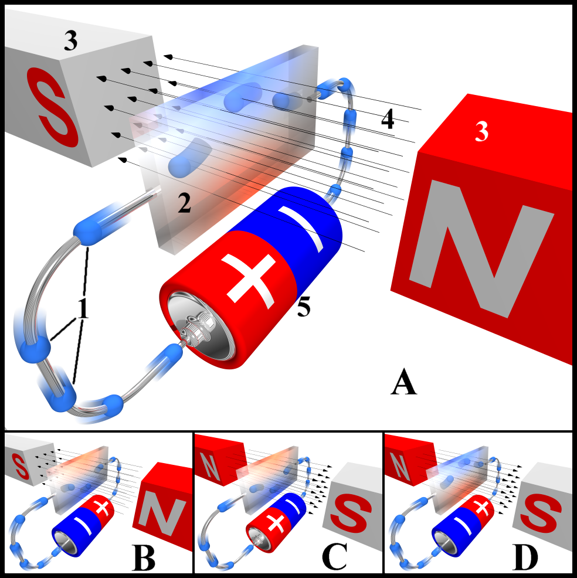
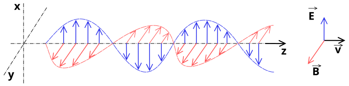

# 1.2 电磁学

> **前置知识**：[1.1 数学基础](1.1-数学基础.md)（承接上一章）。

电磁学是研究电荷、电流与电磁场相互作用的基础学科，是电路理论的物理根基。本章从大学物理层面梳理电磁学核心内容，为后续电路分析、模拟电路和芯片设计打下理论基础。

---

## 1. 静电场

### 1.1 库仑定律

两个点电荷之间的作用力与电荷量的乘积成正比，与距离的平方成反比：

$$
\mathbf{F} = k\frac{q_1 q_2}{r^2} \hat{\mathbf{r}} = \frac{1}{4\pi\varepsilon_0}\frac{q_1 q_2}{r^2} \hat{\mathbf{r}}
$$

其中 $k = 8.99 \times 10^9 \,\text{N}{\cdot}\text{m}^2/\text{C}^2$，$\varepsilon_0 = 8.85 \times 10^{-12} \,\text{F/m}$ 为真空介电常数。

### 1.2 电场强度

电场强度定义为试探电荷所受的力与电荷量之比：

$$
\mathbf{E} = \frac{\mathbf{F}}{q}
$$

点电荷的电场：$\displaystyle \mathbf{E} = \frac{1}{4\pi\varepsilon_0}\frac{q}{r^2} \hat{\mathbf{r}}$

### 1.3 高斯定理

通过任意闭合曲面的电通量等于该曲面内包围的净电荷量除以 $\varepsilon_0$：

$$
\oint_S \mathbf{E} \cdot d\mathbf{S} = \frac{Q_{\text{enc}}}{\varepsilon_0}
$$

**应用示例**：利用高斯定理计算均匀带电球体、无限大带电平面、无限长带电直线的电场分布，比直接积分更简洁。

### 1.4 电势与电势差

静电场是保守场，可以引入电势：

$$
V(\mathbf{r}) = -\int_{\infty}^{\mathbf{r}} \mathbf{E} \cdot d\mathbf{l}
$$

两点间的电势差即为电压：

$$
U_{AB} = V_A - V_B = \int_A^B \mathbf{E} \cdot d\mathbf{l}
$$

**电路中的电压**：电压的本质是单位电荷在静电场中的势能差，与路径无关。

### 1.5 静电场中的导体

- **静电平衡**：导体内电场为零，整个导体为等势体
- **电荷分布**：净电荷分布在导体外表面
- **尖端放电**：曲率半径越小的表面电荷密度越大，电场越强

---

## 2. 静电场中的电介质

### 2.1 电介质的极化

在外电场中，电介质分子中的正负电荷中心发生相对位移，形成**电偶极矩**，宏观上表现为束缚电荷。

### 2.2 介电常数与电容

电介质的引入使电容增大：

$$
C = \frac{Q}{U} = \varepsilon_r C_0
$$

其中 $\varepsilon_r$ 为相对介电常数，$C_0$ 为真空中的电容。

**常见介质**：

| 介质   | 相对介电常数 $\varepsilon_r$ |
| ------ | ---------------------------- |
| 真空   | 1                            |
| 空气   | 1.0006                       |
| 二氧化硅 | 3.9                        |
| 氮化硅 | 7.5                          |
| 水     | 80                           |

### 2.3 电位移矢量与高斯定理的推广

引入电位移矢量 $\mathbf{D} = \varepsilon_0 \mathbf{E} + \mathbf{P} = \varepsilon \mathbf{E}$，高斯定理推广为：

$$
\oint_S \mathbf{D} \cdot d\mathbf{S} = Q_{\text{free}}
$$

其中 $Q_{\text{free}}$ 为自由电荷，不包含束缚电荷。

---

## 3. 恒定磁场

### 3.1 毕奥-萨伐尔定律

电流元 $Id\mathbf{l}$ 在空间某点产生的磁场为：

$$
d\mathbf{B} = \frac{\mu_0}{4\pi} \frac{Id\mathbf{l} \times \hat{\mathbf{r}}}{r^2}
$$

其中 $\mu_0 = 4\pi \times 10^{-7} \,\text{T}{\cdot}\text{m/A}$ 为真空磁导率。

### 3.2 安培环路定理

在恒定磁场中，磁感应强度沿任意闭合回路的环路积分等于穿过该回路的电流代数和的 $\mu_0$ 倍：

$$
\oint_C \mathbf{B} \cdot d\mathbf{l} = \mu_0 I_{\text{enc}}
$$

**应用示例**：无限长直导线、螺线管、环形螺线管的磁场分布。

### 3.3 磁场对电流的作用

载流导线在磁场中受到的安培力：

$$
\mathbf{F} = I \int \mathbf{l} \times \mathbf{B} \, d\mathbf{l}
$$

两平行载流导线之间的相互作用力是电流单位"安培"的定义基础。上述安培力是磁场对宏观电流的作用，若考察单个运动电荷，则其所受磁场力即为**洛伦兹力**，将在第 4 节详细讨论。

### 3.4 磁通量

通过曲面 $S$ 的磁通量：

$$
\Phi_B = \int_S \mathbf{B} \cdot d\mathbf{S}
$$

磁通量的单位是韦伯（Wb），$1 \,\text{Wb} = 1 \,\text{T}{\cdot}\text{m}^2$。

---

## 4. 洛伦兹力

运动电荷在磁场中受到的力称为**洛伦兹力**，其方向始终垂直于电荷运动方向与磁场方向所确定的平面。

### 4.1 洛伦兹力公式

电荷量为 $q$、速度为 $\mathbf{v}$ 的电荷，在磁感应强度为 $\mathbf{B}$ 的磁场中运动时，所受洛伦兹力为：

$$
\mathbf{F} = q\mathbf{v} \times \mathbf{B}
$$

这是一个矢量叉积。洛伦兹力的方向判别与速度 $\mathbf{v}$、磁场 $\mathbf{B}$ 的**叉积方向**一致，可由**左手定则**判断：伸开左手，让磁感线垂直穿入手心，四指指向正电荷运动速度方向，则大拇指所指方向即为洛伦兹力的方向。图源：[Wikimedia Commons](https://commons.wikimedia.org/wiki/File:LeftHandRule.svg)，CC BY-SA 4.0。

使用该定则时需注意以下几点：

- 洛伦兹力方向始终与速度方向垂直，因此**洛伦兹力不做功**，只改变电荷的运动方向，不改变其速率大小。
- 上述左手定则适用于**正电荷**；对于**负电荷**，力的方向与正电荷相反（也可改用右手定则四指指向速度反方向判断）。
- 当速度 $\mathbf{v}$ 与磁场 $\mathbf{B}$ 平行（或反平行）时，叉积为零，此时洛伦兹力为零，电荷不受磁场偏转。

### 4.2 带电粒子在匀强磁场中的匀速圆周运动

当带电粒子以速度 $v$ **垂直**进入匀强磁场 $B$ 时，洛伦兹力大小恒为 $qvB$，并始终指向圆心、充当向心力，因此粒子做匀速圆周运动：

$$
qvB = \frac{mv^2}{r}
$$

由此可得**回旋半径**：

$$
r = \frac{mv}{qB}
$$

绕行一周所用的**回旋周期**为：

$$
T = \frac{2\pi r}{v} = \frac{2\pi m}{qB}
$$

由上式可见，回旋半径与速度成正比，而**周期与速度无关**，仅取决于粒子的质量电荷比 $m/q$ 与磁感应强度 $B$。这一性质是回旋加速器等装置得以工作的关键。

此外，正、负电荷所受洛伦兹力的方向相反，在磁场中的偏转旋向也不同，据此可区分带电粒子的极性与质量。下图是液氢气泡室中带电粒子在匀强磁场中的实际径迹，正、负粒子沿相反方向螺旋偏转。图源：[Wikimedia Commons](https://commons.wikimedia.org/wiki/File:Lorentz_force_on_charged_particles_in_bubble_chamber_-_HD.6D.635_(12000265314).svg)，CC BY-SA 4.0。

### 4.3 应用

| 应用         | 原理说明                                                     |
| ------------ | ------------------------------------------------------------ |
| **回旋加速器** | 利用周期与速度无关的性质，使带电粒子在 D 形盒中反复加速，获得高能量        |
| **质谱仪**   | 利用回旋半径 $r = mv/(qB)$ 与质量相关，将不同质量的离子分离开，用于同位素测定 |
| **速度选择器** | 使电场力与洛伦兹力平衡（$qE = qvB$），让速度为 $v = E/B$ 的粒子无偏转通过，起筛选作用 |

---

## 5. 霍尔效应

### 5.1 霍尔电压的推导

当电流通过置于磁场中的导体（或半导体）时，若磁场方向垂直于电流方向，运动电荷在磁场中会受到洛伦兹力作用发生横向偏转，在导体两侧面累积电荷并形成横向电场，这一现象称为**霍尔效应**。下图示意霍尔元件中电荷的偏转与霍尔电压的产生（A、B、C、D 分别对应磁场/电流取不同方向时的四种情况）。图源：[Wikimedia Commons](https://commons.wikimedia.org/wiki/File:Hall_effect.png)，CC BY-SA 3.0。

设通有电流 $I$ 的导体厚度为 $d$（沿磁场方向）、宽度为 $b$（沿横向电场方向），载流子电荷为 $q$、体密度为 $n$，漂移速度为 $v$。载流子所受洛伦兹力与两侧累积电荷产生的霍尔电场力达到平衡时：

$$
qvB = qE_H \Longrightarrow E_H = vB
$$

由于电流与漂移速度满足 $I = nqvb d$，即 $v = \dfrac{I}{nq b d}$，故导体两横向侧面间的**霍尔电压**为：

$$
\Delta V_H = E_H b = vBb = \frac{IB}{nqd}
$$

### 5.2 霍尔系数

定义**霍尔系数**为霍尔电场与电流密度、磁感应强度之比的浓缩，即 $R_H = \dfrac{1}{nq}$，则霍尔电压可改写为：

$$
\Delta V_H = R_H \frac{IB}{d}
$$

由此可见，霍尔系数仅由载流子的浓度 $n$ 与电荷 $q$ 决定：载流子浓度越低，霍尔系数和霍尔电压越大，故霍尔效应在半导体上远比金属显著（金属载流子浓度高，霍尔电压很小）。霍尔系数的**符号**反映了载流子的极性：$R_H > 0$ 表示以空穴导电（**P 型半导体**），$R_H < 0$ 表示以电子导电（**N 型半导体**）。

### 5.3 应用

- **霍尔传感器**：通过测量与磁感应强度 $B$ 成正比的霍尔电压 $\Delta V_H = R_H IB/d$，可用于非接触式测量磁场、电流和位置。
- **鉴相与逻辑判断**：还可根据霍尔电压的符号判断导体中载流子的类型，进而区分 N 型、P 型半导体材料。
- **霍尔元件**：在电机转速测量、电流互感器（霍尔电流传感器）、汽车点火与无刷电机等领域有广泛应用。

---

## 6. 电磁感应

### 6.1 法拉第电磁感应定律

穿过闭合回路的磁通量发生变化时，回路中产生感应电动势：

$$
\mathcal{E} = -\frac{d\Phi_B}{dt}
$$

**负号**表示感应电动势的方向总是阻碍磁通量的变化（楞次定律）。

### 6.2 动生电动势与感生电动势

| 类型 | 产生原因 | 表达式 |
|------|---------|--------|
| 动生电动势 | 导体在磁场中运动 | $\mathcal{E} = \int (\mathbf{v} \times \mathbf{B}) \cdot d\mathbf{l}$ |
| 感生电动势 | 磁场随时间变化 | $\mathcal{E} = -\int_S \frac{\partial \mathbf{B}}{\partial t} \cdot d\mathbf{S}$ |

### 6.3 自感与互感

**自感**：线圈自身电流变化产生的感应电动势：

$$
\mathcal{E}_L = -L \frac{di}{dt}
$$

$L$ 为自感系数，单位亨利（H）。

**互感**：一个线圈的电流变化在另一个线圈中产生的感应电动势：

$$
\mathcal{E}_{21} = -M \frac{di_1}{dt}, \quad \mathcal{E}_{12} = -M \frac{di_2}{dt}
$$

$M$ 为互感系数，$M = k\sqrt{L_1 L_2}$，$k$ 为耦合系数。

### 6.4 涡旋电场与位移电流

**涡旋电场**：变化的磁场产生涡旋电场（非保守场），这是感生电动势的根源：

$$
\oint_C \mathbf{E} \cdot d\mathbf{l} = -\int_S \frac{\partial \mathbf{B}}{\partial t} \cdot d\mathbf{S}
$$

**位移电流**：变化的电场产生磁场，麦克斯韦引入位移电流概念：

$$
\mathbf{J}_D = \varepsilon_0 \frac{\partial \mathbf{E}}{\partial t}
$$

---

## 7. 麦克斯韦方程组

### 7.1 积分形式

麦克斯韦方程组统一了电学、磁学和光学：

| 方程 | 物理意义 | 数学表达式 |
|------|---------|-----------|
| 高斯定理（电） | 电荷产生电场 | $\oint_S \mathbf{E} \cdot d\mathbf{S} = \frac{Q}{\varepsilon_0}$ |
| 高斯定理（磁） | 无磁单极子 | $\oint_S \mathbf{B} \cdot d\mathbf{S} = 0$ |
| 法拉第定律 | 变化的磁场产生电场 | $\oint_C \mathbf{E} \cdot d\mathbf{l} = -\frac{d\Phi_B}{dt}$ |
| 安培-麦克斯韦定律 | 电流和变化电场产生磁场 | $\oint_C \mathbf{B} \cdot d\mathbf{l} = \mu_0 I + \mu_0\varepsilon_0\frac{d\Phi_E}{dt}$ |

### 7.2 微分形式

$$
\nabla \cdot \mathbf{E} = \frac{\rho}{\varepsilon_0}, \quad
\nabla \cdot \mathbf{B} = 0
$$

$$
\nabla \times \mathbf{E} = -\frac{\partial \mathbf{B}}{\partial t}, \quad
\nabla \times \mathbf{B} = \mu_0 \mathbf{J} + \mu_0\varepsilon_0\frac{\partial \mathbf{E}}{\partial t}
$$

### 7.3 电磁波

从麦克斯韦方程组可以推导出电磁波方程，真空中电磁波速率为：

$$
c = \frac{1}{\sqrt{\mu_0\varepsilon_0}} \approx 3 \times 10^8 \,\text{m/s}
$$

电磁波是横波，$\mathbf{E}$ 和 $\mathbf{B}$ 垂直且同相，能量密度：

$$
u = \frac{1}{2}\varepsilon_0 E^2 + \frac{1}{2\mu_0}B^2
$$

下图示意平面电磁波在空间中的传播：电场 $\mathbf{E}$、磁场 $\mathbf{B}$ 相互垂直并同时垂直于传播方向。图源：[Wikimedia Commons](https://commons.wikimedia.org/wiki/File:Onde_electromagnetique.svg)，CC BY-SA。

---

## 8. 电磁学与电路的联系

### 8.1 电路元件本质

| 电路元件 | 物理本质 | 电磁学关系 |
|---------|---------|-----------|
| 电阻 | 载流子与晶格碰撞耗散能量 | $R = \frac{V}{I}$（欧姆定律） |
| 电容 | 两导体间电场储能 | $C = \frac{Q}{V}$，$W = \frac{1}{2}CV^2$ |
| 电感 | 线圈磁场储能 | $L = \frac{\Phi}{I}$，$W = \frac{1}{2}LI^2$ |

### 8.2 基尔霍夫定律的物理基础

- **KCL**：电荷守恒定律在电路中的体现，节点处电荷不能积累
- **KVL**：静电场保守性（电势的单值性）在电路中的体现

### 8.3 高频电路中的电磁效应

当频率升高时，电路尺寸与电磁波波长可比拟，集总参数模型不再适用：

- **趋肤效应**：高频电流集中在导体表面
- **辐射损耗**：电路结构成为天线，辐射电磁波
- **传输线效应**：信号在导线中传播需要时间，产生反射和驻波

---

## 9. 典型例题

### 9.1 平行板电容器

**问题**：两块面积为 $S$、间距为 $d$ 的平行金属板，中间填充介电常数为 $\varepsilon$ 的电介质，求电容。

**解答**：设极板带电荷 $\pm Q$，忽略边缘效应，极板间电场为：

$$
E = \frac{\sigma}{\varepsilon} = \frac{Q}{\varepsilon S}
$$

极板间电压：

$$
U = Ed = \frac{Qd}{\varepsilon S}
$$

电容：

$$
C = \frac{Q}{U} = \frac{\varepsilon S}{d}
$$

### 9.2 无限长螺线管的自感

**问题**：长直螺线管长度为 $l$，截面积为 $S$，单位长度匝数为 $n$，求自感。

**解答**：通电流 $I$ 时，螺线管内部磁场为：

$$
B = \mu_0 n I
$$

磁通量：

$$
\Phi = NBS = (nl)(\mu_0 n I)S = \mu_0 n^2 l S I
$$

自感：

$$
L = \frac{\Phi}{I} = \mu_0 n^2 l S = \mu_0 n^2 V
$$

其中 $V = lS$ 为螺线管体积。

---

## 小结

| 核心概念 | 关键公式 | 电路应用 |
|---------|---------|---------|
| 电场强度 | $\mathbf{E} = \mathbf{F}/q$ | 电压、击穿场强 |
| 高斯定理 | $\oint \mathbf{E} \cdot d\mathbf{S} = Q/\varepsilon_0$ | 电容计算 |
| 安培环路定理 | $\oint \mathbf{B} \cdot d\mathbf{l} = \mu_0 I$ | 电感计算 |
| 法拉第定律 | $\mathcal{E} = -d\Phi_B/dt$ | 变压器、发电机 |
| 麦克斯韦方程组 | 四个方程统一电磁场 | 传输线、天线、EMC |
| 位移电流 | $\mathbf{J}_D = \varepsilon \partial \mathbf{E}/\partial t$ | 高频电路、趋肤效应 |

电磁学是电路理论的物理根基，从麦克斯韦方程组到基尔霍夫定律，从电场储能到电容，从磁场储能到电感，本章内容将贯穿后续所有电路相关章节。

## 自测清单

1. 「静电场」要解决的核心问题是什么？关键结论或公式是什么？
2. 「静电场中的电介质」与上一节之间是什么关系？
3. 「恒定磁场」在什么场景下会用到？如果条件改变，结论会如何变化？
4. 能否不看正文，写出「洛伦兹力」的关键流程或结构？
5. 「霍尔效应」最容易混淆的点是什么？

---

**下一章**：[1.3 量子力学基础](1.3-量子力学基础.md)
