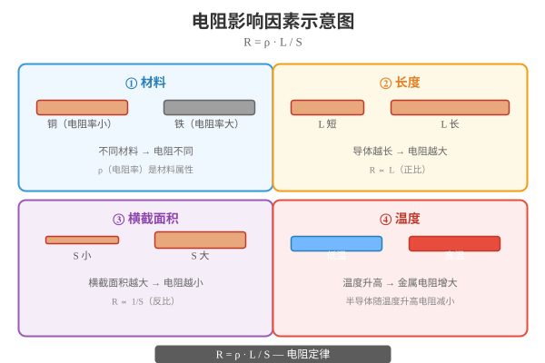
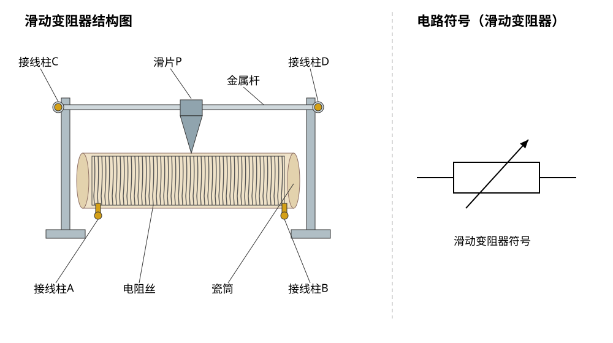

# 1.5 电压与电阻

> **前置知识**：[1.4 电荷与电流](1.4-电荷与电流.md)（承接上一章）。

## 1. 电压的概念

电压是使自由电荷发生定向移动形成电流的原因，用符号 $U$ 表示，国际单位是**伏特**（V）。常用的单位还有千伏（kV）、毫伏（mV）：

$$
1 \, \text{kV} = 10^3 \, \text{V}, \quad 1 \, \text{V} = 10^3 \, \text{mV}
$$

电源是提供电压的装置。常见的电源电压值：

| 电源         | 电压        |
| ------------ | ----------- |
| 一节干电池   | 1.5 V       |
| 一节铅蓄电池 | 2 V         |
| 家庭电路     | 220 V       |
| 人体安全电压 | 不高于 36 V |
| 闪电         | 10^5 V 以上 |

电源借助非静电力做功，将其他形式的能转化为电能，从而在两端维持电压；上图示意了电压的成因与电动势的关系。

### 电压的测量——电压表

电压表是测量电路中两点间电压大小的仪表。

### 电压表的使用规则

1. **并联**：电压表必须并联在被测电路两端。
2. **正进负出**：电流从"+"接线柱流入，从"−"接线柱流出。
3. **不超量程**：被测电压不得超过电压表的量程。
4. **可以直接接电源**：电压表可以直接接在电源两极测电源电压（电压表内阻极大，相当于断路）。

### 电压表的读数

- 常用量程：0~3 V（分度值 0.1 V）和 0~15 V（分度值 0.5 V）。
- 读数时先确定量程，再读取分度值。

## 2. 电阻的概念

电阻表示导体对电流阻碍作用的大小，用符号 $R$ 表示，国际单位是**欧姆**（Ω）。常用的单位还有千欧（kΩ）和兆欧（MΩ）：

$$
1 \, \text{M}\Omega = 10^3 \, \text{k}\Omega = 10^6 \, \Omega
$$

### 电阻的影响因素

导体的电阻是导体本身的一种性质，其大小由以下因素决定：

1. **材料**：不同材料的导电性能不同，电阻率不同。
2. **长度**：在材料和横截面积相同时，导体越长，电阻越大。
3. **横截面积**：在材料和长度相同时，横截面积越大，电阻越小。
4. **温度**：对大多数金属导体，温度升高，电阻增大；对半导体和某些合金，温度升高，电阻减小。

电阻定律公式：

$$
R = \rho \frac{L}{S}
$$

其中 $\rho$ 为电阻率（单位：Ω·m），$L$ 为导体长度（单位：m），$S$ 为横截面积（单位：m²）。

## 3. 滑动变阻器与电阻箱

### 滑动变阻器

滑动变阻器通过改变接入电路中电阻线的**长度**来改变电阻大小。

**滑动变阻器的使用方法：**

1. **一上一下**：将接线柱"一上一下"接入电路。
2. **串联**：滑动变阻器与被控制电路串联。
3. **闭合开关前**：将滑片调到阻值最大端（保护电路）。

**铭牌参数**：例如"20 Ω 2 A"表示最大阻值为 20 Ω，允许通过的最大电流为 2 A。

### 电阻箱

电阻箱是一种可以读出电阻值的变阻器。与滑动变阻器不同，电阻箱能直接读出接入电路的阻值，但一般不能连续改变电阻值。

## 4. 电阻的伏安特性与非线性元件

线性电阻的电压与电流成正比，伏安特性是一条过原点的直线：

$$
U=IR
$$

但实际元件不一定线性：

| 元件 | 伏安特性 | 典型应用 |
|---|---|---|
| 金属膜电阻 | 近似线性 | 偏置、限流、分压 |
| 白炽灯丝 | 随温度升高电阻变大 | 照明、限流 |
| 二极管 | 正向指数、反向截止 | 整流、钳位 |
| 热敏电阻 | 电阻随温度显著变化 | 测温、浪涌抑制 |
| 压敏电阻 | 电压超过阈值后电阻骤降 | 过压保护 |

对非线性元件，**静态电阻**定义为工作点的 $R_{static}=U/I$，**动态电阻**定义为切线斜率 $r_{dynamic}=dU/dI$。二者在同一个工作点上通常不相等，小信号分析用的是动态电阻。

## 5. 电阻的功率与降额

电阻的瞬时功率：

$$
P=UI=I^2R=\frac{U^2}{R}
$$

电阻有额定功率（如 1/16 W、1/4 W、1 W）。实际功率应低于额定值，并随环境温度**降额**使用。例如 1/4 W、$100\,\Omega$ 电阻的最大电流：

$$
I_{max}=\sqrt{\frac{P}{R}}=\sqrt{\frac{0.25}{100}}=50\,\text{mA}
$$

若实际电流为 80 mA，则 $P=0.64\,\text{W}$，远超 0.25 W，会过热甚至烧毁。此时应选更大功率电阻、并联分流或降低电流。

电阻值还随温度变化：

$$
R(T)=R_0\left[1+\alpha(T-T_0)\right]
$$

$\alpha$ 为电阻温度系数。精密电路要选低温度系数电阻，或做温度补偿。

## 6. 电压表内阻与测量误差

理想电压表内阻无穷大，并联到电路上不改变原电路。实际电压表内阻有限，会**分流**并降低被测电压。

例：$10\,\text{V}$ 电源经两个 $10\,\text{k}\Omega$ 电阻分压，理论中点电压为 $5\,\text{V}$。若电压表内阻也是 $10\,\text{k}\Omega$，并联后下臂变为 $5\,\text{k}\Omega$，中点电压：

$$
V=\frac{10\times5}{10+5}=3.33\,\text{V}
$$

误差约 33%。结论：**电压表内阻应远大于被测两点间的等效电阻**；测量高阻节点时要选高输入阻抗电压表或示波器探头。

## 小结

| 概念         | 公式/说明                  |
| ------------ | -------------------------- |
| 电压         | 形成电流的原因，单位 V     |
| 电压表       | 并联使用，正进负出         |
| 电阻         | $R = \rho \, L/S$        |
| 电阻影响因素 | 材料、长度、横截面积、温度 |
| 滑动变阻器   | 改变接入长度来改变电阻     |

## 自测清单

1. 「电压的概念」要解决的核心问题是什么？关键结论或公式是什么？
2. 「电阻的概念」与上一节之间是什么关系？
3. 「滑动变阻器与电阻箱」在什么场景下会用到？如果条件改变，结论会如何变化？
4. 能否不看正文，写出「电压的测量——电压表」的关键流程或结构？
5. 「电压表的使用规则」最容易混淆的点是什么？
6. 线性电阻与非线性电阻的伏安特性有什么区别？静态电阻与动态电阻如何定义？
7. 电阻降额为什么同时考虑功率与环境温度？
8. 电压表内阻如何影响分压电路的测量结果？

---

**下一章**：[1.6 欧姆定律](1.6-欧姆定律.md)
