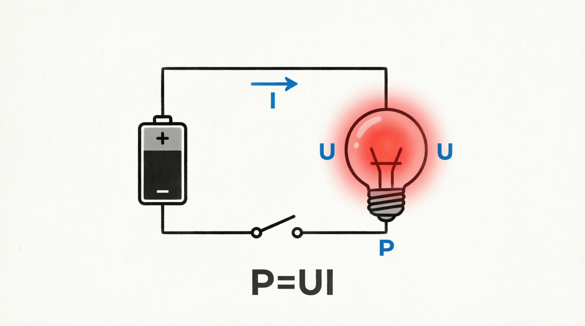
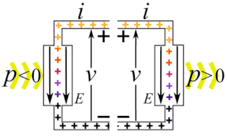
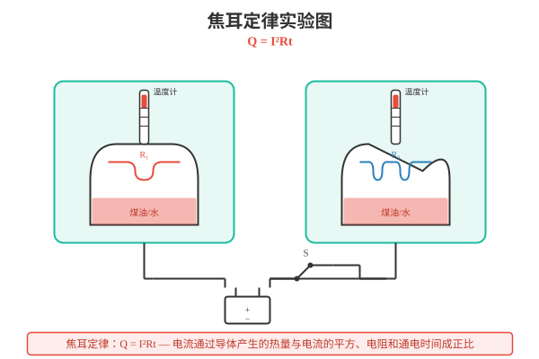
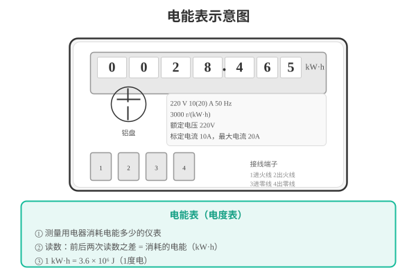

# 1.9 电功与电功率

> **前置知识**：[1.8 串联与并联电路](1.8-串联与并联电路.md)（承接上一章）。

## 1. 电功

### 电功的概念

电流通过用电器时，将电能转化为其他形式的能（如热能、光能、机械能等），电流所做的功称为**电功**，用符号 $W$ 表示。

### 电功公式

电流在某段电路上所做的功，等于这段电路两端的电压、电路中的电流和通电时间的乘积：

$$
W = UIt
$$

其中：

- $W$ 表示电功，单位：焦耳（J）
- $U$ 表示电压，单位：伏特（V）
- $I$ 表示电流，单位：安培（A）
- $t$ 表示时间，单位：秒（s）

### 电功的其他表达式

结合欧姆定律 $I = U/R$，电功公式还可表示为：

$$
W = I^2 R t \quad \text{（适用于纯电阻电路）}
$$

$$
W = \frac{U^2}{R} t \quad \text{（适用于纯电阻电路）}
$$

### 电功的单位

- 国际单位：**焦耳**（J）
- 常用单位：**千瓦时**（kW·h），也称"度"

$$
1 \, \text{kW}{\cdot}\text{h} = 3.6 \times 10^6 \, \text{J}
$$

## 2. 电功率

### 电功率的概念

电功率表示电流做功的快慢，用符号 $P$ 表示。电功率等于电功与时间之比：

$$
P = \frac{W}{t}
$$

### 电功率公式

由 $W = UIt$ 和 $P = W/t$ 可得：

$$
P = UI
$$

电功率等于电压与电流的乘积。

结合欧姆定律，还可得到：

$$
P = I^2 R \quad \text{（适用于纯电阻电路）}
$$

$$
P = \frac{U^2}{R} \quad \text{（适用于纯电阻电路）}
$$

### 电功率的单位

- 国际单位：**瓦特**（W）
- 常用单位：千瓦（kW）

$$
1 \, \text{kW} = 10^3 \, \text{W}
$$

## 3. 焦耳定律

### 电流的热效应

电流通过导体时，导体要发热，这种现象称为**电流的热效应**。

### 焦耳定律内容

英国物理学家焦耳通过大量实验得出：电流通过导体产生的热量，跟电流的二次方成正比，跟导体的电阻成正比，跟通电时间成正比。

**焦耳定律公式：**

$$
Q = I^2 R t
$$

其中 $Q$ 表示热量（单位：J），$I$ 表示电流（A），$R$ 表示电阻（Ω），$t$ 表示时间（s）。

### 纯电阻电路与非纯电阻电路

- **纯电阻电路**：电能全部转化为内能，$W = Q$，即 $UIt = I^2Rt$。
- **非纯电阻电路**：电能只有部分转化为内能（还有机械能、光能等），$W > Q$，如电动机、电风扇等。

## 4. 额定功率与实际功率

### 额定电压与额定功率

- **额定电压**：用电器正常工作时的电压，用 $U_{\text{额}}$ 表示。
- **额定功率**：用电器在额定电压下工作时的功率，用 $P_{\text{额}}$ 表示。

### 实际功率

用电器在实际电压下工作时的功率称为**实际功率**，用 $P_{\text{实}}$ 表示。

当 $U_{\text{实}} = U_{\text{额}}$ 时，$P_{\text{实}} = P_{\text{额}}$，用电器正常工作。
当 $U_{\text{实}} < U_{\text{额}}$ 时，$P_{\text{实}} < P_{\text{额}}$，用电器不能正常工作。
当 $U_{\text{实}} > U_{\text{额}}$ 时，$P_{\text{实}} > P_{\text{额}}$，用电器可能被烧坏。

实际功率与电压的关系：

$$
\frac{P_{\text{实}}}{P_{\text{额}}} = \left(\frac{U_{\text{实}}}{U_{\text{额}}}\right)^2
$$

## 5. 电能表的使用

电能表（电度表）是测量用电器消耗电能多少的仪表。

### 电能表的参数

| 参数           | 含义                                |
| -------------- | ----------------------------------- |
| 220 V          | 额定电压                            |
| 10(20) A       | 标定电流 10 A，最大电流 20 A        |
| 3000 r/(kW·h) | 每消耗 1 kW·h 电能，转盘转 3000 圈 |
| 50 Hz          | 交流电频率                          |

### 电能表读数

电能表的计数器上先后两次读数之差，即为这段时间内消耗的电能：

$$
W = W_{\text{后}} - W_{\text{前}}
$$

### 电费计算

$$
\text{电费} = \text{消耗的电能（kW}{\cdot}\text{h）} \times \text{电价（元/kW}{\cdot}\text{h）}
$$

## 小结

| 物理量        | 公式               | 单位        |
| ------------- | ------------------ | ----------- |
| 电功$W$     | $W = UIt$        | J（焦耳）   |
| 电功率$P$   | $P = UI = W/t$   | W（瓦特）   |
| 焦耳定律$Q$ | $Q = I^2Rt$      | J（焦耳）   |
| 电能表        | 测量消耗电能的多少 | kW·h（度） |

## 自测清单

1. 「电功」要解决的核心问题是什么？关键结论或公式是什么？
2. 「电功率」与上一节之间是什么关系？
3. 「焦耳定律」在什么场景下会用到？如果条件改变，结论会如何变化？
4. 能否不看正文，写出「额定功率与实际功率」的关键流程或结构？
5. 「电能表的使用」最容易混淆的点是什么？

---

**下一章**：[1.10 家庭电路](1.10-家庭电路.md)
