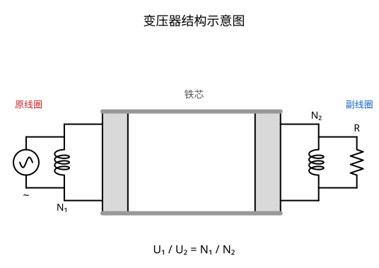
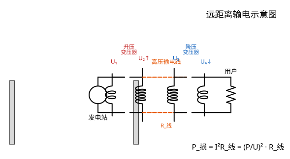

# 1.17 变压器与电能传输

> **前置知识**：必需 [1.15 电感（自感与互感）](1.15-电感-自感与互感.md)、[1.16 交流电](1.16-交流电.md)。

## 1. 变压器的原理

### 1. 变压器的结构

变压器由铁芯和绕在铁芯上的两个（或多个）线圈组成：
- **原线圈（初级线圈）**：与交流电源相连
- **副线圈（次级线圈）**：与负载相连
- **铁芯**：由硅钢片叠压而成，提供闭合磁路，减少涡流损耗

### 2. 互感原理

变压器的工作原理是**互感现象**。当原线圈两端加上交流电压 $u_1$ 时，原线圈中产生交变电流 $i_1$，在铁芯中产生交变磁通 $\Phi$，该磁通同时穿过原线圈和副线圈。

根据法拉第电磁感应定律：

- 原线圈中的感应电动势：

  $$
  e_1 = -N_1 \frac{d\Phi}{dt}
  $$

- 副线圈中的感应电动势：

  $$
  e_2 = -N_2 \frac{d\Phi}{dt}
  $$

其中 $N_1$ 和 $N_2$ 分别为原、副线圈的匝数。

---

## 2. 变压比与变流比

### 1. 变压比（电压比）

对于理想变压器（忽略漏磁、铜损、铁损），原、副线圈的电压之比等于匝数之比：

$$
\frac{U_1}{U_2} = \frac{N_1}{N_2} = k
$$

其中 $k = \dfrac{N_1}{N_2}$ 称为变压比（变比）。

- **降压变压器**：$N_1 > N_2$，$U_1 > U_2$
- **升压变压器**：$N_1 < N_2$，$U_1 < U_2$

### 2. 变流比（电流比）

对于理想变压器，输入功率等于输出功率：

$$
U_1 I_1 = U_2 I_2
$$

结合变压比可得：

$$
\frac{I_1}{I_2} = \frac{U_2}{U_1} = \frac{N_2}{N_1} = \frac{1}{k}
$$

即电流与匝数成反比：匝数多的线圈电流小，匝数少的线圈电流大。

### 3. 理想变压器的特点

- **无能量损耗**：输入功率 $=$ 输出功率
- **无漏磁**：铁芯中磁通完全穿过两个线圈
- **线圈电阻为零**：无铜损
- **铁芯无涡流损耗**：无铁损

---

## 3. 理想变压器的分析

### 1. 基本关系式总结

| 物理量 | 关系式 | 说明 |
|--------|-------|------|
| 电压 | $\dfrac{U_1}{U_2} = \dfrac{N_1}{N_2}$ | 与匝数成正比 |
| 电流 | $\dfrac{I_1}{I_2} = \dfrac{N_2}{N_1}$ | 与匝数成反比 |
| 功率 | $P_1 = P_2$ | 输入等于输出 |
| 阻抗变换 | $Z_1 = \left(\dfrac{N_1}{N_2}\right)^2 Z_2$ | 阻抗变换特性 |

### 2. 阻抗变换

变压器可以将副线圈的负载阻抗 $Z_2$ 变换为原线圈端的等效阻抗 $Z_1$：

$$
Z_1 = \frac{U_1}{I_1} = \frac{(N_1/N_2)U_2}{(N_2/N_1)I_2} = \left(\frac{N_1}{N_2}\right)^2 \frac{U_2}{I_2} = \left(\frac{N_1}{N_2}\right)^2 Z_2
$$

阻抗变换特性在电子电路中有着广泛应用，例如在音频功率放大器中实现阻抗匹配，使负载获得最大功率。

### 3. 多副线圈变压器

当变压器有多个副线圈时：

- 电压关系：$\dfrac{U_1}{N_1} = \dfrac{U_2}{N_2} = \dfrac{U_3}{N_3} = \cdots$
- 电流关系：$N_1 I_1 = N_2 I_2 + N_3 I_3 + \cdots$（磁动势平衡）
- 功率关系：$U_1 I_1 = U_2 I_2 + U_3 I_3 + \cdots$

---

## 4. 远距离输电

### 1. 输电的基本环节

远距离输电系统主要包括以下环节：

1. **发电站**：产生电能，输出电压一般为 $10\ \text{kV}\sim 20\ \text{kV}$
2. **升压变压器**：将电压升高到高压（$110\ \text{kV}\sim 500\ \text{kV}$ 甚至更高）
3. **高压输电线路**：将电能输送到远方
4. **降压变压器**：将电压逐步降低到用户需要的电压等级（$220\ \text{V}$ 或 $380\ \text{V}$）
5. **用户**：消耗电能

### 2. 高压输电的原理

输电线上损失的功率为：

$$
P_{\text{损}} = I^2 R_{\text{线}}
$$

其中 $I$ 为输电线中的电流，$R_{\text{线}}$ 为输电线的总电阻。

由于 $P = UI$，在输送功率 $P$ 一定的情况下，提高输电电压 $U$ 可以减小输电电流 $I$：

$$
I = \frac{P}{U} \quad \Rightarrow \quad P_{\text{损}} = \left(\frac{P}{U}\right)^2 R_{\text{线}}
$$

即输电损耗与电压的平方成反比。因此，远距离输电采用**高压输电**可以显著减小线路损耗。

---

## 5. 高压输电的原理与计算

### 1. 输电效率

输电效率 $\eta$ 定义为用户得到的功率 $P_{\text{用}}$ 与发电站输出功率 $P_{\text{发}}$ 之比：

$$
\eta = \frac{P_{\text{用}}}{P_{\text{发}}} = \frac{P_{\text{发}} - P_{\text{损}}}{P_{\text{发}}} = 1 - \frac{P_{\text{损}}}{P_{\text{发}}}
$$

### 2. 典型计算

设发电站输出功率为 $P$，输出电压为 $U_1$，升压变压器变比为 $k_1 = N_2/N_1$，输电线路总电阻为 $R_{\text{线}}$，降压变压器变比为 $k_2 = N_4/N_3$。

**升压后电压**：

$$
U_2 = k_1 U_1
$$

**输电线电流**：

$$
I_{\text{线}} = \frac{P}{U_2}
$$

**线路损耗功率**：

$$
P_{\text{损}} = I_{\text{线}}^2 R_{\text{线}} = \left(\frac{P}{U_2}\right)^2 R_{\text{线}}
$$

**线路压降**：

$$
\Delta U = I_{\text{线}} R_{\text{线}}
$$

**降压变压器输入电压**：

$$
U_3 = U_2 - \Delta U
$$

**用户得到的电压**：

$$
U_4 = \frac{U_3}{k_2}
$$

**用户得到的功率**：

$$
P_{\text{用}} = P - P_{\text{损}}
$$

### 3. 例题

> 某发电站输出功率为 $100\ \text{MW}$，输出电压为 $10\ \text{kV}$，输电线总电阻为 $10\ \Omega$。
>
> (1) 若直接输电，求线路损耗功率和输电效率。
>
> 解：$I = \dfrac{P}{U} = \dfrac{100 \times 10^6}{10 \times 10^3} = 10^4\ \text{A}$
>
> $P_{\text{损}} = I^2 R = (10^4)^2 \times 10 = 10^9\ \text{W} = 1000\ \text{MW}$
>
> 可见损耗功率远大于输出功率，根本无法输电。
>
> (2) 若采用 $10:1$ 升压变压器将电压升至 $100\ \text{kV}$，再输电，求线路损耗功率和输电效率。
>
> 解：$I' = \dfrac{P}{U'} = \dfrac{100 \times 10^6}{100 \times 10^3} = 10^3\ \text{A}$
>
> $P_{\text{损}}' = I'^2 R = (10^3)^2 \times 10 = 10^7\ \text{W} = 10\ \text{MW}$
>
> $\eta = \dfrac{100 - 10}{100} = 90\%$

### 4. 高压输电的电压等级

| 电压等级 | 典型输送距离 | 典型输送功率 |
|---------|-------------|-------------|
| $110\ \text{kV}$ | $50\ \text{km}\sim 150\ \text{km}$ | $10\ \text{MW}\sim 50\ \text{MW}$ |
| $220\ \text{kV}$ | $100\ \text{km}\sim 300\ \text{km}$ | $100\ \text{MW}\sim 200\ \text{MW}$ |
| $500\ \text{kV}$ | $200\ \text{km}\sim 600\ \text{km}$ | $500\ \text{MW}\sim 1000\ \text{MW}$ |
| $\pm 800\ \text{kV}$（直流） | $> 1000\ \text{km}$ | $> 5000\ \text{MW}$ |

---

## 小结

| 概念 | 公式 | 说明 |
|------|------|------|
| 变压比 | $\dfrac{U_1}{U_2} = \dfrac{N_1}{N_2}$ | 电压与匝数成正比 |
| 变流比 | $\dfrac{I_1}{I_2} = \dfrac{N_2}{N_1}$ | 电流与匝数成反比 |
| 功率关系 | $P_1 = P_2$ | 理想变压器无损耗 |
| 阻抗变换 | $Z_1 = \left(\dfrac{N_1}{N_2}\right)^2 Z_2$ | 实现阻抗匹配 |
| 线路损耗 | $P_{\text{损}} = I^2 R_{\text{线}}$ | 与电流平方成正比 |
| 高压输电 | $P_{\text{损}} = \left(\dfrac{P}{U}\right)^2 R_{\text{线}}$ | 电压越高损耗越小 |

## 自测清单

1. 「变压器的原理」要解决的核心问题是什么？关键结论或公式是什么？
2. 「变压比与变流比」与上一节之间是什么关系？
3. 「理想变压器的分析」在什么场景下会用到？如果条件改变，结论会如何变化？
4. 能否不看正文，写出「远距离输电」的关键流程或结构？
5. 「高压输电的原理与计算」最容易混淆的点是什么？

---

**下一章**：[1.19 电动机与发电机](1.19-电动机与发电机.md)
