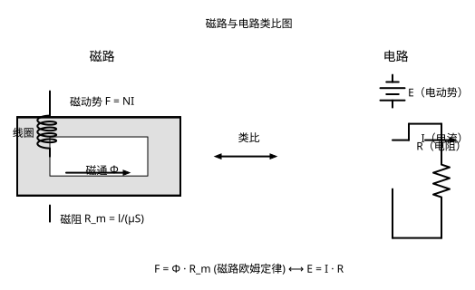

# 1.20 磁场与磁路

> **前置知识**：[1.19 电动机与发电机](1.19-电动机与发电机.md)（承接上一章）。

## 1. 磁场的基本物理量

### 1. 磁感应强度 $B$

磁感应强度是描述磁场强弱和方向的物理量，是矢量。定义式为：

$$
B = \frac{F}{IL\sin\theta}
$$

其中 $F$ 为通电导线在磁场中受到的安培力，$IL$ 为电流元。

单位：特斯拉（T），$1\ \text{T} = 1\ \text{N}/(\text{A}\cdot\text{m})$。

常见磁感应强度数量级：
- 地磁场：约 $5 \times 10^{-5}\ \text{T}$
- 永磁体表面：约 $0.1 \sim 1\ \text{T}$
- 医用 MRI：约 $1.5 \sim 3\ \text{T}$
- 实验室强磁场：可达 $45\ \text{T}$ 以上

### 2. 磁通量 $\Phi$

穿过某一面积的磁感应强度通量：

$$
\Phi = \iint_S \mathbf{B} \cdot d\mathbf{S}
$$

在匀强磁场中，当平面与磁场方向夹角为 $\theta$ 时：

$$
\Phi = BS\cos\theta
$$

单位：韦伯（Wb），$1\ \text{Wb} = 1\ \text{T} \cdot \text{m}^2$。

### 3. 磁导率 $\mu$

磁导率是描述介质导磁性能的物理量。真空磁导率：

$$
\mu_0 = 4\pi \times 10^{-7}\ \text{H/m}
$$

任意介质的磁导率：

$$
\mu = \mu_r \mu_0
$$

其中 $\mu_r$ 为相对磁导率。

| 材料类型 | $\mu_r$ | 典型材料 |
|---------|---------|---------|
| 抗磁性材料 | $\mu_r \lesssim 1$（略小于 1） | 铜、银、水、生物组织 |
| 顺磁性材料 | $\mu_r \gtrsim 1$（略大于 1） | 铝、铂、空气、氧气 |
| 铁磁性材料 | $\mu_r \gg 1$（可达 $10^5$） | 铁、钴、镍及其合金 |

---

## 2. 磁场强度 $H$

### 1. 定义

磁场强度 $H$ 是为方便磁场计算引入的辅助量，它与磁感应强度 $B$ 的关系为：

$$
B = \mu H = \mu_r \mu_0 H
$$

即：

$$
H = \frac{B}{\mu} = \frac{B}{\mu_r \mu_0}
$$

单位：安培每米（A/m）。

### 2. $B$ 与 $H$ 的区别

| 物理量 | 符号 | 单位 | 意义 |
|--------|------|------|------|
| 磁感应强度 | $B$ | T | 描述磁场的实际强弱（包括介质磁化贡献） |
| 磁场强度 | $H$ | A/m | 描述外加磁化场（与介质磁化响应分开） |

### 3. 安培环路定律

在磁介质中，安培环路定律表达为：

$$
\oint_L \mathbf{H} \cdot d\mathbf{l} = \sum I
$$

即磁场强度 $H$ 沿任意闭合环路的线积分等于环路所包围的传导电流的代数和。

这一形式与介质无关，因此 $H$ 在工程计算中非常方便。

---

## 3. 磁路的基本概念

### 1. 什么是磁路

磁路是指磁通量通过的闭合路径。在电机、变压器、电磁铁等设备中，通过高磁导率材料（铁芯）引导磁通，使磁通集中在预定的路径中，形成磁路。

### 2. 磁动势（MMF）

磁动势（Magnetomotive Force）是磁路中产生磁通的"驱动力"，类似于电路中的电动势：

$$
\mathcal{F} = NI
$$

其中：
- $\mathcal{F}$ — 磁动势（A·匝，即安匝）
- $N$ — 线圈匝数
- $I$ — 线圈电流（A）

### 3. 磁阻

磁阻（Reluctance）是磁路对磁通的阻碍作用，类似于电路中的电阻：

$$
\mathcal{R} = \frac{l}{\mu S}
$$

其中：
- $\mathcal{R}$ — 磁阻（A/Wb 或 H⁻¹）
- $l$ — 磁路长度（m）
- $\mu$ — 介质磁导率（H/m）
- $S$ — 磁路截面积（m²）

### 4. 磁路欧姆定律

磁路中的磁通、磁动势和磁阻之间满足类似电路欧姆定律的关系：

$$
\mathcal{F} = \Phi \mathcal{R} \quad \text{即} \quad \Phi = \frac{\mathcal{F}}{\mathcal{R}}
$$

展开为：

$$
\Phi = \frac{NI}{\dfrac{l}{\mu S}} = \frac{\mu SNI}{l}
$$

---

## 4. 磁路与电路的类比

### 1. 类比关系

| 磁路 | 符号 | 单位 | 电路 | 符号 | 单位 |
|------|------|------|------|------|------|
| 磁动势 | $\mathcal{F}$ | A·匝 | 电动势 | $\mathcal{E}$ | V |
| 磁通 | $\Phi$ | Wb | 电流 | $I$ | A |
| 磁阻 | $\mathcal{R}$ | H⁻¹ | 电阻 | $R$ | $\Omega$ |
| 磁导率 | $\mu$ | H/m | 电导率 | $\sigma$ | S/m |
| 磁路欧姆定律 | $\mathcal{F} = \Phi\mathcal{R}$ | — | 欧姆定律 | $U = IR$ | — |

### 2. 磁路的基尔霍夫定律

**磁路 KCL（磁通连续性原理）**：在磁路节点处，磁通的代数和为零。

$$
\sum \Phi = 0
$$

**磁路 KVL（安培环路定律）**：沿磁路任一闭合回路，磁动势的代数和等于磁压降的代数和。

$$
\sum \mathcal{F} = \sum \Phi_i \mathcal{R}_i
$$

### 3. 磁路与电路的重要区别

| 区别 | 磁路 | 电路 |
|------|------|------|
| 是否存在绝缘体 | 无磁绝缘体（无 $\mu=0$ 的材料） | 有电绝缘体（$R\to\infty$） |
| 漏磁通 | 漏磁通不可避免，且较显著 | 漏电流通常很小 |
| 线性度 | 铁磁材料 $\mu$ 非线性，有饱和现象 | 一般电阻线性良好 |
| 能量损耗 | 交变磁化时有磁滞损耗和涡流损耗 | 仅有电阻发热 |

---

## 5. 永磁体材料

### 1. 永磁体的基本特性

永磁体是能够长期保持磁性的材料，其核心性能指标包括：

- **剩磁 $B_r$**：外磁场撤去后，磁体中保留的磁感应强度
- **矫顽力 $H_c$**：使磁感应强度降为零所需的反向磁场强度
- **最大磁能积 $(BH)_{\max}$**：磁体在外部空间能提供的最大磁能密度

### 2. 常见永磁材料

**（1）铁氧体永磁**

- 成分：BaFe₁₂O₁₉ 或 SrFe₁₂O₁₉
- 特点：价格低廉、耐腐蚀、电阻率高（涡流损耗小）
- 缺点：$B_r$ 较低，$(BH)_{\max}$ 较小
- 典型值：$B_r \approx 0.4\ \text{T}$，$H_c \approx 200\ \text{kA/m}$
- 应用：扬声器、玩具电机、冰箱门封条

**（2）铝镍钴（AlNiCo）**

- 成分：Al、Ni、Co、Fe 合金
- 特点：温度稳定性好，$B_r$ 较高
- 缺点：$H_c$ 较低，易退磁
- 典型值：$B_r \approx 0.8 \sim 1.0\ \text{T}$，$H_c \approx 50 \sim 150\ \text{kA/m}$
- 应用：精密仪器、传感器、高温环境

**（3）钐钴（SmCo）**

- 成分：SmCo₅ 或 Sm₂Co₁₇
- 特点：高 $(BH)_{\max}$，优异温度稳定性，耐腐蚀
- 缺点：价格昂贵，脆性大
- 典型值：$B_r \approx 0.9 \sim 1.1\ \text{T}$，$H_c \approx 600 \sim 800\ \text{kA/m}$
- 应用：航空航天、军工、高端医疗设备

**（4）钕铁硼（NdFeB）**

- 成分：Nd₂Fe₁₄B
- 特点：目前商业化磁性最强的永磁材料，$(BH)_{\max}$ 最高
- 缺点：温度系数较大，易腐蚀（需表面涂层保护）
- 典型值：$B_r \approx 1.2 \sim 1.4\ \text{T}$，$H_c \approx 800 \sim 1000\ \text{kA/m}$
- 应用：电动车驱动电机、风力发电机、硬盘驱动器、MRI

### 3. 永磁材料选择要点

| 指标 | 铁氧体 | AlNiCo | SmCo | NdFeB |
|------|--------|--------|------|-------|
| $(BH)_{\max}$ (kJ/m³) | 10 ~ 40 | 40 ~ 70 | 150 ~ 240 | 200 ~ 400 |
| 温度稳定性 | 一般 | 好 | 优 | 差 |
| 耐腐蚀性 | 好 | 好 | 好 | 需涂层 |
| 成本 | 低 | 中 | 高 | 中 |
| 典型最高工作温度 | 250 °C | 500 °C | 300 °C | 80 ~ 200 °C |

---

## 6. 磁滞回线与磁滞损耗

### 1. 磁化曲线

铁磁材料在外加磁场 $H$ 逐渐增大时，磁感应强度 $B$ 随 $H$ 的变化关系称为磁化曲线。磁化曲线一般分为三个阶段：

- **起始区**：可逆磁化，$B$ 随 $H$ 缓慢增大
- **陡峭区**：不可逆磁化，$B$ 随 $H$ 急剧增大（磁畴壁快速移动）
- **饱和区**：$B$ 趋于饱和值 $B_s$，$H$ 增大时 $B$ 几乎不再增大

### 2. 磁滞回线

当外加磁场 $H$ 从零开始增大 → 减小到零 → 反向增大 → 再减小到零 → 再次正向增大，形成一个完整循环时，$B-H$ 曲线形成一个闭合回线，称为**磁滞回线**（Hysteresis Loop）。

**磁滞回线上的关键参数**：

- **饱和磁感应强度 $B_s$**：$H$ 足够大时，$B$ 趋于的极限值
- **剩磁 $B_r$**：当 $H = 0$ 时，材料中保留的 $B$ 值
- **矫顽力 $H_c$**：使 $B$ 降为零所需的反向磁场强度
- **磁滞回线面积**：正比于单位体积材料在一个磁化循环中的能量损耗

### 3. 磁滞损耗

铁磁材料在交变磁化过程中，由于磁畴不断翻转，需要克服内部摩擦而消耗能量，这部分能量损耗称为**磁滞损耗**。

**磁滞损耗功率**（Steinmetz 经验公式）：

$$
P_h = k_h f B_m^n V
$$

其中：
- $P_h$ — 磁滞损耗功率（W）
- $k_h$ — 磁滞损耗系数（由材料决定）
- $f$ — 磁化频率（Hz）
- $B_m$ — 最大磁感应强度（T）
- $n$ — Steinmetz 指数，通常 $n \approx 1.6 \sim 2.0$
- $V$ — 铁芯体积（m³）

### 4. 软磁材料与硬磁材料

根据磁滞回线的形状，铁磁材料分为两类：

| 特性 | 软磁材料 | 硬磁材料（永磁材料） |
|------|---------|-------------------|
| 磁滞回线形状 | 窄长 | 宽胖 |
| 矫顽力 $H_c$ | 小（< 100 A/m） | 大（> 10 kA/m） |
| 剩磁 $B_r$ | 小 | 大 |
| 磁滞损耗 | 小 | 大 |
| 典型材料 | 纯铁、硅钢片、铁氧体、坡莫合金 | NdFeB、SmCo、铁氧体永磁 |
| 应用 | 变压器铁芯、电机铁芯、电磁铁 | 永磁电机、扬声器、传感器 |

### 5. 变压器铁芯的总损耗

变压器铁芯在交变磁化时的总铁损（Core Loss）包括磁滞损耗和涡流损耗：

$$
P_{\text{Fe}} = P_h + P_e = k_h f B_m^n V + k_e f^2 B_m^2 V
$$

其中 $P_e$ 为涡流损耗，$k_e$ 为涡流损耗系数。

---

## 小结

| 概念 | 公式 | 说明 |
|------|------|------|
| 磁感应强度 | $B = \dfrac{F}{IL\sin\theta}$ | 描述磁场力效应 |
| 磁通量 | $\Phi = BS\cos\theta$ | 穿过某面积的磁感线 |
| $B$ 与 $H$ 关系 | $B = \mu H = \mu_r\mu_0 H$ | $H$ 是与介质无关的辅助量 |
| 磁动势 | $\mathcal{F} = NI$ | 磁路中的"驱动力" |
| 磁阻 | $\mathcal{R} = \dfrac{l}{\mu S}$ | 类似电阻 |
| 磁路欧姆定律 | $\Phi = \dfrac{\mathcal{F}}{\mathcal{R}}$ | 磁路基本定律 |
| 磁滞损耗 | $P_h = k_h f B_m^n V$ | 与频率和 $B_m$ 有关 |
| 涡流损耗 | $P_e = k_e f^2 B_m^2 V$ | 与频率平方成正比 |
| 总铁损 | $P_{\text{Fe}} = P_h + P_e$ | 变压器铁芯损耗 |

## 自测清单

1. 「磁场的基本物理量」要解决的核心问题是什么？关键结论或公式是什么？
2. 「磁场强度 $H$」与上一节之间是什么关系？
3. 「磁路的基本概念」在什么场景下会用到？如果条件改变，结论会如何变化？
4. 能否不看正文，写出「磁路与电路的类比」的关键流程或结构？
5. 「永磁体材料」最容易混淆的点是什么？

---

**下一章**：[1.21 电路基本概念与定律](../电路原理/1.21-电路基本概念与定律.md)
