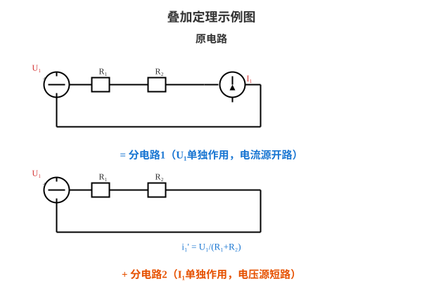
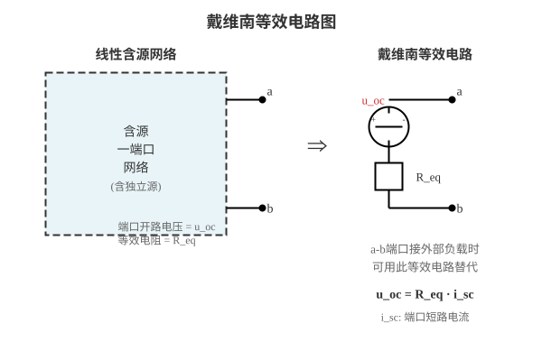
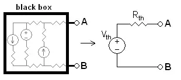
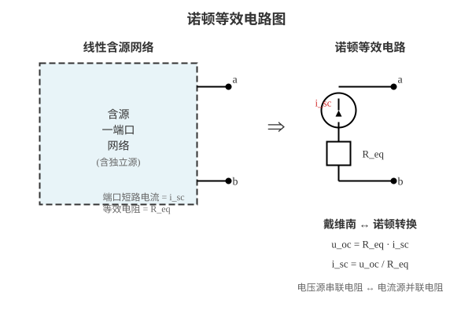
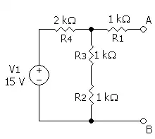
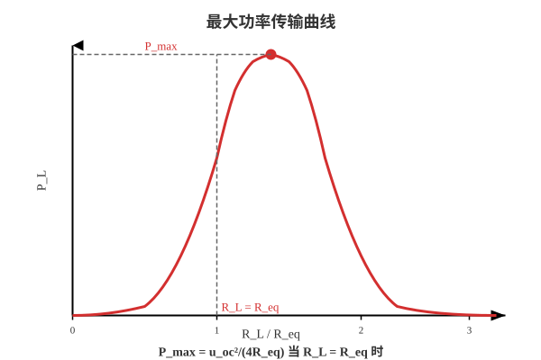

# 1.23 电路定理

> **前置知识**：[1.22 电阻电路的一般分析方法](1.22-电阻电路的一般分析方法.md)（承接上一章）。

## 1. 叠加定理

**叠加定理**：在线性电路中，任一电压或电流都是电路中各个独立电源单独作用时，在该处产生的电压或电流的叠加。

数学表达式：

$$
u = \sum_{k=1}^{n} u_k, \quad i = \sum_{k=1}^{n} i_k
$$

其中 $u_k$ 和 $i_k$ 是第 $k$ 个独立源单独作用时产生的响应。

**使用叠加定理的注意事项**：
- 当某个独立源单独作用时，其他独立源置零（电压源短路，电流源开路）
- 受控源不能单独作用，必须保留在电路中
- 功率不能叠加，因为功率是电压和电流的二次函数

**含受控源的叠加**：

受控源在叠加过程中必须始终保留在原电路中，不能像独立源一样置零。这是因为受控源反映的是电路中的控制关系，不是独立激励。

## 2. 替代定理

**替代定理**：在任意（线性或非线性）电路中，若某支路的电压 $u_k$、电流 $i_k$ 已确定，则可用以下两者之一替换该支路，而不影响电路中其余部分的电压与电流：

- 电压为 $u_k$、与支路电压方向一致的**理想电压源**；
- 电流为 $i_k$、与支路电流方向一致的**理想电流源**。

**使用条件**：被替换支路与外电路之间不存在耦合（如互感或受控源的控制-受控关系）；且原支路电压、电流在替换前后保持不变。至于选用电压源还是电流源，取决于原支路与外网络的连接结构（若支路为串联于网络中的一端口，则宜用电压源；若为并联，则宜用电流源）。

**意义**：替代定理是戴维南定理、诺顿定理和叠加定理证明的基础工具，也常用于把网络中某一支路单独拆出、独立分析后再"代回"，从而简化含单一受扰电阻等问题的求解。

## 3. 戴维南定理与诺顿定理

### 戴维南定理

**戴维南定理**：任何一个线性含源一端口网络，对外电路而言，可以用一个电压源 $u_{oc}$ 与电阻 $R_{eq}$ 串联的支路等效替代。

其中：
- $u_{oc}$：端口开路电压
- $R_{eq}$：端口内所有独立源置零（电压源短路、电流源开路）后的等效电阻

### 诺顿定理

**诺顿定理**：任何一个线性含源一端口网络，对外电路而言，可以用一个电流源 $i_{sc}$ 与电阻 $R_{eq}$ 并联的支路等效替代。

其中：
- $i_{sc}$：端口短路电流
- $R_{eq}$：端口内所有独立源置零后的等效电阻（与戴维南等效电阻相同）

**戴维南等效与诺顿等效的转换关系**：

$$
u_{oc} = R_{eq} \cdot i_{sc}
$$

### 求戴维南等效电阻的三种方法

将端口内所有**独立源置零**（电压源短路、电流源开路），仅保留受控源与电阻，从端口看进去的等效电阻 $R_{eq}$ 可用三种方法求取：

**方法一：除源后串并联化简**。当电路内**不含受控源**时，独立源置零后即为纯电阻串并联网络，直接用电阻串并联等效化简求得 $R_{eq}$。注意：若存在受控源，一般不能简单地直接化简——受控源是受控的有源元件，需用其他方法处理。

**方法二：开路电压 / 短路电流法**。由戴维南等效支路可得：

$$
R_{eq} = \frac{u_{oc}}{i_{sc}}
$$

其中 $u_{oc}$ 为端口开路电压，$i_{sc}$ 为端口短路电流。该方法既保留独立源又可使用，尤其适用于除源后仍含受控源、不便直接化简的电路。

**方法三：外加电源法（适用于含受控源电路）**。将端口内**所有独立源置零**（保留受控源），在端口**外加**一个电压源 $u_t$（或电流源 $i_t$），求流入端口的电流 $i_t$（或端电压 $u_t$），则：

$$
R_{eq} = \frac{u_t}{i_t}
$$

外加电源法把端口视为一个不含独立源的一端口网络，通过假设的驱动源求输入电阻，是含受控源电路求等效电阻的通用方法。

### 戴维南定理例题（含受控源）

**例题**：一端口网络由并联于端口两输出端之间的电阻 $R_1 = 4\,\Omega$、$R_2 = 4\,\Omega$、一个受 $R_1$ 两端电压控制的电流源（VCCS，$i_g = u_{R_1}$）以及一个独立电流源 $1\,\text{A}$（注入端口）组成。求该网络的戴维南等效电路。

**解**：

**① 求开路电压 $u_{oc}$**。端口开路，独立电流源电流全部流入网络。设端口电压为 $u$，则 $u_{R_1} = u$，VCCS 电流 $i_g = u$。对端口节点列 KCL：

$$
1 = \frac{u}{4} + \frac{u}{4} + u
\;\Rightarrow\;
1 = \frac{3}{2}u
\;\Rightarrow\;
u_{oc} = u = \frac{2}{3}\ \text{V}
$$

**② 求短路电流 $i_{sc}$**。端口短接时 $u=0$，故 $u_{R_1}=0$、$i_g=0$，两电阻被短路，短路电流即独立电流源电流：

$$
i_{sc} = 1\ \text{A}
$$

**③ 求等效电阻 $R_{eq}$（外加电源法）**。将独立电流源置零（开路），保留受控源，在端口外加电压源 $u_t$，流入端口的电流：

$$
i_t = \frac{u_t}{4} + \frac{u_t}{4} + u_t = \frac{3}{2}u_t
\;\Rightarrow\;
R_{eq} = \frac{u_t}{i_t} = \frac{2}{3}\ \Omega
$$

**④ 校验（方法二：开路/短路电流法）**：

$$
R_{eq} = \frac{u_{oc}}{i_{sc}} = \frac{2/3}{1} = \frac{2}{3}\ \Omega
$$

与外加法一致。

**答案**：戴维南等效电路为电压源 $\frac{2}{3}\,\text{V}$ 串联电阻 $\frac{2}{3}\,\Omega$。

## 4. 最大功率传输定理

### 直流电路

对于直流电路，当负载电阻 $R_L$ 等于戴维南等效电阻 $R_{eq}$ 时，负载获得最大功率。

最大功率为：

$$
P_{L\max} = \frac{u_{oc}^2}{4R_{eq}}
$$

### 交流电路

对于交流电路，当负载阻抗 $Z_L$ 等于戴维南等效阻抗 $Z_{eq}$ 的共轭复数时，负载获得最大功率，即：

$$
Z_L = Z_{eq}^*
$$

最大功率为：

$$
P_{L\max} = \frac{|U_{oc}|^2}{4R_{eq}}
$$

其中 $R_{eq}$ 是等效阻抗的实部（电阻部分）。

## 5. 互易定理

**互易定理**：在线性无源（不含独立源和受控源）电路中，在端口1施加激励，在端口2产生的响应，等于在端口2施加相同激励，在端口1产生的响应。

**互易定理的三种形式**（均要求网络为线性无源，不含独立源和受控源）：

1. **形式一（电压源—短路电流）**：在端口1接入电压源 $u_s$、端口2短路，测得端口2的短路电流为 $i_2$；若将同一电压源 $u_s$ 改接入端口2、端口1短路，则端口1的短路电流 $i_1 = i_2$。
2. **形式二（电流源—开路电压）**：在端口1接入电流源 $i_s$、端口2开路，测得端口2的开路电压为 $u_2$；若将同一电流源 $i_s$ 改接入端口2、端口1开路，则端口1的开路电压 $u_1 = u_2$。
3. **形式三（电压源与电流源互换）**：先在端口1接入电压源 $u_s$、端口2短路，测得端口2短路电流为 $i_2$；然后断开端口1的电压源并改接电压表，在端口2接入电流源 $i_s = i_2$（电流源数值取上述短路电流 $i_2$ 的值），此时端口1电压表的读数 $u_1$ 恰好等于原电压源的端电压 $u_s$。

## 6. 补偿定理

**补偿定理**：在线性电路中，若某支路的电流为 $i_k$，电阻为 $R_k$，当该支路电阻变化 $\Delta R_k$ 时，该支路电流的变化量 $\Delta i_k$ 等于电路中所有独立源置零后，在变化支路中串联一个电压为 $i_k \cdot \Delta R_k$ 的电压源所产生的响应。

$$
\Delta i_k = -\frac{i_k \cdot \Delta R_k}{R_k + \Delta R_k + R_{eq}}
$$

其中 $R_{eq}$ 是从该支路看进去的等效电阻。

## 7. 对偶原理

**对偶原理**：如果两个电路（或电路中的两组关系）在数学形式上相似，则它们构成对偶关系。对偶原理指出，如果电路中的一个关系式成立，则其对偶关系式也成立。

常见的对偶量：

| 原量 | 对偶量 | 原量 | 对偶量 |
|-----|-------|-----|-------|
| 电压 $u$ | 电流 $i$ | 电阻 $R$ | 电导 $G$ |
| 电感 $L$ | 电容 $C$ | 电压源 | 电流源 |
| 串联 | 并联 | 开路 | 短路 |
| KVL | KCL | 网孔 | 节点 |

## 小结

- 叠加定理将多激励问题分解为单激励问题的叠加
- 戴维南和诺顿定理将复杂含源网络简化为简单等效电路
- 最大功率传输定理给出了负载获得最大功率的条件
- 互易定理反映了线性无源网络的对称性
- 补偿定理用于分析电阻变化对电路的影响
- 对偶原理揭示了电路理论中的对称性结构

## 自测清单

1. 「叠加定理」要解决的核心问题是什么？关键结论或公式是什么？
2. 「替代定理」与上一节之间是什么关系？
3. 「戴维南定理与诺顿定理」在什么场景下会用到？如果条件改变，结论会如何变化？
4. 能否不看正文，写出「最大功率传输定理」的关键流程或结构？
5. 「互易定理」最容易混淆的点是什么？

---

**下一章**：[1.24 一阶电路暂态分析](1.24-一阶电路暂态分析.md)
