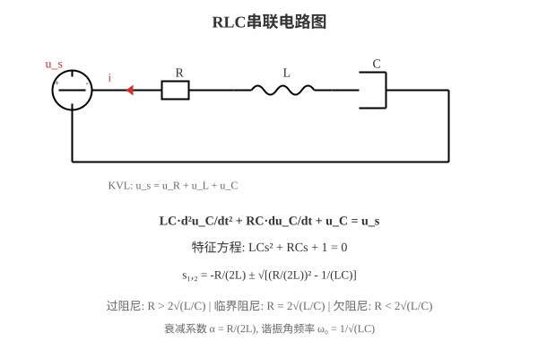
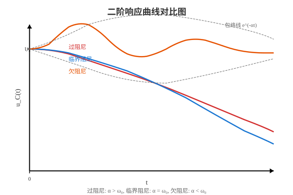
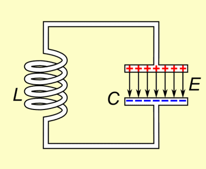
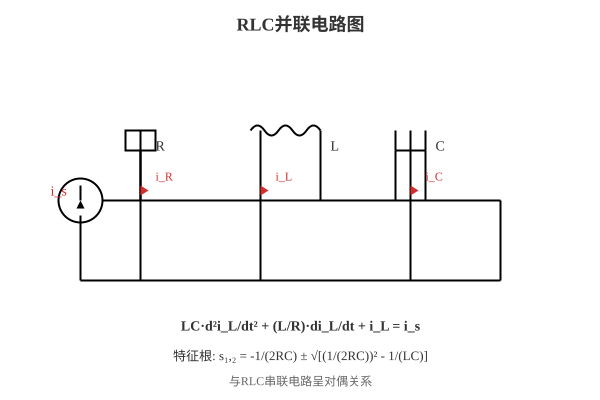

# 1.25 二阶电路暂态分析

> **前置知识**：[1.24 一阶电路暂态分析](1.24-一阶电路暂态分析.md)（承接上一章）。

## 1. RLC串联电路的零输入响应

RLC串联电路是最典型的二阶电路。设电路由电阻 $R$、电感 $L$、电容 $C$ 串联组成，初始条件为 $u_C(0^+) = U_0$，$i_L(0^+) = 0$。

根据KVL，得到二阶微分方程：

$$
LC\frac{d^2u_C}{dt^2} + RC\frac{du_C}{dt} + u_C = 0
$$

特征方程：

$$
LCs^2 + RCs + 1 = 0
$$

特征根：

$$
s_{1,2} = -\frac{R}{2L} \pm \sqrt{\left(\frac{R}{2L}\right)^2 - \frac{1}{LC}}
$$

定义：
- **衰减系数**：$\alpha = \frac{R}{2L}$
- **谐振角频率**：$\omega_0 = \frac{1}{\sqrt{LC}}$
- **阻尼振荡角频率**：$\omega_d = \sqrt{\omega_0^2 - \alpha^2}$

则特征根可写为：

$$
s_{1,2} = -\alpha \pm \sqrt{\alpha^2 - \omega_0^2}
$$

### 过阻尼情况（$\alpha > \omega_0$，即 $R > 2\sqrt{L/C}$）

特征根为两个不相等的负实根，响应为：

$$
u_C(t) = A_1 e^{s_1 t} + A_2 e^{s_2 t}
$$

其中 $A_1$ 和 $A_2$ 由初始条件确定。响应非振荡地衰减到零。

### 临界阻尼情况（$\alpha = \omega_0$，即 $R = 2\sqrt{L/C}$）

特征根为两个相等的负实根 $s_1 = s_2 = -\alpha$，响应为：

$$
u_C(t) = (A_1 + A_2 t)e^{-\alpha t}
$$

响应从临界状态过渡到非振荡衰减。

### 欠阻尼情况（$\alpha < \omega_0$，即 $R < 2\sqrt{L/C}$）

特征根为一对共轭复根 $s_{1,2} = -\alpha \pm j\omega_d$，响应为：

$$
u_C(t) = e^{-\alpha t}(A_1 \cos\omega_d t + A_2 \sin\omega_d t)
$$

或写成：

$$
u_C(t) = U_m e^{-\alpha t} \cos(\omega_d t + \theta)
$$

响应呈衰减振荡形式，振荡频率为 $\omega_d$，包络线按指数 $e^{-\alpha t}$ 衰减。

### RLC串联电路例题（带数字）

**例题**：RLC 串联电路，$R = 2\,\Omega$、$L = 1\,\text{H}$、$C = 0.5\,\text{F}$，初始条件 $u_C(0^+) = 10\,\text{V}$、$i_L(0^+) = 0$。求 $t \geq 0$ 的 $u_C(t)$，并判断振荡类型。

**解**：

**① 求衰减系数与谐振角频率**。

$$
\alpha = \frac{R}{2L} = \frac{2}{2\times1} = 1\ \text{s}^{-1}, \qquad
\omega_0 = \frac{1}{\sqrt{LC}} = \frac{1}{\sqrt{1\times0.5}} = \sqrt{2}\ \text{rad/s}
$$

因 $\alpha < \omega_0$，属**欠阻尼**，阻尼振荡角频率：

$$
\omega_d = \sqrt{\omega_0^2 - \alpha^2} = \sqrt{2-1} = 1\ \text{rad/s}
$$

**② 写出响应形式（零输入、欠阻尼）**：

$$
u_C(t) = e^{-\alpha t}(A_1\cos\omega_d t + A_2\sin\omega_d t) = e^{-t}(A_1\cos t + A_2\sin t)
$$

**③ 由初始条件定系数**。$u_C(0^+) = 10 \Rightarrow A_2\sin0=0$ 恒成立，故 $A_1 = 10$。又 $i_L(0^+)=0$，故 $\dfrac{du_C}{dt}\big|_{0^+} = \dfrac{i_L(0^+)}{C} = 0$：

$$
\frac{du_C}{dt}\bigg|_{0^+} = -\alpha A_1 + \omega_d A_2 = -10 + A_2 = 0
\;\Rightarrow\;
A_2 = 10
$$

**④ 写出最终响应**：

$$
u_C(t) = 10e^{-t}(\cos t + \sin t)\ \text{V}, \quad t\geq0
$$

**⑤ 求电流** $i(t) = C\dfrac{du_C}{dt}$：

$$
i(t) = 0.5 \cdot 10e^{-t}\big[-( \cos t+\sin t)+(-\sin t+\cos t)\big]
= -10e^{-t}\sin t\ \text{A}
$$

**答案**：$u_C(t) = 10e^{-t}(\cos t + \sin t)\ \text{V}$，欠阻尼衰减振荡，阻尼振荡角频率 $1\,\text{rad/s}$，包络按 $10e^{-t}$ 衰减；电流 $i(t) = -10e^{-t}\sin t\ \text{A}$。

## 2. RLC串联电路的零状态响应

零状态响应是指初始储能为零，由外加激励引起的响应。

对于外加直流电压源 $U_s$ 的情况，微分方程为：

$$
LC\frac{d^2u_C}{dt^2} + RC\frac{du_C}{dt} + u_C = U_s
$$

全解由齐次解和特解组成：

$$
u_C(t) = u_{Ch}(t) + u_{Cp}
$$

其中特解 $u_{Cp} = U_s$（稳态值），齐次解的形式与零输入响应相同，取决于特征根的类型。

## 3. RLC并联电路的分析

RLC并联电路与RLC串联电路具有对偶关系。

对于RLC并联电路，以电感电流 $i_L$ 为变量的微分方程为：

$$
LC\frac{d^2i_L}{dt^2} + \frac{L}{R}\frac{di_L}{dt} + i_L = 0
$$

特征方程：

$$
LCs^2 + \frac{L}{R}s + 1 = 0
$$

特征根：

$$
s_{1,2} = -\frac{1}{2RC} \pm \sqrt{\left(\frac{1}{2RC}\right)^2 - \frac{1}{LC}}
$$

定义并联电路的衰减系数 $\alpha_p = \frac{1}{2RC}$，谐振角频率 $\omega_0 = \frac{1}{\sqrt{LC}}$。

与串联电路类似，根据 $\alpha_p$ 与 $\omega_0$ 的大小关系，也分为过阻尼、临界阻尼和欠阻尼三种情况。

## 4. 二阶电路的全响应

二阶电路的全响应是零输入响应与零状态响应的叠加，也可由暂态分量与稳态分量组成。

对于RLC串联电路外加直流电压源 $U_s$ 的全响应，一般形式为：

**过阻尼**：

$$
u_C(t) = U_s + A_1 e^{s_1 t} + A_2 e^{s_2 t}
$$

**临界阻尼**：

$$
u_C(t) = U_s + (A_1 + A_2 t)e^{-\alpha t}
$$

**欠阻尼**：

$$
u_C(t) = U_s + e^{-\alpha t}(A_1 \cos\omega_d t + A_2 \sin\omega_d t)
$$

其中常数 $A_1$、$A_2$ 由初始条件 $u_C(0^+)$ 和 $\frac{du_C}{dt}\big|_{0^+} = \frac{i_L(0^+)}{C}$ 确定。

## 小结

- RLC二阶电路的特征根决定了响应的类型：过阻尼（不相等的负实根）、临界阻尼（相等的负实根）、欠阻尼（共轭复根）
- 过阻尼响应是非振荡的，欠阻尼响应是衰减振荡的
- RLC并联电路与RLC串联电路存在对偶关系
- 二阶电路的全响应可由初始条件和稳态条件确定常数后得到

## 自测清单

1. 「RLC串联电路的零输入响应」要解决的核心问题是什么？关键结论或公式是什么？
2. 「RLC串联电路的零状态响应」与上一节之间是什么关系？
3. 「RLC并联电路的分析」在什么场景下会用到？如果条件改变，结论会如何变化？
4. 能否不看正文，写出「二阶电路的全响应」的关键流程或结构？
5. 「过阻尼情况（$\alpha > \omega_0$，即 $R > 2\sqrt{L/C}$）」最容易混淆的点是什么？

---

**下一章**：[1.26 正弦稳态分析](1.26-正弦稳态分析.md)
