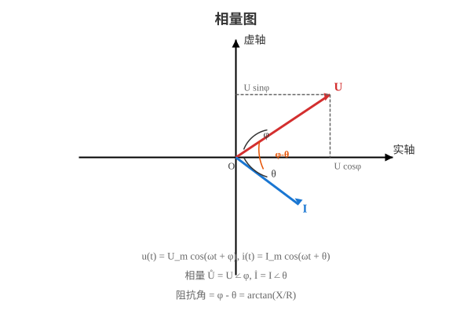
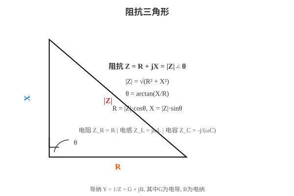
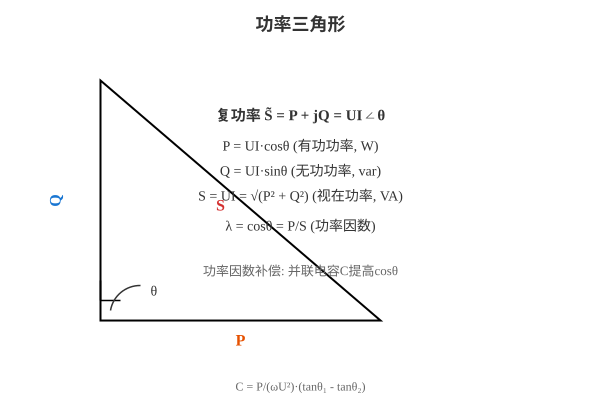
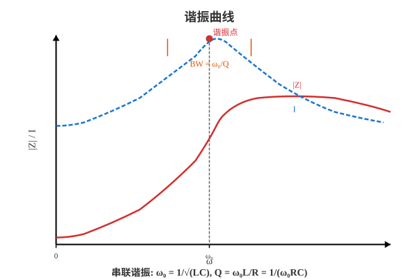

# 1.26 正弦稳态分析

> **前置知识**：[1.25 二阶电路暂态分析](1.25-二阶电路暂态分析.md)（承接上一章）。

## 1. 相量法基础

正弦电压的一般形式：

$$
u(t) = U_m \cos(\omega t + \varphi)
$$

其中 $U_m$ 为幅值，$\omega$ 为角频率，$\varphi$ 为初相位。

### 复数的表示

**直角坐标形式**：

$$
A = a + jb
$$

**极坐标形式**：

$$
A = |A| \angle \theta = |A| e^{j\theta}
$$

两种形式的转换关系：

$$
|A| = \sqrt{a^2 + b^2}, \quad \theta = \arctan\frac{b}{a}
$$

$$
a = |A|\cos\theta, \quad b = |A|\sin\theta
$$

### 相量表示

正弦量 $u(t) = U_m \cos(\omega t + \varphi)$ 对应的相量为：

$$
\dot{U} = U_m e^{j\varphi} = U_m \angle \varphi
$$

或使用有效值相量：

$$
\dot{U} = U e^{j\varphi} = U \angle \varphi
$$

其中 $U = U_m/\sqrt{2}$ 为有效值。

## 2. 阻抗与导纳的相量形式

### 阻抗

阻抗 $Z$ 定义为电压相量与电流相量之比：

$$
Z = \frac{\dot{U}}{\dot{I}} = R + jX = |Z| \angle \theta_z
$$

其中：
- $R$ 为电阻分量
- $X$ 为电抗分量
- $|Z| = \sqrt{R^2 + X^2}$ 为阻抗模
- $\theta_z = \arctan(X/R)$ 为阻抗角

各元件的阻抗：

| 元件 | 阻抗 |
|-----|------|
| 电阻 $R$ | $Z_R = R$ |
| 电感 $L$ | $Z_L = j\omega L$ |
| 电容 $C$ | $Z_C = \frac{1}{j\omega C} = -j\frac{1}{\omega C}$ |

### 导纳

导纳 $Y$ 定义为阻抗的倒数：

$$
Y = \frac{1}{Z} = G + jB = |Y| \angle \theta_y
$$

其中 $G$ 为电导，$B$ 为电纳。

## 3. 正弦稳态电路的相量分析

正弦稳态电路的分析方法在形式上与电阻电路相同，只需将电压、电流用相量表示，电阻用阻抗替代。

**基本步骤**：
1. 将时域正弦量转换为相量形式
2. 将电路元件用阻抗表示
3. 应用KCL、KVL的相量形式：$\sum \dot{I} = 0$，$\sum \dot{U} = 0$
4. 使用节点法、网孔法、戴维南定理等分析方法求解
5. 将求得的相量转换回时域形式

## 4. 功率的分析

### 平均功率（有功功率）

$$
P = UI \cos\theta = UI \cos(\varphi_u - \varphi_i)
$$

其中 $\cos\theta$ 称为功率因数，$\theta = \varphi_u - \varphi_i$ 为功率因数角。

### 无功功率

$$
Q = UI \sin\theta
$$

### 视在功率

$$
S = UI
$$

### 复功率

复功率 $\tilde{S}$ 定义为：

$$
\tilde{S} = \dot{U} \dot{I}^* = P + jQ
$$

其中 $\dot{I}^*$ 为电流相量的共轭复数。

复功率的模即为视在功率：

$$
S = |\tilde{S}| = \sqrt{P^2 + Q^2}
$$

## 5. 功率因数的补偿

功率因数 $\lambda = \cos\theta$ 反映了有功功率在视在功率中的占比。低功率因数会导致供电设备利用率降低和线路损耗增加。

**提高功率因数的方法**：在感性负载两端并联电容器。

补偿电容的计算：

$$
C = \frac{P}{\omega U^2}(\tan\theta_1 - \tan\theta_2)
$$

其中 $\theta_1$ 为补偿前的功率因数角，$\theta_2$ 为补偿后的功率因数角。

### 例题：相量与功率计算

**例题**：$R = 6\,\Omega$ 与 $L = 25.5\,\text{mH}$ 串联，接电源 $u(t) = 220\sqrt{2}\cos(314t)\,\text{V}$（$f = 50\ \text{Hz}$）。求电流相量、功率因数、有功/无功/视在/复功率。

**解**：

**① 求电阻、电抗与阻抗**。$\omega = 314\ \text{rad/s}$，

$$
X_L = \omega L = 314\times25.5\times10^{-3} \approx 8\ \Omega
$$

$$
Z = R + jX_L = 6 + j8 = 10\angle 53.13^\circ\ \Omega
$$

**② 求电流相量**。电源有效值相量 $\dot{U} = 220\angle 0^\circ\ \text{V}$：

$$
\dot{I} = \frac{\dot{U}}{Z} = \frac{220\angle 0^\circ}{10\angle 53.13^\circ} = 22\angle -53.13^\circ\ \text{A}
$$

故 $i(t) = 22\sqrt{2}\cos(314t - 53.13^\circ)\ \text{A}$。

**③ 求功率因数**。阻抗角即功率因数角，$\theta = 53.13^\circ$（感性，电流滞后电压）：

$$
\lambda = \cos\theta = \frac{R}{|Z|} = \frac{6}{10} = 0.6\ \text{（滞后）}
$$

**④ 求三种功率**。由 $U=220\ \text{V}$、$I=22\ \text{A}$、$\cos\theta=0.6$、$\sin\theta=0.8$：

$$
P = UI\cos\theta = 220\times22\times0.6 = 2904\ \text{W}
$$
$$
Q = UI\sin\theta = 220\times22\times0.8 = 3872\ \text{var}
$$
$$
S = UI = 220\times22 = 4840\ \text{VA}
$$

**⑤ 求复功率**（$\dot{I}^* = 22\angle +53.13^\circ$）：

$$
\tilde{S} = \dot{U}\dot{I}^* = 220\angle 0^\circ \times 22\angle 53.13^\circ = 4840\angle 53.13^\circ = 2904 + j3872\ \text{VA}
$$

复功率模即视在功率 $S = |\tilde{S}| = \sqrt{2904^2+3872^2} = 4840\ \text{VA}$，与第④步一致。

**答案**：$\dot{I} = 22\angle -53.13^\circ\ \text{A}$，$\lambda = 0.6$（滞后），$P = 2904\,\text{W}$，$Q = 3872\,\text{var}$，$S = 4840\,\text{VA}$，$\tilde{S} = 2904 + j3872\,\text{VA}$。

## 6. 最大功率传输（共轭匹配）

在正弦稳态电路中，当负载阻抗 $Z_L$ 等于电源内阻抗 $Z_s$ 的共轭复数时，负载获得最大功率：

$$
Z_L = Z_s^* = R_s - jX_s
$$

最大功率为：

$$
P_{L\max} = \frac{|U_s|^2}{4R_s}
$$

## 7. 谐振电路的分析与应用

### 串联谐振

RLC串联电路发生谐振的条件：

$$
\omega_0 L = \frac{1}{\omega_0 C}, \quad \omega_0 = \frac{1}{\sqrt{LC}}
$$

谐振时电路呈纯电阻性，阻抗最小，电流最大。

**品质因数**：

$$
Q = \frac{\omega_0 L}{R} = \frac{1}{\omega_0 RC} = \frac{1}{R}\sqrt{\frac{L}{C}}
$$

**通频带**：

$$
BW = \frac{\omega_0}{Q}
$$

### 并联谐振

RLC并联电路发生谐振的条件与串联谐振相同：

$$
\omega_0 = \frac{1}{\sqrt{LC}}
$$

谐振时电路呈纯电阻性，阻抗最大，电流最小。

## 小结

- 相量法将正弦量用复数表示，简化了正弦稳态电路的分析
- 阻抗和导纳分别描述了元件对正弦信号的阻碍和导通能力
- 正弦稳态电路的分析方法与电阻电路类似，但使用相量和阻抗
- 功率分为有功功率、无功功率、视在功率和复功率
- 功率因数补偿通过并联电容实现
- 谐振电路在通信和电力系统中有广泛应用

## 自测清单

1. 「相量法基础」要解决的核心问题是什么？关键结论或公式是什么？
2. 「阻抗与导纳的相量形式」与上一节之间是什么关系？
3. 「正弦稳态电路的相量分析」在什么场景下会用到？如果条件改变，结论会如何变化？
4. 能否不看正文，写出「功率的分析」的关键流程或结构？
5. 「功率因数的补偿」最容易混淆的点是什么？

---

**下一章**：[1.27 耦合电感与变压器](1.27-耦合电感与变压器.md)
