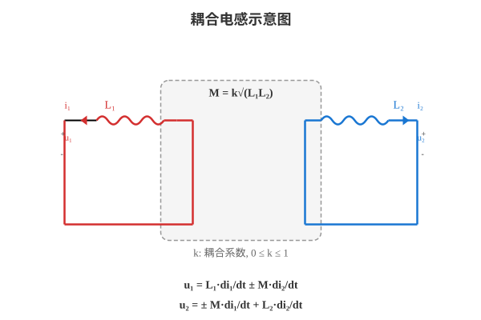
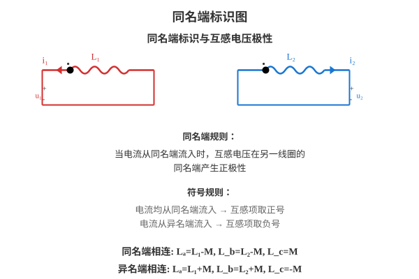
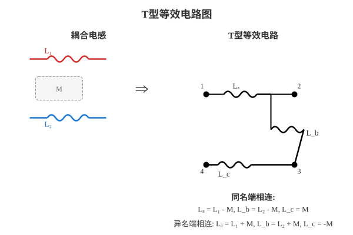
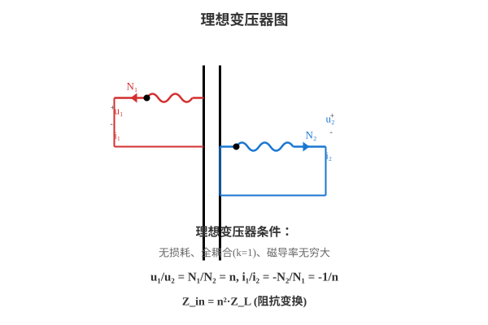
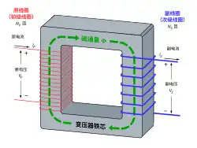
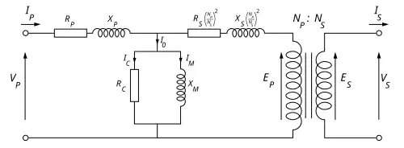

# 1.27 耦合电感与变压器

> **前置知识**：[1.26 正弦稳态分析](1.26-正弦稳态分析.md)（承接上一章）。

## 1. 耦合电感的互感电压与同名端

### 自感和互感

当两个电感线圈靠近时，一个线圈中的电流变化会在另一个线圈中产生感应电压，这种现象称为**互感**。

**自感电压**：

$$
u_{L1} = L_1 \frac{di_1}{dt}, \quad u_{L2} = L_2 \frac{di_2}{dt}
$$

**互感电压**：

$$
u_{M1} = M \frac{di_2}{dt}, \quad u_{M2} = M \frac{di_1}{dt}
$$

其中 $M$ 为互感系数，满足 $M = k\sqrt{L_1 L_2}$，$k$ 为耦合系数（$0 \leq k \leq 1$）。

### 同名端

同名端是用于标识互感电压极性的一对标记。当电流从同名端流入时，产生的互感电压在另一个线圈的同名端为正极性。

**耦合电感的伏安关系**：

$$
u_1 = L_1 \frac{di_1}{dt} \pm M \frac{di_2}{dt}
$$
$$
u_2 = \pm M \frac{di_1}{dt} + L_2 \frac{di_2}{dt}
$$

符号规则：当电流均从同名端流入（或均从异名端流入）时，互感项取正号；否则取负号。

## 2. 耦合电感的去耦等效（T型等效）

耦合电感可以通过T型等效电路进行去耦，将互感效应转化为等效电感。

### 同名端相连的T型等效

当两个电感线圈的同名端相连时，T型等效电路为：

$$
L_a = L_1 - M, \quad L_b = L_2 - M, \quad L_c = M
$$

### 异名端相连的T型等效

当两个电感线圈的异名端相连时，T型等效电路为：

$$
L_a = L_1 + M, \quad L_b = L_2 + M, \quad L_c = -M
$$

### 耦合电感例题（同名端与串联等效）

**例题**：两耦合线圈顺接串联，$L_1 = 4\,\text{H}$、$L_2 = 2\,\text{H}$、互感 $M = 1\,\text{H}$。串联支路通以电流 $i(t) = 5\cos(2t)\ \text{A}$（电流依次从两线圈的同名端流入）。求支路电压 $u(t)$。

**解**：

**① 判断连接方式，求等效电感**。电流从两线圈同名端流入为**顺接（顺向串联）**，互感受助，等效电感：

$$
L_{eq} = L_1 + L_2 + 2M = 4 + 2 + 2\times1 = 8\ \text{H}
$$

（若电流分别从两线圈异名端流入，则为反接，$L_{eq} = L_1+L_2-2M = 4\ \text{H}$。）

**② 求支路电压**：

$$
u(t) = L_{eq}\frac{di}{dt} = 8 \cdot \frac{d}{dt}\big[5\cos 2t\big] = -80\sin 2t\ \text{V}
$$

**③ 用去耦等效校验**：顺接串联时两线圈在公共节点互相以"同名端"相接（电流流出线圈1的同名端、又流入线圈2的同名端），按异名端相连去耦公式 $L_a = L_1 + M$、$L_b = L_2 + M$：

$$
L_a = 4+1 = 5\ \text{H}, \quad L_b = 2+1 = 3\ \text{H}
$$

串联回路在公共节点处无第三条支路，等效电感 $L_{eq} = L_a + L_b = 8\ \text{H}$，与①求得的顺接结果一致。

**答案**：$u(t) = -80\sin 2t\ \text{V}$（顺接时）；若反接，$u(t) = -40\sin 2t\ \text{V}$。

## 3. 空芯变压器电路分析

空芯变压器是指没有铁磁材料磁芯的耦合电感线圈，其耦合系数较小。

**电路方程**：

一次侧回路：

$$
(R_1 + j\omega L_1)\dot{I}_1 + j\omega M\dot{I}_2 = \dot{U}_s
$$

二次侧回路：

$$
j\omega M\dot{I}_1 + (R_2 + j\omega L_2 + Z_L)\dot{I}_2 = 0
$$

**一次侧等效阻抗**（反映阻抗）：

$$
Z_{ref} = \frac{(\omega M)^2}{Z_{22}}
$$

其中 $Z_{22} = R_2 + j\omega L_2 + Z_L$ 为二次侧回路总阻抗。

## 4. 理想变压器模型

**理想变压器**是理想化的变压器模型，满足以下条件：
1. 无损耗（线圈电阻为零）
2. 全耦合（$k = 1$）
3. 磁芯磁导率无穷大

**理想变压器的伏安关系**：

$$
\frac{u_1}{u_2} = \frac{N_1}{N_2} = n
$$
$$
\frac{i_1}{i_2} = -\frac{N_2}{N_1} = -\frac{1}{n}
$$

其中 $n = N_1/N_2$ 为变比。

**阻抗变换特性**：

从一次侧看进去的输入阻抗为：

$$
Z_{in} = n^2 Z_L
$$

## 5. 全耦合变压器

全耦合变压器是介于耦合电感和理想变压器之间的模型，满足 $k = 1$，但磁芯磁导率为有限值，即励磁电感不为无穷大。

**全耦合变压器的方程**：

$$
u_1 = L_1 \frac{di_1}{dt} + M \frac{di_2}{dt}
$$
$$
u_2 = M \frac{di_1}{dt} + L_2 \frac{di_2}{dt}
$$

由于 $k = 1$，有 $M = \sqrt{L_1 L_2}$，且 $L_1/L_2 = (N_1/N_2)^2 = n^2$。

**等效电路**：全耦合变压器可以用理想变压器并联励磁电感来等效。

## 小结

- 耦合电感通过互感将两个线圈的磁场联系起来
- 同名端标识了互感电压的极性关系
- T型等效电路将互感耦合转化为三个电感元件，便于分析
- 空芯变压器可通过反映阻抗分析一次侧特性
- 理想变压器具有电压变换、电流变换和阻抗变换功能
- 全耦合变压器是更接近实际的模型，考虑了励磁电感

## 自测清单

1. 「耦合电感的互感电压与同名端」要解决的核心问题是什么？关键结论或公式是什么？
2. 「耦合电感的去耦等效（T型等效）」与上一节之间是什么关系？
3. 「空芯变压器电路分析」在什么场景下会用到？如果条件改变，结论会如何变化？
4. 能否不看正文，写出「理想变压器模型」的关键流程或结构？
5. 「全耦合变压器」最容易混淆的点是什么？

---

**下一章**：[1.28 三相电路](1.28-三相电路.md)
