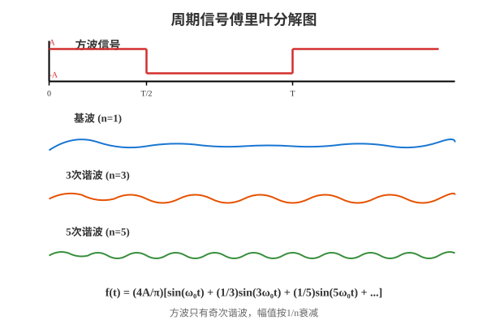
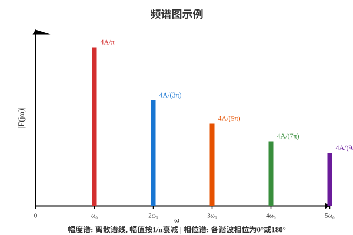

# 1.31 傅里叶变换在电路中的应用

> **前置知识**：[1.1 数学基础 §2 复数与相量](../大学物理基础/1.1-数学基础.md)（欧拉公式是频域展开的核心工具）、[1.26 正弦稳态分析](1.26-正弦稳态分析.md)。本章以"定义 + 性质表 + 应用"的方式速成，不展开数学推导。

## 1. 傅里叶级数

### 1.1 周期信号的傅里叶分解

任何满足狄利克雷条件的周期信号 $f(t)$（周期为 $T$，基频 $\omega_0 = 2\pi/T$）都可以分解为一系列正弦和余弦谐波分量的叠加。

### 1.2 三角形式傅里叶级数

$$
f(t) = a_0 + \sum_{n=1}^{\infty} \left[ a_n \cos(n\omega_0 t) + b_n \sin(n\omega_0 t) \right]
$$

其中各系数为：

$$
\begin{aligned}
a_0 &= \frac{1}{T} \int_{t_0}^{t_0+T} f(t) \, dt \\
a_n &= \frac{2}{T} \int_{t_0}^{t_0+T} f(t) \cos(n\omega_0 t) \, dt \\
b_n &= \frac{2}{T} \int_{t_0}^{t_0+T} f(t) \sin(n\omega_0 t) \, dt
\end{aligned}
$$

也可以合并为幅度-相位形式：

$$
f(t) = A_0 + \sum_{n=1}^{\infty} A_n \cos(n\omega_0 t + \varphi_n)
$$

其中：

$$
A_0 = a_0, \quad A_n = \sqrt{a_n^2 + b_n^2}, \quad \varphi_n = -\arctan\frac{b_n}{a_n}
$$

### 1.3 指数形式傅里叶级数

利用欧拉公式 $e^{j\theta} = \cos\theta + j\sin\theta$，可以将三角形式转化为更简洁的指数形式：

$$
f(t) = \sum_{n=-\infty}^{\infty} C_n e^{jn\omega_0 t}
$$

其中复系数：

$$
C_n = \frac{1}{T} \int_{t_0}^{t_0+T} f(t) e^{-jn\omega_0 t} \, dt
$$

指数形式与三角形式的关系：

$$
C_0 = a_0, \quad C_n = \frac{a_n - jb_n}{2}, \quad C_{-n} = \frac{a_n + jb_n}{2} = C_n^*
$$

### 1.4 常见周期信号的傅里叶级数

**方波信号**（占空比 50%，幅值 $\pm A$）：

$$
f(t) = \frac{4A}{\pi} \sum_{k=1,3,5,\ldots}^{\infty} \frac{1}{k} \sin(k\omega_0 t)
$$

方波只有奇次谐波，频谱呈 $1/n$ 衰减。

**三角波信号**（幅值 $\pm A$）：

$$
f(t) = \frac{8A}{\pi^2} \sum_{k=1,3,5,\ldots}^{\infty} \frac{(-1)^{(k-1)/2}}{k^2} \sin(k\omega_0 t)
$$

三角波也只有奇次谐波，但频谱按 $1/n^2$ 衰减，收敛更快。

**锯齿波信号**（幅值 $A$，周期 $T$）：

$$
f(t) = \frac{A}{2} - \frac{A}{\pi} \sum_{n=1}^{\infty} \frac{1}{n} \sin(n\omega_0 t)
$$

锯齿波包含所有整数次谐波。

## 2. 傅里叶变换

### 2.1 从傅里叶级数到傅里叶变换

当周期 $T \to \infty$（即 $\omega_0 \to 0$）时，周期信号退化为非周期信号，傅里叶级数中的离散频谱变为连续频谱，离散求和过渡为连续积分，从而引出傅里叶变换。

### 2.2 傅里叶变换的定义

**正变换**：

$$
F(j\omega) = \mathcal{F}[f(t)] = \int_{-\infty}^{\infty} f(t) e^{-j\omega t} \, dt
$$

**逆变换**：

$$
f(t) = \mathcal{F}^{-1}[F(j\omega)] = \frac{1}{2\pi} \int_{-\infty}^{\infty} F(j\omega) e^{j\omega t} \, d\omega
$$

### 2.3 基本性质

| 性质 | 时域 | 频域 |
|-----|------|------|
| 线性性质 | $af_1(t) + bf_2(t)$ | $aF_1(j\omega) + bF_2(j\omega)$ |
| 时移性质 | $f(t - t_0)$ | $e^{-j\omega t_0}F(j\omega)$ |
| 频移性质 | $e^{j\omega_0 t}f(t)$ | $F(j(\omega - \omega_0))$ |
| 尺度变换 | $f(at)$ | $\frac{1}{|a|}F\left(j\frac{\omega}{a}\right)$ |
| 时域微分 | $\frac{d^n f(t)}{dt^n}$ | $(j\omega)^n F(j\omega)$ |
| 时域积分 | $\int_{-\infty}^{t} f(\tau) d\tau$ | $\frac{F(j\omega)}{j\omega} + \pi F(0)\delta(\omega)$ |
| 卷积定理 | $f_1(t) * f_2(t)$ | $F_1(j\omega) \cdot F_2(j\omega)$ |
| 乘积定理 | $f_1(t) \cdot f_2(t)$ | $\frac{1}{2\pi}F_1(j\omega) * F_2(j\omega)$ |
| 对偶性 | $F(jt)$ | $2\pi f(-\omega)$ |
| 帕塞瓦尔定理 | $\int_{-\infty}^{\infty}|f(t)|^2 dt$ | $\frac{1}{2\pi}\int_{-\infty}^{\infty}|F(j\omega)|^2 d\omega$ |

### 2.4 常见信号的傅里叶变换

| 时域信号 $f(t)$ | 傅里叶变换 $F(j\omega)$ |
|----------------|----------------------|
| $\delta(t)$ | $1$ |
| $1$ | $2\pi \delta(\omega)$ |
| $\varepsilon(t)$ | $\pi\delta(\omega) + \frac{1}{j\omega}$ |
| $e^{-at}\varepsilon(t) \ (a>0)$ | $\frac{1}{a + j\omega}$ |
| $\text{sgn}(t)$ | $\frac{2}{j\omega}$ |
| 矩形脉冲 $\Pi(t/\tau)$ | $\tau \cdot \text{sinc}\left(\frac{\omega\tau}{2}\right)$ |
| $\cos(\omega_0 t)$ | $\pi[\delta(\omega - \omega_0) + \delta(\omega + \omega_0)]$ |
| $\sin(\omega_0 t)$ | $j\pi[\delta(\omega + \omega_0) - \delta(\omega - \omega_0)]$ |
| 周期冲激串 $\sum_{n=-\infty}^{\infty}\delta(t - nT)$ | $\frac{2\pi}{T}\sum_{n=-\infty}^{\infty}\delta\left(\omega - \frac{2\pi n}{T}\right)$ |

## 3. 电路的频率响应与传递函数 $H(j\omega)$

### 3.1 传递函数的定义

对于线性时不变（LTI）电路，在正弦稳态激励下，输出相量与输入相量之比定义为传递函数（网络函数）：

$$
H(j\omega) = \frac{Y(j\omega)}{X(j\omega)}
$$

其中 $X(j\omega)$ 为输入信号的傅里叶变换，$Y(j\omega)$ 为输出信号的傅里叶变换。

### 3.2 传递函数的物理意义

传递函数可表示为幅频特性和相频特性的乘积：

$$
H(j\omega) = |H(j\omega)| \cdot e^{j\angle H(j\omega)}
$$

- **幅频特性** $|H(j\omega)|$：输出信号幅度与输入信号幅度之比随频率的变化
- **相频特性** $\angle H(j\omega)$：输出信号与输入信号之间的相位差随频率的变化

### 3.3 典型电路的传递函数

**一阶 RC 低通滤波器**：

$$
H(j\omega) = \frac{1}{1 + j\omega RC}
$$

截止频率 $\omega_c = 1/(RC)$。

**一阶 RC 高通滤波器**：

$$
H(j\omega) = \frac{j\omega RC}{1 + j\omega RC}
$$

**RLC 串联谐振电路**：

$$
H(j\omega) = \frac{R}{R + j\omega L + \frac{1}{j\omega C}}
$$

## 4. 傅里叶变换与拉普拉斯变换的关系

### 4.1 从拉普拉斯变换到傅里叶变换

拉普拉斯变换的变量为 $s = \sigma + j\omega$，傅里叶变换对应于 $s$ 平面虚轴上的取值：

$$
F(j\omega) = F(s)\big|_{s = j\omega}
$$

当信号 $f(t)$ 满足绝对可积条件 $\int_{-\infty}^{\infty}|f(t)|dt < \infty$ 时，其傅里叶变换等于拉普拉斯变换在 $s = j\omega$ 处的值。

### 4.2 收敛域与傅里叶变换的存在性

- 若拉普拉斯变换的收敛域包含虚轴（$\sigma = 0$），则傅里叶变换存在，且 $F(j\omega) = F(s)|_{s=j\omega}$
- 若收敛域不包含虚轴（如 $\varepsilon(t)$ 的拉普拉斯变换收敛域为 $\text{Re}(s) > 0$），则傅里叶变换可能包含冲激函数项

### 4.3 电路分析中的统一视角

在电路分析中：

- **拉普拉斯变换**（s域）：适用于暂态分析和任意激励响应，可以方便地处理初始条件
- **傅里叶变换**（频域）：适用于稳态分析和频率响应，便于理解信号的频谱特性

对于因果稳定系统，$H(s)$ 的收敛域包含虚轴，因此 $H(j\omega) = H(s)|_{s=j\omega}$ 可以直接用于稳态分析。

## 5. 傅里叶分析在滤波器设计中的应用

### 5.1 滤波器的频域描述

滤波器本质上是一个选频网络，其传递函数 $H(j\omega)$ 在通带内 $|H(j\omega)| \approx 1$，在阻带内 $|H(j\omega)| \approx 0$。

四种基本滤波器类型：

| 类型 | 传递函数特征 |
|------|------------|
| 低通滤波器 | $|H(j\omega)| \approx 1$ 当 $\omega < \omega_c$；$|H(j\omega)| \to 0$ 当 $\omega > \omega_c$ |
| 高通滤波器 | $|H(j\omega)| \approx 1$ 当 $\omega > \omega_c$；$|H(j\omega)| \to 0$ 当 $\omega < \omega_c$ |
| 带通滤波器 | $|H(j\omega)| \approx 1$ 当 $\omega_1 < \omega < \omega_2$ |
| 带阻滤波器 | $|H(j\omega)| \approx 0$ 当 $\omega_1 < \omega < \omega_2$ |

### 5.2 理想滤波器与实际滤波器

理想低通滤波器的传递函数：

$$
H(j\omega) = \begin{cases}
e^{-j\omega t_0}, & |\omega| \leq \omega_c \\
0, & |\omega| > \omega_c
\end{cases}
$$

理想滤波器在物理上不可实现（非因果系统），实际滤波器用逼近函数实现（如 Butterworth、Chebyshev、Bessel 等逼近）。

### 5.3 滤波器设计的频域方法

给定滤波器的幅频特性指标（通带最大衰减 $\alpha_{max}$、阻带最小衰减 $\alpha_{min}$、截止频率 $\omega_c$、阻带边界频率 $\omega_s$），通过频域综合方法确定传递函数 $H(s)$，再通过电路综合实现。

## 6. 频谱分析的基本概念

### 6.1 幅度谱与相位谱

信号 $f(t)$ 的傅里叶变换 $F(j\omega)$ 一般为复函数，可表示为：

$$
F(j\omega) = |F(j\omega)| e^{j\varphi(\omega)}
$$

- **幅度谱** $|F(j\omega)|$：描述信号各频率分量幅度的分布
- **相位谱** $\varphi(\omega) = \angle F(j\omega)$：描述信号各频率分量相位的分布

### 6.2 能量谱与功率谱

**能量信号**（能量有限）的能量谱密度：

$$
E(\omega) = |F(j\omega)|^2
$$

总能量（帕塞瓦尔定理）：

$$
E = \int_{-\infty}^{\infty} |f(t)|^2 dt = \frac{1}{2\pi} \int_{-\infty}^{\infty} |F(j\omega)|^2 d\omega
$$

**功率信号**（周期信号，功率有限）的功率谱密度描述了信号功率在各频率分量上的分布。对于周期信号，功率集中在基频和各次谐波频率上，表现为离散谱线。

### 6.3 频谱分析在电路中的应用

- **失真分析**：通过比较输入和输出信号的频谱，判断信号经过电路后是否发生线性失真（幅度失真、相位失真）或非线性失真（产生新的频率分量）
- **噪声分析**：通过频谱分析识别电路中的噪声频率分布
- **带宽计算**：通过频谱确定信号的带宽，进而设计合适的电路带宽

### 6.4 采样定理（Nyquist-Shannon）

对于最高频率为 $f_m$ 的带限信号，采样频率 $f_s$ 必须满足：

$$
f_s \geq 2f_m
$$

否则会发生频谱混叠（Aliasing）。这一定理在数字信号处理和数据采集系统中具有基础性意义。

## 7. 非正弦周期信号的有效值与平均功率

非正弦周期信号（含直流与各次谐波）的有效值等于**各次谐波（含直流）有效值平方和的平方根**：

$$
U = \sqrt{U_0^2 + U_1^2 + U_2^2 + \cdots}
$$

其中 $U_0$ 为直流分量的有效值，$U_n$ 为第 $n$ 次谐波分量的有效值（幅值除以 $\sqrt{2}$）。

由于不同频率的正弦量正交，各谐波之间不产生平均功率，故**平均功率等于各谐波（含直流）单独作用功率之和**：

$$
P = P_0 + P_1 + P_2 + \cdots = \frac{U_0^2}{R} + \frac{U_1^2}{R} + \frac{U_2^2}{R} + \cdots = \frac{U^2}{R}
$$

最后一个等号对纯电阻成立。

### 例题：非正弦周期信号的有效值与平均功率

**例题**：非正弦周期性电流源作用于电阻 $R = 5\,\Omega$，电流 $i(t) = 10 + 5\sqrt{2}\cos(100\pi t) + 2\sqrt{2}\cos(300\pi t)\ \text{A}$。求电流有效值 $I$、电压有效值 $U$ 与平均功率 $P$。

**解**：

**① 求电流有效值**。直流 $I_0 = 10\ \text{A}$、基波有效值 $I_1 = 5\ \text{A}$、三次谐波有效值 $I_3 = 2\ \text{A}$：

$$
I = \sqrt{I_0^2 + I_1^2 + I_3^2} = \sqrt{10^2 + 5^2 + 2^2} = \sqrt{129} \approx 11.36\ \text{A}
$$

**② 求电压有效值**。电阻上各次谐波电压的峰值与有效值按 $U_n = I_n R$ 放大：$U_0 = 50\ \text{V}$、$U_1 = 25\ \text{V}$、$U_3 = 10\ \text{V}$：

$$
U = \sqrt{50^2 + 25^2 + 10^2} = 5\sqrt{129} \approx 56.8\ \text{V}
$$

（也可直接由 $U = IR = \sqrt{129}\times5 \approx 56.8\ \text{V}$ 求得，结果一致。）

**③ 求平均功率**。

$$
P = I^2 R = \frac{U^2}{R} = 129\times5 = 645\ \text{W}
$$

亦可逐谐波求和验证：$P = I_0^2R + I_1^2R + I_3^2R = (100+25+4)\times5 = 645\ \text{W}$。

**答案**：$I \approx 11.36\,\text{A}$，$U \approx 56.8\,\text{V}$，$P = 645\,\text{W}$。

## 小结

- 傅里叶级数将周期信号分解为各次谐波的叠加，而傅里叶变换将周期推广到非周期信号，把时域信号映射到连续的频域频谱上
- 传递函数 $H(j\omega)$ 是电路频率响应的核心工具，其幅频特性和相频特性直观描述了输出与输入随频率的关系
- 滤波器本质上是选频网络，通过对频率分量的通阻实现选频，是傅里叶分析在电路设计中的典型应用
- 采样定理指出采样频率须不小于信号最高频率的两倍（$f_s \geq 2f_m$），否则会引起频谱混叠，是连续信号数字化的基础

## 自测清单

1. 「傅里叶级数」要解决的核心问题是什么？关键结论或公式是什么？
2. 「傅里叶变换」与上一节之间是什么关系？
3. 「电路的频率响应与传递函数 $H(j\omega)$」在什么场景下会用到？如果条件改变，结论会如何变化？
4. 能否不看正文，写出「傅里叶变换与拉普拉斯变换的关系」的关键流程或结构？
5. 「傅里叶分析在滤波器设计中的应用」最容易混淆的点是什么？

---

**下一章**：[1.32 概率与随机变量基础](../大学物理基础/1.32-概率与随机变量基础.md)
