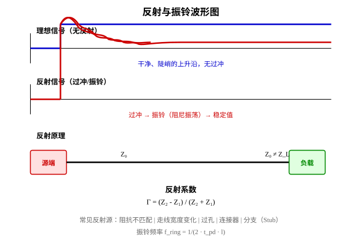
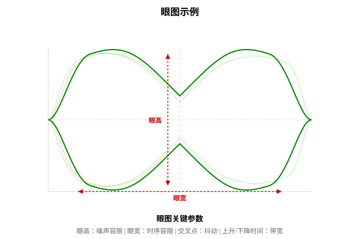
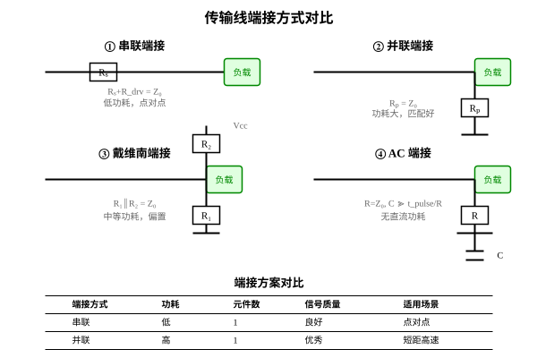

# 2.25 信号完整性

> **本章定位**：把高频与电磁兼容问题落到 PCB/封装层面，补全硬件工程的最后一块。

> **前置知识**：[2.17–2.20 射频与传输线基础](../射频与高频电路/2.17-传输线理论.md)。

## 1. 引言

信号完整性（Signal Integrity, SI）是指在高速数字系统中，信号从发送端到接收端保持其正确波形和时序的能力。随着数字系统时钟频率突破 GHz 大关和上升/下降沿进入亚纳秒范围，信号完整性问题已成为高速 PCB 设计的首要挑战。反射、串扰、地弹、码间干扰等问题如果处理不当，轻则降低系统可靠性，重则导致系统完全失效。

## 2. 信号完整性的基本概念

### 2.1 信号完整性的三大维度

**时序（Timing）**：
- 建立时间（Setup Time）：数据在时钟沿到达前必须稳定的最小时间
- 保持时间（Hold Time）：数据在时钟沿到达后必须保持的最小时间
- 时钟抖动（Jitter）与时钟偏移（Skew）

**噪声（Noise）**：
- 电源噪声、地弹、串扰、反射
- 噪声容限（Noise Margin）：

$$NM_H = V_{OH(min)} - V_{IH(min)}$$

$$NM_L = V_{IL(max)} - V_{OL(max)}$$

**电磁干扰（EMI）**：
- 高速信号辐射的电磁能量
- 传导发射与辐射发射

### 2.2 何时需要考虑信号完整性

当信号上升时间 $t_r$ 满足以下条件时，需要关注信号完整性：

$$t_r < 6 \cdot t_{pd}$$

其中 $t_{pd}$ 为传输线延迟。或者说，当互连长度超过：

$$l > \frac{t_r}{2 \cdot t_{pd\_unit}}$$

在 FR-4 中，典型 $t_{pd\_unit} \approx 55\text{–}70$ ps/cm。对于 1 ns 上升沿，临界长度约 7–9 cm。

## 3. 反射与振铃

### 3.1 反射的产生机制

当信号沿传输线传播遇到阻抗不连续点时，部分能量被反射回来。反射系数：

$$\Gamma = \frac{Z_2 - Z_1}{Z_2 + Z_1}$$

其中 $Z_1$ 为传输线特征阻抗，$Z_2$ 为不连续点的阻抗。

常见反射源：
- 接收端阻抗不匹配（高阻输入 → $\Gamma \approx +1$）
- 走线宽度变化
- 过孔、连接器
- 分支（Stub）

> **特征阻抗的物理来源**：本章反复使用的特征阻抗 $Z_0$ 是所有反射、端接与阻抗匹配分析的基础，它由传输线的分布参数（单位长度电感/电容）与介质、几何结构共同决定。特征阻抗的严格推导、反射系数定义以及微带线、带状线的阻抗计算方法，见 2.17–2.20 射频基础——[2.17 传输线理论](../射频与高频电路/2.17-传输线理论.md)（特征阻抗与反射系数）与 [2.20 微带线与带状线](../射频与高频电路/2.20-微带线与带状线.md)（各结构阻抗计算）。

### 3.2 振铃（Ringing）

当源端和负载端均不匹配时，信号在两端之间来回反射，形成振铃。

振铃频率由传输线往返延迟决定：

$$f_{ring} = \frac{1}{2 \cdot t_{pd} \cdot l}$$

振铃幅度取决于反射系数和线路损耗。

### 3.3 反弹图（Bounce Diagram）

反弹图是分析反射的直观工具，纵轴为时间，横轴为距离。通过追踪每次反射的幅度和延迟，可以构造接收端的波形。

## 4. 串扰（Crosstalk）

### 4.1 串扰的产生机制

当两条走线平行布线时，电磁耦合导致一条线上的信号干扰另一条线。耦合机制包括：
- **容性耦合**（电场耦合）：通过互电容 $C_m$
- **感性耦合**（磁场耦合）：通过互感 $L_m$

### 4.2 近端串扰（NEXT）

近端串扰出现在干扰源驱动端附近（"近端"）。近端串扰系数：

$$NEXT = \frac{V_{near}}{V_{source}}$$

近端串扰脉冲宽度约为 $2 \cdot t_{pd}$（往返时间）。

近似公式：

$$V_{near} \approx \frac{1}{4}\left(\frac{C_m}{C} + \frac{L_m}{L}\right) \cdot V_s$$

### 4.3 远端串扰（FEXT）

远端串扰出现在干扰源负载端附近（"远端"）。远端串扰系数：

$$FEXT = \frac{V_{far}}{V_{source}}$$

远端串扰脉冲幅度较小但具有更高的频率成分。

近似公式：

$$V_{far} \approx \frac{1}{2}\left(\frac{C_m}{C} - \frac{L_m}{L}\right) \cdot \frac{t_r}{t_{pd}} \cdot V_s$$

在均匀介质中（如带状线），$\frac{C_m}{C} = \frac{L_m}{L}$，FEXT ≈ 0。在非均匀介质中（如微带线），FEXT 不可忽略。

### 4.4 减小串扰的措施

- 增加走线间距（3W 规则：间距 ≥ 3 倍线宽）
- 减小并行长度
- 插入地线隔离（Guard Trace）
- 使用差分信号
- 降低信号上升/下降时间

## 5. 地弹与同步开关噪声

### 5.1 地弹（Ground Bounce）

当多个输出同时从高电平切换到低电平时，大量电流瞬间流过芯片封装电感（$L_{pkg}$），在地引脚上产生电压尖峰：

$$V_{gb} = n \cdot L_{pkg} \cdot \frac{di}{dt}$$

其中 $n$ 为同时切换的输出数量。

### 5.2 同步开关噪声（SSN）

SSN（Simultaneous Switching Noise）是地弹的广义概念，包括地弹和电源弹（Vcc Sag）。SSN 会导致：
- 芯片内部参考地偏移
- 输出信号抖动
- 误触发

### 5.3 减小 SSN 的措施

- 增加电源/地引脚数量
- 降低封装电感（BGA 优于 QFP）
- 使用片上去耦电容
- 控制同时开关的输出数量
- 使用差分信号（SSN 为共模噪声）

## 6. 码间干扰与眼图

### 6.1 码间干扰（ISI）

ISI（Inter-Symbol Interference）是由于信道带宽限制和色散效应，导致前一个码元的拖尾干扰后续码元。ISI 限制了数字通信系统的最大数据传输速率。

奈奎斯特准则（无 ISI 条件）：

$$\sum_{k=-\infty}^{\infty} h(t - kT) = \begin{cases} 1 & t = 0 \\ 0 & t = nT, n \neq 0 \end{cases}$$

### 6.2 眼图（Eye Diagram）

眼图是评估信号质量的最直观工具，通过将多个码元周期叠加显示。

眼图的关键参数：
- **眼高（Eye Height）**：垂直张开度，反映噪声容限
- **眼宽（Eye Width）**：水平张开度，反映时序容限
- **眼图交叉点**：反映抖动
- **上升/下降时间**：反映带宽

眼图张开度与误码率（BER）的关系：

$$BER \propto \operatorname{erfc}\left(\frac{EyeHeight}{2\sigma_n}\right)$$

## 7. 传输线端接技术

### 7.1 为什么需要端接

端接的目的：消除/减少反射，改善信号质量。选择端接方案需综合考虑功耗、驱动能力、PCB 面积等因素。

### 7.2 串联端接（Series Termination）

在源端串联电阻 $R_s$，使 $R_s + R_{driver} = Z_0$。

- 优点：功耗低、单电阻、适用于点对点拓扑
- 缺点：上升沿变缓，不适合多负载总线

### 7.3 并联端接（Parallel Termination）

在接收端并联电阻 $R_p = Z_0$ 到地。

- 优点：匹配效果好、信号质量高
- 缺点：功耗大（$P = V_{OH}^2/R_p$），直流偏置变化

### 7.4 戴维南端接（Thevenin Termination）

在接收端用两个电阻分压到 $V_{cc}$ 和 GND，等效电阻 $R_{eq} = Z_0$。

$$R_{eq} = R_1 \parallel R_2 = Z_0$$

$$V_{eq} = \frac{R_2}{R_1 + R_2} \cdot V_{cc}$$

- 优点：提供偏置电压，适合非 50% 占空比信号
- 缺点：静态功耗较大

### 7.5 AC 端接

在接收端串联 RC 网络到地，$R = Z_0$，$C$ 选择：

$$C \gg \frac{t_{pulse}}{R}$$

- 优点：无直流功耗
- 缺点：大电容占用面积，仅适用于平衡信号

### 7.6 端接方案对比

| 端接方式 | 功耗 | 元件数 | 信号质量 | 适用场景 |
|----------|------|--------|---------|---------|
| 串联端接 | 低 | 1 | 良好 | 点对点 |
| 并联端接 | 高 | 1 | 优秀 | 短距离高速 |
| 戴维南端接 | 中 | 2 | 优秀 | 高速总线 |
| AC 端接 | 极低 | 2 | 良好 | 时钟信号 |

## 8. 差分信号与共模抑制

### 8.1 差分信号的优势

差分信号使用两条线传输互补信号：
- 抗共模噪声能力强
- 辐射 EMI 低（磁场相互抵消）
- 对地弹不敏感
- 可实现更低的电压摆幅

### 8.2 差分阻抗

差分阻抗 $Z_{diff}$ 取决于两条线之间的耦合：

$$Z_{diff} = 2Z_{odd}$$

其中 $Z_{odd}$ 为奇模阻抗。当线间距很小时，$Z_{diff} < 2Z_0$；当间距很大时，$Z_{diff} \approx 2Z_0$。

### 8.3 共模抑制

共模抑制比（CMRR）衡量差分接收器抑制共模噪声的能力：

$$CMRR = 20\log_{10}\left(\frac{A_{diff}}{A_{cm}}\right) \quad \text{(dB)}$$

良好的差分接收器 CMRR > 60 dB。

## 9. 电源完整性（Power Integrity, PI）

### 9.1 PDN 与目标阻抗

电源分配网络（Power Distribution Network, PDN）指从电源模块经电源平面、过孔、封装引线直至片上去耦电容的整套供电通路。高速电路中，芯片瞬态电流 $I_{transient}$ 越大、上升越快，若 PDN 阻抗过高，电源与地之间就会出现明显的电压跌落/尖峰。为保证核心电压偏差不超过允许范围 $\Delta V$，PDN 在工作频率范围内应满足目标阻抗：

$$Z_{target} = \frac{\Delta V}{I_{transient}}$$

例如允许电压波动 $\Delta V = 50$ mV、瞬态电流 $I_{transient} = 4$ A 时，目标阻抗仅约 12.5 mΩ。目标阻抗是从系统层面约束 PDN 的总阻抗上限，是电源完整性设计的出发点。

### 9.2 目标阻抗与去耦网络

单颗电容无法覆盖 GHz 级频段——它在自谐振频率以上即表现为感性。因此实际需要"多层去耦"的网络：较大的容值（寄生电感大、谐振点低）覆盖低频，较小的容值（封装小、寄生电感小、谐振点高）覆盖高频，使 PDN 总阻抗在宽频段保持平坦并始终低于 $Z_{target}$。电源平面为供电与回流提供低感量的分布回路，但它本身是谐振腔，在特定频点会出现并联谐振阻抗尖峰，需要借助合理布置的去耦电容加以抑制。

一句话：**去耦的目的不是"堆电容"，而是把 PDN 阻抗在目标频段内压平整，使其处处低于 $Z_{target}$**。

### 9.3 与 2.26 去耦电容的衔接

关于单颗去耦电容的选型、等效模型与 PCB 布局要点，主体见本教程 2.26 章"去耦电容"小节。本小节提供的是**进阶的系统视角**：先从瞬态电流与允许压降确定 $Z_{target}$ 和目标频段，再由高频向低频逐级分配各容值电容，整体约束 PDN 阻抗曲线，而非孤立地一颗颗选电容。掌握目标阻抗法后，再去理解单颗电容的容值、介质与布局，才能"知其然更知其所以然"。

## 10. 信道均衡（Equalization）

### 10.1 为什么需要均衡

随着速率攀升，信道（走线、过孔、连接器）损耗随频率显著增大，FR-4 介质的介电损耗尤其明显，导致信号高频分量大幅衰减、眼图闭合、ISI 加剧。单纯依靠端接已无法消除这类由频率响应非平坦引起的损伤，于是引入均衡（Equalization）：在发送端或接收端对信道频率响应进行反向补偿，或抬高高频、或压低低频，从而重新张开眼图。

### 10.2 发送端预加重与去加重

- **预加重（Pre-Emphasis）**：发送时对跳变沿对应的高频分量加大幅度，预先补偿信道的高频损耗
- **去加重（De-Emphasis）**：压低稳态（低频）分量、相对突出高频跳变，与预加重是同一思想的互补实现，二者常在同一发送器中配置

发送端均衡实现简单、无需反馈，但属于"固定补偿"，无法随具体链路特性自适应。

### 10.3 接收端均衡（CTLE 与 DFE）

- **连续时间线性均衡器（CTLE，Continuous-Time Linear Equalizer）**：接收端的模拟滤波网络，以放大高频、压低低频的线性方式补偿信道损耗，结构简单、无反馈、无误差传播，是多数 SerDes 接收端的第一级均衡
- **判决反馈均衡器（DFE，Decision Feedback Equalizer）**：基于先前已判决的符号，把前一个码元留下的确定性拖尾"减掉"，可高效消除剩余 ISI 与反射带来的尾部，且不像线性均衡那样放大高频噪声；代价是存在误差传播风险

高速串行链路常采用"CTLE 抬升高频 + DFE 消除拖尾"的组合，以在最低噪声代价下获得最大的眼图裕量。

## 11. 抖动分解（Jitter）

### 11.1 抖动的来源与分类

抖动（Jitter）是信号边沿相对理想时刻的偏移，直接影响时序裕量。工程上通常将抖动按统计特性分解为两大成分：

- **随机抖动（RJ, Random Jitter）**：由热噪声、散粒噪声等随机源产生，服从高斯分布、无界增长，其峰峰值随观测样本数增大而增大，只能以均方根（rms）描述
- **确定性抖动（DJ, Deterministic Jitter）**：由可确定的原因产生、有界且可预测，进一步分为：
  - **周期性抖动（PJ）**：源于电源纹波、周期串扰等，表现为离散谱线
  - **数据相关抖动（DDJ）**：与具体比特序列有关，主要由 ISI 引起
  - **有界不相关抖动（BUJ）**：由异步干扰源（如其他通道的串扰）触发

总抖动（TJ）常近似为确定性部分与目标误码率下的随机部分叠加：$TJ \approx DJ + n \cdot RJ_{rms}$，其中 $n$ 与目标 BER（如 $10^{-12}$ 时取 $n \approx 14$）相关。

### 11.2 浴缸曲线与误码率

浴缸曲线（Bathtub Curve）将误码率随采样点位置的变化绘制成两端抬起的"浴缸"形状：中央平坦区对应眼图张开、误码率忽略不计的可采样窗口。对曲线进行高斯外推，可得到在极低目标误码率下仍保留的有效眼宽。据此可检验抖动预算是否充足——若目标 BER 下仍有正裕量的采样窗口，则链路可靠；若窗口闭合，则需通过均衡、降低噪声、改进时钟恢复等方式收紧抖动。

## 12. 信号完整性仿真方法学概述

### 12.1 IBIS 模型与仿真工具

IBIS（I/O Buffer Information Specification）是用电压—电流及暂态曲线描述驱动/接收特性的标准化模型，无需泄露器件内部工艺细节，是 SI 仿真的行业标准输入。仿真分为时域（反射、串扰、眼图）与频域（S 参数、阻抗）两类，常用工具包括 SI 仿真软件与 SPICE 类电路仿真器。

### 12.2 "分析 → 仿真 → 整改"闭环

高速链路设计遵循闭环方法学：先用阻抗目标、时序/抖动预算等**分析**手段确定风险点并给出初版方案；再用基于 IBIS 模型的**仿真**定量验证反射、串扰、眼图与抖动裕量；当裕量不足时回到设计**整改**（调整端接、均衡、去耦、布线、拓扑），并复测确认达标。分析与仿真相互印证、反复迭代，是从"经验布线"走向"定量设计"的关键。

## 小结

1. 信号完整性关注时序、噪声和 EMI 三大维度
2. 反射源于阻抗不连续，通过端接消除
3. 串扰分近端（NEXT）和远端（FEXT），3W 规则是有效的预防措施
4. 地弹/SSN 源于封装电感上的瞬态电流
5. 眼图是评估信号质量最直观的工具
6. 端接技术（串联、并联、戴维南、AC）各有适用场景
7. 差分信号是高速接口的首选方案
8. 电源完整性用目标阻抗 $Z_{target} = \Delta V / I_{transient}$ 从系统层面约束 PDN 阻抗
9. 信道均衡（预加重/去加重、CTLE、DFE）用于补偿信道高频损耗、恢复眼图
10. 抖动分为有界的确定性抖动（DJ）与高斯随机抖动（RJ），用浴缸曲线评估误码率裕量
11. 高速设计遵循"分析 → 仿真 → 整改"闭环流程

## 自测清单

1. 「引言」要解决的核心问题是什么？关键结论或公式是什么？
2. 「信号完整性的基本概念」与上一节之间是什么关系？
3. 「反射与振铃」在什么场景下会用到？如果条件改变，结论会如何变化？
4. 能否不看正文，写出「串扰（Crosstalk）」的关键流程或结构？
5. 「地弹与同步开关噪声」最容易混淆的点是什么？

---

**下一章**：[2.26 电磁兼容（EMC/EMI）](2.26-电磁兼容-EMC-EMI.md)
