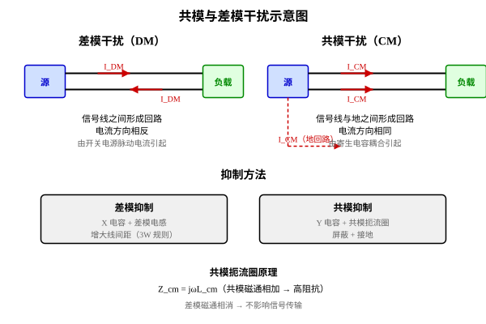
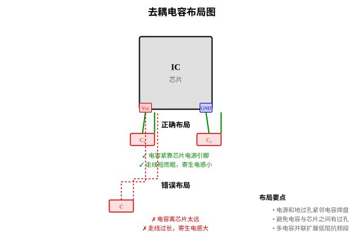
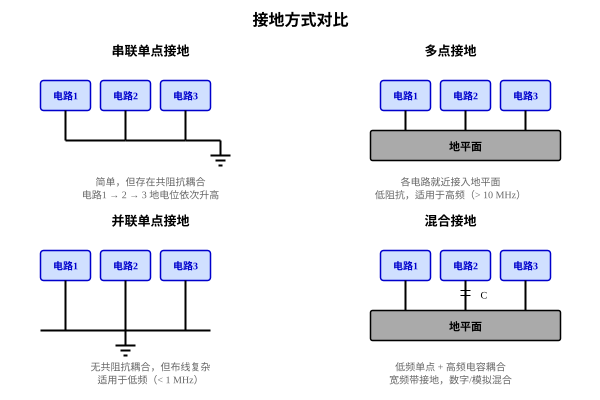

# 2.26 电磁兼容（EMC/EMI）

> **前置知识**：[2.25 信号完整性](2.25-信号完整性.md)（承接上一章）。

## 1. 引言

电磁兼容性（EMC，Electromagnetic Compatibility）是指电子设备在电磁环境中能正常工作且不产生不可接受的电磁干扰的能力。EMC 包含两个方面：电磁干扰（EMI）和电磁抗扰度（EMS）。随着电子设备密度增加和频率不断攀升，EMC 设计已成为产品能否通过认证、成功上市的关键因素。

## 2. EMC 基本概念

### 2.1 EMI 与 EMS

**EMI（Electromagnetic Interference，电磁干扰）**：
设备对外界产生的电磁骚扰：
- 传导发射（Conducted Emission）：通过电源线、信号线传导
- 辐射发射（Radiated Emission）：通过空间电磁波辐射

**EMS（Electromagnetic Susceptibility，电磁抗扰度）**：
设备抵抗外界电磁骚扰的能力：
- 静电放电（ESD）
- 电快速瞬变脉冲群（EFT/B）
- 浪涌（Surge）
- 射频场感应的传导骚扰（CS）
- 射频电磁场辐射抗扰度（RS）

### 2.2 EMC 三要素

任何 EMI 问题都包含三个要素：

1. **干扰源（Source）**：产生电磁能量的源头
2. **耦合路径（Coupling Path）**：干扰传播的通道
3. **敏感设备（Victim）**：受干扰影响的设备

EMC 设计的目标就是削弱其中至少一个要素。

### 2.3 传导发射与辐射发射

**传导发射**（150 kHz–30 MHz）：
- 通过电源线、信号线传导
- 分为差模（DM）和共模（CM）干扰

**辐射发射**（30 MHz–1 GHz 及以上）：
- 通过空间电磁场传播
- 远场辐射电场强度（对于短偶极子天线模型）：

$$E = \frac{1.26 \times 10^{-4} \cdot I \cdot l \cdot f^2}{r} \quad \text{(V/m)}$$

其中 $I$ 为电流（A），$l$ 为天线长度（m），$f$ 为频率（MHz），$r$ 为距离（m）。

## 3. 差模干扰与共模干扰

### 3.1 差模干扰（DM）

差模干扰电流在两条信号线之间形成回路，方向相反。主要由开关电源的脉动电流、数字电路的瞬态电流引起。

### 3.2 共模干扰（CM）

共模干扰电流在信号线和地之间流动，方向相同。主要由以下原因产生：
- 电路中的寄生电容耦合
- 地电位差
- 非对称电路结构

共模干扰比差模干扰更难抑制，且更容易产生辐射发射。

### 3.3 共模转差模

由于电路不对称，共模干扰会转化为差模干扰，影响信号质量。共模抑制的重要手段是**共模扼流圈**：

$$Z_{cm} = j\omega L_{cm}$$

其中 $L_{cm}$ 为共模电感（绕在同一磁芯上的两个绕组，共模磁通相加）。

## 4. 去耦电容

### 4.1 去耦电容的作用

去耦电容（Decoupling Capacitor）为芯片提供本地电荷存储，减小电源分配网络（PDN）的阻抗，抑制电源噪声。

### 4.2 电容的等效模型

实际电容的等效电路：理想电容 $C$ + 等效串联电阻 $ESR$ + 等效串联电感 $ESL$。

阻抗频率特性：

$$Z(f) = ESR + j\left(2\pi f \cdot ESL - \frac{1}{2\pi f \cdot C}\right)$$

自谐振频率（SRF）：

$$f_{SRF} = \frac{1}{2\pi\sqrt{ESL \cdot C}}$$

- $f < f_{SRF}$：电容呈容性
- $f = f_{SRF}$：阻抗最小，$Z = ESR$
- $f > f_{SRF}$：电容呈感性

### 4.3 电容的选择

**容量选择**：

$$C = \frac{I \cdot \Delta t}{\Delta V}$$

其中 $I$ 为瞬态电流，$\Delta t$ 为电流脉宽，$\Delta V$ 为允许的电压波动。

**多电容并联策略**：
- 大电容（10–100 μF）：提供低频能量，覆盖 kHz–MHz 频率
- 中电容（0.1–1 μF）：覆盖 MHz–数十 MHz
- 小电容（1–10 nF）：覆盖数十 MHz–数百 MHz

不同容值电容并联可扩展低阻抗频率范围。

### 4.4 PCB 布局要点

- 去耦电容应尽可能靠近芯片电源引脚
- 走线短而粗，减小寄生电感
- 电源和地过孔紧邻电容焊盘
- 避免电容与芯片之间有过孔
- 典型布局：电容 → 短走线 → 电源引脚 → 芯片

### 4.5 旁路电容与去耦电容的区别

| 特性 | 去耦电容 | 旁路电容 |
|------|---------|---------|
| 目的 | 为芯片提供本地电荷 | 将高频噪声旁路到地 |
| 位置 | 靠近芯片电源引脚 | 靠近噪声源或电源入口 |
| 容量 | 较大（μF 级） | 较小（nF 级） |
| 关注的频率 | 中低频（PDN 阻抗） | 高频（噪声滤波） |

两者在实践中常混用，但从原理上有区别。

## 5. 接地设计

### 5.1 接地的目的

- 为信号提供参考电位
- 为电流提供回流通路
- 实现电磁屏蔽
- 安全保护

### 5.2 单点接地

所有电路的地线在一个物理点汇聚。分为：
- **串联单点接地**：各电路地线串联，简单但存在共阻抗耦合
- **并联单点接地**：各电路地线独立汇聚，避免共阻抗耦合但布线复杂

适用于低频电路（< 1 MHz）。

### 5.3 多点接地

各电路就近连接到地平面。地平面提供低阻抗回流通路，适用于高频电路（> 10 MHz）。

### 5.4 混合接地

不同频率范围使用不同接地方式：低频用单点接地，高频用电容耦合到地平面，实现宽频带接地。

### 5.5 接地设计原则

- 保持地平面完整性，避免分割（除非隔离需要）
- 避免"地环路"（Ground Loop）
- 数字地和模拟地分开，在 ADC/DAC 下方单点连接
- 高速信号回流路径应紧邻信号走线（最小化环路面积）

## 6. 屏蔽技术

### 6.1 电场屏蔽

使用导电材料（铜、铝）包围敏感电路或干扰源，利用静电感应原理：

- 屏蔽体接地时，外部电场终止于屏蔽体表面
- 屏蔽效能取决于材料的导电性和接地质量

### 6.2 磁场屏蔽

低频磁场（< 100 kHz）屏蔽：
- 使用高磁导率材料（坡莫合金、铁氧体）
- 通过磁分路效应将磁场限制在屏蔽体内

高频磁场屏蔽：
- 利用涡流效应（良导体如铜、铝）
- 涡流产生的反向磁场抵消入射磁场

### 6.3 电磁屏蔽

同时屏蔽电场和磁场，屏蔽效能（SE）：

$$SE = R + A + B \quad \text{(dB)}$$

其中：
- $R$：反射损耗（与阻抗失配相关）
- $A$：吸收损耗（与材料厚度和趋肤深度相关）
- $B$：多次反射修正（薄材料时不可忽略）

吸收损耗：

$$A = 131.4 \cdot t \cdot \sqrt{f \cdot \mu_r \cdot \sigma_r} \quad \text{(dB)}$$

其中 $t$ 为材料厚度（m），$f$ 为频率（Hz），$\mu_r$ 为相对磁导率，$\sigma_r$ 为相对电导率。

### 6.4 缝隙与开口的影响

屏蔽体的缝隙和开口会严重降低屏蔽效能：

- 缝隙相当于缝隙天线，长度为 $\lambda/2$ 时辐射最强
- 缝隙长度应小于 $\lambda/20$（对应所需屏蔽的最高频率）
- 使用导电衬垫填充缝隙
- 通风孔使用蜂窝波导结构

## 7. PCB 布局中的 EMC 设计原则

### 7.1 层叠设计

- 高速信号层应紧邻完整地平面
- 关键信号（时钟、高速总线）走内层，两侧有地平面
- 电源层和地层紧邻（平面电容效应）
- 推荐的 4 层板层叠：信号–地–电源–信号

### 7.2 走线原则

- 避免 90° 拐角，使用 45° 或圆弧
- 关键信号走线长度尽量短
- 信号环路面积最小化
- 差分信号保持等长、等间距
- 时钟走线远离 I/O 接口和板边

### 7.3 20H 规则

电源层边缘比地层边缘内缩 20 倍介质厚度（$20H$），减少边缘辐射：

$$d_{edge} = 20 \times h$$

其中 $h$ 为电源层与地层之间的介质厚度。

### 7.4 I/O 区域隔离

- 在 PCB 上划分"安静区"和"噪声区"
- 数字电路、开关电源放在远离 I/O 接口的位置
- I/O 接口区域使用滤波、隔离措施
- 板边使用地线包围（Guard Ring）

## 8. EMC 标准体系

前述各节讨论的是"设计预防"层面——从源头降低发射、提升抗扰度。但衡量一个产品是否合格，最终要由**标准**与**测试**来裁决。EMC 工程闭环包含"标准 → 测试 → 整改"三个环节，本小节从标准讲起。

### 8.1 国际与国内标准概览

- **CISPR（国际无线电干扰特别委员会）**：隶属 IEC，制定无线电骚扰测量与限值的基础标准。例如 **CISPR 32** 覆盖多媒体设备的传导与辐射发射，是许多国家采纳限值的蓝本。
- **FCC（美国联邦通信委员会）**：通过法规强制要求进入美国市场的设备满足发射限值。例如 **FCC Part 15** 规定了有意/无意辐射体的辐射发射与传导发射限值，是北美上市的硬性门槛。
- **GB（国家标准）**：国内参照 CISPR 体系转化而来，如 GB/T 9254（信息技术设备）、GB 4824（工业、科学和医疗设备）等，用于国内强制认证（CCC）与入网测试。

不同标准在频段划分、限值分级、测试距离上略有差异，但设计宗旨一致：在保证功能的前提下，把对外界的"干扰足迹"控制在可接受范围内。

### 8.2 辐射/传导限值为何重要

标准给出的限值曲线（如辐射限值单位 dBμV/m，传导限值单位 dBμV）规定了发射的"天花板"。这里有两个概念：

- **商用量（Commercial）**：面向消费市场的较宽松限值（多为 CISPR Class B，如 CISPR 32 Class B），是绝大多数消费电子产品需要满足的标准。
- **限值等级（Limit Class）**：同一标准往往再分等级（如 Class A / Class B，或 CISPR 32 的 Class A / Class B）。工业/商用量常对应较松的 Class A，家用/商用量对应更严的 Class B。

理解限值等级的意义在于：设计目标不是"越安静越好"，而是"留出足够的裕量（Margin）跨过限值"。预留 3–6 dB 裕量是工程惯例，因为批量间器件、装配差异会导致发射波动，只贴着限值过线极易在复测时翻车。

## 9. EMC 测试方法

标准规定了"测什么、在哪测、怎么测"。核心的测试分为发射测试（EMI）与抗扰度测试（EMS）两大类，这里聚焦发射类测试。

### 9.1 辐射发射测试

辐射发射在**电波暗室（Anechoic Chamber）**中进行，暗室内壁贴吸波材料、屏蔽外界电磁环境，从而提供"静区"内的稳定测量条件。

- **3m 法 / 10m 法**：指接收天线与被测设备（EUT）之间的距离。3m 法场地小、成本低；10m 法更接近真实远场、结果更保守，是许多标准（如 CISPR 类）自洽限值所基于的参考距离。测试时在水平/垂直两种极化、驻留各频点扫描，参照环境噪声与限值线判定余量。

### 9.2 传导发射测试

传导发射在 150 kHz–30 MHz 频段用**线路阻抗稳定网络（LISN，Line Impedance Stabilization Network）**测量。其核心作用是在被测设备与电源之间提供一个**稳定、已知、复现性好**的阻抗，使不同实验室测得的结果可比，同时把电源侧噪声隔离开、只让设备自身产生的传导干扰进入接收机。

### 9.3 近场探头预扫描

正式认证前，常用**近场探头（Near-field Probe）**配合频谱分析仪做**预扫描**。小体积探头贴近 PCB 表面即可定位到"哪个器件、哪段走线、哪个频点"辐射最强，属于**预兼容测试（Pre-compliance Test）**，可在设计早期快速发现并定位问题，成本远低于正式测试。正式测试用于最终认证，预兼容测试用于帮助整改定位，两者互补。

## 10. EMI 滤波器设计

当去耦、布局、接地等手段仍然压不住发射时，就需要在**端口**（电源入口、I/O）处加滤波器，以"堵"的方式抑制干扰。电源线滤波器是工程中最常见的一类。

### 10.1 电源线滤波器的构成

电源线滤波器主要包含三类元件：

- **共模扼流圈（Common-mode Choke）**：两只绕组绕在同一磁芯上。差模电流在磁芯中产生的磁通彼此抵消，几乎不呈现阻抗；共模电流同向使磁通相加，表现为高阻抗，从而抑制共模干扰。其阻抗模型即 3.3 节给出的 $Z_{cm} = j\omega L_{cm}$，这里正是该公式的工程落点。
- **X 电容（X capacitor）**：跨接在 L/N 两线之间，面向**差模**干扰提供低阻抗旁路，抑制差模噪声。因直接跨在电源线上，需选用 X 级安规电容。
- **Y 电容（Y capacitor）**：跨接在火线/零线与地之间，面向**共模**干扰。同样需用 Y 级安规电容，且容量受漏电流限制、取值远小于 X 电容。

### 10.2 选型原则

- 共模扼流圈的电感量以目标频段的共模阻抗需求为基准，同时注意避免与分布电容形成谐振放大；选择磁芯材料时兼顾高频特性和饱和电流能力。
- X、Y 电容容量在满足滤波需求与安规（漏电流上限、耐压）之间权衡：Y 电容越大滤波越好，但漏电流风险越高。
- 遵循"阻抗失配"原则放置：低阻抗源串联高阻抗，高阻抗源并联低阻抗，使滤波器插在最能体现衰耗的位置。典型布局如下：

| 环节 | 元件 | 抑制对象 | 典型位置 |
|------|------|---------|---------|
| 共模抑制 | 共模扼流圈 | 共模干扰 | 电源线入口穿入的整根线上 |
| 差模抑制 | X 电容 | 差模干扰 | L–N 之间 |
| 共模抑制 | Y 电容 | 共模到地 | L/N–PE 之间 |

## 11. 板级 ESD 防护（EMS 整改）

2.1 节列出了 ESD、EFT、浪涌等 EMS 现象，本小节从"对策"而非仅"现象"的角度，讨论**板级保护器件**的选用。

### 11.1 三类常见保护器件

| 器件 | 特点 | 适用位置 |
|------|------|---------|
| **TVS 管** | 响应极快（ps–ns 级）、钳位电压精确，但通流能力相对有限 | 高速信号线（USB、HDMI）、芯片引脚就近，用于 ESD 精细钳位 |
| **气体放电管（GDT）** | 通流能力强、电容小，但响应慢、导通残压高（续流） | 电源线、信号线入口的一级防雷/浪涌泄放 |
| **压敏电阻（MOV）** | 通流较强、成本低，但响应较慢、老化后漏电流增大 | 电源输入端的中级浪涌吸收 |

### 11.2 分级防护原则

实际端口往往采用**多级防护**：入口先由 GDT / MOV 泄放大部分能量，再由 TVS 做精细钳位，中间以去耦电阻/扼流圈限流并拉开两级器件的开启时间差。分级的关键是让"慢而强的器件在前、快而精的器件在后"，才能真正保护到最敏感的后级芯片。

### 11.3 与 IC 内部 ESD 的分工

本小节讨论的是**板级**防护（器件加在 PCB 端口、保护整机），而片上防护发生在**芯片内部**，两者共同构成完整的 ESD 保护体系。IC 内部 ESD 保护网络的设计思路见 [4.18 ESD保护设计](../../04-集成电路设计/芯片设计/4.18-ESD保护设计.md)。当板级保护与片内保护协调时，外部干扰应在到达芯片内部结构之前被耗散掉，从而优先牺牲外部器件、保护内部更贵的电路。

## 12. EMC 整改排查

当测试超标或现场暴露骚扰问题时，遵循"测量 → 定位 → 整改 → 复测"的闭环流程，比盲目尝试更高效：

1. **测量**：先定量测量。辐射超标查暗室/近场探头频谱，传导超标查 LISN 结果，明确超标的频点与幅度。
2. **定位**：结合频谱特征反溯源头——窄带尖峰多与时钟/开关频率及其谐波相关，宽带底噪多与开关瞬态、地弹相关；再用近场探头锁定具体器件和走线区段。
3. **整改**：按"先源头后路径"行动——优化去耦与布局、调整接地、加屏蔽、加滤波器，每次只改一个变量以确证因果关系（参见第 4、5、6、10 章）。
4. **复测**：整改后重新测量确认频点与裕量，并保留裕量（见 8.2 节）。

## 小结

1. EMC 包含 EMI（发射）和 EMS（抗扰度）两个方面
2. 差模干扰和共模干扰需要不同的抑制手段
3. 去耦电容是控制 PDN 阻抗的关键，需合理选择容值和布局
4. 接地方式（单点、多点、混合）需根据频率选择
5. 屏蔽效能取决于材料、厚度、频率和结构完整性
6. PCB EMC 设计的关键是层叠、走线、20H 规则和 I/O 隔离
7. EMC 设计应在产品开发早期介入，后期修改成本极高
8. 设计预防之外，需通过标准（CISPR / FCC / GB）与测试（暗室 3m/10m 法、LISN、近场预扫描）构成"标准 → 测试 → 整改"闭环
9. 端口超标时用电源线滤波器（共模扼流圈 + X/Y 电容）与板级保护器件（TVS、GDT、压敏电阻）"堵住"残余干扰
10. EMC 整改遵循"测量 → 定位 → 整改 → 复测"流程，并预留限值裕量

## 自测清单

1. 「引言」要解决的核心问题是什么？关键结论或公式是什么？
2. 「EMC 基本概念」与上一节之间是什么关系？
3. 「差模干扰与共模干扰」在什么场景下会用到？如果条件改变，结论会如何变化？
4. 能否不看正文，写出「去耦电容」的关键流程或结构？
5. 「接地设计」最容易混淆的点是什么？

---

**下一章**：[3.1 数制与编码](../../03-数字与计算机系统/数字电路/3.1-数制与编码.md)
