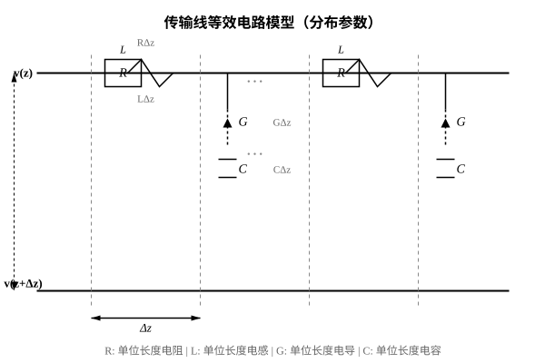
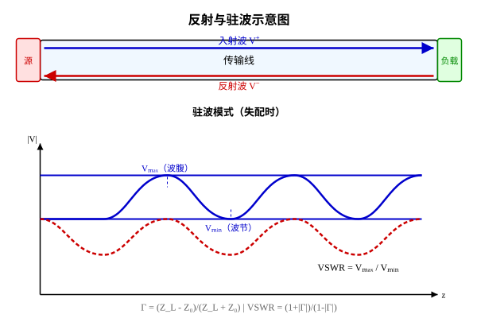

# 2.17 传输线理论

> **本章定位**：从集总电路转向分布参数，建立传输线、阻抗匹配与 S 参数的高频视角。

> **前置知识**：[2.6 频率响应](../模拟电路/2.6-频率响应.md)；[1.26 正弦稳态分析](../../01-基础与电路分析/电路原理/1.26-正弦稳态分析.md)。

## 1. 引言

在低频电路中，我们习惯于使用集总参数模型（Lumped Parameter Model），即将电阻、电容、电感视为空间上集中于一点的元件，导线仅起连接作用。然而，当信号频率升高到一定程度，导线的长度与信号波长可比拟时，导线上的电压和电流不再处处相等，此时必须采用分布参数模型（Distributed Parameter Model），即传输线理论。

## 2. 集总参数与分布参数的区别

### 2.1 何时必须使用传输线模型

判断标准：当互连线的物理长度 $l$ 与信号波长 $\lambda$ 满足以下条件时，需使用传输线模型：

$$l \geq \frac{\lambda}{10}$$

其中波长 $\lambda$ 与频率 $f$、信号传播速度 $v$ 的关系为：

$$\lambda = \frac{v}{f}$$

在典型 FR-4 介质（介电常数 $\varepsilon_r \approx 4$）中，信号传播速度约为：

$$v \approx \frac{c}{\sqrt{\varepsilon_r}} \approx 1.5 \times 10^8 \text{ m/s}$$

例如，对于 1 GHz 信号，$\lambda \approx 15$ cm，因此当走线长度超过约 1.5 cm 时就应考虑传输线效应。

### 2.2 集总参数模型的局限性

- 集总参数模型假设电路尺寸远小于波长，电压和电流处处相等
- 实际上，高频信号在导体上以电磁波形式传播，存在相位延迟
- 当 $l \geq \lambda/10$ 时，沿线各点的电压和电流幅值、相位均不同

## 3. 传输线等效电路模型

### 3.1 单位长度参数

将传输线划分为无限多个长度为 $\Delta z$ 的微小线段，每个线段可用以下四个单位长度参数描述：

| 参数 | 名称 | 单位 | 物理意义 |
|------|------|------|----------|
| $R$ | 单位长度电阻 | $\Omega/\text{m}$ | 导体损耗（趋肤效应） |
| $L$ | 单位长度电感 | $\text{H}/\text{m}$ | 导体的自感 |
| $G$ | 单位长度电导 | $\text{S}/\text{m}$ | 介质损耗 |
| $C$ | 单位长度电容 | $\text{F}/\text{m}$ | 导体间电容 |

## 4. 电报方程与波动方程

### 4.1 电报方程（Telegrapher's Equations）

对传输线微元应用基尔霍夫电压定律和电流定律，令 $\Delta z \to 0$，得到：

$$\frac{\partial v(z,t)}{\partial z} = -R \cdot i(z,t) - L \cdot \frac{\partial i(z,t)}{\partial t}$$

$$\frac{\partial i(z,t)}{\partial z} = -G \cdot v(z,t) - C \cdot \frac{\partial v(z,t)}{\partial t}$$

### 4.2 频域（相量）形式

对于正弦稳态，使用相量表示 $V(z)$ 和 $I(z)$：

$$\frac{dV(z)}{dz} = -(R + j\omega L) \cdot I(z)$$

$$\frac{dI(z)}{dz} = -(G + j\omega C) \cdot V(z)$$

### 4.3 波动方程

将上述方程联立，消去 $I(z)$ 或 $V(z)$，得到波动方程：

$$\frac{d^2V(z)}{dz^2} = \gamma^2 V(z)$$

$$\frac{d^2I(z)}{dz^2} = \gamma^2 I(z)$$

## 5. 特征阻抗与传播常数

### 5.1 传播常数 $\gamma$

$$\gamma = \sqrt{(R + j\omega L)(G + j\omega C)} = \alpha + j\beta$$

其中：
- $\alpha$：**衰减常数**（Np/m），描述波沿传输线传播时的幅度衰减
- $\beta$：**相位常数**（rad/m），描述波沿传输线传播时的相位变化

### 5.2 特征阻抗 $Z_0$

特征阻抗是传输线最重要的参数之一，定义为传输线上电压波与电流波之比：

$$Z_0 = \sqrt{\frac{R + j\omega L}{G + j\omega C}}$$

特征阻抗的物理意义：无限长传输线的输入阻抗，或终端匹配时传输线的输入阻抗。

### 5.3 相速度与波长

相速度 $v_p$ 是等相位面沿传输线移动的速度：

$$v_p = \frac{\omega}{\beta}$$

波长 $\lambda$ 为：

$$\lambda = \frac{2\pi}{\beta} = \frac{v_p}{f}$$

## 6. 无损耗传输线

在实际工程中，当频率较高时，通常满足 $R \ll \omega L$ 且 $G \ll \omega C$，此时可近似为无损耗传输线：

### 6.1 简化参数

$$\gamma \approx j\omega\sqrt{LC}, \quad \alpha = 0, \quad \beta = \omega\sqrt{LC}$$

$$Z_0 = \sqrt{\frac{L}{C}}$$

相速度：

$$v_p = \frac{1}{\sqrt{LC}}$$

### 6.2 无损耗传输线的波动方程解

$$V(z) = V^+ e^{-j\beta z} + V^- e^{+j\beta z}$$

$$I(z) = \frac{V^+}{Z_0} e^{-j\beta z} - \frac{V^-}{Z_0} e^{+j\beta z}$$

其中 $V^+$ 为入射波幅值，$V^-$ 为反射波幅值。

## 7. 反射系数与驻波比

### 7.1 反射系数 $\Gamma$

当传输线终端接负载 $Z_L$ 时，反射系数定义为反射波与入射波之比：

$$\Gamma_L = \frac{V^-}{V^+} = \frac{Z_L - Z_0}{Z_L + Z_0}$$

重要特例：
- **匹配负载**（$Z_L = Z_0$）：$\Gamma_L = 0$，无反射
- **短路**（$Z_L = 0$）：$\Gamma_L = -1$，全反射（反相）
- **开路**（$Z_L = \infty$）：$\Gamma_L = +1$，全反射（同相）

在传输线上任意位置 $z$ 处的反射系数：

$$\Gamma(z) = \Gamma_L \cdot e^{-j2\beta z}$$

### 7.2 输入阻抗

距离负载 $d$ 处的输入阻抗：

$$Z_{in}(d) = Z_0 \cdot \frac{Z_L + jZ_0 \tan(\beta d)}{Z_0 + jZ_L \tan(\beta d)}$$

### 7.3 电压驻波比 VSWR

驻波比是衡量传输线匹配程度的重要指标：

$$VSWR = \frac{V_{max}}{V_{min}} = \frac{1 + |\Gamma_L|}{1 - |\Gamma_L|}$$

- VSWR = 1：完全匹配，无反射
- VSWR → ∞：全反射（开路或短路）
- 工程中通常要求 VSWR < 2.0（对应 $|\Gamma| < 0.33$）

## 8. 传输线的终端条件

### 8.1 短路传输线（$Z_L = 0$）

$$\Gamma_L = -1, \quad Z_{in}(d) = jZ_0 \tan(\beta d)$$

输入阻抗为纯电抗，根据长度不同可表现为电感或电容。

### 8.2 开路传输线（$Z_L = \infty$）

$$\Gamma_L = +1, \quad Z_{in}(d) = -jZ_0 \cot(\beta d)$$

同样为纯电抗。

### 8.3 匹配传输线（$Z_L = Z_0$）

$$\Gamma_L = 0, \quad Z_{in}(d) = Z_0$$

无反射，传输线上电压幅值处处相等，实现最大功率传输。

### 8.4 四分之一波长变换器

当 $d = \lambda/4$ 时（$\beta d = \pi/2$）：

$$Z_{in} = \frac{Z_0^2}{Z_L}$$

这一特性被广泛用于阻抗匹配设计。

## 小结

传输线理论是高频电路设计的基础。关键要点：

1. 当走线长度超过 $\lambda/10$ 时，必须使用传输线模型
2. 特征阻抗 $Z_0$ 和传播常数 $\gamma$ 是传输线的核心参数
3. 反射系数 $\Gamma$ 和 VSWR 衡量匹配程度
4. 无损耗传输线模型是工程中最常用的近似
5. 阻抗匹配是实现最大功率传输、消除反射的关键

## 自测清单

1. 「引言」要解决的核心问题是什么？关键结论或公式是什么？
2. 「集总参数与分布参数的区别」与上一节之间是什么关系？
3. 「传输线等效电路模型」在什么场景下会用到？如果条件改变，结论会如何变化？
4. 能否不看正文，写出「电报方程与波动方程」的关键流程或结构？
5. 「特征阻抗与传播常数」最容易混淆的点是什么？

---

**下一章**：[2.18 阻抗匹配与Smith圆图](2.18-阻抗匹配与Smith圆图.md)
