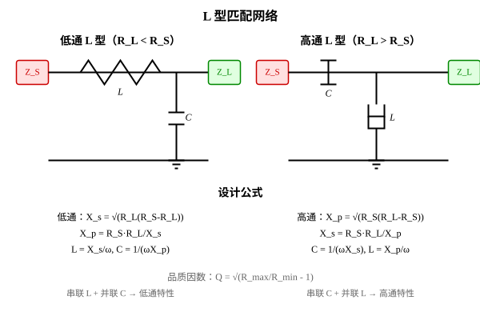
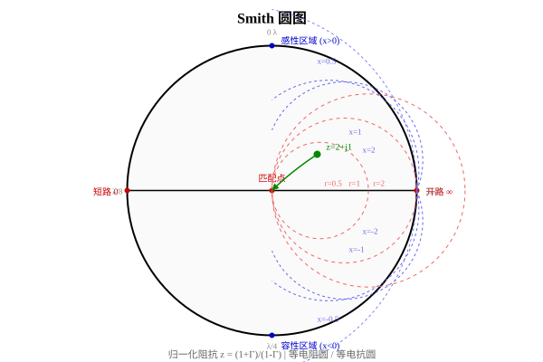

# 2.18 阻抗匹配与Smith圆图

> **前置知识**：[2.17 传输线理论](2.17-传输线理论.md)（承接上一章）。

## 1. 引言

在射频电路设计中，阻抗匹配是最基本也是最重要的技术之一。阻抗不匹配会导致信号反射，造成功率传输效率降低、信号失真，甚至损坏功放等有源器件。Smith 圆图是射频工程师最常用的阻抗匹配设计工具，它将复杂的阻抗变换计算转化为直观的图解操作。

## 2. 阻抗匹配的意义

### 2.1 最大功率传输定理

从源阻抗 $Z_S = R_S + jX_S$ 向负载阻抗 $Z_L = R_L + jX_L$ 传输功率时，负载获得的平均功率为：

$$P_L = \frac{|V_S|^2 R_L}{(R_S + R_L)^2 + (X_S + X_L)^2}$$

当满足共轭匹配条件时，负载获得最大功率：

$$Z_L = Z_S^* \quad \text{即} \quad R_L = R_S, \quad X_L = -X_S$$

最大传输功率为：

$$P_{max} = \frac{|V_S|^2}{4R_S}$$

### 2.2 消除反射

反射系数 $\Gamma$ 与失配的关系：

$$\Gamma = \frac{Z_L - Z_0}{Z_L + Z_0}$$

不匹配会导致：
- 功率反射回源端，降低传输效率
- 在传输线上形成驻波，某些位置电压过高可能损坏器件
- 信号失真（多径反射导致码间干扰）

### 2.3 匹配网络的作用

匹配网络是一个无耗（理想情况下）的无源网络，插入在源与负载之间，使从源端看入的阻抗等于源阻抗的共轭。

## 3. L 型匹配网络

L 型匹配网络是最简单的匹配网络，由两个电抗元件（电感或电容）组成，呈 L 形拓扑。

### 3.1 低通 L 型匹配

当 $R_L < R_S$ 时（负载电阻小于源电阻）：

- 串联电感 + 并联电容（低通形式）
- 串联支路：$X_s = \sqrt{R_L(R_S - R_L)}$
- 并联支路：$X_p = \frac{R_S R_L}{X_s}$

转换为实际元件值（频率 $\omega$）：

$$L = \frac{X_s}{\omega}, \quad C = \frac{1}{\omega X_p}$$

### 3.2 高通 L 型匹配

当 $R_L > R_S$ 时（负载电阻大于源电阻）：

- 串联电容 + 并联电感（高通形式）
- 并联支路：$X_p = \sqrt{R_S(R_L - R_S)}$
- 串联支路：$X_s = \frac{R_S R_L}{X_p}$

### 3.3 L 型网络的品质因数

L 型匹配网络的 Q 值由电阻比决定，不可独立选择：

$$Q = \sqrt{\frac{R_{max}}{R_{min}} - 1}$$

## 4. π 型与 T 型匹配网络

### 4.1 π 型匹配网络

π 型网络由三个电抗元件组成，呈 π 形拓扑（两个并联支路 + 一个串联支路）。优势在于可以独立选择 Q 值，从而控制带宽。

设计步骤：
1. 选定中间节点阻抗 $R_{int}$（需满足 $R_{int} < \min(R_S, R_L)$）
2. 将 π 型网络分解为两个背靠背的 L 型网络
3. 分别设计两段 L 型匹配

### 4.2 T 型匹配网络

T 型网络由三个电抗元件组成，呈 T 形拓扑（两个串联支路 + 一个并联支路）。同样可独立选择 Q 值。

设计步骤：
1. 选定中间节点阻抗 $R_{int}$（需满足 $R_{int} > \max(R_S, R_L)$）
2. 将 T 型网络分解为两个背靠背的 L 型网络
3. 分别设计两段 L 型匹配

## 5. Smith 圆图的基本原理

### 5.1 反射系数平面

Smith 圆图是反射系数 $\Gamma = \Gamma_r + j\Gamma_i$ 在复平面上的图形表示。归一化阻抗 $z = r + jx$ 与反射系数的关系：

$$z = \frac{Z}{Z_0} = \frac{1 + \Gamma}{1 - \Gamma}, \quad \Gamma = \frac{z - 1}{z + 1}$$

这是复平面上的**分式线性变换（Möbius 变换）**，具有保圆性。

### 5.2 等电阻圆

将 $\Gamma = \Gamma_r + j\Gamma_i$ 代入 $z$ 表达式，分离实部：

$$r = \frac{1 - \Gamma_r^2 - \Gamma_i^2}{(1 - \Gamma_r)^2 + \Gamma_i^2}$$

整理得等电阻圆方程：

$$\left(\Gamma_r - \frac{r}{r+1}\right)^2 + \Gamma_i^2 = \left(\frac{1}{r+1}\right)^2$$

- 圆心：$\left(\frac{r}{r+1}, 0\right)$
- 半径：$\frac{1}{r+1}$

所有等电阻圆都经过点 $(1, 0)$（即 $\Gamma = 1$，对应开路点）。

### 5.3 等电抗圆

分离虚部得等电抗圆方程：

$$(\Gamma_r - 1)^2 + \left(\Gamma_i - \frac{1}{x}\right)^2 = \left(\frac{1}{x}\right)^2$$

- 圆心：$\left(1, \frac{1}{x}\right)$
- 半径：$\frac{1}{|x|}$

所有等电抗圆都经过点 $(1, 0)$。

### 5.4 Smith 圆图上的关键点

| 点 | 归一化阻抗 | 反射系数 |
|----|-----------|---------|
| 中心点 | $z = 1$（匹配） | $\Gamma = 0$ |
| 最右端 | $z = \infty$（开路） | $\Gamma = 1$ |
| 最左端 | $z = 0$（短路） | $\Gamma = -1$ |
| 上半圆 | 感性区域（$x > 0$） | — |
| 下半圆 | 容性区域（$x < 0$） | — |

## 6. Smith 圆图上的阻抗变换

### 6.1 串联元件

串联电感：沿等电阻圆向**顺时针**方向移动（感抗增加）
串联电容：沿等电阻圆向**逆时针**方向移动（容抗增加，即感抗减小）

### 6.2 并联元件

使用导纳 Smith 圆图更为方便。归一化导纳 $y = g + jb$：

$$y = \frac{1}{z} = \frac{1 - \Gamma}{1 + \Gamma}$$

并联电感：沿等电导圆向逆时针方向移动
并联电容：沿等电导圆向顺时针方向移动

### 6.3 传输线变换

在传输线上移动距离 $d$，反射系数旋转 $-2\beta d$ 角度：

$$\Gamma(d) = \Gamma_L \cdot e^{-j2\beta d}$$

在 Smith 圆图上，沿等 $|\Gamma|$ 圆（即等 VSWR 圆）旋转：
- 向负载方向移动：**逆时针**旋转
- 向源方向移动：**顺时针**旋转

## 7. 使用 Smith 圆图设计匹配网络

### 7.1 设计步骤

1. 在 Smith 圆图上标出归一化负载阻抗 $z_L$ 和源阻抗 $z_S$
2. 确定匹配路径：通过串联/并联元件和传输线变换，将 $z_L$ 变换到 $z_S^*$
3. 根据路径长度计算元件值

### 7.2 示例

假设负载 $Z_L = 100 + j50\ \Omega$，需匹配到 $Z_0 = 50\ \Omega$，频率 $f = 1\ \text{GHz}$。

归一化负载：$z_L = 2 + j1$，目标：$z_{in} = 1$。

## 8. 单支节匹配

单支节匹配使用一段传输线和一个并联（或串联）短路/开路支节实现匹配。

### 8.1 并联支节匹配

设计步骤：
1. 从负载出发，沿传输线向源方向移动距离 $d$，使该点导纳的实部等于 $Y_0 = 1/Z_0$
2. 在 $d$ 处并联一个长度为 $l$ 的短路或开路支节，抵消虚部

支节长度 $l$ 的计算：
- 短路支节：$jB = -jY_0 \cot(\beta l)$
- 开路支节：$jB = jY_0 \tan(\beta l)$

### 8.2 串联支节匹配

类似原理，但使用串联支节，在阻抗 Smith 圆图上操作。

### 8.3 双支节匹配

使用两个固定位置的支节，通过调整支节长度实现匹配。解决了单支节匹配中 $d$ 可能不便于实现的问题。

## 小结

1. 阻抗匹配的核心目标是最大化功率传输和消除反射
2. L 型匹配网络是最简单的匹配方案，但 Q 值不可选
3. π 型和 T 型网络可独立设计 Q 值，但元件更多
4. Smith 圆图是阻抗匹配的强有力可视化工具
5. 单支节匹配是实践中常用的窄带匹配方案

## 自测清单

1. 「引言」要解决的核心问题是什么？关键结论或公式是什么？
2. 「阻抗匹配的意义」与上一节之间是什么关系？
3. 「L 型匹配网络」在什么场景下会用到？如果条件改变，结论会如何变化？
4. 能否不看正文，写出「π 型与 T 型匹配网络」的关键流程或结构？
5. 「Smith 圆图的基本原理」最容易混淆的点是什么？

---

**下一章**：[2.19 S参数](2.19-S参数.md)
