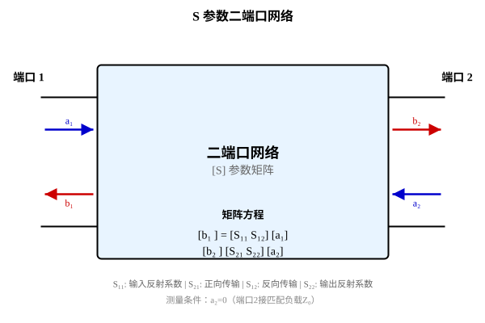
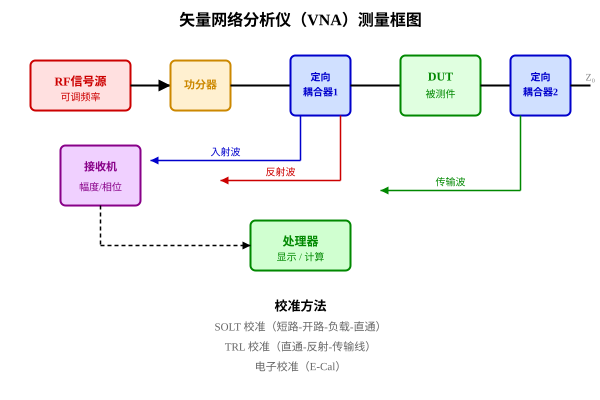

# 2.19 S参数

> **前置知识**：[2.18 阻抗匹配与Smith圆图](2.18-阻抗匹配与Smith圆图.md)（承接上一章）。

## 1. 引言

在低频电路中，我们常用 Z 参数、Y 参数、H 参数和 ABCD 参数来描述二端口网络。然而，当频率升高到射频/微波频段时，这些参数面临一个根本性问题：难以实现理想的**开路**和**短路**条件。S 参数（散射参数，Scattering Parameters）通过使用**入射波**和**反射波**的概念，以**匹配终端**为参考条件，完美解决了这一问题。

## 2. 二端口网络参数回顾

### 2.1 Z 参数（阻抗参数）

$$\begin{bmatrix} V_1 \\ V_2 \end{bmatrix} = \begin{bmatrix} Z_{11} & Z_{12} \\ Z_{21} & Z_{22} \end{bmatrix} \begin{bmatrix} I_1 \\ I_2 \end{bmatrix}$$

测量条件：端口开路（$I_1 = 0$ 或 $I_2 = 0$）。高频下难以实现理想开路。

### 2.2 Y 参数（导纳参数）

$$\begin{bmatrix} I_1 \\ I_2 \end{bmatrix} = \begin{bmatrix} Y_{11} & Y_{12} \\ Y_{21} & Y_{22} \end{bmatrix} \begin{bmatrix} V_1 \\ V_2 \end{bmatrix}$$

测量条件：端口短路（$V_1 = 0$ 或 $V_2 = 0$）。高频下寄生电感使短路不理想。

### 2.3 ABCD 参数（传输参数）

$$\begin{bmatrix} V_1 \\ I_1 \end{bmatrix} = \begin{bmatrix} A & B \\ C & D \end{bmatrix} \begin{bmatrix} V_2 \\ -I_2 \end{bmatrix}$$

适用于级联网络分析，但同样面临高频测量困难。

### 2.4 为什么需要 S 参数

- 高频下开路/短路难以实现 → 振荡、寄生效应
- S 参数使用匹配负载（$Z_0$，通常 50Ω）作为参考，易于实现
- 入射波和反射波具有明确的物理意义
- 直接与功率增益、反射损耗等工程指标关联

## 3. S 参数的定义

### 3.1 入射波与反射波

定义归一化电压波（功率波）：

$$a_i = \frac{V_i^+}{\sqrt{Z_0}} = \frac{V_i + Z_0 I_i}{2\sqrt{Z_0}}$$

$$b_i = \frac{V_i^-}{\sqrt{Z_0}} = \frac{V_i - Z_0 I_i}{2\sqrt{Z_0}}$$

其中 $a_i$ 为端口 $i$ 的入射波，$b_i$ 为端口 $i$ 的反射波。$|a_i|^2$ 和 $|b_i|^2$ 分别代表入射和反射功率。

### 3.2 S 参数矩阵

对于二端口网络：

$$\begin{bmatrix} b_1 \\ b_2 \end{bmatrix} = \begin{bmatrix} S_{11} & S_{12} \\ S_{21} & S_{22} \end{bmatrix} \begin{bmatrix} a_1 \\ a_2 \end{bmatrix}$$

### 3.3 各 S 参数的物理意义

| 参数 | 名称 | 定义 | 物理意义 |
|------|------|------|----------|
| $S_{11}$ | 输入反射系数 | $S_{11} = \frac{b_1}{a_1}\big|_{a_2=0}$ | 输出端口匹配时，输入端口的反射系数 |
| $S_{21}$ | 正向传输系数 | $S_{21} = \frac{b_2}{a_1}\big|_{a_2=0}$ | 输出端口匹配时，从端口1到端口2的传输增益 |
| $S_{12}$ | 反向传输系数 | $S_{12} = \frac{b_1}{a_2}\big|_{a_1=0}$ | 输入端口匹配时，从端口2到端口1的反向传输增益 |
| $S_{22}$ | 输出反射系数 | $S_{22} = \frac{b_2}{a_2}\big|_{a_1=0}$ | 输入端口匹配时，输出端口的反射系数 |

**测量条件**：$a_2 = 0$ 意味着端口 2 接匹配负载 $Z_0$（无反射回网络的波）。

## 4. S 参数与阻抗的关系

### 4.1 输入反射系数

当端口 2 接任意负载 $Z_L$（对应反射系数 $\Gamma_L$）时，端口 1 的实际反射系数为：

$$\Gamma_{in} = S_{11} + \frac{S_{12} S_{21} \Gamma_L}{1 - S_{22} \Gamma_L}$$

当端口 2 匹配（$\Gamma_L = 0$）时：$\Gamma_{in} = S_{11}$。

### 4.2 S 参数与 Z 参数的转换

$$S_{11} = \frac{(Z_{11} - Z_0)(Z_{22} + Z_0) - Z_{12}Z_{21}}{\Delta Z}$$

$$S_{21} = \frac{2Z_{21}Z_0}{\Delta Z}$$

其中 $\Delta Z = (Z_{11} + Z_0)(Z_{22} + Z_0) - Z_{12}Z_{21}$。

### 4.3 用 S 参数表示输入阻抗

$$Z_{in} = Z_0 \cdot \frac{1 + S_{11}}{1 - S_{11}} \quad (\text{当端口2匹配时})$$

## 5. 回波损耗与插入损耗

### 5.1 回波损耗（Return Loss）

回波损耗衡量端口匹配程度，定义为反射功率与入射功率之比（dB）：

$$RL_1 = -20 \log_{10} |S_{11}| \quad \text{(dB)}$$

$$RL_2 = -20 \log_{10} |S_{22}| \quad \text{(dB)}$$

- $RL = \infty$ dB：完全匹配（$S_{11} = 0$）
- $RL = 0$ dB：全反射（$|S_{11}| = 1$）
- 工程中通常要求 $RL > 10$ dB（VSWR < 2.0）

### 5.2 插入损耗（Insertion Loss）

插入损耗衡量信号通过网络的衰减：

$$IL = -20 \log_{10} |S_{21}| \quad \text{(dB)}$$

理想无损传输：$IL = 0$ dB（$|S_{21}| = 1$）。

### 5.3 隔离度（Isolation）

$$I = -20 \log_{10} |S_{12}| \quad \text{(dB)}$$

隔离度越大，反向传输越小。

## 6. 矢量网络分析仪（VNA）

### 6.1 基本原理

矢量网络分析仪（VNA）是测量 S 参数的标准仪器。其核心组成：

1. **射频信号源**：产生可调频率的激励信号
2. **定向耦合器/电桥**：分离入射波和反射波
3. **接收机**：测量入射波和反射波的幅度和相位
4. **校准件**：SOLT（短路-开路-负载-直通）校准标准

### 6.2 校准方法

VNA 测量前必须校准以消除系统误差：

- **SOLT 校准**：最常用的同轴校准方法，需要短路、开路、负载和直通标准件
- **TRL 校准**：适用于非同轴环境（如微带线），需要直通、反射和传输线标准件
- **电子校准（E-Cal）**：使用电子校准模块，快速方便

### 6.3 误差模型

VNA 的 12 项误差模型包括：
- 方向性误差（Directivity）
- 源匹配误差（Source Match）
- 负载匹配误差（Load Match）
- 反射跟踪误差（Reflection Tracking）
- 传输跟踪误差（Transmission Tracking）
- 串扰误差（Crosstalk）

## 7. S 参数在放大器设计中的应用

### 7.1 稳定性分析

放大器必须满足稳定性条件，否则会自激振荡。定义稳定性因子：

$$K = \frac{1 - |S_{11}|^2 - |S_{22}|^2 + |\Delta|^2}{2|S_{12}S_{21}|}$$

其中 $\Delta = S_{11}S_{22} - S_{12}S_{21}$。

无条件稳定条件：$K > 1$ 且 $|\Delta| < 1$。

### 7.2 增益圆

在 $\Gamma_S$ 平面（Smith 圆图）上，等功率增益轨迹为圆。常用增益定义：

- **功率增益**：$G_P = \frac{P_L}{P_{in}}$
- **可用增益**：$G_A = \frac{P_{avn}}{P_{avs}}$
- **转换功率增益**：$G_T = \frac{P_L}{P_{avs}}$

### 7.3 噪声系数圆

在 $\Gamma_S$ 平面上，等噪声系数轨迹为圆。最小噪声系数对应的 $\Gamma_S = \Gamma_{opt}$。

$$F = F_{min} + \frac{4R_n}{Z_0} \cdot \frac{|\Gamma_S - \Gamma_{opt}|^2}{(1 - |\Gamma_S|^2)|1 + \Gamma_{opt}|^2}$$

其中 $R_n$ 为等效噪声电阻。

## 小结

1. S 参数以入射波和反射波为基础，适合高频测量
2. $S_{11}$ 和 $S_{22}$ 反映端口匹配，$S_{21}$ 反映增益，$S_{12}$ 反映隔离度
3. 回波损耗和插入损耗是工程中最常用的 S 参数衍生指标
4. VNA 是测量 S 参数的标准仪器，校准是关键
5. S 参数广泛用于放大器稳定性分析、增益和噪声设计

## 自测清单

1. 「引言」要解决的核心问题是什么？关键结论或公式是什么？
2. 「二端口网络参数回顾」与上一节之间是什么关系？
3. 「S 参数的定义」在什么场景下会用到？如果条件改变，结论会如何变化？
4. 能否不看正文，写出「S 参数与阻抗的关系」的关键流程或结构？
5. 「回波损耗与插入损耗」最容易混淆的点是什么？

---

**下一章**：[2.20 微带线与带状线](2.20-微带线与带状线.md)
