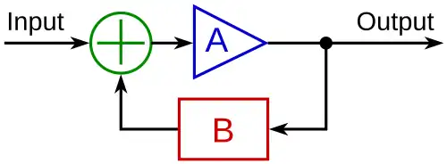
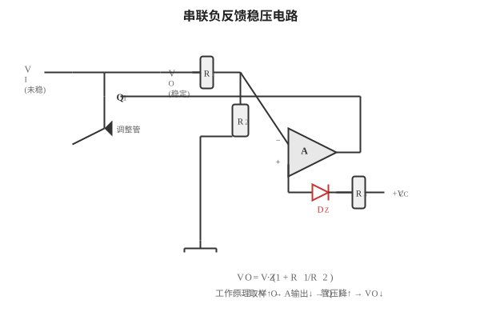
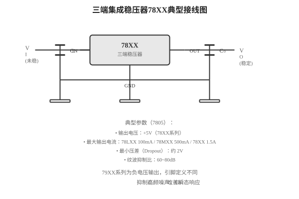
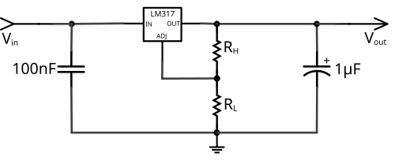
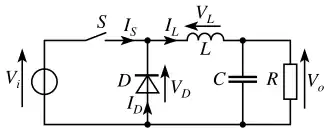
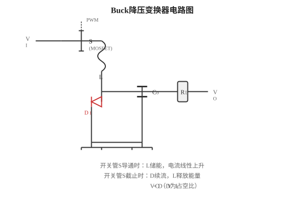
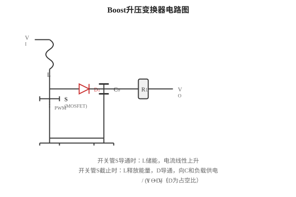

# 2.12 稳压电源

> **前置知识**：[2.11 波形发生电路](2.11-波形发生电路.md)（承接上一章）。

## 1. 线性稳压电源基本原理

线性稳压电源（Linear Regulator）通过调整管工作在线性区，将不稳定的直流电压转换为稳定的直流电压。

### 基本组成

1. **电源变压器**：将交流电网电压降压
2. **整流电路**：将交流电压转换为脉动直流
3. **滤波电路**：平滑脉动直流，减小纹波
4. **稳压电路**：稳定输出电压，抑制纹波和噪声

### 稳压指标

**稳压系数**：

$$
S_V = \frac{\Delta V_O / V_O}{\Delta V_I / V_I}
$$

**输出电阻**：

$$
R_o = \frac{\Delta V_O}{\Delta I_O}
$$

**纹波抑制比**：

$$
S_{rip} = 20 \log \frac{V_{rip(in)}}{V_{rip(out)}}
$$

## 2. 串联负反馈稳压电路

串联负反馈稳压电路由四部分组成：
1. **调整管**：串联在输入和输出之间，由比较放大器的输出控制
2. **基准电压**：提供稳定的参考电压（通常用齐纳二极管）
3. **取样电路**：分压电阻取样输出电压
4. **比较放大**：比较取样电压和基准电压，控制调整管

### 输出电压

$$
V_O = V_Z \left(1 + \frac{R_1}{R_2}\right)
$$

### 工作原理

当输出电压升高时，取样电压升高，比较放大器输出降低，调整管基极电流减小，管压降增大，使输出电压回降，实现稳压。

## 3. 三端集成稳压器（78XX/79XX）

78XX系列为正电压输出，79XX系列为负电压输出，XX表示输出电压值（如 7805 输出 +5V）。

### 典型应用电路

输入电容 $C_i$ 用于抑制高频噪声，输出电容 $C_o$ 用于改善瞬态响应。

### 主要参数

- 输出电压范围：5V、6V、8V、9V、12V、15V、18V、24V
- 最大输出电流：78LXX（100mA）、78MXX（500mA）、78XX（1.5A）
- 最小输入输出电压差（Dropout Voltage）：约 2V
- 电压调整率：典型值 0.01%/V
- 纹波抑制比：典型值 60~80dB

## 4. 可调集成稳压器（LM317/LM337）

LM317 为正电压可调稳压器，LM337 为负电压可调稳压器。

### LM317 典型应用

输出电压调节：

$$
V_O = 1.25 \left(1 + \frac{R_2}{R_1}\right) + I_{ADJ} \cdot R_2
$$

其中 $I_{ADJ}$ 约为 $50\mu\text{A}$，当 $R_2$ 不大时可忽略。

输出电压范围：1.25V ~ 37V，输出电流可达 1.5A。

## 5. 开关稳压电源基本拓扑

### Buck（降压）变换器

Buck 变换器输出电压低于输入电压：

$$
V_O = D \cdot V_I
$$

其中 $D$ 为占空比（$0 < D < 1$）。

### Boost（升压）变换器

Boost 变换器输出电压高于输入电压：

$$
V_O = \frac{V_I}{1 - D}
$$

### Buck-Boost（升降压）变换器

Buck-Boost 变换器输出电压可高于或低于输入电压，但极性相反：

$$
V_O = -\frac{D}{1 - D} \cdot V_I
$$

## 6. 开关电源工作原理

### PWM控制

开关电源通过脉冲宽度调制（PWM）控制开关管的导通时间，调节输出电压。

### 工作过程

1. 开关管导通时，电感储能，电流线性增长
2. 开关管截止时，电感通过续流二极管释放能量，电流线性下降
3. 输出电容滤波，获得平滑的直流电压

### 关键元件

- **开关管**：MOSFET或BJT，工作于开关状态
- **电感**：储能元件，决定纹波电流大小
- **续流二极管**：开关管截止时提供电流通路
- **输出电容**：滤波，减小输出电压纹波

### 效率

开关电源效率远高于线性电源：

$$
\eta = \frac{P_O}{P_I} = \frac{V_O I_O}{V_I I_I} \times 100\%
$$

典型效率可达 80% ~ 95%。

## 7. 电源管理芯片简介

### 常用电源管理芯片

- **TL494**：PWM控制芯片，用于推挽和半桥变换器
- **UC3842**：电流模式PWM控制器，用于反激变换器
- **LM2596**：集成开关稳压器，简单易用
- **TPS5430**：高效率同步降压变换器

### 发展趋势

- 高效率（同步整流技术）
- 小体积（高开关频率）
- 数字化控制（数字电源管理）
- 多输出集成（PMIC电源管理芯片）

## 本章要点

- 线性稳压电源基本原理
- 串联负反馈稳压电路
- 三端集成稳压器（78XX/79XX）
- 可调集成稳压器（LM317/LM337）
- 开关稳压电源基本拓扑
- 开关电源工作原理

## 自测清单

1. 「线性稳压电源基本原理」要解决的核心问题是什么？关键结论或公式是什么？
2. 「串联负反馈稳压电路」与上一节之间是什么关系？
3. 「三端集成稳压器（78XX/79XX）」在什么场景下会用到？如果条件改变，结论会如何变化？
4. 能否不看正文，写出「可调集成稳压器（LM317/LM337）」的关键流程或结构？
5. 「开关稳压电源基本拓扑」最容易混淆的点是什么？

---

**下一章**：[2.13 噪声分析与低噪声设计](2.13-噪声分析与低噪声设计.md)
