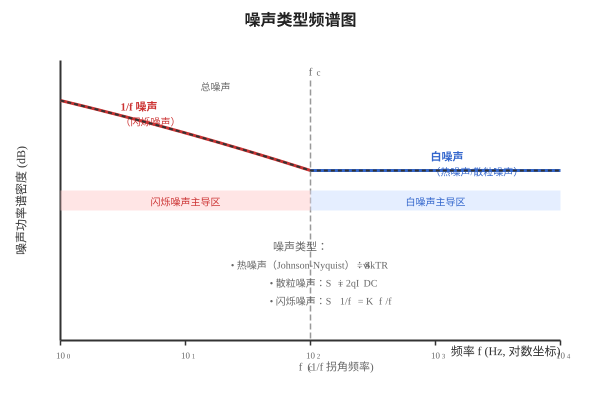
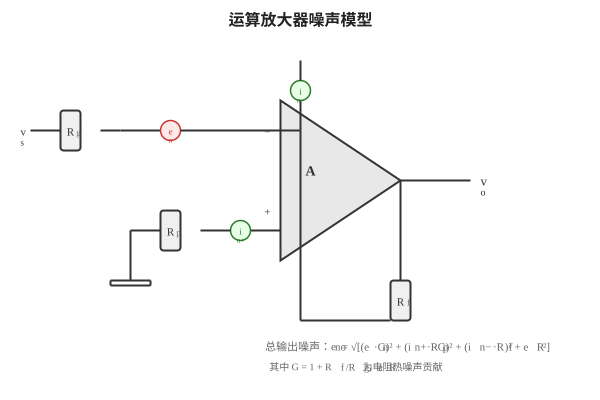

# 2.13 噪声分析与低噪声设计

> **前置知识**：[2.12 稳压电源](2.12-稳压电源.md)（承接上一章）。

## 1. 噪声的基本概念

### 1.1 噪声的定义与分类

噪声是指电路中不希望存在的随机电信号波动。噪声来源可分为两类：

- **外部噪声**：来自电路外部的电磁干扰（EMI），如电源纹波、无线电干扰、开关噪声等
- **内部噪声**：由电路元件本身的物理机制产生，是本章讨论的重点

### 1.2 信噪比（SNR）

信噪比是衡量信号质量的重要指标：

$$
\text{SNR} = 10 \log_{10} \frac{P_{signal}}{P_{noise}} \quad (\text{dB})
$$

或用电压比表示：

$$
\text{SNR} = 20 \log_{10} \frac{V_{signal(rms)}}{V_{noise(rms)}} \quad (\text{dB})
$$

### 1.3 噪声系数（Noise Figure, NF）

噪声系数描述了放大器或系统引入的额外噪声：

$$
\text{NF} = 10 \log_{10} \frac{\text{SNR}_{in}}{\text{SNR}_{out}} \quad (\text{dB})
$$

理想无噪声放大器的 $\text{NF} = 0 \text{ dB}$（即 $\text{SNR}_{out} = \text{SNR}_{in}$）。

噪声因子 $F$（线性值）：

$$
F = \frac{\text{SNR}_{in}}{\text{SNR}_{out}} = 1 + \frac{N_{added}}{N_{in} \cdot G}
$$

其中 $N_{added}$ 为放大器自身增加的噪声功率，$G$ 为增益。

### 1.4 级联系统的噪声系数（Friis 公式）

多级级联系统的总噪声因子：

$$
F_{total} = F_1 + \frac{F_2 - 1}{G_1} + \frac{F_3 - 1}{G_1 G_2} + \cdots
$$

这表明第一级对整体噪声性能影响最大，因此前端放大器（LNA，低噪声放大器）的设计至关重要。

## 2. 热噪声（Johnson-Nyquist 噪声）

### 2.1 产生机理

热噪声由导体中电子的随机热运动引起，存在于所有电阻性元件中，与是否有电流流过无关。

### 2.2 噪声电压与噪声功率

电阻 $R$ 在温度 $T$ 下产生的热噪声电压均方值为：

$$
\overline{v_n^2} = 4kTRB
$$

其中：
- $k = 1.38 \times 10^{-23} \text{ J/K}$（玻尔兹曼常数）
- $T$ 为绝对温度（K）
- $R$ 为电阻值（$\Omega$）
- $B$ 为等效噪声带宽（Hz）

噪声电压有效值（RMS）：

$$
v_{n(rms)} = \sqrt{\overline{v_n^2}} = \sqrt{4kTRB}
$$

### 2.3 噪声等效电路模型

电阻的热噪声可以用两种等效模型表示：

- **串联电压源模型**：理想无噪声电阻 $R$ 串联一个噪声电压源 $\overline{v_n^2} = 4kTRB$
- **并联电流源模型**：理想无噪声电导 $G = 1/R$ 并联一个噪声电流源 $\overline{i_n^2} = 4kTGB$

两者通过诺顿-戴维南转换等效。

### 2.4 热噪声的功率谱密度

热噪声属于白噪声（White Noise），其功率谱密度在极宽的频率范围内为常数：

$$
S_v(f) = 4kTR \quad (\text{V}^2/\text{Hz})
$$

在常温（$T = 290\text{ K}$）下，$1\text{ k}\Omega$ 电阻的热噪声谱密度约为 $4 \text{ nV}/\sqrt{\text{Hz}}$。

## 3. 散粒噪声（Shot Noise）

### 3.1 产生机理

散粒噪声源于载流子跨越势垒（如 PN 结、真空管阴极）时的随机性，是电流离散性的表现。散粒噪声存在于二极管、BJT 等有源器件中。

### 3.2 散粒噪声公式

散粒噪声电流均方值：

$$
\overline{i_{sh}^2} = 2qI_{DC}B
$$

其中：
- $q = 1.6 \times 10^{-19} \text{ C}$（电子电荷量）
- $I_{DC}$ 为直流偏置电流（A）
- $B$ 为等效噪声带宽（Hz）

散粒噪声也是白噪声，功率谱密度为常数：

$$
S_{sh}(f) = 2qI_{DC}
$$

## 4. 闪烁噪声（1/f 噪声）

### 4.1 产生机理

闪烁噪声（Flicker Noise）产生于半导体材料中的缺陷和杂质对载流子的随机俘获与释放，其功率谱密度与频率成反比。

### 4.2 闪烁噪声公式

闪烁噪声的功率谱密度近似为：

$$
S_{1/f}(f) = \frac{K_f}{f^{\alpha}}
$$

其中 $K_f$ 为与器件和工艺相关的常数，$\alpha \approx 0.8 \sim 1.2$（通常取 $\alpha = 1$）。

### 4.3 1/f 拐角频率

在低频段，闪烁噪声占主导；在高频段，白噪声（热噪声、散粒噪声）占主导。两者功率谱密度相等的频率称为 **1/f 拐角频率** $f_c$：

$$
S_{1/f}(f_c) = S_{white}
$$

## 5. 双极型晶体管（BJT）和场效应管（FET）的噪声模型

### 5.1 BJT 噪声模型

BJT 的主要噪声源包括：

**基极电阻热噪声**：

$$
\overline{v_{bb}^2} = 4kTr_b B
$$

**集电极电流散粒噪声**：

$$
\overline{i_c^2} = 2qI_C B
$$

**基极电流散粒噪声**：

$$
\overline{i_b^2} = 2qI_B B
$$

**闪烁噪声**（主要在基极电流中）：

$$
\overline{i_{bf}^2} = \frac{K_f I_B^{\alpha}}{f} B
$$

BJT 的噪声等效输入模型通常将各噪声源归算到输入端。

### 5.2 MOSFET 噪声模型

MOSFET 的主要噪声源：

**沟道热噪声**（漏极电流噪声）：

$$
\overline{i_{nd}^2} = 4kT\gamma g_m B
$$

其中 $\gamma$ 为工艺相关参数（长沟道器件 $\gamma \approx 2/3$，短沟道器件 $\gamma > 1$）。

**栅极电阻热噪声**：

$$
\overline{v_{ng}^2} = 4kTR_g B
$$

**闪烁噪声**（影响较大，因 MOSFET 是表面器件）：

$$
\overline{v_{nf}^2} = \frac{K_f}{C_{ox}WL} \cdot \frac{1}{f}
$$

MOSFET 的闪烁噪声通常比 BJT 大，因为 MOSFET 的导电沟道在 Si-SiO₂ 界面处，缺陷较多。

## 6. 运算放大器的噪声分析

### 6.1 运放噪声模型

运算放大器的噪声可用三个等效输入噪声源建模：

- **输入噪声电压源** $e_n$（$nV/\sqrt{Hz}$）：与输入端串联
- **同相输入噪声电流源** $i_{n+}$（$pA/\sqrt{Hz}$）：与同相输入端并联
- **反相输入噪声电流源** $i_{n-}$（$pA/\sqrt{Hz}$）：与反相输入端并联

### 6.2 总输出噪声计算

对于同相放大器（增益 $G = 1 + R_f/R_g$），总输出噪声电压为：

$$
e_{no(total)} = \sqrt{ \left(e_n \cdot G\right)^2 + \left(i_{n+} \cdot R_p \cdot G\right)^2 + \left(i_{n-} \cdot R_f\right)^2 + e_{R}^2 }
$$

其中 $e_R$ 为电阻热噪声贡献，$R_p$ 为同相端等效电阻。

### 6.3 运放噪声的频谱特性

运放的噪声谱密度曲线通常分为两个区域：
- **低频区**：1/f 噪声占主导，$e_n$ 随频率降低而增大
- **高频区**：白噪声（热噪声）占主导，$e_n$ 近似为常数

运放数据手册通常给出：
- 1kHz 处的噪声电压密度 $e_n$（如 $5\text{ nV}/\sqrt{\text{Hz}}$）
- 峰峰值低频噪声（0.1Hz~10Hz 范围内的 $e_{n(p-p)}$）

### 6.4 噪声带宽

噪声带宽不同于信号带宽。对于一阶低通滤波器，噪声等效带宽为：

$$
B_n = \frac{\pi}{2} f_c = 1.57 f_c
$$

其中 $f_c$ 为 -3dB 截止频率。

## 7. 低噪声设计原则

### 7.1 阻抗匹配

- 信号源阻抗应尽量低，以减小热噪声贡献
- 对于传感器前端，输入阻抗应与信号源阻抗匹配以获得最佳噪声系数
- 噪声最优源阻抗 $R_{opt}$ 为 $R_{opt} = e_n / i_n$

### 7.2 选择低噪声器件

- 对于低源阻抗（$< 1\text{ k}\Omega$），BJT 通常优于 FET（因为 BJT 的 $e_n$ 更低）
- 对于高源阻抗（$> 100\text{ k}\Omega$），FET 通常优于 BJT（因为 FET 的 $i_n$ 更低）
- 金属膜电阻的热噪声低于碳膜电阻
- 选用低噪声运放（如 OP27、AD797、LT1028 等）

### 7.3 带宽限制

- 在满足信号带宽要求的前提下，尽量限制电路带宽，以减小总噪声
- 在放大器的反馈电阻上并联电容，形成低通特性
- 在 ADC 前端使用抗混叠滤波器

### 7.4 其他措施

- **电源去耦**：使用旁路电容和π型滤波器抑制电源噪声
- **屏蔽**：使用金属屏蔽盒隔离外部电磁干扰
- **接地**：采用星形接地或接地平面，避免地环路噪声
- **PCB 布局**：将模拟电路和数字电路分区布局，敏感信号远离高频信号线

## 本章要点

- 噪声的基本概念
- 热噪声（Johnson-Nyquist 噪声）
- 散粒噪声（Shot Noise）
- 闪烁噪声（1/f 噪声）
- 双极型晶体管（BJT）和场效应管（FET）的噪声模型
- 运算放大器的噪声分析

## 自测清单

1. 「噪声的基本概念」要解决的核心问题是什么？关键结论或公式是什么？
2. 「热噪声（Johnson-Nyquist 噪声）」与上一节之间是什么关系？
3. 「散粒噪声（Shot Noise）」在什么场景下会用到？如果条件改变，结论会如何变化？
4. 能否不看正文，写出「闪烁噪声（1/f 噪声）」的关键流程或结构？
5. 「双极型晶体管（BJT）和场效应管（FET）的噪声模型」最容易混淆的点是什么？

---

**下一章**：[2.14 电流源电路](2.14-电流源电路.md)
