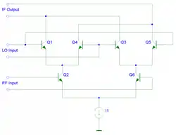
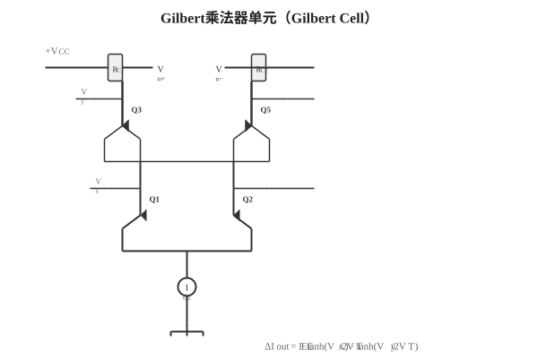
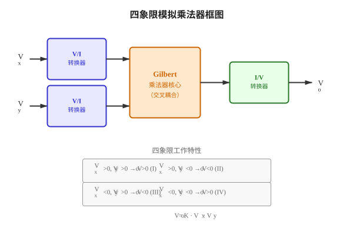

# 2.15 模拟乘法器

> **本章定位**：模拟进阶选修，非所有方向的公共必修。

> **前置知识**：[2.14 电流源电路](2.14-电流源电路.md)（差分对尾电流与偏置）。

## 1. 模拟乘法器的基本概念

### 1.1 定义

模拟乘法器（Analog Multiplier）是一种输出信号与两个输入信号乘积成正比的电路：

$$
V_o = K \cdot V_x \cdot V_y
$$

其中 $K$ 为乘法器的标度因子（Scaling Factor），通常 $K = 0.1 \text{ V}^{-1}$（即 $V_x = V_y = 10\text{ V}$ 时，$V_o = 10\text{ V}$）。

### 1.2 理想乘法器的特性

- 线性度：$V_o$ 与 $V_x$、$V_y$ 的乘积严格成正比
- 带宽：在工作频率范围内保持乘法特性
- 输入阻抗：理想情况下为无穷大
- 输出阻抗：理想情况下为零
- 馈通误差：当 $V_x = 0$ 或 $V_y = 0$ 时，$V_o$ 应为零

### 1.3 乘法器的象限分类

| 类型 | $V_x$ 范围 | $V_y$ 范围 | 典型应用 |
|------|-----------|-----------|---------|
| 一象限乘法器 | 单极性 | 单极性 | 功率测量 |
| 二象限乘法器 | 双极性 | 单极性 | 幅度调制 |
| 四象限乘法器 | 双极性 | 双极性 | 调制解调、相位检测 |

## 2. 跨导线性乘法器原理

### 2.1 跨导线性原理（Translinear Principle）

跨导线性原理基于 BJT 的指数关系 $I_C = I_S \exp(V_{BE}/V_T)$。在闭环跨导线性环路中，顺时针方向各晶体管 $V_{BE}$ 之和等于逆时针方向之和。

### 2.2 基于差分对的二象限乘法器

利用 BJT 差分对的跨导 $g_m = I_C/V_T$ 随偏置电流线性变化的特性，可以实现二象限乘法器。

差分对的输出电流：

$$
\Delta I_C = I_{EE} \cdot \tanh\left(\frac{V_{in}}{2V_T}\right)
$$

当 $V_{in} \ll 2V_T$ 时，$\tanh(x) \approx x$，因此：

$$
\Delta I_C \approx \frac{I_{EE}}{2V_T} \cdot V_{in}
$$

若 $I_{EE}$ 由另一个输入信号 $V_y$ 控制（$I_{EE} \propto V_y$），则 $\Delta I_C \propto V_x \cdot V_y$，实现乘法功能。

## 3. Gilbert 乘法器单元（Gilbert Cell）

### 3.1 电路结构

Gilbert 乘法器单元（Gilbert Cell）由 Barrie Gilbert 于 1968 年发明，是模拟乘法器中最经典的结构。它由三个差分对交叉耦合构成：

- **下差分对**（$Q_1$、$Q_2$）：由输入信号 $V_x$ 驱动，控制尾电流 $I_{EE}$ 在 $Q_1$ 和 $Q_2$ 之间的分配
- **上交叉耦合对**（$Q_3$、$Q_4$、$Q_5$、$Q_6$）：由输入信号 $V_y$ 驱动，实现电流的交叉切换
- **负载电阻** $R_{C1}$、$R_{C2}$：将输出电流转换为电压

### 3.2 工作原理

下差分对将 $V_x$ 转换为差模电流：

$$
I_{C1} - I_{C2} = I_{EE} \cdot \tanh\left(\frac{V_x}{2V_T}\right)
$$

上交叉耦合对将 $V_y$ 作为切换信号，使输出差模电流为：

$$
\Delta I_{out} = I_{EE} \cdot \tanh\left(\frac{V_x}{2V_T}\right) \cdot \tanh\left(\frac{V_y}{2V_T}\right)
$$

当 $V_x, V_y \ll 2V_T$ 时：

$$
\Delta I_{out} \approx I_{EE} \cdot \frac{V_x}{2V_T} \cdot \frac{V_y}{2V_T} \propto V_x \cdot V_y
$$

输出电压：

$$
V_o = (R_{C1} + R_{C2}) \cdot \Delta I_{out} \approx K \cdot V_x \cdot V_y
$$

### 3.3 线性化技术

基本 Gilbert 单元的线性输入范围较小（仅 $|V_x|, |V_y| < 2V_T \approx 52\text{ mV}$）。为扩展线性范围，常采用**发射极负反馈**（预失真技术）：

- 在 $V_x$ 输入端使用二极管连接的 BJT 或电阻进行预失真
- 在 $V_y$ 输入端同样采用线性化措施

经过线性化处理后，输入范围可扩展到 $\pm 10\text{ V}$ 甚至更大。

## 4. 四象限乘法器

### 4.1 四象限工作特性

四象限乘法器允许两个输入信号都可以为正或为负，输出极性由两输入信号的乘积符号决定：

| $V_x$ 极性 | $V_y$ 极性 | $V_o$ 极性 |
|-----------|-----------|-----------|
| + | + | + |
| + | - | - |
| - | + | - |
| - | - | + |

### 4.2 线性化四象限乘法器

通过引入发射极负反馈的电压-电流转换器（V-I Converter），将输入电压 $V_x$ 和 $V_y$ 线性地转换为电流，再送入 Gilbert 核心单元，实现四象限线性乘法。

### 4.3 主要性能指标

- **总误差**（Total Error）：实际输出与理想输出的偏差，通常表示为满量程的百分比
- **馈通误差**（Feedthrough Error）：一个输入为零时，另一个输入导致的输出残余
- **非线性度**（Nonlinearity）：输出与输入乘积的偏离程度
- **-3dB 带宽**：乘法增益下降 3dB 的频率
- **压摆率**（Slew Rate）：输出最大变化率

## 5. 模拟乘法器的应用

### 5.1 调制与解调

**幅度调制（AM）**：

设载波 $v_c(t) = V_c \cos(\omega_c t)$，调制信号 $v_m(t) = V_m \cos(\omega_m t)$：

$$
v_o(t) = K \cdot V_c \cos(\omega_c t) \cdot V_m \cos(\omega_m t) = \frac{KV_c V_m}{2} \left[ \cos(\omega_c + \omega_m)t + \cos(\omega_c - \omega_m)t \right]
$$

**双边带抑制载波调制（DSB-SC）**：与 AM 调制类似，但不包含独立的载波分量。

**同步解调**：将已调信号与载波信号相乘，再经低通滤波恢复原始信号：

$$
v_{demod}(t) = \text{LPF}\left[ v_{DSB}(t) \cdot v_c(t) \right] \propto v_m(t)
$$

### 5.2 相位检测

当两个同频率的正弦信号送入乘法器：

$$
v_x = V_1 \cos(\omega t), \quad v_y = V_2 \cos(\omega t + \varphi)
$$

输出：

$$
v_o = K V_1 V_2 \cos(\omega t) \cos(\omega t + \varphi) = \frac{K V_1 V_2}{2} \left[ \cos\varphi + \cos(2\omega t + \varphi) \right]
$$

经低通滤波后，直流分量 $\propto \cos\varphi$，可用于相位检测。

### 5.3 其他应用

- **自动增益控制（AGC）**：乘法器作为可变增益放大器
- **均方根（RMS）计算**：$V_{rms} = \sqrt{\overline{v^2}}$
- **功率测量**：$P = V \cdot I$
- **频率变换**：混频器、倍频器
- **压控滤波器**：用乘法器控制滤波器的截止频率

## 6. 模拟乘法器集成电路

### 6.1 MC1496 / LM1496

MC1496 是经典的 Gilbert 单元乘法器芯片，内部包含完整的双差分对结构：

- 工作频率可达 100 MHz
- 载波抑制比典型值 50 dB（平衡调制时）
- 需要外部偏置和负载电阻
- 广泛应用于通信电路中的调制解调

### 6.2 AD633

AD633 是 Analog Devices 公司的完整四象限模拟乘法器：

- 内置激光微调电阻，$K = 0.1 \text{ V}^{-1}$（精确到 0.25%）
- 总误差小于 2%（满量程）
- -3dB 带宽：1 MHz
- 压摆率：20 V/$\mu$s
- 使用简单：$W = \frac{(X_1 - X_2)(Y_1 - Y_2)}{10\text{ V}} + Z$

### 6.3 其他常见型号

| 型号 | 特点 |
|------|------|
| MPY634 | 宽带乘法器，带宽 10 MHz |
| AD534 | 精密乘法器，总误差 0.25% |
| AD835 | 高速乘法器，带宽 250 MHz |
| MLT04 | 四通道乘法器 |

## 本章要点

- 模拟乘法器的基本概念
- 跨导线性乘法器原理
- Gilbert 乘法器单元（Gilbert Cell）
- 四象限乘法器
- 模拟乘法器的应用
- 模拟乘法器集成电路

## 自测清单

1. 「模拟乘法器的基本概念」要解决的核心问题是什么？关键结论或公式是什么？
2. 「跨导线性乘法器原理」与上一节之间是什么关系？
3. 「Gilbert 乘法器单元（Gilbert Cell）」在什么场景下会用到？如果条件改变，结论会如何变化？
4. 能否不看正文，写出「四象限乘法器」的关键流程或结构？
5. 「模拟乘法器的应用」最容易混淆的点是什么？

---

**下一章**：[2.16 自动增益控制（AGC）](2.16-自动增益控制-AGC.md)
