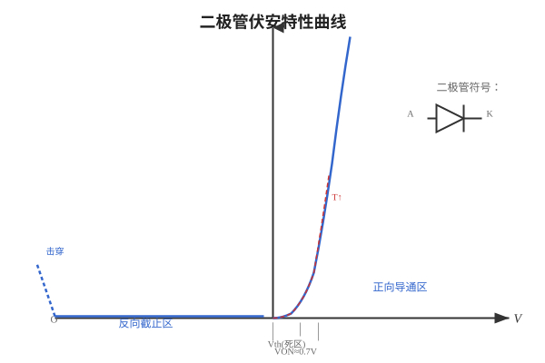
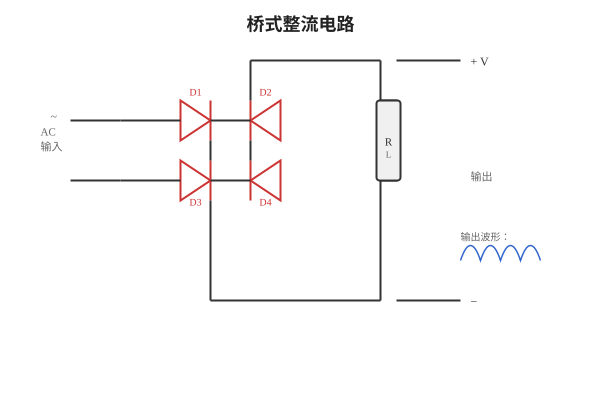
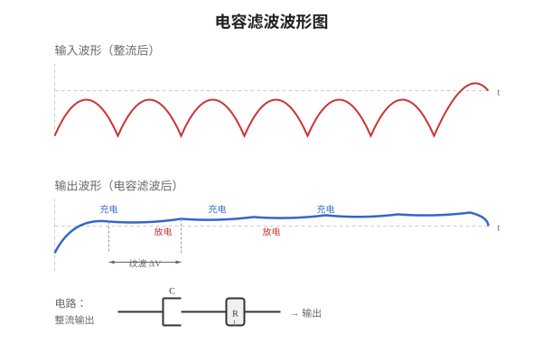
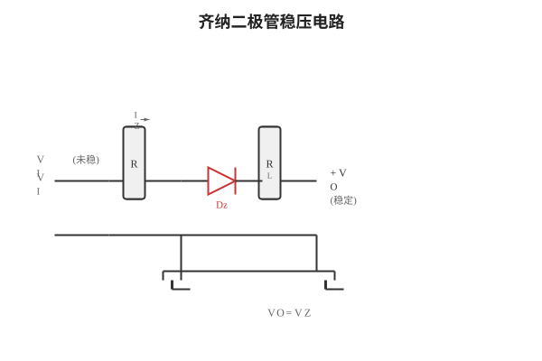
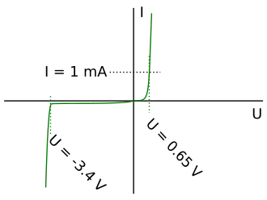
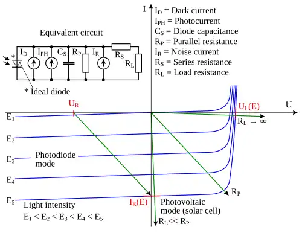

# 2.2 二极管

> **前置知识**：[2.1 半导体物理基础](2.1-半导体物理基础.md)（承接上一章）。

## 1. 二极管的伏安特性与温度特性

### 伏安特性

二极管（Diode）是一个PN结加上两个电极引线封装而成。其伏安特性遵循PN结的电流方程：

$$
I = I_S \left( e^{\frac{qV}{nkT}} - 1 \right)
$$

正向特性：当正向电压小于**死区电压**（硅管约 0.5V，锗管约 0.1V）时，电流几乎为零；超过死区电压后，电流随电压指数增长。**导通压降**硅管约为 0.6~0.8V，锗管约为 0.2~0.3V。

反向特性：反向电压时，电流极小（反向饱和电流 $I_S$）。当反向电压增大到击穿电压时，反向电流急剧增大。

### 温度特性

温度对二极管特性有显著影响：

- **反向饱和电流 $I_S$** 随温度升高而增大，温度每升高 10°C，$I_S$ 约增加一倍：
  $$
  I_S(T_2) = I_S(T_1) \cdot 2^{\frac{T_2 - T_1}{10}}
  $$

- **导通压降 $V_D$** 随温度升高而降低，温度系数约为 $-2 \text{mV/°C}$：
  $$
  \frac{dV_D}{dT} \approx -2 \text{ mV/°C}
  $$

## 2. 二极管的主要参数

- **最大整流电流 $I_F$**：二极管长期运行时允许通过的最大正向平均电流
- **最高反向工作电压 $V_{RM}$**：允许施加的最大反向电压（通常为击穿电压的一半）
- **反向电流 $I_R$**：反向电压下的漏电流
- **最高工作频率 $f_M$**：二极管能正常工作的最高频率
- **结电容 $C_j$**：PN结的电容，影响高频性能

## 3. 理想二极管模型与恒压降模型

### 理想二极管模型

正向导通时视为短路（$V=0$），反向截止时视为开路（$I=0$），忽略导通压降。

### 恒压降模型

正向导通时视为一个恒压源（硅管 0.7V，锗管 0.3V）串联一个小电阻，反向截止时视为开路。

$$
V_D = \begin{cases}
V_{ON} & I > 0 \\
\text{开路} & I \leq 0
\end{cases}
$$

### 折线模型

用阈值电压 $V_{th}$ 和导通电阻 $R_D$ 近似：

$$
V_D = V_{th} + I_D \cdot R_D
$$

## 4. 整流电路

### 半波整流

在输入电压的正半周，二极管导通，负载获得电压；负半周，二极管截止，负载电压为零。输出平均电压：

$$
V_{O(avg)} = \frac{1}{2\pi} \int_0^\pi V_m \sin(\omega t) d(\omega t) = \frac{V_m}{\pi} \approx 0.318 V_m
$$

### 全波整流（中心抽头式）

利用两个二极管交替导通，正负半周均有电流流过负载。输出平均电压：

$$
V_{O(avg)} = \frac{2V_m}{\pi} \approx 0.637 V_m
$$

### 桥式整流

使用四个二极管组成桥式结构，正负半周均有二极管导通，输出平均电压与全波整流相同：

$$
V_{O(avg)} = \frac{2V_m}{\pi} \approx 0.637 V_m
$$

桥式整流器的优点是无需中心抽头变压器，二极管反向耐压要求较低。

## 5. 滤波电路

### 电容滤波

在整流电路输出端并联大容量电容，利用电容的充放电使输出电压平滑。

电容滤波的输出电压估算：

- 半波整流电容滤波：$V_O \approx V_m$
- 桥式整流电容滤波：$V_O \approx 1.2 V_m$（空载时 $V_O \approx \sqrt{2} V_m$）

滤波电容的选择：

$$
C \geq \frac{T}{R_L \cdot \Delta V / V_m}
$$

其中 $T$ 为输入交流周期，$\Delta V$ 为允许的纹波电压峰峰值。

### 电感滤波

在整流输出端串联电感，利用电感对变化电流的阻碍作用平滑电流波形。电感滤波适用于大电流负载，输出特性较硬。

## 6. 限幅电路与钳位电路

### 限幅电路

利用二极管的单向导电性将输出电压限制在某一范围内。串联型限幅器将二极管与负载串联，并联型限幅器将二极管与负载并联。

上限幅电路输出电压为：

$$
V_O = \min(V_I, V_R)
$$

其中 $V_R$ 为参考电压。

### 钳位电路

将输入信号的直流电平移动到指定值。钳位电路由二极管、电容和电阻组成。在稳态下，输出波形与输入波形形状相同，但直流电平被移动。

## 7. 齐纳二极管及其稳压电路

齐纳二极管（Zener Diode）是一种专门工作在反向击穿区的二极管，具有稳定的击穿电压。

最简单的稳压电路由齐纳二极管和限流电阻组成。输出电压等于齐纳二极管的稳压值 $V_Z$。

稳压电路分析：

$$
I_Z = \frac{V_I - V_Z}{R} - I_L
$$

$$
V_O = V_Z
$$

稳压系数：

$$
S_V = \frac{\Delta V_O / V_O}{\Delta V_I / V_I} \approx \frac{r_Z}{R + r_Z} \cdot \frac{V_I}{V_O}
$$

其中 $r_Z$ 为齐纳二极管的动态电阻。

## 8. LED与光电二极管

### LED（发光二极管）

LED正向导通时，电子与空穴复合释放能量产生光。LED的导通电压较高（红 1.6~2.0V，绿 2.0~2.5V，蓝 2.5~3.5V），需串联限流电阻。

### 光电二极管

光电二极管反向偏置，光照产生光生载流子形成光电流，光电流与光照强度成正比：

$$
I_{photo} = K \cdot E
$$

其中 $K$ 为灵敏度，$E$ 为光照强度。

## 9. 肖特基二极管与变容二极管

### 肖特基二极管（Schottky Diode）

利用金属-半导体接触形成肖特基势垒，多数载流子器件，无少子存储效应，开关速度快，正向压降小（约 0.3~0.4V），适用于高频整流和开关电路。

### 变容二极管（Varactor Diode）

利用PN结势垒电容随反向偏压变化的特性，用作可变电容器。变容二极管的结电容与反向电压的关系：

$$
C_j = \frac{C_{j0}}{\left(1 + \frac{V_R}{V_{bi}}\right)^m}
$$

广泛应用于压控振荡器（VCO）和调谐电路中。

## 本章要点

- 二极管的伏安特性与温度特性
- 二极管的主要参数
- 理想二极管模型与恒压降模型
- 整流电路
- 滤波电路
- 限幅电路与钳位电路

## 自测清单

1. 「二极管的伏安特性与温度特性」要解决的核心问题是什么？关键结论或公式是什么？
2. 「二极管的主要参数」与上一节之间是什么关系？
3. 「理想二极管模型与恒压降模型」在什么场景下会用到？如果条件改变，结论会如何变化？
4. 能否不看正文，写出「整流电路」的关键流程或结构？
5. 「滤波电路」最容易混淆的点是什么？

---

**下一章**：[2.3 双极型晶体管（BJT）](2.3-双极型晶体管-BJT.md)
