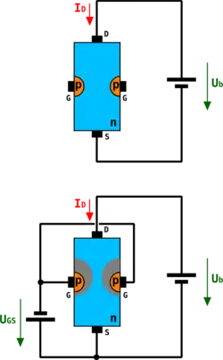
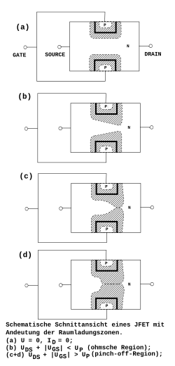
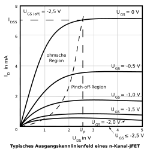
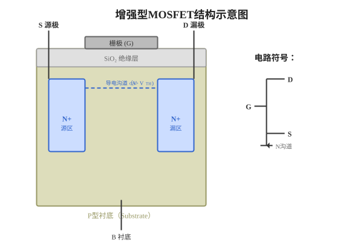
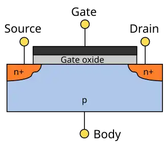
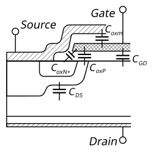
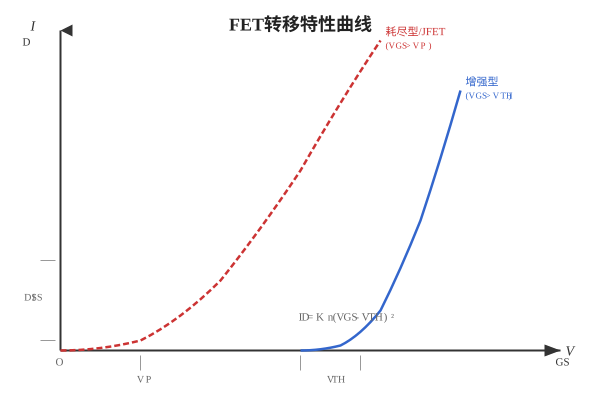
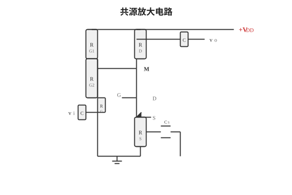

# 2.4 场效应管（FET）

> **前置知识**：[2.3 双极型晶体管（BJT）](2.3-双极型晶体管-BJT.md)（承接上一章）。

## 1. JFET结构与工作原理

结型场效应管（Junction Field Effect Transistor, JFET）是一种利用电场效应控制电流的半导体器件。JFET分为N沟道和P沟道两种类型。

N沟道JFET的结构：在N型半导体两侧制作两个P型区，形成两个PN结。三个电极分别为：漏极（D）、源极（S）和栅极（G）。

工作原理：在漏源之间施加电压 $V_{DS}$，电子从源极流向漏极形成漏极电流 $I_D$。栅源电压 $V_{GS}$ 反向偏置PN结，改变导电沟道宽度，从而控制 $I_D$。

当 $V_{GS}$ 负向增大时，耗尽层展宽，沟道变窄，$I_D$ 减小。当 $V_{GS}$ 达到**夹断电压** $V_P$ 时，沟道被完全夹断，$I_D = 0$。

## 2. 耗尽型MOSFET

耗尽型MOSFET（Metal-Oxide-Semiconductor FET）在制造时已在二氧化硅绝缘层中掺入正离子，使P型衬底表面感应出N型导电沟道。

即使在 $V_{GS} = 0$ 时也存在导电沟道。当 $V_{GS}$ 为负时，沟道变窄，$I_D$ 减小；当 $V_{GS}$ 为正时，沟道变宽，$I_D$ 增大。

## 3. 增强型MOSFET

增强型MOSFET在 $V_{GS} = 0$ 时没有导电沟道，$I_D = 0$。

当 $V_{GS}$ 大于**阈值电压** $V_{TH}$ 时，衬底表面感应出反型层形成导电沟道，$I_D$ 开始流通。$V_{GS}$ 越大，沟道越宽，$I_D$ 越大。

N沟道增强型MOSFET的工作条件：
- $V_{GS} > V_{TH}$（形成导电沟道）
- $V_{DS} > 0$（产生漏极电流）

## 4. FET的伏安特性与转移特性

### 输出特性

FET的输出特性描述 $V_{GS}$ 固定时 $I_D$ 与 $V_{DS}$ 的关系，分为三个区域：

- **可变电阻区（线性区）**：$V_{DS}$ 较小，$I_D$ 随 $V_{DS}$ 线性增加，FET表现为压控电阻
- **饱和区（恒流区/放大区）**：$V_{DS}$ 增大到一定值后，$I_D$ 基本不变，仅受 $V_{GS}$ 控制
- **截止区**：$V_{GS} < V_{TH}$（增强型）或 $V_{GS} < V_P$（耗尽型），$I_D \approx 0$

### 转移特性

转移特性描述 $V_{DS}$ 固定时 $I_D$ 与 $V_{GS}$ 的关系。

**增强型MOSFET**：

$$
I_D = K_n (V_{GS} - V_{TH})^2
$$

其中 $K_n = \frac{1}{2} \mu_n C_{ox} \frac{W}{L}$，$\mu_n$ 为电子迁移率，$C_{ox}$ 为单位面积栅氧化层电容，$W/L$ 为沟道宽长比。

**JFET/耗尽型MOSFET**：

$$
I_D = I_{DSS} \left(1 - \frac{V_{GS}}{V_P}\right)^2
$$

其中 $I_{DSS}$ 为 $V_{GS} = 0$ 时的饱和漏极电流。

## 5. FET 偏置电路

FET 栅源之间几乎不取电流（栅极输入电阻极高），因此 FET 的偏置比 BJT 更简单，主要任务是给栅极提供合适的直流电位，以确定静态工作点（Q点）。

### 自给偏压电路（耗尽型）

自给偏压电路利用源极电阻 $R_S$ 上的直流压降，为栅源之间提供负的栅压，适用于耗尽型 FET（JFET 或耗尽型 MOSFET）。

由于栅极电流为零，栅极经大电阻 $R_G$ 接地，故 $V_G = 0$，源极电位 $V_S = I_D R_S$，于是：

$$
V_{GS} = V_G - V_S = -I_D R_S
$$

**Q点估算步骤**：
1. 由栅极回路得 $V_{GS} = -I_D R_S$
2. 代入转移特性方程 $I_D = I_{DSS}\left(1-\dfrac{V_{GS}}{V_P}\right)^2$，解得 $I_{DQ}$
3. 求 $V_{GSQ} = -I_{DQ} R_S$
4. 求 $V_{DS} = V_{DD} - I_D(R_D + R_S)$
5. 验证是否处于饱和（恒流）区：$V_{DS} > V_{GS} - V_P$

**例题**：设 N 沟道 JFET 的 $I_{DSS} = 8\,\text{mA}$、$V_P = -4\,\text{V}$，自给偏压电路 $V_{DD} = 20\,\text{V}$、$R_D = 3\,\text{k}\Omega$、$R_S = 1\,\text{k}\Omega$，求 Q 点。

解：由 $V_{GS} = -I_D R_S = -I_D$（$I_D$ 以 mA 计，$R_S$ 以 kΩ 计，则 $V_{GS}$ 以 V 计）。代入转移特性：

$$
I_D = 8\left(1 - \frac{V_{GS}}{-4}\right)^2 = 8\left(1 - \frac{I_D}{4}\right)^2
$$

整理得 $I_D^2 - 10I_D + 16 = 0$，解出 $I_D = 8\,\text{mA}$ 或 $I_D = 2\,\text{mA}$。其中 $I_D = 8\,\text{mA}$ 对应 $V_{GS} = -8\,\text{V} < V_P$，器件已处于截止区，舍去。故取：

$$
I_{DQ} = 2\,\text{mA}, \quad V_{GSQ} = -I_{DQ} R_S = -2\,\text{V}
$$

$$
V_{DSQ} = V_{DD} - I_{DQ}(R_D + R_S) = 20 - 2 \times (3+1) = 12\,\text{V}
$$

验证饱和区条件：$V_{DS} = 12\,\text{V} > V_{GS} - V_P = -2 + 4 = 2\,\text{V}$，成立，Q 点有效。

### 分压式（自偏压+正栅压）偏置电路

分压式偏置电路用两个电阻 $R_1$、$R_2$ 对 $V_{DD}$ 分压，为栅极提供直流正电位，再配合源极电阻 $R_S$ 提供的自偏压，既能为增强型 MOSFET 提供所需的正栅压，又可稳定 Q 点。

由于栅极电流为零，栅极电位：

$$
V_G = \frac{R_2}{R_1 + R_2} V_{DD}
$$

**Q点估算步骤**：
1. 求栅极电位 $V_G = \dfrac{R_2}{R_1+R_2}V_{DD}$
2. 栅源电压 $V_{GS} = V_G - I_D R_S$
3. 代入转移特性 $I_D = K(V_{GS} - V_{TH})^2$（增强型）解得 $I_{DQ}$
4. 求 $V_{DS} = V_{DD} - I_D(R_D + R_S)$
5. 验证饱和区条件 $V_{DS} > V_{GS} - V_{TH}$

**例题**：N 沟道增强型 MOSFET，$V_{TH} = 2\,\text{V}$、$K = 0.5\,\text{mA/V}^2$，$V_{DD} = 15\,\text{V}$、$R_1 = 100\,\text{k}\Omega$、$R_2 = 50\,\text{k}\Omega$、$R_D = 4\,\text{k}\Omega$、$R_S = 1\,\text{k}\Omega$，求 Q 点。

解：栅极电位

$$
V_G = \frac{50}{100+50} \times 15 = 5\,\text{V}
$$

令 $I_D$ 以 mA 计，则 $V_{GS} = 5 - I_D$。代入转移特性：

$$
I_D = 0.5(5 - I_D - 2)^2 = 0.5(3 - I_D)^2
$$

整理得 $I_D^2 - 8I_D + 9 = 0$，解出 $I_D = 6.6\,\text{mA}$ 或 $I_D = 1.36\,\text{mA}$。其中 $I_D = 6.6\,\text{mA}$ 对应 $V_{GS} = 5 - 6.6 = -1.6\,\text{V} < V_{TH}$，不成立，舍去。故：

$$
I_{DQ} \approx 1.36\,\text{mA}, \quad V_{GSQ} = 5 - 1.36 \approx 3.64\,\text{V}
$$

$$
V_{DSQ} = V_{DD} - I_{DQ}(R_D + R_S) = 15 - 1.36 \times 5 \approx 8.2\,\text{V}
$$

验证：$V_{DS} = 8.2\,\text{V} > V_{GS} - V_{TH} = 3.64 - 2 = 1.64\,\text{V}$，处于饱和区，Q 点成立。

## 6. FET的小信号模型

FET的小信号等效模型参数：

跨导（Transconductance）：

$$
g_m = \frac{\partial I_D}{\partial V_{GS}} = \sqrt{2K_n I_{DQ}} = 2\sqrt{K_n I_{DQ}}
$$

$$
g_m = \frac{2I_{DSS}}{|V_P|} \left(1 - \frac{V_{GS}}{V_P}\right) \quad (\text{JFET/耗尽型})
$$

输出电阻：

$$
r_{ds} = \frac{1}{\lambda I_{DQ}} \quad \text{或} \quad r_{ds} = \frac{|V_A|}{I_{DQ}}
$$

其中 $\lambda$ 为沟道长度调制系数，$V_A$ 为厄尔利电压。

## 7. FET 的主要参数

### 开启电压与夹断电压

- **开启电压 $V_T$（又称阈值电压 $V_{TH}$）**：增强型 MOSFET 形成导电沟道所需的最小栅源电压
- **夹断电压 $V_P$**：JFET 和耗尽型 MOSFET 中，使导电沟道完全夹断的栅源电压

两者分别对应增强型与耗尽型两类器件的“导通临界”电压，共同限定了器件进入导通状态所需的 $V_{GS}$ 范围。

### 跨导与输出电阻

- **跨导 $g_m$**：$g_m = \dfrac{\partial I_D}{\partial V_{GS}}$，表征 $V_{GS}$ 对 $I_D$ 的控制能力，其值与静态工作点有关，具体表达式见本章第 6 节。JFET 的跨导典型值为几 mS 到几十 mS
- **输出电阻 $r_{ds}$**：$r_{ds} = \left.\dfrac{\partial V_{DS}}{\partial I_D}\right|_{V_{GS}}$，反映沟道长度调制效应，$r_{ds}$ 越大，恒流特性越好

### 极间电容

FET 各电极之间存在寄生电容，主要包括 $C_{gs}$（栅源）、$C_{gd}$（栅漏）和 $C_{ds}$（漏源）。这些电容限制了 FET 的高频性能，是决定其上限频率的主要因素；其中 $C_{gd}$ 会因密勒效应对输入特性产生明显影响。

### 极限参数

- **最大耗散功率 $P_{DM}$**：漏极允许耗散的最大功率（$P_{DM} = I_D V_{DS}$），超过会使沟道结温过高而损坏器件，功率应用时需配合外部散热
- **最大漏极电流 $I_{DM}$**
- **最大漏源电压 $V_{(BR)DSS}$**：栅源短路时漏源之间所能承受的最大电压

### 体效应（衬底偏置效应）

对于四端 MOSFET，当衬底（体端 B）与源极之间存在电压差 $V_{SB}$ 时，会改变源-衬底之间的耗尽层宽度，使阈值电压 $V_T$ 随 $V_{SB}$ 增大而增大，这一现象称为**体效应**（Body Effect，又称衬底偏置效应）。其等效作用相当于衬底成为一个“背栅”控制电极（对应等效跨导 $g_{mb}$）。体效应在集成电路中普遍存在，本书 4.29–4.32 模拟 IC 设计部分将结合相关电路进一步讨论。

## 8. 共源/共漏/共栅放大电路

### 共源放大电路

电压增益：

$$
A_v = -g_m (R_D \parallel R_L \parallel r_{ds}) \approx -g_m R_D'
$$

输入电阻极高（MOSFET可达 $10^{12}\Omega$ 以上），输出电阻 $\approx R_D$。

### 共漏放大电路（源极跟随器）

电压增益：

$$
A_v = \frac{g_m R_S'}{1 + g_m R_S'} \approx 1
$$

输入电阻高，输出电阻低（$R_o \approx 1/g_m$）。

### 共栅放大电路

电压增益：

$$
A_v = g_m R_D'
$$

输入电阻低，输出电阻高，高频特性好。

## 9. BJT与FET性能比较

| 性能参数 | BJT | FET |
|---------|-----|-----|
| 控制方式 | 电流控制（$I_B \to I_C$） | 电压控制（$V_{GS} \to I_D$） |
| 输入电阻 | 中（kΩ级） | 极高（$10^8 \sim 10^{15}\Omega$） |
| 噪声 | 较大 | 较小 |
| 温度稳定性 | 较差 | 较好 |
| 增益 | 高（$\beta$ 几十~几百） | 较低（$g_m$ 几~几十 mS） |
| 功耗 | 较大 | 较小 |
| 高频特性 | 较好 | 较好 |
| 制造工艺 | 较简单 | 较复杂（CMOS工艺成熟） |
| 抗辐射能力 | 较弱 | 较强 |

## 10. VMOS功率管

VMOS（Vertical MOSFET）是一种垂直沟道结构的功率MOSFET，具有以下特点：

- **垂直结构**：源极在上表面，漏极在下表面，电流垂直流动
- **高耐压**：可达数百伏
- **大电流**：可达数十安培
- **开关速度快**：无少子存储效应，开关频率可达 MHz 级
- **安全工作区宽**：无二次击穿问题

VMOS功率管广泛应用于开关电源、电机驱动、功率放大器等大功率场合。

VMOS管的转移特性仍遵循平方律关系：

$$
I_D = K (V_{GS} - V_{TH})^2
$$

但 $K$ 值远大于普通MOSFET，因为沟道宽长比（$W/L$）极大。

## 本章要点

- JFET结构与工作原理
- 耗尽型MOSFET
- 增强型MOSFET
- FET的伏安特性与转移特性
- FET 偏置电路
- FET的小信号模型

## 自测清单

1. 「JFET结构与工作原理」要解决的核心问题是什么？关键结论或公式是什么？
2. 「耗尽型MOSFET」与上一节之间是什么关系？
3. 「增强型MOSFET」在什么场景下会用到？如果条件改变，结论会如何变化？
4. 能否不看正文，写出「FET的伏安特性与转移特性」的关键流程或结构？
5. 「FET 偏置电路」最容易混淆的点是什么？

---

**下一章**：[2.5 多级放大电路](2.5-多级放大电路.md)
