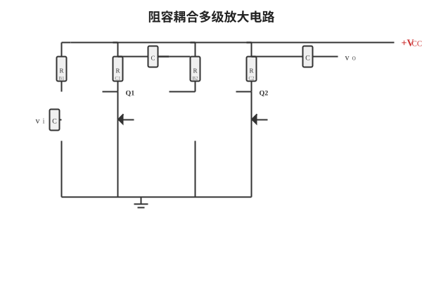
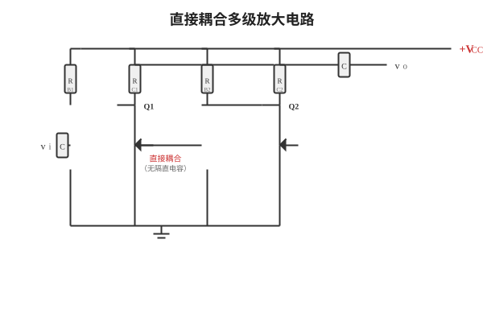

# 2.5 多级放大电路

> **前置知识**：[2.4 场效应管（FET）](2.4-场效应管-FET.md)（承接上一章）。

## 1. 多级放大电路的耦合方式

当单级放大电路的增益不足以满足要求时，需将多个放大级级联构成多级放大电路。级间连接方式称为**耦合**。

### 阻容耦合

利用电容和电阻实现级间连接，电容隔直流通交流。

特点：
- 各级静态工作点相互独立，互不影响
- 电容耦合仅传递交流信号，隔离直流分量
- 低频特性差，不能放大直流和缓慢变化信号
- 不便于集成化（电容占用面积大）

### 直接耦合

前后级直接连接，无隔直元件。

特点：
- 可放大直流和缓慢变化信号
- 频率特性好，从直流到高频均有增益
- 便于集成化
- 各级静态工作点相互影响，存在**零点漂移**问题
- 需要电平移位电路

### 变压器耦合

利用变压器实现级间耦合和阻抗变换。

特点：
- 实现阻抗匹配，使功率传输最大
- 各级静态工作点独立
- 频率特性差，体积大，不便于集成
- 主要用于功率放大电路和射频电路

## 2. 总增益计算

多级放大电路的总电压增益为各级增益的乘积（用分贝表示为加法）：

$$
A_v = A_{v1} \cdot A_{v2} \cdot A_{v3} \cdots A_{vn}
$$

用分贝表示：

$$
A_v(\text{dB}) = A_{v1}(\text{dB}) + A_{v2}(\text{dB}) + \cdots + A_{vn}(\text{dB})
$$

其中：

$$
A_v(\text{dB}) = 20 \log_{10} |A_v|
$$

计算时需考虑级间负载效应：后级的输入电阻是前级的负载，影响前级的电压增益。

## 3. 频率响应

多级放大电路的总频率响应为各级频率响应的叠加。总带宽小于单级带宽：

设每级的上限频率为 $f_H$，下限频率为 $f_L$，则n级相同放大电路的总频率特性：

$$
f_{H(total)} = f_H \sqrt{2^{1/n} - 1}
$$

$$
f_{L(total)} = \frac{f_L}{\sqrt{2^{1/n} - 1}}
$$

可见，级数增多，上限频率下降，下限频率升高，总带宽变窄。

## 4. 直接耦合电路的零点漂移问题

### 零点漂移

直接耦合放大电路输入端短路时，输出端电压缓慢偏离零点，随时间上下波动，这种现象称为零点漂移（Zero Drift），简称**零漂**。

### 产生原因

- 温度变化引起晶体管参数（$V_{BE}$、$\beta$、$I_{CBO}$）变化
- 电源电压波动
- 元器件老化

### 抑制措施

- 引入直流负反馈（如分压式偏置电路）
- 采用差动放大电路（最有效的方法）
- 采用温度补偿电路
- 选用高稳定度电源

### 温度漂移的衡量

将输出漂移电压折算到输入端：

$$
V_{id} = \frac{\Delta V_O}{A_V}
$$

温度漂移系数：

$$
\frac{dV_{id}}{dT}
$$

单位通常为 $\mu\text{V}/^\circ\text{C}$，表示温度每变化1°C等效到输入端的漂移电压。

## 5. 多级放大电路的输入电阻与输出电阻

多级放大电路的整体输入/输出电阻可按以下规则直接求得：

- **输入电阻 $R_i$**：等于**第一级**的输入电阻，即 $R_i = R_{i1}$。中间各级的输入电阻不影响总输入电阻，因为信号总是先进入第一级。
- **输出电阻 $R_o$**：等于**最后一级**的输出电阻，即 $R_o = R_{on}$。前各级的输出电阻不影响总输出电阻。

**具体求解步骤**：

1. **从输出端逐级往前**：先求最后一级（第 n 级）的输入电阻 $R_{in}$；在求解第 $n-1$ 级动态指标时，把 $R_{in}$ 当作第 $n-1$ 级的交流负载，即 $R'_{L(n-1)} = R_{C(n-1)} \parallel R_{in}$，从而求出第 $n-1$ 级的输入电阻 $R_{i(n-1)}$；
2. **逐级往前递推**：依次求出前面各级的输入电阻，直至第一级的输入电阻 $R_{i1}$，即为整个多级放大电路的输入电阻 $R_i$；
3. **输出电阻**直接取末级集电极（或漏极）电阻 $R_o = R_{C(n)}$；
4. **总电压增益**等于各级增益的乘积 $A_v = A_{v1} A_{v2} \cdots A_{vn}$，计算每一级增益时，都必须把**下一级的输入电阻**作为本级的交流负载（即级间负载效应），否则会高估增益。

## 6. 两级放大电路计算实例

两级阻容耦合共射放大电路，两级参数相同：$V_{CC} = 12\text{V}$，$R_{B1} = 47\text{k}\Omega$，$R_{B2} = 15\text{k}\Omega$，$R_C = 4.7\text{k}\Omega$，$R_E = 2\text{k}\Omega$，$\beta = 100$，末级负载 $R_L = 3\text{k}\Omega$。室温下 $V_T = 26\text{mV}$，忽略 $r_{bb'}$。求总电压增益、输入电阻、输出电阻。

**（1）求各级 Q 点与 $r_{be}$**

基极电压：

$$
V_B = \frac{R_{B2}}{R_{B1} + R_{B2}} V_{CC} = \frac{15}{47+15} \times 12 = 2.90\text{V}
$$

发射极电流：

$$
I_E = \frac{V_B - U_{BE}}{R_E} = \frac{2.90 - 0.7}{2\text{k}} = 1.10\text{mA}
$$

$$
r_{be} = (1 + \beta)\frac{V_T}{I_E} = 101 \times \frac{26\text{mV}}{1.1\text{mA}} = 2.39\text{k}\Omega
$$

两级参数相同，故 $r_{be1} = r_{be2} = 2.39\text{k}\Omega$。

**（2）从末级往前递推，体现级间负载效应**

关键点：**后级（第二级）的输入电阻是第一级的交流负载**。

第二级输入电阻：

$$
R_{i2} = R_{B1}\parallel R_{B2}\parallel r_{be2} = 47\text{k}\parallel 15\text{k}\parallel 2.39\text{k}
$$

其中 $47\text{k}\parallel 15\text{k} = 11.37\text{k}\Omega$，故：

$$
R_{i2} = 11.37\text{k} \parallel 2.39\text{k} = 1.97\text{k}\Omega
$$

第一级的交流负载为第一级集电极电阻与第二级输入电阻并联：

$$
R'_{L1} = R_C \parallel R_{i2} = 4.7\text{k} \parallel 1.97\text{k} = 1.39\text{k}\Omega
$$

第一级增益：

$$
A_{v1} = -\frac{\beta R'_{L1}}{r_{be1}} = -\frac{100 \times 1.39\text{k}}{2.39\text{k}} = -58.2
$$

第二级交流负载（末级真实负载 $R_L$ 与集电极电阻并联）：

$$
R'_{L2} = R_C \parallel R_L = 4.7\text{k} \parallel 3\text{k} = 1.83\text{k}\Omega
$$

第二级增益：

$$
A_{v2} = -\frac{\beta R'_{L2}}{r_{be2}} = -\frac{100 \times 1.83\text{k}}{2.39\text{k}} = -76.6
$$

**（3）总增益、输入电阻、输出电阻**

总电压增益：

$$
A_v = A_{v1} \cdot A_{v2} = (-58.2) \times (-76.6) = 4458 \quad \text{（约 } 20\lg 4458 = 73\text{dB）}
$$

输入电阻即第一级输入电阻：

$$
R_i = R_{i1} = R_{i2} = 1.97\text{k}\Omega
$$

输出电阻即末级集电极电阻：

$$
R_o = R_C = 4.7\text{k}\Omega
$$

**讨论（级间负载效应的重要性）**：若计算第一级增益时错误地把第二级输入电阻当作开路（即不把它作为负载），则 $R'_{L1} = R_C = 4.7\text{k}\Omega$，会得到 $A_{v1} = -100 \times 4.7\text{k}/2.39\text{k} = -196.7$，比正确的 $-58.2$ 高出约 3.4 倍，从而严重高估总增益。可见多级放大电路计算中必须逐级计入下一级的输入电阻作为本级负载。

## 本章要点

- 多级放大电路的耦合方式
- 总增益计算
- 频率响应
- 直接耦合电路的零点漂移问题
- 多级放大电路的输入电阻与输出电阻
- 两级放大电路计算实例

## 自测清单

1. 「多级放大电路的耦合方式」要解决的核心问题是什么？关键结论或公式是什么？
2. 「总增益计算」与上一节之间是什么关系？
3. 「频率响应」在什么场景下会用到？如果条件改变，结论会如何变化？
4. 能否不看正文，写出「直接耦合电路的零点漂移问题」的关键流程或结构？
5. 「多级放大电路的输入电阻与输出电阻」最容易混淆的点是什么？

---

**下一章**：[2.6 频率响应](2.6-频率响应.md)
