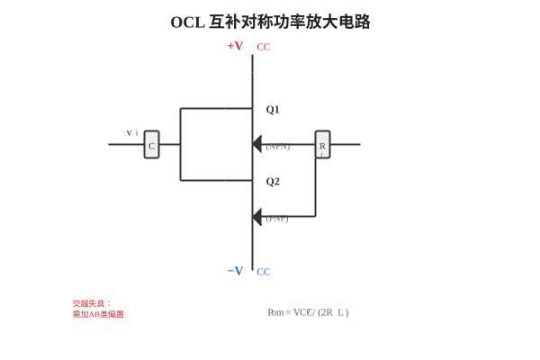
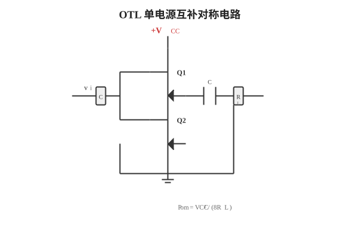
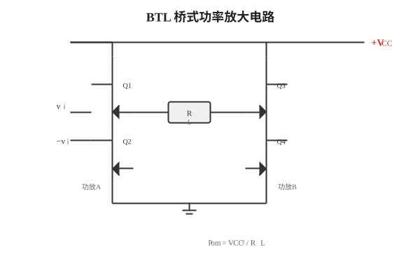

# 2.9 功率放大电路

> **前置知识**：[2.8 运算放大器](2.8-运算放大器.md)（承接上一章）。

## 1. 功率放大电路特点与分类

### 特点

功率放大电路（Power Amplifier）以向负载提供足够大的输出功率为主要目标，其特点如下：

- 输出功率大（电压和电流幅度都大）
- 效率高（将直流电源功率转换为交流输出功率的能力）
- 非线性失真小
- 散热问题突出

### 分类（按静态工作点位置）

**A类（甲类）**：Q点设置在放大区中部，导通角 $\theta = 360^\circ$，静态电流大，效率低（理论最高 50%），失真小。

**B类（乙类）**：Q点设置在截止点，导通角 $\theta = 180^\circ$，静态电流为零，效率高（理论最高 78.5%），存在交越失真。

**AB类（甲乙类）**：Q点设置在放大区靠近截止区处，导通角 $180^\circ < \theta < 360^\circ$，兼顾效率和失真。

**C类（丙类）**：Q点设置在截止区内，导通角 $\theta < 180^\circ$，效率极高，但失真严重，用于射频调谐放大器。

**D类（丁类）**：工作于开关状态，晶体管饱和导通或截止，效率极高（可达 90% 以上），需低通滤波器恢复信号。

## 2. 互补对称功率放大电路（OCL）

OCL（Output Capacitor Less）电路采用正负双电源供电，无需输出电容。

### 工作原理

由NPN和PNP管组成互补对称结构，正半周NPN管导通，负半周PNP管导通，负载 $R_L$ 上获得完整的输出波形。

### 输出功率

最大输出功率：

$$
P_{om} = \frac{V_{CC}^2}{2R_L}
$$

### 效率

B类OCL电路的理论最大效率：

$$
\eta = \frac{P_o}{P_V} = \frac{\pi}{4} \approx 78.5\%
$$

其中 $P_V$ 为电源提供的总功率。

### 交越失真

B类功放中，由于BJT存在死区电压，在输入信号过零附近两管均截止，造成输出波形失真。消除方法：在基极间加偏置电压，使两管工作在AB类状态。

### OCL功放设计算例

设计一个双电源供电的B类OCL互补对称功放，电源电压 $V_{CC} = 15\text{V}$（整流后约 $V_{CC} \approx 13\text{V}$，此处按理想电源取 $V_{CC} = 15\text{V}$），负载 $R_L = 8\Omega$。求最大输出功率、电源提供功率、单管最大管耗、效率，并据以确定功放管的选管条件。

**（1）最大输出功率 $P_{om}$**

$$
P_{om} = \frac{V_{CC}^2}{2R_L} = \frac{15^2}{2 \times 8} = 14.06\text{W}
$$

对应的最大输出电流（管峰值电流）：

$$
I_{Cm} = \frac{V_{CC}}{R_L} = \frac{15}{8} = 1.875\text{A}
$$

**（2）电源提供的总功率 $P_V$**

B类OCL电路中，两电源在输出最大时提供的总功率：

$$
P_V = \frac{2V_{CC}^2}{\pi R_L} = \frac{2 \times 15^2}{\pi \times 8} = 17.9\text{W}
$$

（每只晶体管在一个周期内导通半周，单个电源 $P_{V(\text{单})} = \dfrac{V_{CC}^2}{\pi R_L} = 8.96\text{W}$。）

**（3）效率 $\eta$**

$$
\eta = \frac{P_{om}}{P_V} = \frac{14.06}{17.9} \approx 78.5\%
$$

与B类OCL理论最大效率一致。

**（4）单管最大管耗 $P_{C1\text{(max)}}$**

两只功放管的耗散功率之和 $P_C = P_V - P_o$。单管最大管耗发生在其输出约为最大输出的 40% 时，其最大值：

$$
P_{C1\text{(max)}} \approx \frac{V_{CC}^2}{\pi^2 R_L} = \frac{15^2}{\pi^2 \times 8} = 2.85\text{W} \approx 0.2 P_{om}
$$

**（5）选管条件**

综合考虑最大电流、最大反压与最大耗散功率，功放管至少需满足：

- **最大集电极电流**：$I_{CM} \geq \dfrac{V_{CC}}{R_L} = 1.875\text{A}$（留裕量取 $\geq 3\text{A}$）
- **集电极-发射极反向击穿电压**：$V_{(BR)CEO} \geq 2V_{CC} = 30\text{V}$（留裕量取 $\geq 50\text{V}$）
- **最大允许耗散功率**：$P_{CM} \geq P_{C1\text{(max)}} = 2.85\text{W}$，工程上常取 $P_{CM} \geq P_{om}$（即 $\geq 14\text{W}$）以保证长期可靠工作

## 3. 单电源互补对称电路（OTL）

OTL（Output Transformer Less）电路采用单电源供电，通过输出电容隔直通交。

最大输出功率：

$$
P_{om} = \frac{V_{CC}^2}{8R_L}
$$

其中 $V_{CC}$ 为单电源电压值。

### 自举电路

自举（Bootstrap）电路用于提高OTL等单电源互补对称电路的输出动态范围。由于上管（NPN）集电极接电源 $V_{CC}$，其基极电位最高只能由偏置网络的分压点决定，输出正半周幅度受限于上管基极驱动电压，易提前进入饱和而减小不失真输出幅度。自举电路在偏置电阻上并联一个电容 $C_B$（电容一端接输出节点），利用电容的"泵升"作用使该偏置点电位跟随输出随信号抬升，从而在正半周为上管提供比电源电压更高的基极驱动，扩大正摆幅。因电容使偏置点电压"自举"到高于电源，故得名。自举电路只改善输出动态范围，不改变电路类型。

## 4. 桥式功率放大电路（BTL）

BTL（Bridge-Tied Load）电路由两个相同的功放电路和负载组成桥式结构，负载接在两个功放输出端之间。

特点：
- 无需输出电容
- 最大输出功率为同电源电压下OCL的4倍
- 对电源电压要求低
- 需要两路相位相反的输入信号

最大输出功率：

$$
P_{om} = \frac{V_{CC}^2}{R_L}
$$

## 5. 功率BJT的安全工作区

功率BJT的安全工作区（Safe Operating Area, SOA）受以下因素限制：
- **最大集电极电流 $I_{C(max)}$**
- **最大集电极-发射极电压 $V_{CE(max)}$**
- **最大功耗 $P_{C(max)}$**
- **二次击穿**：功率BJT在高压大电流下可能发生二次击穿，导致器件永久损坏

## 6. 功放管散热问题

### 热阻模型

功率管的散热路径：管芯 $\to$ 管壳 $\to$ 散热器 $\to$ 环境。

热路欧姆定律：

$$
T_j - T_a = P_D \cdot R_{\theta j a}
$$

其中 $T_j$ 为结温，$T_a$ 为环境温度，$P_D$ 为耗散功率，$R_{\theta j a}$ 为总热阻。

### 散热计算

所需散热器的热阻：

$$
R_{\theta sa} \leq \frac{T_{j max} - T_a}{P_D} - R_{\theta jc} - R_{\theta cs}
$$

其中 $R_{\theta jc}$ 为管芯到管壳的热阻，$R_{\theta cs}$ 为管壳到散热器的热阻（与绝缘垫片有关）。

### 降低热阻的方法

- 选用大功率管（热阻小）
- 安装足够大的散热器
- 使用导热硅脂降低接触热阻
- 必要时采用风冷或水冷

## 本章要点

- 功率放大电路特点与分类
- 互补对称功率放大电路（OCL）
- 单电源互补对称电路（OTL）
- 桥式功率放大电路（BTL）
- 功率BJT的安全工作区
- 功放管散热问题

## 自测清单

1. 「功率放大电路特点与分类」要解决的核心问题是什么？关键结论或公式是什么？
2. 「互补对称功率放大电路（OCL）」与上一节之间是什么关系？
3. 「单电源互补对称电路（OTL）」在什么场景下会用到？如果条件改变，结论会如何变化？
4. 能否不看正文，写出「桥式功率放大电路（BTL）」的关键流程或结构？
5. 「功率BJT的安全工作区」最容易混淆的点是什么？

---

**下一章**：[2.10 信号处理电路](2.10-信号处理电路.md)
