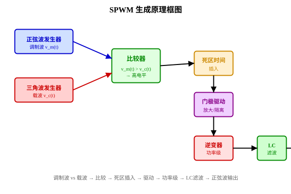
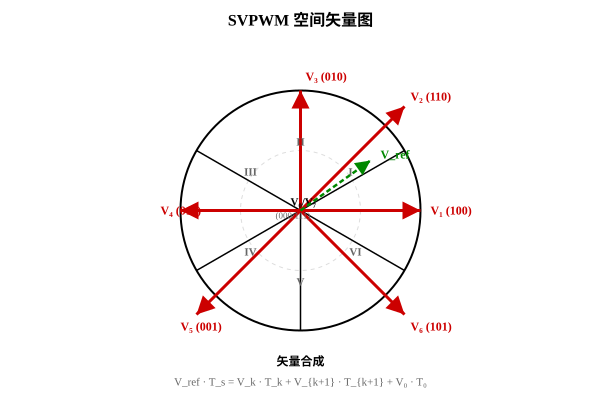

# 2.23 PWM调制技术

> **前置知识**：**必需**：[2.21 功率半导体器件](2.21-晶闸管-SCR与双向晶闸管-TRIAC.md)（功率器件与换流）、[1.15 电感（自感与互感）](../../01-基础与电路分析/物理·电路进阶/1.15-电感-自感与互感.md)、[1.16 交流电](../../01-基础与电路分析/物理·电路进阶/1.16-交流电.md)（电感储能与正弦交流分析）。

## 1. 引言

脉宽调制（PWM，Pulse Width Modulation）是电力电子领域最核心的控制技术之一。通过改变开关器件的导通时间比例（占空比），可以在不改变直流母线电压的情况下，等效地调节输出电压的幅值和频率。PWM 技术从简单的 DC-DC 斩波，发展到用于逆变器的 SPWM 和 SVPWM，覆盖了几乎所有电力电子应用。

## 2. PWM 的基本概念

### 2.1 占空比

占空比（Duty Cycle）定义为：

$$D = \frac{T_{on}}{T} = \frac{T_{on}}{T_{on} + T_{off}}$$

其中 $T$ 为开关周期，$T_{on}$ 为导通时间，$T_{off}$ 为关断时间。

### 2.2 平均输出电压

对于 DC-DC 变换器，输出电压平均值与占空比的关系：

**Buck 变换器**（降压型）：

$$V_o = D \cdot V_{in}$$

**Boost 变换器**（升压型）：

$$V_o = \frac{1}{1 - D} \cdot V_{in}$$

**Buck-Boost 变换器**（升降压型）：

$$V_o = \frac{D}{1 - D} \cdot V_{in}$$

### 2.3 开关频率的选择

开关频率 $f_s$ 的选择是一个权衡：

- **高频**：减小滤波器体积、提高动态响应，但开关损耗增大
- **低频**：降低开关损耗，但滤波器体积大、可能产生音频噪声

典型开关频率：DC-DC 变换器 100 kHz–2 MHz，逆变器 2–20 kHz。

## 3. 自然采样 PWM 与规则采样 PWM

### 3.1 自然采样 PWM

自然采样（Natural Sampling）将调制波直接与载波比较，开关时刻由两波形的自然交点决定。

特点：
- 开关时刻精确，谐波特性最优
- 模拟实现简单（比较器）
- 数字实现困难（需要求解超越方程）

### 3.2 规则采样 PWM

规则采样（Regular Sampling）在每个载波周期的固定时刻（通常是载波峰值或谷值）对调制波进行采样，用采样值确定占空比。

**对称规则采样**：在载波谷值处采样

$$T_{on} = \frac{T_s}{2} \left[1 + \frac{v_m(t_k)}{V_c}\right]$$

**不对称规则采样**：在载波峰值和谷值处各采样一次，精度更高。

规则采样 PWM 的优点：
- 易于数字实现（DSP/MCU）
- 采样频率等于载波频率
- 谐波特性略逊于自然采样，但可接受

## 4. SPWM（正弦波脉宽调制）

### 4.1 基本原理

SPWM 以正弦波为调制波、三角波为载波，产生宽度按正弦规律变化的 PWM 脉冲序列。

调制波：

$$v_m(t) = V_m \sin(\omega_m t) = m_a \cdot V_c \cdot \sin(\omega_m t)$$

载波：

$$v_c(t) = \begin{cases} V_c \cdot \frac{4t}{T_s} & 0 \leq t < T_s/4 \\ V_c \cdot \left(2 - \frac{4t}{T_s}\right) & T_s/4 \leq t < 3T_s/4 \\ V_c \cdot \left(\frac{4t}{T_s} - 4\right) & 3T_s/4 \leq t < T_s \end{cases}$$

### 4.2 调制比与频率比

**调制比（Amplitude Modulation Ratio）**：

$$m_a = \frac{V_m}{V_c}$$

**频率比（Frequency Modulation Ratio）**：

$$m_f = \frac{f_c}{f_m}$$

频率比的选择原则：
- $m_f$ 应为奇数且为 3 的倍数（对三相系统），以消除偶次谐波和 3 的倍数次谐波
- 典型值：$m_f = 21, 39, 75$ 等

### 4.3 输出电压谐波分析

SPWM 输出电压的谐波分布：
- 基波频率为 $f_m$，幅值 $V_{o1} = m_a V_{dc}$（线性调制区）
- 主要谐波集中在 $m_f$、$2m_f$、$3m_f$ 等载波频率及其整数倍周围
- 低次谐波（$f < m_f$）含量很低

### 4.4 过调制

当 $m_a > 1$ 时进入过调制区，输出电压基波不再线性增长：

- $1 < m_a < 3.24$（近似）：部分脉冲丢失，输出电压逐渐趋于方波
- $m_a > 3.24$：完全退化为方波，$V_{o1} \to \frac{4}{\pi}V_{dc}$

## 5. 空间矢量 PWM（SVPWM）

### 5.1 基本原理

SVPWM（Space Vector PWM）将三相逆变器的 8 种开关状态映射为 6 个非零电压矢量和 2 个零矢量，通过合成参考电压矢量来生成 PWM 波形。

三相逆变器的开关状态与电压矢量：

| 状态 | $S_A$ | $S_B$ | $S_C$ | 电压矢量 |
|------|-------|-------|-------|----------|
| 0 | 0 | 0 | 0 | $\vec{V}_0$（零矢量） |
| 1 | 1 | 0 | 0 | $\vec{V}_1$（$V_{dc}$, 0°） |
| 2 | 1 | 1 | 0 | $\vec{V}_2$（$V_{dc}$, 60°） |
| 3 | 0 | 1 | 0 | $\vec{V}_3$（$V_{dc}$, 120°） |
| 4 | 0 | 1 | 1 | $\vec{V}_4$（$V_{dc}$, 180°） |
| 5 | 0 | 0 | 1 | $\vec{V}_5$（$V_{dc}$, 240°） |
| 6 | 1 | 0 | 1 | $\vec{V}_6$（$V_{dc}$, 300°） |
| 7 | 1 | 1 | 1 | $\vec{V}_7$（零矢量） |

### 5.2 矢量合成

参考电压矢量 $\vec{V}_{ref}$ 位于某个扇区时，由相邻两个非零矢量和一个零矢量合成：

$$\vec{V}_{ref} \cdot T_s = \vec{V}_k \cdot T_k + \vec{V}_{k+1} \cdot T_{k+1} + \vec{V}_0 \cdot T_0$$

作用时间计算（以扇区 I 为例）：

$$T_1 = \frac{\sqrt{3} |\vec{V}_{ref}| T_s}{V_{dc}} \sin(60° - \theta)$$

$$T_2 = \frac{\sqrt{3} |\vec{V}_{ref}| T_s}{V_{dc}} \sin(\theta)$$

$$T_0 = T_s - T_1 - T_2$$

### 5.3 SVPWM 与 SPWM 对比

| 特性 | SPWM | SVPWM |
|------|------|-------|
| 直流电压利用率 | $V_{dc}/2$（$m_a=1$） | $V_{dc}/\sqrt{3}$（约 15.5% 更高） |
| 谐波特性 | 一般 | 更优 |
| 开关损耗 | 一般 | 可通过零矢量分配优化 |
| 数字实现 | 简单 | 较复杂 |
|- 适用场景 | 通用 | 高性能电机控制 |

SVPWM 生成的三相 PWM 波形，通常配合矢量控制中的磁场定向控制（FOC）一起使用，驱动 PMSM/BLDC，构成标准的高性能电机驱动方案——FOC 计算出的参考电压矢量，正是由 SVPWM 在逆变器中调制实现。FOC 控制链路的完整展开见 2.24 节 §5.3 磁场定向控制（[2.24 电机驱动基础](2.24-电机驱动基础.md)）。

## 6. 死区时间（Dead Time）

### 6.1 死区时间的必要性

在半桥/全桥逆变器中，同一桥臂的上下两个开关管**绝对不能同时导通**（直通短路）。由于开关管存在开通和关断延迟，需要在切换时插入死区时间 $t_d$。

### 6.2 死区时间的影响

死区时间导致输出电压波形畸变，主要表现为：
- 基波幅值降低
- 引入低次谐波（特别是 5 次、7 次）
- 可能引起电机转矩脉动

死区时间引起的电压误差（近似）：

$$\Delta V \approx t_d \cdot f_s \cdot V_{dc} \cdot \operatorname{sgn}(i_o)$$

### 6.3 死区补偿

常用补偿方法：
- 基于电流极性的前馈补偿
- 无电流传感器的在线补偿
- 自适应死区补偿

## 7. PWM 的应用

### 7.1 电机控制

PWM 是电机调速的核心手段：
- **直流电机**：调节电枢电压平均值
- **交流感应电机**：V/f 控制、矢量控制（FOC）
- **无刷直流电机（BLDC）**：电子换相控制
- **步进电机**：微步控制

### 7.2 开关电源

PWM 控制器是开关电源的核心：
- **电压模式控制**：仅反馈输出电压
- **电流模式控制**：反馈输出电压和电感电流
- PID 补偿网络设计

### 7.3 其他应用

- **LED 调光**：PWM 调光无色谱偏移
- **音频 D 类放大器**：PWM 调制 + LC 解调
- **加热控制**：PWM 调节加热功率

## 小结

1. PWM 通过改变占空比控制输出电压平均值
2. SPWM 以正弦波为调制波，实现正弦波输出
3. 调制比 $m_a$ 和频率比 $m_f$ 是 SPWM 的核心参数
4. SVPWM 比 SPWM 电压利用率高约 15.5%，适合高性能电机控制
5. 死区时间对输出波形有显著影响，需要补偿
6. PWM 是电机控制、开关电源、LED 调光等领域的核心技术

## 自测清单

1. 「引言」要解决的核心问题是什么？关键结论或公式是什么？
2. 「PWM 的基本概念」与上一节之间是什么关系？
3. 「自然采样 PWM 与规则采样 PWM」在什么场景下会用到？如果条件改变，结论会如何变化？
4. 能否不看正文，写出「SPWM（正弦波脉宽调制）」的关键流程或结构？
5. 「空间矢量 PWM（SVPWM）」最容易混淆的点是什么？

---

**下一章**：[2.27 整流与DC-DC变换基础](2.27-整流与DC-DC变换基础.md)
