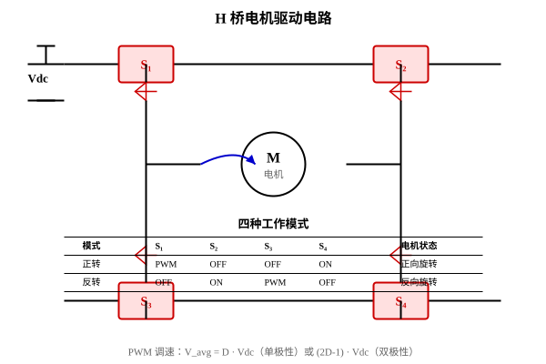
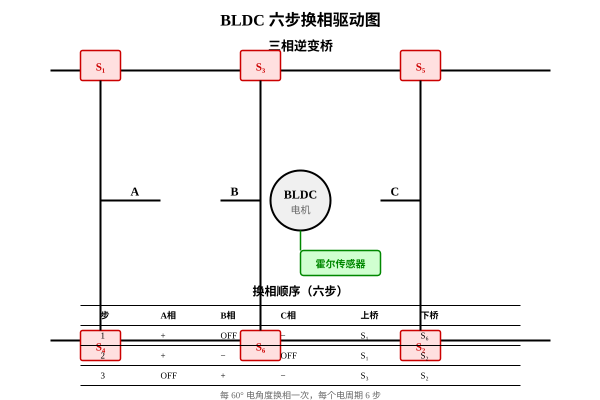

# 2.24 电机驱动基础

> **前置知识**：**必需**：[2.22 逆变器（DC-AC）](2.22-逆变器-DC-AC.md)、[2.23 PWM调制技术](2.23-PWM调制技术.md)（H 桥、逆变与调速控制）。**FOC 部分推荐**：[5.24 控制系统基本概念](../../05-信号、通信与控制/自动控制原理/5.24-控制系统基本概念.md)–[5.31 状态空间与现代控制](../../05-信号、通信与控制/自动控制原理/5.31-状态空间与现代控制.md)（自动控制原理）与[6.4 电力系统与电机学基础](../../06-专题与实战/专题/6.4-电力系统与电机学基础.md)。

## 1. 引言

电机驱动（Motor Drive）是电力电子技术最重要的应用领域之一，它将电能转换为机械能，驱动各类电机运转。不同类型的电机需要不同的驱动方式，从简单的直流有刷电机 H 桥驱动，到复杂的无刷直流电机（BLDC）电子换相，再到高精度的伺服电机闭环控制，电机驱动技术涵盖了从基础到高级的完整知识体系。

## 2. 直流有刷电机驱动

### 2.1 直流电机基本原理

直流有刷电机由定子（永磁体或励磁绕组）和转子（电枢绕组 + 换向器 + 电刷）组成。换向器和电刷实现机械换相，使转子电流方向随位置变化。

电枢电压方程：

$$V_a = E_a + I_a R_a = k_e \omega + I_a R_a$$

电磁转矩：

$$T_e = k_t I_a$$

其中 $k_e$ 为反电动势常数，$k_t$ 为转矩常数（在 SI 单位制中 $k_e = k_t$）。

### 2.2 转速-转矩特性

从电压方程和转矩方程可得：

$$\omega = \frac{V_a}{k_e} - \frac{R_a}{k_e k_t} T_e$$

空载转速（$T_e = 0$）：$\omega_0 = \frac{V_a}{k_e}$

堵转转矩（$\omega = 0$）：$T_{stall} = \frac{k_t V_a}{R_a}$

### 2.3 H 桥驱动

H 桥是最基本的直流电机驱动拓扑，可实现正反转和调速。

**四种工作模式**：

| 模式 | S1 | S2 | S3 | S4 | 电机状态 |
|------|----|----|----|----|---------|
| 正转 | PWM | OFF | OFF | ON | 正向旋转 |
| 反转 | OFF | ON | PWM | OFF | 反向旋转 |
| 制动 | OFF | ON | OFF | ON | 能耗制动 |
| 滑行 | OFF | OFF | OFF | OFF | 自由旋转 |

**PWM 调速**：通过调节占空比控制电机两端平均电压：

$$V_{avg} = (2D - 1) \cdot V_{dc} \quad (\text{双极性驱动})$$

$$V_{avg} = D \cdot V_{dc} \quad (\text{单极性驱动})$$

### 2.4 电机驱动芯片

**L298N**：经典双 H 桥驱动芯片
- 每个 H 桥持续电流 2A，峰值 3A
- 电源电压最高 46V
- 逻辑电压 5V
- 导通压降较大（约 2V @ 1A），效率较低

**L293D**：类似 L298N，内置续流二极管，单通道 600mA

## 3. 步进电机驱动

### 3.1 步进电机原理

步进电机将电脉冲信号转换为离散的角位移。每接收一个脉冲，转子旋转一个固定角度（步距角）。

步距角：

$$\theta_s = \frac{360°}{N_r \cdot N_p}$$

其中 $N_r$ 为转子齿数，$N_p$ 为相数。

### 3.2 驱动方式

**全步驱动（Full-Step）**：
- 单相励磁：每次仅一相通电（力矩小，振动大）
- 双相励磁：每次两相同时通电（力矩大，振动小）

**半步驱动（Half-Step）**：
- 单相和双相交替通电
- 步距角减半，运行更平滑

**微步驱动（Micro-Stepping）**：
- 通过调节各相电流比例，实现小于步距角的细分
- 电流按正弦/余弦变化：

$$I_A = I_{max} \cos(\theta), \quad I_B = I_{max} \sin(\theta)$$

- 可达到 1/256 微步甚至更高

### 3.3 步进电机驱动芯片

**A4988**：
- 内置微步控制（全步、1/2、1/4、1/8、1/16）
- 最大电流 2A（需散热）
- 简单 DIR/STEP 接口

**DRV8825**：
- 支持 1/32 微步
- 最大电流 2.5A
- 可调电流衰减模式

**TMC2208/TMC2209**：
- 超静音驱动（StealthChop²）
- 256 微步
- 支持 StallGuard 无传感器堵转检测

## 4. 无刷直流电机（BLDC）

### 4.1 BLDC 基本原理

BLDC 电机使用电子换相替代机械换向器，由永磁转子、定子绕组和位置传感器（或反电动势检测）组成。

反电动势方程（三相）：

$$e_A = k_e \cdot \omega \cdot \sin(\theta_e)$$

$$e_B = k_e \cdot \omega \cdot \sin(\theta_e - 120°)$$

$$e_C = k_e \cdot \omega \cdot \sin(\theta_e + 120°)$$

电磁转矩：

$$T_e = \frac{e_A i_A + e_B i_B + e_C i_C}{\omega}$$

### 4.2 六步换相法

六步换相法（Six-Step Commutation）是 BLDC 最基本的驱动方式，每个电周期分为 6 个扇区，每 60° 切换一次电流方向。

| 扇区 | 电角度 | 上桥臂 | 下桥臂 | A相 | B相 | C相 |
|------|--------|--------|--------|-----|-----|-----|
| 1 | 0°–60° | S1 | S5 | + | OFF | − |
| 2 | 60°–120° | S1 | S6 | + | − | OFF |
| 3 | 120°–180° | S2 | S6 | OFF | + | − |
| 4 | 180°–240° | S2 | S4 | − | + | OFF |
| 5 | 240°–300° | S3 | S4 | − | OFF | + |
| 6 | 300°–360° | S3 | S5 | OFF | − | + |

### 4.3 转子位置检测

**有传感器方案**：
- 霍尔传感器（3 个，间隔 120° 电角度或 60°）
- 光电编码器
- 旋转变压器

**无传感器方案**：
- 反电动势过零检测法
- 反电动势三次谐波积分法
- 高频注入法（零速/低速）

反电动势过零检测原理：在未通电相检测反电动势过零点，延迟 30° 电角度后换相。

### 4.4 BLDC 调速

通过 PWM 调节绕组电压实现调速：

$$\omega \approx \frac{V_{dc} \cdot D - I_a R_a}{k_e}$$

其中 $D$ 为 PWM 占空比。

## 5. 伺服电机与闭环控制

### 5.1 伺服系统组成

典型的伺服系统包括：
- **伺服电机**（BLDC 或 PMSM）
- **位置/速度传感器**（编码器）
- **伺服驱动器**（含电流环、速度环、位置环）
- **控制器**（PID 或更高级算法）

### 5.2 三环控制结构

**电流环**（最内环）：
- 控制 $i_q$ 和 $i_d$（FOC 框架下）
- 通常使用 PI 控制器
- 带宽最高（kHz 级）

**速度环**（中间环）：
- 电流环输出作为被控对象
- PI 控制器，带宽百 Hz 级

**位置环**（最外环）：
- 通常使用 P 控制器（避免过冲）
- 带宽数十 Hz

### 5.3 磁场定向控制（FOC）

FOC（Field-Oriented Control）通过 Clarke 变换和 Park 变换，将三相电流解耦为励磁分量 $i_d$ 和转矩分量 $i_q$，实现类似直流电机的控制性能。

Clarke 变换（三相 → 两相静止坐标系）：

$$\begin{bmatrix} i_\alpha \\ i_\beta \end{bmatrix} = \frac{2}{3} \begin{bmatrix} 1 & -\frac{1}{2} & -\frac{1}{2} \\ 0 & \frac{\sqrt{3}}{2} & -\frac{\sqrt{3}}{2} \end{bmatrix} \begin{bmatrix} i_A \\ i_B \\ i_C \end{bmatrix}$$

Park 变换（静止 → 旋转坐标系）：

$$\begin{bmatrix} i_d \\ i_q \end{bmatrix} = \begin{bmatrix} \cos\theta & \sin\theta \\ -\sin\theta & \cos\theta \end{bmatrix} \begin{bmatrix} i_\alpha \\ i_\beta \end{bmatrix}$$

FOC 解耦出的参考电压矢量，最终要由 PWM 调制环节在逆变器中变为实际开关信号——这是高性能电机驱动的标准搭配，其中空间矢量 PWM（SVPWM）以其更高的直流电压利用率更适合 FOC。SVPWM 的原理、矢量合成与扇区计算见 2.23 节 §5 空间矢量 PWM（[2.23 PWM调制技术](2.23-PWM调制技术.md)）。

## 小结

1. 直流有刷电机最简单，H 桥 + PWM 即可实现调速和正反转
2. 步进电机适合开环定位，微步驱动可提高精度和平滑性
3. BLDC 电机效率高、寿命长，六步换相是最基本的驱动方式
4. FOC 控制使 BLDC/PMSM 获得接近直流电机的控制性能
5. 伺服系统采用三环级联控制，实现高精度位置/速度伺服
6. 电机驱动芯片（L298N、A4988、DRV8825）大幅简化了驱动电路设计

## 自测清单

1. 「引言」要解决的核心问题是什么？关键结论或公式是什么？
2. 「直流有刷电机驱动」与上一节之间是什么关系？
3. 「步进电机驱动」在什么场景下会用到？如果条件改变，结论会如何变化？
4. 能否不看正文，写出「无刷直流电机（BLDC）」的关键流程或结构？
5. 「伺服电机与闭环控制」最容易混淆的点是什么？

---

**下一章**：[2.25 信号完整性](../信号完整性与电磁兼容/2.25-信号完整性.md)
