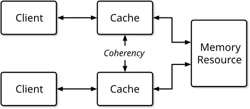
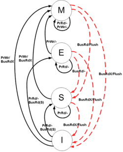

# 3.14 存储层次与缓存一致性

> **前置知识**：[3.13 超标量CPU微架构基础](3.13-超标量CPU微架构基础.md)（承接上一章）。

## 1. 存储层次结构

### 1.1 存储层次金字塔

现代CPU的存储层次基于成本与速度的权衡：

```
寄存器 (Registers)          ← 1周期，几十字节
    ↓
L1 缓存 (I-cache/D-cache)  ← 2~4周期，32~64KB
    ↓
L2 缓存                     ← 10~15周期，256~512KB
    ↓
L3 缓存 (共享)              ← 30~50周期，8~64MB
    ↓
主存 (DRAM)                 ← 100~300周期，8~128GB
    ↓
SSD / 磁盘                  ← 百万~上亿周期
```

**局部性原理**：
- **时间局部性**：刚访问过的数据很可能再次被访问
- **空间局部性**：访问某个地址后，相邻地址很可能被访问

### 1.2 缓存行（Cache Line）

缓存与内存之间的数据传输单位：

- 典型大小：**64字节**（x86_64和AArch64都使用）
- 缓存行是缓存一致性协议的基本操作单元

**缓存行组织结构**：

```
| 标签 (Tag) | 索引 (Index) | 块内偏移 (Offset) |
|  (高地址)   |  (中间位)     |   (低地址)         |
```

**N路组相联缓存**：每组包含N个缓存行，地址映射到固定组，但可以在组内任意行。

| 缓存级别 | 典型大小 | 相联度 | 行大小 |
|---------|---------|--------|-------|
| L1 | 32KB | 8路 | 64B |
| L2 | 512KB | 8路 | 64B |
| L3 | 16MB | 16路 | 64B |

### 1.3 缓存替换策略

当缓存满时，需要替换掉一个缓存行：

| 策略 | 描述 | 复杂度 |
|-----|------|-------|
| LRU（最近最少使用） | 替换最久未使用的行 | 高（需要记录访问顺序） |
| pseudo-LRU | 近似LRU，用树形结构 | 中等 |
| 随机替换 | 随机选择一行 | 低 |
| RRIP（Re-Reference Interval Prediction） | 预测下次访问的远近 | 中等 |

**Intel使用的策略**：自适应替换策略，根据访问模式动态调整。

---

### 1.4 缓存写策略

缓存需要决定**写命中**与**写缺失**时的行为：

**写命中策略**（数据已在缓存中，何时写回内存）：
- **写直达（Write-Through）**：写缓存的同时也写入内存。实现简单、内存始终与缓存一致，但每次写入都占用总线流量，性能较差。
- **写回（Write-Back）**：只写缓存并标记为脏（Dirty），直到该行被驱逐时才写回内存。总线流量少、性能好，但内存会短暂地"滞后"于缓存。

**写缺失策略**（数据不在缓存中，是否先取入缓存）：
- **写分配（Write-Allocate）**：先把整块数据取入缓存（RFO），再按写回策略修改。通常与写回搭配使用。
- **写不分配（Write-No-Allocate）**：不取入缓存，直接写向内存。通常与写直达搭配，可避免污染缓存。

**常见组合**：Intel 默认 L1/L2 采用**写回 + 写分配**；写直达 + 写不分配多用于避免缓存污染的散写场景。

### 1.5 缓存缺失三分类（Cache Miss）

按缺失原因，缓存未命中可分为三类：

- **强制性缺失（Compulsory / 冷缺失）**：某地址**首次**被访问，数据从不在缓存中。无法靠扩大缓存解决，只能靠预取缓解。
- **容量缺失（Capacity）**：缓存容量不足以容纳整个工作集，某行虽曾访问过但已被替换出。加大缓存可缓解。
- **冲突缺失（Conflict）**：因相联度有限，多个地址映射到同一组导致相互挤压、非自愿替换。提高相联度可缓解。

### 1.6 多级缓存的包含策略

多级缓存之间对行内容的约束关系：

- **包含式（Inclusive）**：外层缓存（L2/L3）包含内层（L1）的所有行。一致性探测只需查询外层即可判断某地址是否在任意缓存中，简化管理；但占用更多外层容量，且L1驱逐时需联动外层。
- **排他式（Exclusive）**：各级之间互不重叠，某行在同一时刻只存在于一级。总有效容量更大，常用作L2/L3策略（如AMD），L1缺失命中的行可直接升级到L1而不产生重复副本。
- **非包含非排他（NINE, Non-Inclusive Non-Exclusive）**：各级之间无强制约束，既允许重叠也允许不重叠。灵活，但一致性探测可能需要查询多个缓存。

**缺失代价**（逐级填充）大致为：L1缺失→L2命中约10\~15周期，→L3命中约30\~50周期，→主存约100\~300周期。包含策略主要影响硬件复杂度与有效容量，而非缺失代价本身。

### 1.7 缓存地址划分与索引方式

缓存可用虚拟地址（VA）或物理地址（PA）进行索引与打标签，组合出三种方式：

- **VIVT（Virtual Index, Virtual Tag）**：用虚拟地址索引并用虚拟地址作标签。命中检测快（无需TLB），但同一物理地址可能被多个虚拟地址映射，产生**虚拟别名（Virtual Aliasing）**——同一数据在缓存中存在多份，需额外机制处理，且进程切换时需刷新。
- **VIPT（Virtual Index, Physical Tag）**：用虚拟地址索引、物理地址打标签。索引计算与TLB并行，命中仍快；只要索引位全部落在页内偏移位之内就不产生别名。多数现代L1采用此方式，也是后续 3.15 节"物理标签缓存"讨论的基础。
- **PIPT（Physical Index, Physical Tag）**：全部用物理地址。无别名问题、一致性最简单，但索引需等TLB地址转换完成，命中延迟较高。常用于L2/L3。

---

## 2. 缓存一致性协议

在多核CPU中，每个核心有自己的L1/L2缓存，多个缓存可能同时缓存同一内存地址的数据。缓存一致性协议确保所有缓存看到一致的数据视图。



*图为缓存一致性概念示意图，展示了多个核心各自的缓存如何通过共享一致互联保持对同一内存地址的一致视图。*

### 2.1 MESI协议

MESI是最经典的缓存一致性协议，每个缓存行有四种状态：

| 状态 | 含义 | 该缓存行 | 其他缓存行 |
|-----|------|---------|-----------|
| **M**odified | 已修改 | 数据最新，与内存不一致 | 无效 |
| **E**xclusive | 独占 | 数据与内存一致 | 无效 |
| **S**hared | 共享 | 数据与内存一致 | 可能有效 |
| **I**nvalid | 无效 | 数据无效 | - |

**状态转换**（核心操作）：

```
读操作:
  I → S (其他核心有该行) 或 E (自己是唯一持有者)

写操作:
  E → M (直接写，无需通知)
  S → M (需要使其他核心的行失效 → 发送Invalidate)
  I → M (需要读取数据，然后修改 → Read For Ownership)

写回（驱逐）:
  M → I (写回内存)
  E/S → I (直接丢弃，无需写回)
```



*图为 MESI 状态机的经典状态转移示意图，展示 Modified/Exclusive/Shared/Invalid 四种状态及其在各读写操作下的转移关系。*

**总线嗅探（Bus Snooping）**：每个核心监听总线上的缓存操作，更新自身缓存状态。

### 2.2 MOESI协议

AMD使用的增强协议，增加**O**wned状态：

- **O**wned：数据被修改，但内存也有备份（不像M那样独占最新数据）
- 减少了不必要的写回操作

**优势**：O状态允许一个核心持有最新数据，同时其他核心以S状态共享，无需将数据写回内存。

### 2.3 MESIF协议

Intel使用的协议，增加**F**orward状态：

- **F**orward：类似S，但作为"指定转发者"
- 当一个缓存行被多个核心以S状态共享时，从F状态的核心转发数据
- 避免了总线仲裁的延迟

### 2.4 缓存一致性协议对比

| 特性 | MESI | MOESI (AMD) | MESIF (Intel) |
|-----|------|-------------|---------------|
| 状态数 | 4 | 5 | 5 |
| 新增状态 | - | O (Owned) | F (Forward) |
| 优点 | 简单 | 减少写回 | 减少转发延迟 |
| 使用 | 基础协议 | AMD Zen系列 | Intel Core系列 |

### 2.5 一致性协议的性能开销

**写缺失（Write Miss）**：核心要写入一个不在缓存中的行，需要：

1. 发送"读拥有"（RFO）请求到总线上
2. 其他核心使该行失效
3. 从内存或其他核心获取数据
4. 修改数据，状态变为M

**假共享（False Sharing）**：两个核心频繁写入不同的变量，但这两个变量在同一缓存行中。即使没有真正的数据依赖，每次写操作都会导致缓存行在核心间来回传递，产生大量一致性流量。

```c
// 假共享示例
struct {
    int x;  // 核心1频繁写入
    int y;  // 核心2频繁写入
} data;  // x和y在同一个缓存行！
```

**解决方法**：缓存行对齐填充（Padding）：

```c
struct {
    int x;
    char padding[64];  // 填充到缓存行大小
    int y;
} data;
```

---

## 3. 存储缓冲区与写合并

### 3.1 存储缓冲区（Store Buffer）

**问题**：写操作需要等待缓存行就绪（如果在I状态，需要先获取所有权），这会阻塞流水线。

**解决**：存储缓冲区暂存写操作，让流水线继续执行。

**Store Buffer的作用**：
1. 暂存写数据，缓存行就绪后异步写入
2. 合并对同一缓存行的多次写操作
3. 处理存储转发（Store-to-Load Forwarding）

### 3.2 存储转发（Store Forwarding）

当后续加载指令要读取刚写入的地址时，直接从Store Buffer转发数据，无需等待写回缓存：

```
STR  X0, [X1]     ; 写入地址 X1
LDR  X2, [X1]     ; 立即读取同一地址 → 从 Store Buffer 转发
```

**存储转发延迟**：通常为1~2个周期，比等待写回快得多。

### 3.3 写合并缓冲区（Write Combining Buffer）

**作用**：合并对同一缓存行的多次写操作，减少总线事务。

**典型应用**：
- 图形帧缓冲区写入
- 非时间性存储（Non-temporal Store）

**Intel的写合并**：有4个写合并缓冲区，每个64字节，用于合并对非缓存或写组合内存区域的写入。

---

## 4. 内存排序模型

### 4.1 为什么需要内存排序？

乱序执行和存储缓冲区导致指令的访存顺序可能不同于程序顺序。不同ISA对内存访问顺序有不同的保证。

### 4.2 x86_64 TSO（Total Store Order）

x86_64使用**TSO**内存模型（源自Intel和AMD的约定）：

**保证**：
- 同一核心的加载不重排（加载按程序顺序执行）
- 存储按程序顺序提交到缓存
- 加载可以越过之前的存储（但存储不能越过加载？）

实际上，x86 TSO的简化规则是：

```
Load Load Reorder?     No
Load Store Reorder?    No
Store Load Reorder?    Yes (实际实现中通常不允许，但理论模型允许)
Store Store Reorder?   No
```

**具体来说**：
- **同一个核心**：写操作按序提交，读操作可以越过之前的写操作
- **不同核心**：写操作对所有核心以相同顺序可见

**内存屏障指令**：
- `MFENCE`：全屏障，确保所有之前的内存操作完成后再执行后续操作
- `LFENCE`：加载屏障
- `SFENCE`：存储屏障

### 4.3 AArch64 RCsc（Release Consistency）

AArch64使用**RCsc**（Release Consistency with Sequential Consistency）内存模型，比x86 TSO更弱，允许更多重排序：

```
Load Load Reorder?     Yes
Load Store Reorder?    Yes
Store Load Reorder?    Yes
Store Store Reorder?   Yes
```

**关键特性**：
- 允许几乎所有类型的访存重排序
- 通过显式的内存屏障指令控制顺序
- 提供更好的性能优化空间

**AArch64内存屏障指令**：
- `DMB`（Data Memory Barrier）：数据内存屏障
- `DSB`（Data Synchronization Barrier）：数据同步屏障
- `ISB`（Instruction Synchronization Barrier）：指令同步屏障

**Load-Acquire / Store-Release 语义**：
- `LDAR`（Load-Acquire）：之后的加载和存储不能越过该加载
- `STLR`（Store-Release）：之前的加载和存储不能越过该存储

### 4.4 内存模型对比

| 特性 | x86_64 (TSO) | AArch64 (RCsc) |
|------|-------------|----------------|
| Load-Load重排 | 不允许 | 允许 |
| Load-Store重排 | 不允许 | 允许 |
| Store-Load重排 | 有限制 | 允许 |
| Store-Store重排 | 不允许 | 允许 |
| 硬件复杂度 | 较低（自动保证） | 更低（由软件控制） |
| 性能 | 需要更多硬件保证 | 更少硬件开销 |
| 编程复杂度 | 较低 | 较高（需要显式屏障） |

### 4.5 内存屏障与无锁编程

**经典例子**：用x86实现自旋锁

```c
// x86_64 自旋锁
void spin_lock(volatile int *lock) {
    while (__atomic_test_and_set(lock, __ATOMIC_ACQUIRE))
        ; // 自旋等待
}

void spin_unlock(volatile int *lock) {
    __atomic_clear(lock, __ATOMIC_RELEASE);
}
```

**AArch64实现**：

```c
// AArch64 自旋锁
void spin_lock(volatile int *lock) {
    unsigned int tmp;
    asm volatile(
        "1: ldaxr %w0, [%1]\n"   // Load-Acquire Exclusive
        "   cbnz %w0, 1b\n"       // 如果已锁，重试
        "   stxr %w0, %w2, [%1]\n" // 尝试写入
        "   cbnz %w0, 1b\n"       // 如果写入失败，重试
        : "=&r" (tmp)
        : "r" (lock), "r" (1)
        : "memory"
    );
}

void spin_unlock(volatile int *lock) {
    asm volatile(
        "stlr %w1, [%0]\n"  // Store-Release
        : "=r" (lock)
        : "r" (0)
        : "memory"
    );
}
```

---

### 4.6 内存屏障的CPU内部实现机制

内存屏障指令在CPU内部通过操作**存储缓冲区（Store Buffer）**、**失效队列（Invalidate Queue）** 和**加载缓冲区（Load Buffer）** 来实现。理解这些机制，才能清楚为什么不同架构的屏障指令开销差异如此之大。

**核心数据结构**：
- **存储缓冲区（Store Buffer）**：写操作先进入Store Buffer，再异步写入缓存。
- **失效队列（Invalidate Queue）**：接收其他核心发来的缓存行失效请求，可能有延迟处理。
- **加载缓冲区（Load Buffer）**：暂存已发射但尚未返回数据的加载指令。

#### 4.6.1 同步屏障与顺序屏障

屏障可依"是否阻塞流水线"分为两类：

**① 同步屏障（MFENCE / DSB / ISB）**——停止流水线，等待一切就绪后再继续，开销大：
- **MFENCE（x86）**：在Store Buffer插入屏障标记→**清空Store Buffer**→等待所有Invalidate确认→等待Load Buffer完成→串行化指令流（serializing=YES）。对WC内存区域还会刷新写合并缓冲区。约20\~50周期。
- **DSB（AArch64）**：MFENCE的超集，清空Store Buffer后还等待缓存维护（DC CVAC）、TLB维护（TLBI）与分支预测维护（BPALI）完成，完全阻塞流水线。约50\~200+周期。用于MMU页表/TLB维护、缓存维护、上下文切换、内存映射IO之后。
- **ISB（AArch64）**：最重的屏障，等待旧指令退休后**清空流水线、预取缓冲与分支预测器并重新取指**。约50\~100+周期。用于自修改代码、修改系统寄存器（SCTLR、TTBR0_EL1）、修改MMU/缓存配置及上下文切换之后。

**② 顺序屏障（DMB）**——只在Store Buffer插入一个屏障标记，**不阻塞流水线**：

```
DMB 执行流程 (约5~15周期):
  ① 在 Store Buffer 中插入屏障标记（Barrier Tag）
  ② 屏障标记前的条目写入缓存（到指定域可见）
  ③ 后续指令继续执行（不阻塞流水线）
```

DMB 只保证访存顺序、不等待完成——后续加载/存储可以越过执行，靠Store Buffer中"实体书签"物理分隔新旧存储，且不等待Invalidate ACK。

**③ 半屏障（LDAR / STLR）**——最轻量的单向屏障（约5\~10周期）：
- **LDAR（Load-Acquire）**：加载后在Load Buffer标记为"acquire"，**后续**的加载/存储不能越过该加载。
- **STLR（Store-Release）**：存储前在Store Buffer标记为"release"，**之前的**加载/存储必须在该存储之前完成。

**DMB 的 Shareability Domain 参数**（决定屏障作用域）：
```
DMB ISH   → Inner Shareable（同一集群内的核心）
DMB ISHST → Inner Shareable, Store only
DMB NSH   → Non-shareable（仅当前核心）
DMB SY    → Full system（所有核心）
```

**DMB vs DSB 对比**：

| 对比项 | DMB | DSB |
|-------|-----|-----|
| 阻塞流水线 | 否 | **是** |
| 清空 Store Buffer | 到屏障标记 | **全部清空** |
| 等待缓存/TLB/分支预测维护 | 否 | **是** |
| 典型开销 | 5\~15 周期 | 50\~200+ 周期 |
| 用途 | 普通内存排序 | 系统级同步 |

#### 4.6.2 三种架构的屏障实现对比

| 屏障指令 | 核心机制 | 阻塞流水线 | 典型开销 | 适用场景 |
|---------|---------|-----------|---------|---------|
| MFENCE (x86) | 清空 Store Buffer + 等待 Load + 等待 Invalidate | **是** | 20\~50 周期 | 全同步 |
| SFENCE (x86) | 清空 Store Buffer | 否 | 10\~20 周期 | 写排序 |
| LFENCE (x86) | 等待 Load Buffer | 是 | 10\~20 周期 | 读排序 |
| DMB (AArch64) | Store Buffer 屏障标记 | 否 | 5\~15 周期 | 内存排序 |
| DSB (AArch64) | 清空 Store + 等待 Cache/TLB/BP | **是** | 50\~200+ 周期 | 系统同步 |
| ISB (AArch64) | 清空流水线 + 重新取指 | **是** | 50\~100+ 周期 | 指令同步 |
| LDAR (AArch64) | Load Buffer 单向标记 | 否 | 5\~10 周期 | 读后排序 |
| STLR (AArch64) | Store Buffer 单向标记 | 否 | 5\~10 周期 | 写前排序 |

**性能总结**：普通LOAD(1\~4) < LDAR/STLR(5\~10) < DMB(5\~15) < SFENCE/LFENCE(10\~20) < MFENCE(20\~50) < ISB(50\~100+) < DSB(50\~200+) 周期。

**选择建议**：
- 普通锁操作：优先LDAR/STLR（AArch64）或原子CAS（x86）
- 生产者-消费者同步：DMB（AArch64）或SFENCE/LFENCE（x86）
- 全内存屏障：DSB（AArch64）或MFENCE（x86）
- 系统寄存器修改：DSB + ISB（AArch64）

---

### 4.7 屏障指令的完整流水线执行过程

#### 4.7.1 流水线阶段总览

所有屏障指令都经历典型乱序执行流水线，各阶段的行为决定了其开销差异：

```
取指(IF) → 预解码(PreDec) → 解码(Dec) → 重命名(Rename) → 发射队列(IssueQ) → 调度(Sch) → 执行(EX) → 写回(WB) → 提交(Commit)

                                   按序阶段        ↓                    乱序阶段       ↓
```

**关键观察**：屏障在**按序**阶段（取指→重命名）与**乱序**阶段（发射队列→写回）的行为有本质区别，最终在**提交**阶段回归按序。

#### 4.7.2 MFENCE 的完整流水线追踪（x86_64）

以 `MOV [a1],eax; MOV [a2],ebx; MFENCE; MOV ecx,[a3]` 为例：

| 阶段 | MFENCE 的行为 |
|-----|--------------|
| IF / PreDec | 与普通指令相同，取指器不停止；3字节编码 0F AE F0 被识别为屏障并标记 |
| Dec | 解码为一个**BARRIER μop**，字段 serializing = **YES**（关键标志） |
| Rename | 分配ROB条目，不分配物理寄存器 |
| IssueQ | **等待所有更老的μop完成**，且后续μop不能越过它发射 |
| Schedule | 旧μop全部完成后才被调度到内存排序单元 |
| Execute | 发Drain信号清空Store Buffer并刷新Write Combine Buffer→等待所有Invalidate ACK→等待Load Buffer完成（20\~50周期） |
| WB / Commit | 标记完成、按序退休；退休后屏障效果消失，后续μop解除阻挡 |

**关键观察**：MFENCE之前的存储在屏障执行前完成，之后的加载在屏障退休后才执行——前后操作被完全隔离，即"全屏障"。

#### 4.7.3 DMB 的完整流水线追踪（AArch64）

| 阶段 | DMB 的行为（与MFENCE对比） |
|-----|--------------------------|
| Dec | AArch64定长4字节，无需指令边界检测；DMB ISH（0xD5033BBF）解码为DMB μop，serializing = **NO** |
| IssueQ | 插入后立即就绪，**不等待旧操作**；后续μop也可以越过DMB继续调度 |
| Execute | 仅在Store Buffer插入屏障标记，1\~2周期完成——不等待清空、不等待Invalidate ACK |
| Commit | 按序退休，但**屏障标记仍留在Store Buffer中**，继续分隔新旧存储 |

**本质区别**：MFENCE是"同步屏障"（停止一切、等待就绪）；DMB是"顺序屏障"（只建顺序点、不阻塞流水线）。顺序保证由Store Buffer中的物理标记实现，而非流水线阻塞。

#### 4.7.4 DSB 的完整流水线追踪（AArch64）

DSB在Dec阶段同样是 serializing=YES、IssueQ等待旧操作完成，与MFENCE的流水线行为非常相似，区别在于**执行阶段等待更多**：

```
DSB 执行:
 ① 清空 Store Buffer 所有条目 → 写入缓存
 ② 等待所有缓存维护操作完成（DC CVAC 等）
 ③ 等待所有 TLB 维护操作完成（TLBI 等）
 ④ 等待所有分支预测器维护完成（BPALI 等）
 ⑤ 阻塞流水线直到全部完成，移除DSB标记
```

#### 4.7.5 ISB 的完整流水线追踪（AArch64）

ISB不是内存屏障，而是**指令流同步屏障**——不做任何访存排序，而是保证后续指令使用更新后的系统配置执行：

```
ISB 执行:
 ① 等待所有之前的指令退休
 ② 清空流水线全部阶段（IF/PreDec/Dec/Rename/IssueQ）
 ③ 清空预取缓冲与分支预测器
 ④ 从 ISB 之后的地址重新取指，从头执行
```

**典型使用**（修改MMU页表）：`STR 新页表项 → DSB SY（等待写入与TLBI失效完成）→ ISB（清空流水线，按新页表重新取指）`。

#### 4.7.6 LDAR/STLR 的完整流水线追踪（AArch64）

LDAR/STLR仅在加载/存储缓冲区中做**单向标记**，发射队列中立即就绪、可并行调度（不阻塞），执行仅1\~2周期：
- **LDAR**：加载正常执行后，在Load Buffer标记该条目为"acquire"，后续的加载/存储不能越过它。
- **STLR**：存储正常进入Store Buffer后标记为"release"，之前的加载/存储必须在此标记前完成。

#### 4.7.7 四种屏障指令的完整流水线对比

**完整流水线时间线**（IF→PreDec→Dec→Rename→IssueQ→Sch→Execute→WB→Commit）：

```
MFENCE (x86, 20~50周期):  …→IssQ→[等待旧操作]→Sch→[清空StoreBuf]→WB→Rtr
                                            ↓
                                      旧μop全完成才调度

DMB (AArch64, 5~15周期):    …→IssQ→Sch→[插入标记]→WB→Rtr   （仅1~2周期，不等待）

DSB (AArch64, 50~200+周期): …→IssQ→[等待旧操作]→Sch→[清空+等待维护]→WB→Rtr

ISB (AArch64, 50~100+周期): …→IssQ→Sch→[清空流水线]→[重新取指]
```

**按阶段的行为对比表**：

| 流水线阶段 | MFENCE (x86) | DMB (AArch64) | DSB (AArch64) | ISB (AArch64) |
|-----------|-------------|---------------|---------------|---------------|
| **Dec** | 1 μop, serializing | 1 μop, 非serializing | 1 μop, serializing | 1 μop, 特殊 |
| **IssueQ** | **等待所有旧μop完成** | 正常就绪 | **等待所有旧μop完成** | 正常就绪 |
| **Schedule** | 旧操作完成后才调度 | 可立即调度 | 旧操作完成后才调度 | 可立即调度 |
| **Execute** | 清空StoreBuf+等待Load+Invalidate | 插入屏障标记(1\~2周期) | 清空StoreBuf+等待Cache/TLB/BP | 清空流水线+重新取指 |
| **退休后** | 屏障效果消失 | 屏障标记仍在StoreBuf中 | 屏障效果消失 | 流水线清空 |
| **后续μop何时执行** | 屏障退休后 | 屏障就绪后即可执行 | 屏障退休后 | 重新取指后 |

**硬件实现开销总结**：

```
ISB (AArch64):  ════════════════════════════════  50~100+ 周期
DSB (AArch64):  ════════════════════════════════════  50~200+ 周期
MFENCE (x86):   ══════════════════════════════  20~50 周期
LFENCE (x86):   ══════════  10~20 周期
SFENCE (x86):   ══════════  10~20 周期
DMB (AArch64):  ══════  5~15 周期
LDAR (AArch64): ════  5~10 周期
STLR (AArch64): ════  5~10 周期
普通LOAD:       ═  1~4 周期
```

---

## 5. 页表与TLB

### 5.1 虚拟内存与分页

CPU使用虚拟地址访问内存，通过页表转换为物理地址：

- **页大小**：4KB（标准小页），2MB（大页），1GB（超大页）

**页表项（PTE）的核心权限位**（用于访问控制与权限检查）：
- 有效位（Valid/Present）：该映射是否可用
- 读写权限（Readable/Writable）
- 执行权限（Executable / NX 禁止执行）
- 用户态/内核态位（User/Supervisor）
- 脏位（Dirty）：该页是否被写入过——配合写回策略判断是否需写回磁盘
- 访问位（Accessed）：该页是否被访问过——页面替换算法据此统计使用情况

**多级页表（Multi-Level Page Table）**：
- 用多级索引逐级查找，避免为稀疏地址空间维护连续大表（否则4GB地址空间需要百万级PTE）。
- x86_64：4级页表（PML4 → PDPT → PD → PT）；AArch64：通常3\~4级（取决于页大小和地址空间大小）。
- 每级只需按需分配实际用到的页表页，既省内存又便于按需分页。

**缺页错误（Page Fault）的处理流程**：
1. CPU访问映射不存在的页（页未加载、被换出，或写入只读页），TLB缺失且页表遍历也找不到有效PTE。
2. 硬件记录出错地址（如x86的CR2）与出错原因，将控制权切换到操作系统的缺页处理程序（异常）。
3. 操作系统判定：若是按需分页（首次访问或换出页），则从磁盘读入对应页并更新页表与TLB；若是权限违规（如写入只读页），则触发保护异常/段错误。
4. 更新PTE的有效位/访问位/脏位，返回用户态**重试**同一条指令——此刻页已映射，可正常完成。

**页面替换的简单原则**：
- 物理内存不足时需替换某页，理想目标是替换"将来最不可能再次访问"的页。
- 实际采用近似LRU：利用PTE访问位定时清除并统计实现时钟算法（Clock/第二次机会），**优先淘汰近期未被访问（访问位为0）的干净页**。
- 淘汰脏页需先写回磁盘（I/O开销大），干净页可直接复用，因此替换时优先选干净页。

### 5.2 TLB（Translation Lookaside Buffer）

TLB是页表项的缓存，加速地址转换：

| 缓存级别 | 典型大小 | 延迟 |
|---------|---------|------|
| L1 TLB (指令) | 64~128条目 | 1周期 |
| L1 TLB (数据) | 64~128条目 | 1周期 |
| L2 TLB (统一) | 512~2048条目 | 2~5周期 |

**TLB缺失处理**：硬件页表遍历（Page Table Walker），加载页表项到TLB。

**大页（Huge Pages）**：使用2MB或1GB大页，可以减少TLB压力，提高内存密集型应用的性能。

---

## 6. 预取

### 6.1 硬件预取

现代CPU自动检测访问模式并预取数据：

- **顺序预取**：检测到连续访问时，预取后续缓存行
- **步长预取**：检测到固定间隔的访问模式时，预取
- **空间预取**：访问一个地址时，预取相邻的缓存行

**Intel的预取器**：现代Intel CPU有多个独立的硬件预取器：

| 预取器 | 功能 |
|-------|------|
| DCU (Data Cache Unit) 预取器 | 检测顺序访问模式 |
| IP-based 预取器 | 基于指令地址的预取 |
| 步长预取器 | 检测固定步长模式 |
| L2 预取器 | 从L2到L1的预取 |

### 6.2 软件预取

通过预取指令显式通知CPU预取数据：

```c
// x86_64 预取指令
_mm_prefetch((const char*)addr, _MM_HINT_T0);  // 预取到L1
_mm_prefetch((const char*)addr, _MM_HINT_T1);  // 预取到L2
_mm_prefetch((const char*)addr, _MM_HINT_T2);  // 预取到L3
```

---

## 小结

| 存储子系统组件 | 功能 | 关键挑战 |
|--------------|------|---------|
| 缓存层次（L1/L2/L3） | 缩小处理速度与内存速度的差距 | 命中率、延迟、容量 |
| 缓存写策略 | 决定写命中/写缺失的行为 | 写直达 vs 写回、写分配 vs 写不分配 |
| 缓存缺失分类 | 按缺失原因归类 | 强制性/容量/冲突缺失 |
| 缓存包含策略 | 约束多级缓存的行关系 | Inclusive/Exclusive/NINE、有效容量 |
| 缓存地址索引 | 决定命中延迟与别名风险 | VIVT/VIPT/PIPT、虚拟别名 |
| 缓存一致性协议 | 确保多核数据一致 | 假共享、一致性流量 |
| 存储缓冲区 | 隐藏写延迟 | 存储转发、排序 |
| 内存模型 | 定义访存顺序 | TSO vs RCsc |
| 内存屏障 | 约束访存顺序/同步 | 同步屏障 vs 顺序屏障、开销差异 |
| 虚拟内存 | 按需映射并管理物理内存 | 缺页处理、PTE权限、多级页表 |
| TLB | 加速地址转换 | 大页支持、TLB缺失 |
| 硬件预取 | 提前加载数据 | 预取准确性、污染 |

## 自测清单

1. 「存储层次结构」要解决的核心问题是什么？关键结论或公式是什么？
2. 「缓存一致性协议」与上一节之间是什么关系？
3. 「存储缓冲区与写合并」在什么场景下会用到？如果条件改变，结论会如何变化？
4. 能否不看正文，写出「内存排序模型」的关键流程或结构？
5. 「页表与TLB」最容易混淆的点是什么？

---

**下一章**：[3.15 现代CPU实现分析](3.15-现代CPU实现分析.md)
