# 3.10 数字系统设计基础

> **前置知识**：[3.9 数模与模数转换](3.9-数模与模数转换.md)（承接上一章）。

## 1. 数字系统设计方法论

### 1.1 自顶向下设计（Top-Down Design）

自顶向下设计从系统级功能描述开始，逐步细化到模块级、电路级实现。

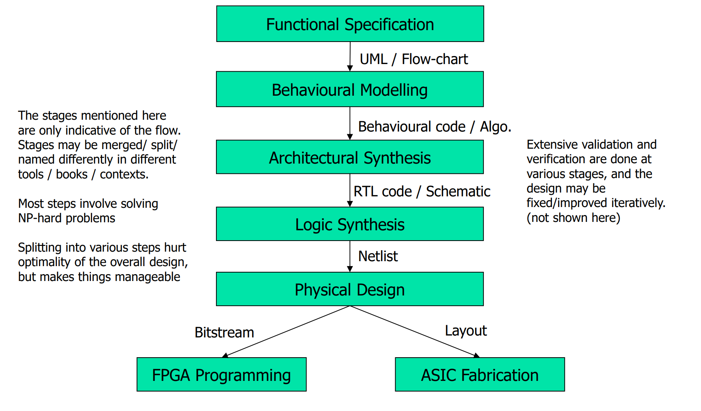

**设计流程**：
1. **系统需求分析**：明确系统功能、性能指标和约束条件
2. **系统级设计**：将系统划分为若干功能模块
3. **模块级设计**：细化每个模块的功能和接口
4. **逻辑级设计**：实现模块的详细逻辑电路
5. **物理级设计**：布局布线，生成版图


**优点**：
- 从全局出发，把握整体架构
- 便于团队协作
- 可复用性强
- 便于测试和验证

### 1.2 自底向上设计（Bottom-Up Design）

自底向上设计从基本电路单元开始，逐步组合成更大的功能模块。

**优点**：
- 底层单元经过验证，可靠性高
- 适合小规模设计

**缺点**：
- 缺乏全局优化
- 不适合复杂系统

### 1.3 混合设计方法

现代数字系统设计通常采用自顶向下的设计流程，同时结合自底向上的 IP 复用策略。

### 1.4 逻辑综合

逻辑综合是将高层次设计描述转换为门级网表的过程，包括逻辑优化和工艺映射。

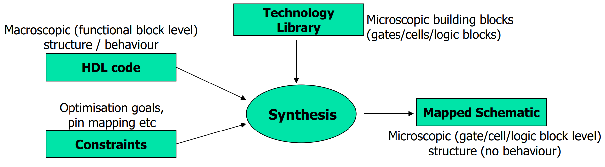

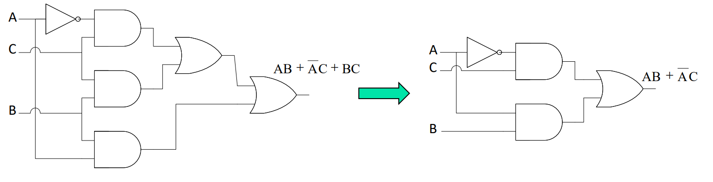

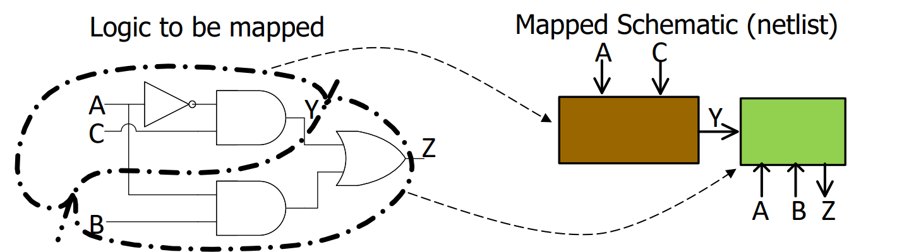

综合工具把 RTL 描述转换为由基本逻辑门组成的**综合门级电路**：

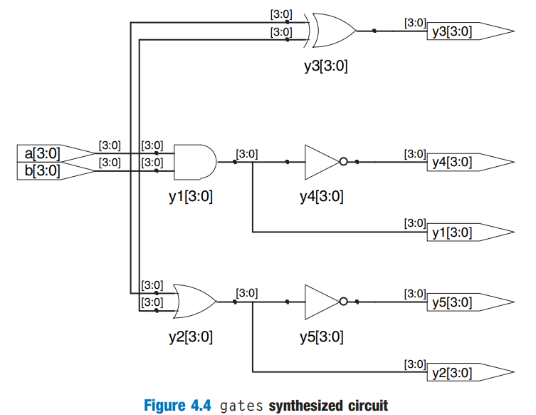
综合出的门级电路即最终映射到目标工艺库、可供布局布线直接使用的逻辑门网表。

下图给出一个**原理图绘制示例**，展示如何用图形化方式表达门级电路连接关系：

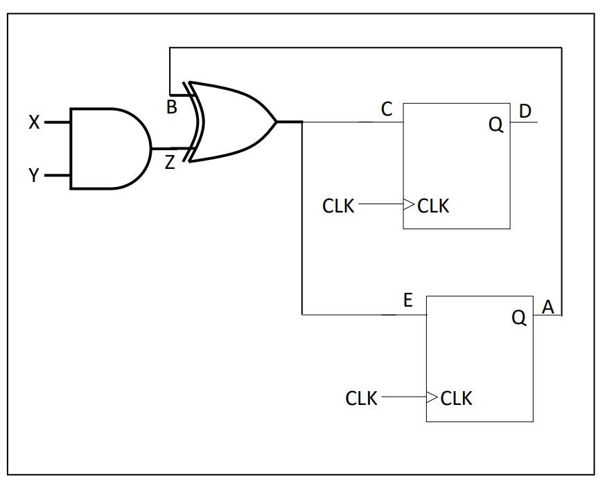
该原理图示例演示了将逻辑表达式/结构描述转化为标准逻辑门——门级电路的图形表达方式。

## 2. 层次化与模块化设计

### 2.1 层次化设计

层次化设计将系统按功能分解为多个层次，每个层次负责不同的抽象级别。

**层次结构**：
- **系统层**：整体功能描述
- **子系统层**：主要功能模块
- **寄存器传输级（RTL）**：寄存器和组合逻辑
- **门级**：基本逻辑门
- **晶体管级**：MOS 管实现

**设计抽象层次**：

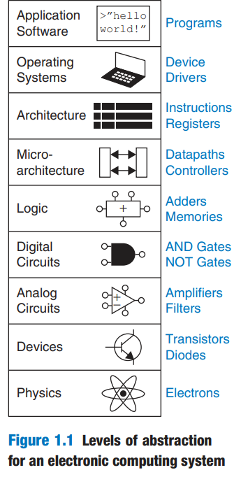

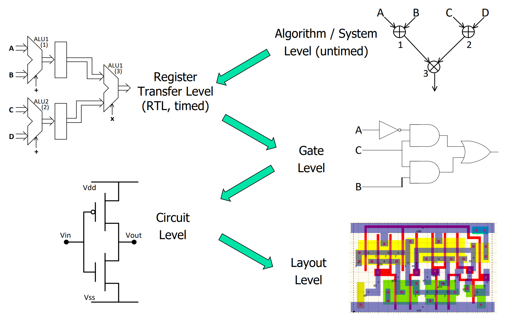

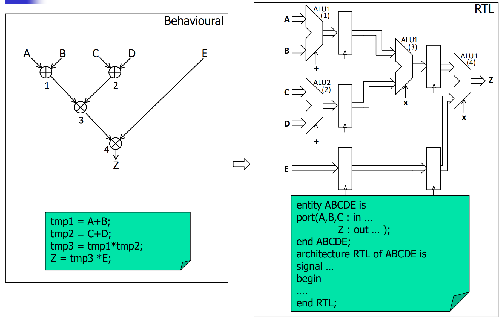

### 2.2 模块化设计

模块化设计将系统划分为功能独立的模块，每个模块有明确的接口定义。

**模块划分原则**：
- 高内聚：模块内部功能紧密相关
- 低耦合：模块间依赖关系简单
- 接口清晰：模块的输入输出定义明确
- 功能单一：每个模块完成一个明确的功能

## 3. 数据通路与控制单元设计

### 3.1 数据通路（Datapath）

数据通路负责数据的运算和传输，包括：
- **寄存器文件**：存储数据
- **算术逻辑单元（ALU）**：执行算术和逻辑运算
- **多路选择器**：选择数据源
- **总线**：数据传输通道

### 3.2 控制单元（Control Unit）

控制单元根据指令和状态产生控制信号，协调数据通路的操作。

**控制单元实现方式**：
- **硬布线控制**：用组合逻辑实现
- **微程序控制**：用 ROM 存储微指令序列

### 3.3 数据通路与控制单元的交互

控制单元根据当前状态和外部输入产生控制信号，控制数据通路的操作；数据通路将状态标志反馈给控制单元。

## 4. 有限状态机设计

### 4.1 Moore 型状态机

Moore 型状态机的输出仅取决于当前状态，与输入无关。

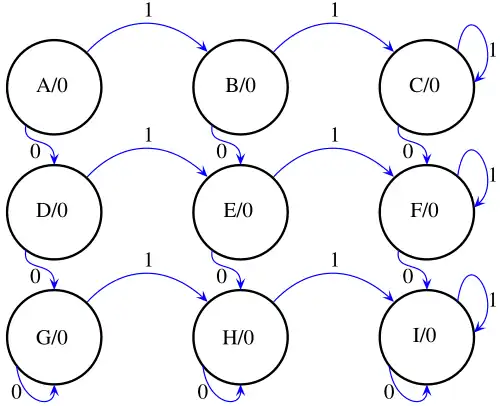

**结构模型**：
- 次态逻辑：$S_{next} = F(S_{current}, X)$
- 状态寄存器：$S_{current} = S_{next}$（时钟沿触发）
- 输出逻辑：$Y = G(S_{current})$

**特点**：
- 输出与时钟同步变化
- 输出稳定，无毛刺
- 可能需要更多状态（相比 Mealy 型）

### 4.2 Mealy 型状态机

Mealy 型状态机的输出取决于当前状态和当前输入。

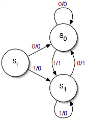

**结构模型**：
- 次态逻辑：$S_{next} = F(S_{current}, X)$
- 状态寄存器：$S_{current} = S_{next}$（时钟沿触发）
- 输出逻辑：$Y = G(S_{current}, X)$

**特点**：
- 输出对输入变化即时响应
- 状态数通常比 Moore 型少
- 输出可能有毛刺

### 4.3 Moore 型与 Mealy 型的比较

| 特性 | Moore 型 | Mealy 型 |
|------|---------|---------|
| 输出依赖 | 仅当前状态 | 当前状态 + 输入 |
| 状态数 | 较多 | 较少 |
| 输出时序 | 时钟同步 | 输入变化可能立即影响输出 |
| 抗毛刺 | 较好 | 较差 |
| 输入响应速度 | 慢（需等待时钟沿） | 快（组合逻辑直接输出） |

### 4.4 算法状态机（ASM）图

算法状态机（Algorithmic State Machine, ASM）图是设计有限状态机的一种图形化方法，类似于流程图。

**ASM图的基本符号**：
- **状态框**：矩形，表示一个状态，包含状态名称和输出
- **判断框**：菱形，表示条件判断，有两条出口（真/假）
- **条件输出框**：圆角矩形，表示在某个转移路径上的输出

**ASM图与状态图的关系**：
- ASM图与状态图在功能上等价，但更接近程序设计
- ASM图更适合复杂状态机的设计，特别是包含多个条件分支的情况
- 从ASM图可以直接转换为HDL代码

### 4.5 FSM分解（Factoring）

复杂状态机可以直接设计，但状态数过多会导致状态表庞大、设计困难。FSM分解（Factoring）将复杂状态机分解为多个交互的简单状态机，降低设计复杂度。

**分解示例**：一个包含两个独立功能（A和B）的FSM，功能A有3个状态，功能B有2个状态：
- 未分解：一个FSM，需要3×2=6个状态
- 分解后：两个FSM，分别有3个状态和2个状态

**分解步骤**：
1. 分析系统的功能，识别独立的功能模块
2. 为每个功能模块设计独立的FSM
3. 定义FSM之间的通信信号（握手信号）
4. 验证FSM之间的交互是否正确

**分解优点**：
- 简化状态表，每个FSM的状态数较少
- 便于团队协作，每个设计者负责一个FSM
- 提高可维护性，修改一个FSM不影响其他FSM
- 更容易验证和调试

**分解缺点**：
- 握手信号增加延迟，可能降低性能
- 需要额外的通信逻辑

### 4.6 Verilog 硬件描述语言基础

Verilog 是一种**硬件描述语言（Hardware Description Language, HDL）**，用文本代码描述数字电路的结构与行为，既可作为设计输入，也可用于仿真验证。与普通编程语言最大的不同在于：Verilog 的语句在综合后会**映射为实际硬件**（逻辑门、触发器），因此它区分 `wire`（连线）与 `reg`（寄存器），并区分阻塞/非阻塞赋值，不能像写软件那样随意编写。

**模块（module）与端口（port）**：Verilog 的基本设计单元是 `module`，相当于一个带明确接口的电路块。端口用 `input`/`output` 声明方向；`wire` 表示由组合逻辑驱动的连线（常配合 `assign` 连续赋值），`reg` 表示可保持值的变量（常在 `always` 块中被赋值）。例如一个半加器：

```verilog
module half_adder (
    input  wire a,      // 加数
    input  wire b,      // 加数
    output wire s,      // 和
    output wire c       // 进位
);
    assign s = a ^ b;   // 异或：和
    assign c = a & b;   // 与：进位
endmodule
```

上述模块用两条 `assign` 连续赋值实现组合逻辑。要将多个模块组成更大系统，只需在另一个模块中**实例化** `half_adder` 并连接端口即可——这正是第 2.1 节所讲层次化设计在代码层面的体现。

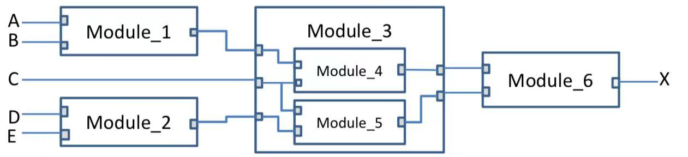

一个完整的 **Verilog 设计示例**展示了从模块声明、端口连接到逻辑实现的代码组织方式：

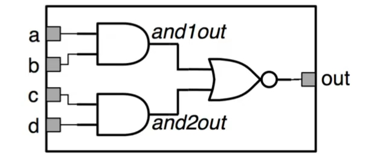

Verilog 也支持**门级原语（gate-level primitives）**建模，直接用 `and`、`or`、`not` 等基本门元件例化构成电路，属于结构级描述：

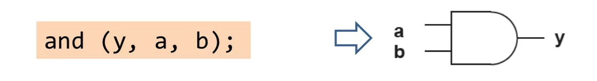

**`wire` 与 `reg` 初步**：`wire` 是线网，只能由 `assign` 或门输出驱动；`reg` 是寄存器变量，在过程块（`always`/`initial`）中被赋值并能保持上次的值。粗略记忆：**组合逻辑多用 `wire`，时序逻辑（计数器、状态机）多用 `reg`**。

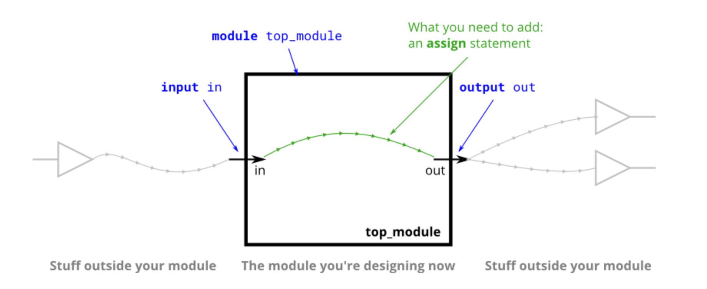

下面为 **wire 类型示例**，展示线网在模块间如何作为连线使用：

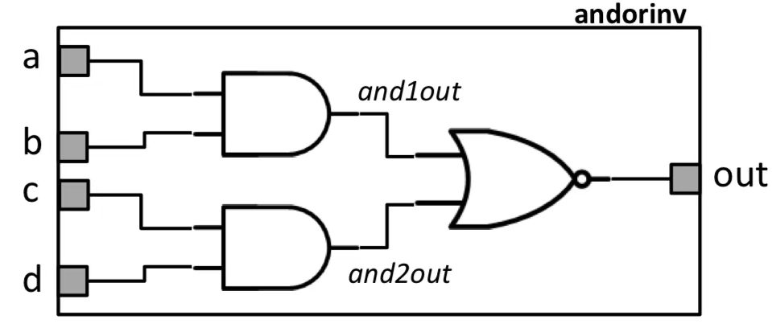

Verilog 用**向量（vector）**表示多比特位宽，`[3:0]` 等声明用于并行数据，示例见下：

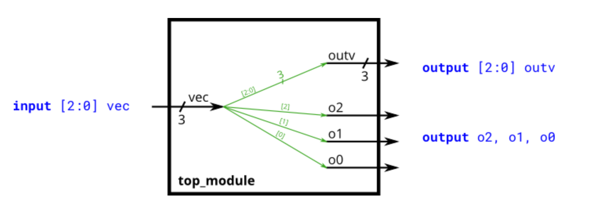

**位拼接（concatenation）**用大括号 `{}` 将多个向量/位拼合成更宽的向量，是构造与拆分数据的重要手段：

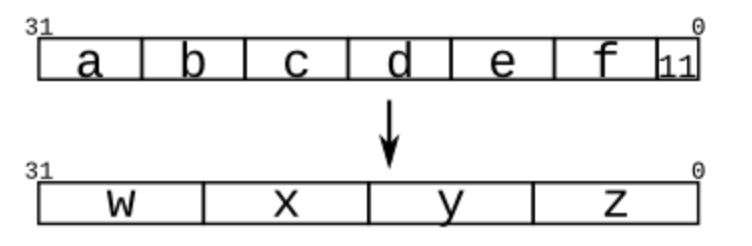

Verilog 更细致的语法（`always @(posedge clk)` 时序写法、`blocking`/`non-blocking` 赋值、testbench 仿真）详见本章 **3.8 节《可编程逻辑器件》** 的 HDL 部分；完整的语法体系与进阶设计方法（参数化模块、层次化实例化、SystemVerilog 等）属于《芯片设计》[4.5 RTL 设计（Verilog/SystemVerilog）](../../04-集成电路设计/芯片设计/4.5-RTL设计-基础语法与建模.md)，此处不再展开，避免重复。

下面再补充四幅关于 **Verilog 书写特性与运算符** 的图示：

- **模块书写顺序无关**：模块/端口的声明顺序不影响综合结果：

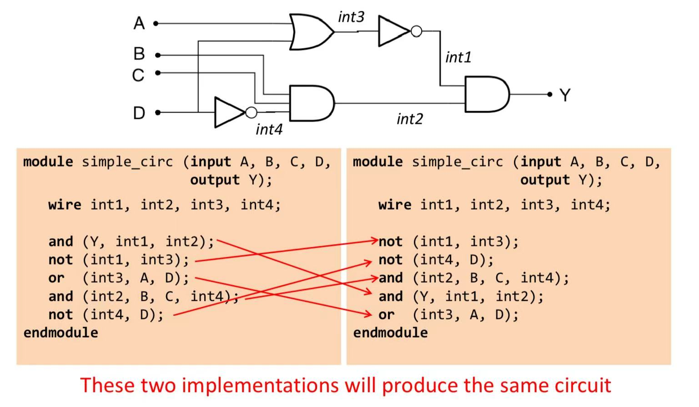

- **语句顺序有影响**：过程块内（`always` 等）语句的执行顺序会影响最终行为：

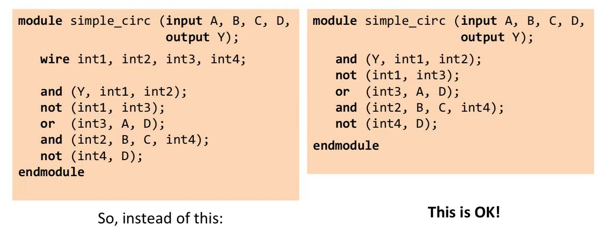

- **运算符优先级**：SystemVerilog 的运算符优先级与 C 语言一致，书写表达式时要注意结合顺序：

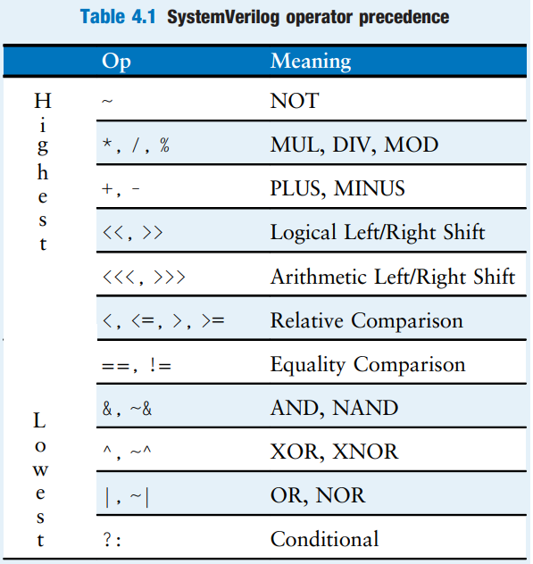

- **VHDL 风格 Verilog**：带有 VHDL 描述风格的 Verilog 写法示例：

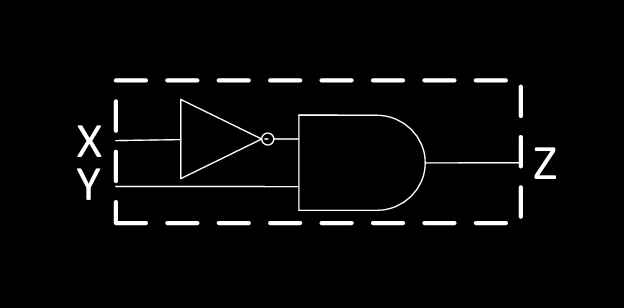

## 5. 同步时序电路设计规则

### 5.1 同步电路的定义

同步时序电路是数字系统的基础，其行为由统一的时钟信号控制。同步时序电路必须满足以下组成规则：

1. 每个电路元件要么是寄存器，要么是组合电路
2. 至少有一个电路元件是寄存器
3. 所有寄存器接收**相同**的时钟信号
4. 每个循环路径至少包含一个寄存器

不符合这些规则的时序电路称为异步电路，设计复杂且容易出错。

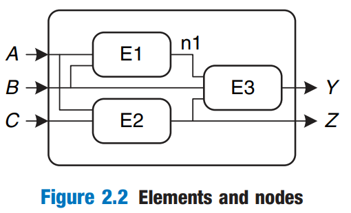

### 5.2 同步电路的优势

- **可预测性**：所有寄存器在时钟沿同步更新，行为确定性高
- **可测试性**：扫描链测试方便
- **抗干扰性**：组合逻辑中的毛刺在时钟沿之前被过滤
- **时序分析简单**：只需分析建立时间和保持时间约束

### 5.3 同步设计规范

1. 单一时钟域：尽量使用单一时钟，避免跨时钟域问题
2. 避免异步复位：优先使用同步复位或异步复位同步释放
3. 避免组合反馈：组合逻辑的输出不能直接反馈到自身输入
4. 避免锁存器：完整的条件分支确保综合时不产生锁存器
5. 寄存器划分：组合逻辑块之间插入寄存器

### 5.4 相关知识归属：脉冲波形的产生与整形

数字系统需要干净的时钟与脉冲信号，而脉冲波形的产生与整形（如施密特触发器、单稳态触发器、多谐振荡器与 555 定时器）属于**模拟电路**的内容，本数字电路章节不展开详解，此处仅作知识归属说明：

- **施密特触发器（滞回比较器）**：对缓慢或带抖动的输入进行整形，利用滞回特性滤除边沿抖动、得到干净的数字电平，属于模拟电路 2.10 节的内容
- **单稳态触发器与多谐振荡器**：分别用于产生单个定时脉冲与周期性方波，是产生定时/时钟信号的基础电路
- **555 定时器**：可配置为单稳态或自激多谐振荡器，用来产生定时脉冲与时钟信号

上述电路的原理、结构与设计方法位于《模拟电路》**4.10（信号处理电路，含比较器与施密特触发器）**与 **4.11（波形发生电路，含 555 定时器、单稳态触发器、多谐振荡器）** 章节。数字系统中方波时钟的抖动（jitter）与按键抖动常借助施密特整形或同步/滤波电路予以抑制。

## 6. 时序分析基础

### 6.1 动态纪律（Dynamic Discipline）

时序逻辑的动态纪律要求寄存器的输入信号在时钟沿前后必须保持稳定，定义了以下两个关键时序参数：

**建立时间（Setup Time, t_setup）**：在时钟有效沿之前，数据输入必须保持稳定的最小时间。

**保持时间（Hold Time, t_hold）**：在时钟有效沿之后，数据输入必须保持稳定的最小时间。

建立时间和保持时间合称为**孔径时间（Aperture Time）**。违反建立时间或保持时间约束会导致**亚稳态（Metastability）**，寄存器输出可能进入中间状态，需要较长时间才能恢复。

### 6.2 传播延迟与污染延迟

**传播延迟（Propagation Delay, t_pd）**：从输入变化到输出达到最终值的**最大**时间。传播延迟由关键路径（Critical Path）决定，即从输入到输出的最长路径。

**污染延迟（Contamination Delay, t_cd）**：从输入变化到**任何**输出开始变化的**最小**时间。污染延迟由短路径（Short Path）决定，即从输入到输出的最短路径。

**寄存器时序参数**：
- t_pcq：从时钟沿到Q输出的传播延迟（最大）
- t_ccq：从时钟沿到Q输出的污染延迟（最小）

### 6.3 建立时间约束

建立时间约束确保数据在时钟沿到达之前已经稳定：

$$T_c \ge t_{pcq} + t_{pd} + t_{setup}$$

其中 T_c 为时钟周期，t_pcq 为寄存器传播延迟，t_pd 为组合逻辑传播延迟，t_setup 为建立时间。

**约束的物理意义**：数据从第一个寄存器的时钟沿出发，经过寄存器延迟和组合逻辑延迟，必须在第二个寄存器的建立时间之前到达。

**最大时钟频率**：根据建立时间约束，最大时钟频率为：
$$f_{max} = \frac{1}{t_{pcq} + t_{pd} + t_{setup}}$$

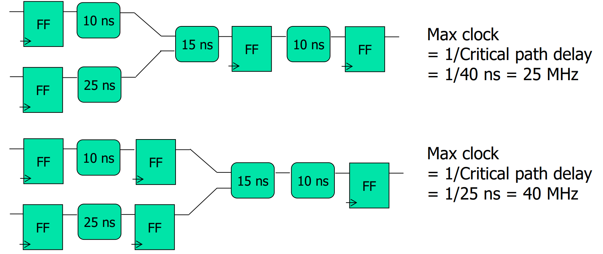

### 6.4 保持时间约束

保持时间约束确保数据在时钟沿之后保持稳定：

$$t_{ccq} + t_{cd} \ge t_{hold}$$

其中 t_ccq 为寄存器污染延迟，t_cd 为组合逻辑污染延迟，t_hold 为保持时间。

**约束的物理意义**：数据从第一个寄存器出发，经过组合逻辑（最短路径），必须在第二个寄存器的保持时间内到达。

**保持时间违例**：如果组合逻辑的污染延迟过小（即路径太短），数据可能太快到达下级寄存器，导致保持时间违例。解决方法是在短路径中添加缓冲器（Buffer）增加延迟。

### 6.5 时钟偏移（Clock Skew）

时钟偏移是指时钟信号到达不同寄存器的时间差异，主要由时钟布线延迟不同引起。

**时钟偏移的影响**：
- 正时钟偏移（目标寄存器时钟晚到）：增加建立时间裕量，但减少保持时间裕量
- 负时钟偏移（目标寄存器时钟早到）：减少建立时间裕量，但增加保持时间裕量

**带时钟偏移的建立时间约束**：
$$T_c \ge t_{pcq} + t_{pd} + t_{setup} + t_{skew}$$

**带时钟偏移的保持时间约束**：
$$t_{ccq} + t_{cd} \ge t_{hold} + t_{skew}$$

### 6.6 时序分析示例

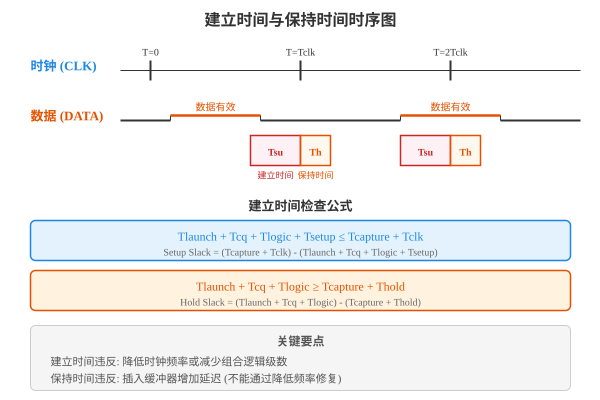

**示例**：分析一个两级寄存器电路，已知：
- t_pcq = 30ps, t_ccq = 25ps
- t_pd = 50ps, t_cd = 35ps
- t_setup = 60ps, t_hold = 50ps
- 时钟周期 T_c = 200ps

**建立时间检查**：30ps + 50ps + 60ps = 140ps < 200ps ✅
**保持时间检查**：25ps + 35ps = 60ps > 50ps ✅

### 6.7 毛刺与竞争冒险

**毛刺（Glitch）**：组合逻辑中，由于各路径延迟不同，单个输入变化可能导致输出出现短暂的不期望的脉冲。

**毛刺的成因**：输入信号经过不同路径到达逻辑门的延迟不同，导致短暂的错误输出。

**应对毛刺的方法**：
- 在输出端加寄存器（同步电路自然消除毛刺）
- 增加冗余项（消除静态冒险）
- 使用格雷码编码（消除多bit同时变化）

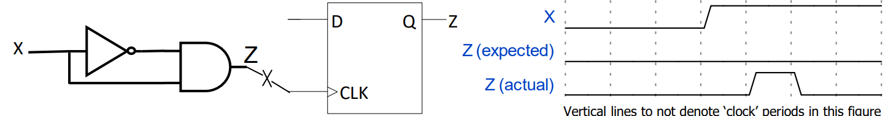

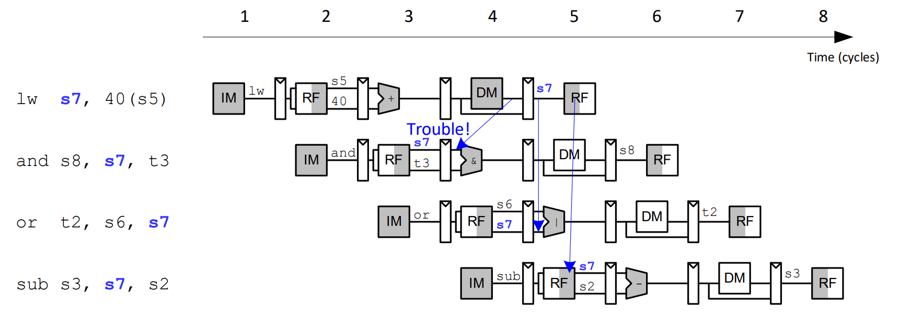

## 7. 状态编码

### 7.1 二进制编码

用最少的触发器数量表示状态数。

$$n = \lceil \log_2 M \rceil$$

其中 $M$ 为状态数，$n$ 为触发器数。

**缺点**：可能产生毛刺，因为多 bit 同时变化时路径延迟不同。

### 7.2 格雷码编码

相邻状态之间只有一位不同，消除多 bit 同时变化的问题。

**优点**：减少毛刺，降低功耗
**缺点**：状态转换复杂时编码困难

### 7.3 独热码（One-Hot Encoding）

每个状态对应一个触发器，只有一个触发器为 1。

$$n = M$$

**优点**：
- 译码逻辑简单（只需判断对应位是否为 1）
- 速度最快
- 无毛刺

**缺点**：
- 需要更多触发器（$M$ 个）
- 适合状态数较少（通常 $M < 16$）的设计

## 8. 数字系统设计实例

### 8.1 交通灯控制器

**需求**：主干道和支路交叉口的交通灯控制。

**状态定义**：
- S0：主干道绿灯，支路红灯（30秒）
- S1：主干道黄灯，支路红灯（5秒）
- S2：主干道红灯，支路绿灯（20秒）
- S3：主干道红灯，支路黄灯（5秒）

**计数器设计**：每个状态对应不同的计时值。

### 8.2 UART 收发器

**UART（Universal Asynchronous Receiver Transmitter）**：通用异步收发器。

**帧格式**：
- 起始位（1位，低电平）
- 数据位（5~8位）
- 校验位（可选）
- 停止位（1~2位，高电平）

**波特率**：每秒传输的位数，如 9600、115200 等。

### 8.3 数字频率计

**工作原理**：
1. 在固定的闸门时间（如 1秒）内对输入信号计数
2. 计数值即为信号频率

$$f = \frac{N}{T_{gate}}$$

其中 $N$ 为计数值，$T_{gate}$ 为闸门时间。

## 9. 可测试性设计（DFT）

### 9.1 测试的重要性

随着集成电路集成度的提高，测试成本和难度越来越大。可测试性设计（Design for Testability, DFT）旨在提高电路的可控性和可观测性。

### 9.2 扫描链（Scan Chain）

将普通触发器替换为扫描触发器，连接成移位寄存器链。

**扫描触发器结构**：
- 正常工作模式：$D$ 输入
- 扫描模式：$SD$（扫描输入）

**测试过程**：
1. 扫描输入：将测试向量串行移入扫描链
2. 捕获：一个时钟周期捕获电路响应
3. 扫描输出：将响应串行移出，与预期结果比较

### 9.3 边界扫描（Boundary Scan）

**JTAG（Joint Test Action Group）标准（IEEE 1149.1）**：在芯片 I/O 端口添加边界扫描单元，实现板级测试。

**JTAG 接口信号**：
- TCK：测试时钟
- TMS：测试模式选择
- TDI：测试数据输入
- TDO：测试数据输出
- TRST（可选）：测试复位

### 9.4 内建自测试（BIST）

在芯片内部集成测试电路，使其能够自我测试。

**BIST 结构**：
- **测试向量生成器（TPG）**：生成测试向量（如 LFSR）
- **输出响应分析器（ORA）**：压缩和分析响应（如 MISR）
- **BIST 控制器**：控制测试流程

**优点**：
- 减少对外部测试设备的依赖
- 可进行在线测试
- 降低测试成本

### 9.5 测试覆盖率

$$\text{测试覆盖率} = \frac{\text{可检测到的故障数}}{\text{总故障数}} \times 100\%$$

**故障模型**：
- 固定故障（Stuck-at Fault）：节点固定为 0 或 1
- 桥接故障（Bridging Fault）：两个节点短路
- 延迟故障（Delay Fault）：路径延迟超过时钟周期

### 9.6 JTAG边界扫描

JTAG（Joint Test Action Group）是IEEE 1149.1标准，用于PCB测试和IC调试。

**边界扫描结构**：
- **测试访问端口（TAP）**：TCK（时钟）、TMS（模式选择）、TDI（数据输入）、TDO（数据输出）
- **边界扫描寄存器（BSR）**：每个I/O引脚对应一个边界扫描单元，串联成链
- **指令寄存器（IR）**：存储当前测试指令
- **旁路寄存器（Bypass）**：旁路当前芯片，缩短扫描链

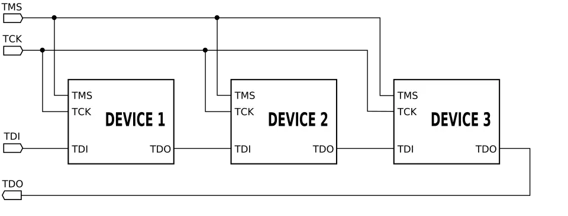

**边界扫描测试模式**：
1. **EXTEST**：测试芯片间互连，捕获输出引脚信号并驱动输入引脚
2. **INTEST**：测试芯片内部逻辑
3. **SAMPLE/PRELOAD**：在正常运行状态下采样引脚状态
4. **BYPASS**：将芯片设为旁路模式

**TAP状态机**：包含16个状态，通过TMS信号控制状态转移，实现测试指令和数据的加载。

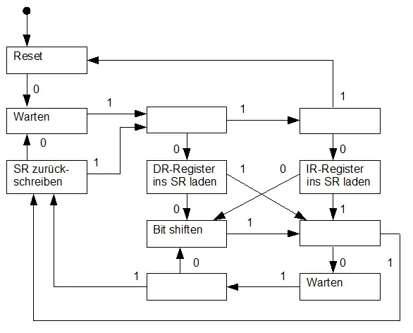

**应用范围**：
- PCB制造测试（检测焊接缺陷、开路、短路）
- 芯片调试（读取内部寄存器、设置断点）
- 固件升级（通过JTAG烧录Flash）
- 在线仿真（ICE）

## 本章要点

- 数字系统设计方法论
- 层次化与模块化设计
- 数据通路与控制单元设计
- 有限状态机设计
- 同步时序电路设计规则
- 时序分析基础

## 自测清单

1. 「数字系统设计方法论」要解决的核心问题是什么？关键结论或公式是什么？
2. 「层次化与模块化设计」与上一节之间是什么关系？
3. 「数据通路与控制单元设计」在什么场景下会用到？如果条件改变，结论会如何变化？
4. 能否不看正文，写出「有限状态机设计」的关键流程或结构？
5. 「同步时序电路设计规则」最容易混淆的点是什么？

---

**下一章**：[3.11 从逻辑门到单周期处理器](../计算机组成原理/3.11-从逻辑门到单周期处理器.md)
