# 3.3 基本逻辑门电路

> **前置知识**：[3.2 逻辑代数基础](3.2-逻辑代数基础.md)（承接上一章）。

## 1. 二极管逻辑门电路

二极管是构成二极管逻辑门电路的基本元件，其符号如下图所示。

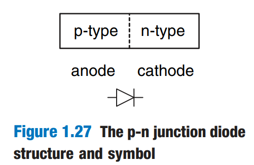

### 1.1 二极管与门

二极管与门利用二极管的单向导电性实现与逻辑功能。

当 $V_{CC}$ 通过电阻 $R$ 连接到两个二极管 $D_1$、$D_2$ 的阳极。输入 $A$、$B$ 接阴极。

- 当 $A$ 或 $B$ 为低电平（0V）时，对应二极管导通，输出 $Y$ 为低电平
- 只有当 $A$ 和 $B$ 均为高电平（$V_{CC}$）时，两个二极管均截止，输出 $Y$ 为高电平

### 1.2 二极管或门

二极管或门中，两个二极管的阴极通过电阻接地，输入接阳极。

- 当 $A$ 或 $B$ 为高电平时，对应二极管导通，输出为高电平
- 只有当 $A$ 和 $B$ 均为低电平时，输出才为低电平

## 2. 三极管非门

三极管非门（反相器）利用三极管的开关特性实现逻辑非功能。

**工作原理**：
- 输入为高电平时，三极管饱和导通，输出为低电平
- 输入为低电平时，三极管截止，输出为高电平（通过集电极电阻上拉至 $V_{CC}$）

## 3. 缓冲器

缓冲器（Buffer）用于增强信号的驱动能力，其输出逻辑电平与输入相同，符号如下图所示。

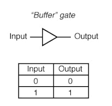

## 4. TTL 逻辑门电路

### 4.1 TTL 与非门电路结构

TTL（Transistor-Transistor Logic）与非门是 TTL 电路的基本单元。

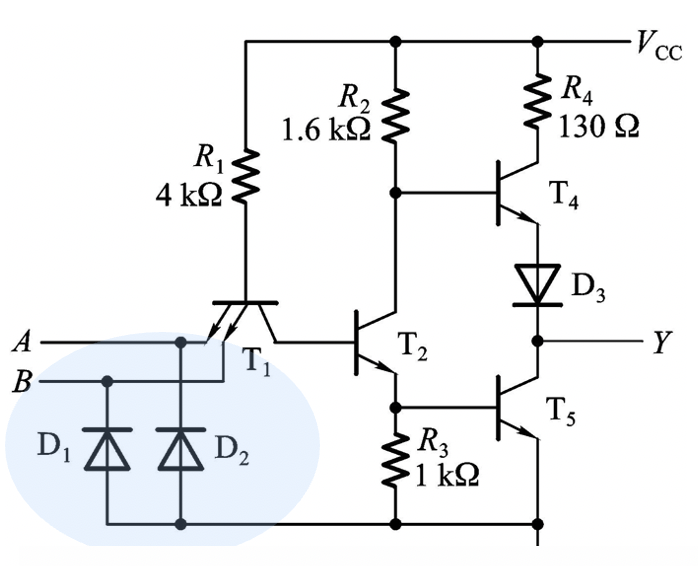

**典型 TTL 与非门结构**：
- **输入级**：多发射极三极管 $T_1$，实现与逻辑
- **中间级**：$T_2$ 和 $R_2$、$R_3$ 构成分相器
- **输出级**：$T_3$、$T_4$、$D$ 和 $R_4$ 构成推挽输出（图腾柱结构）

**推挽输出级**由 $T_3$（上管）和 $T_4$（下管）组成：
- 输出高电平时，$T_3$ 导通，$T_4$ 截止
- 输出低电平时，$T_3$ 截止，$T_4$ 导通

### 4.2 TTL 电压传输特性

TTL 反相器的电压传输特性曲线描述输入电压 $v_I$ 与输出电压 $v_O$ 的关系。

**特性曲线分段**：
1. **AB 段（截止区）**：$v_I < 0.6V$，输出保持高电平
2. **BC 段（线性区）**：$0.6V < v_I < 1.3V$，输出线性下降
3. **CD 段（转折区）**：$v_I \approx 1.4V$，输出急剧下降
4. **DE 段（饱和区）**：$v_I > 1.4V$，输出保持低电平

### 4.3 TTL 输入与输出特性

**输入特性**：
- 输入低电平电流 $I_{IL}$：输入为低电平时，电流从门电路流出
- 输入高电平电流 $I_{IH}$：输入为高电平时，电流流入门电路

**输出特性**：
- 输出高电平 $V_{OH} \approx 3.6V$
- 输出低电平 $V_{OL} \approx 0.2V$
- 高电平输出电流 $I_{OH}$：拉电流
- 低电平输出电流 $I_{OL}$：灌电流

### 4.4 TTL 主要参数

**扇出系数（Fan-out）**：一个门电路能驱动同类门电路的最大数目。

$$N = \min\left(\frac{I_{OL}}{I_{IL}}, \frac{I_{OH}}{I_{IH}}\right)$$

**噪声容限（Noise Margin）**：保证电路正常工作时允许的最大噪声电压。

$$V_{NH} = V_{OH(min)} - V_{IH(min)}$$
$$V_{NL} = V_{IL(max)} - V_{OL(max)}$$

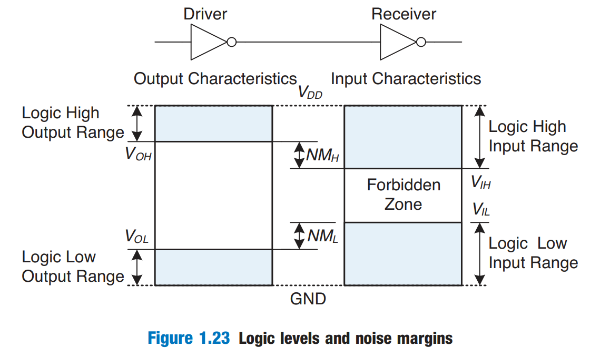

**传输延迟（Propagation Delay）**：信号从输入到输出所需的时间。

$$t_{pd} = \frac{t_{PLH} + t_{PHL}}{2}$$

其中 $t_{PLH}$ 为输出从低到高的延迟，$t_{PHL}$ 为输出从高到低的延迟。

**功耗**：门电路消耗的功率，通常 $P = V_{CC} \times I_{CC}$。

### 4.5 OC 门（Open Collector Gate）

OC 门输出级集电极开路，使用时需外接上拉电阻 $R_L$。

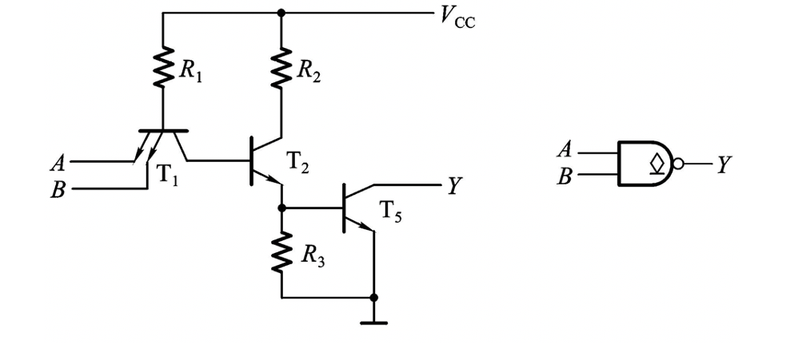

**特点**：
- 可以将多个 OC 门的输出直接相连，实现"线与"功能
- 需要外接上拉电阻
- 输出高电平由上拉电阻和外部电源决定
- 适合驱动 LED、继电器等负载

**线与连接**：$Y = \overline{AB} \cdot \overline{CD} = \overline{AB + CD}$

### 4.6 三态门（Tri-state Gate）

三态门有三种输出状态：高电平、低电平、高阻态（Z）。

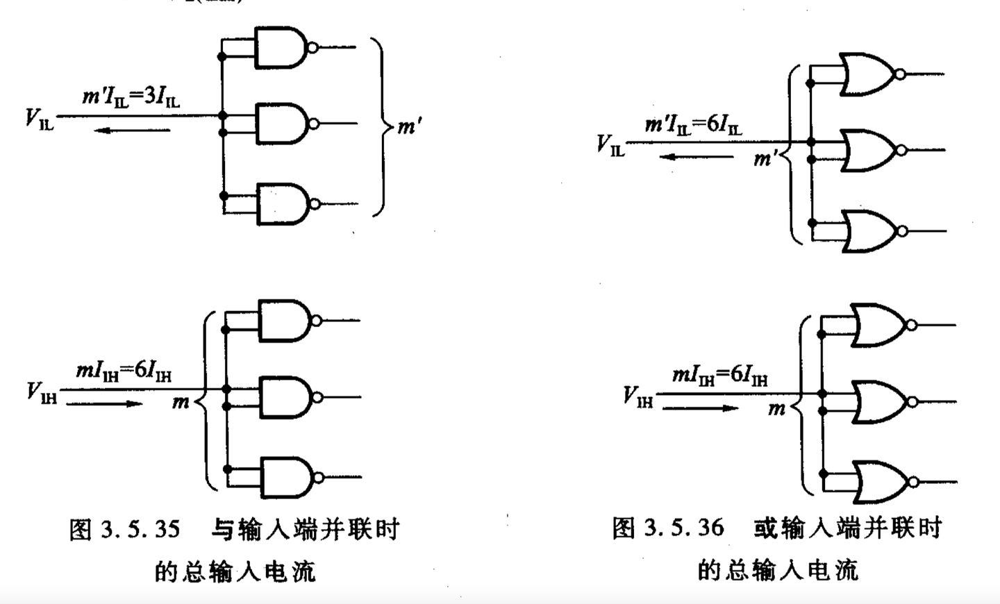

**控制信号 EN 的作用**：
- EN = 1 时，正常逻辑输出
- EN = 0 时，输出高阻态

三态门广泛应用于总线结构，允许多个设备分时共享同一数据总线。

### 4.7 TTL 或非门

TTL 或非门由输入级、中间级和输出级组成，实现或非逻辑功能。

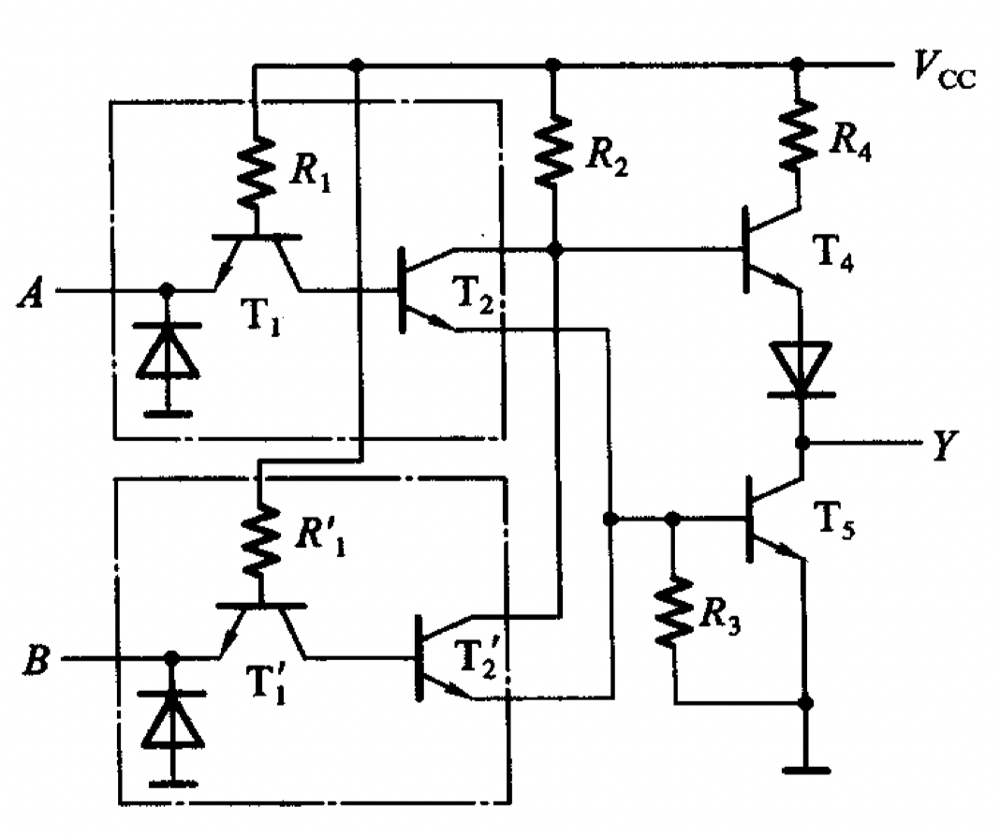

**电路结构**：
- **输入级**：两个并联的三极管 $T_1$、$T_2$，实现或逻辑
- **中间级**：$T_3$ 和 $T_4$ 构成分相器
- **输出级**：$T_5$、$T_6$、$D$ 和 $R_4$ 构成推挽输出（图腾柱结构）

**工作原理**：
- 当 $A$ 或 $B$ 为高电平时，对应的输入管导通，使输出为低电平
- 只有当 $A$ 和 $B$ 均为低电平时，输出才为高电平

$$Y = \overline{A + B}$$

**TTL 或非门的特点**：
- 输入级采用并联结构，与 TTL 与非门的串联结构不同
- 输入管基极分别接输入信号，发射极并联后接公共电阻
- 由于输入管并联，输入低电平电流较大，扇出能力相对较弱

### 4.8 TTL 与或非门

TTL 与或非门（AND-OR-INVERT Gate）实现与或非逻辑功能，是 TTL 电路中常用的复合门。

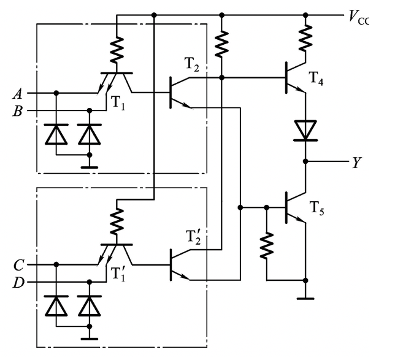

**电路结构**：
- 输入级：多发射极三极管实现与逻辑（$A \cdot B$ 和 $C \cdot D$）
- 中间级：两个分相管 $T_2$、$T_2'$ 并联，实现或逻辑
- 输出级：图腾柱推挽输出

**逻辑表达式**：

$$Y = \overline{AB + CD}$$

**工作原理**：
- 当 $A$ 和 $B$ 均为高电平，或 $C$ 和 $D$ 均为高电平时，对应的分相管导通，使输出为低电平
- 只有当 $(A \cdot B)$ 和 $(C \cdot D)$ 均为低电平时，输出才为高电平

**扇出计算**：
- 输入低电平时，$I_{IL}$ 取两份（每组分相器独立）
- 输入高电平时，$I_{IH}$ 取四份（多发射极与门分别计算）

### 4.9 TTL 与门

TTL 与门由 TTL 与非门后接一个反相器构成，实现与逻辑功能。

**电路结构**：
- 第一级：标准 TTL 与非门，实现 $Y_1 = \overline{A \cdot B}$
- 第二级：TTL 反相器（共射极放大），对 $Y_1$ 取反

**工作原理**：
- 当 $A$ 和 $B$ 均为高电平时，与非门输出低电平，经反相器后输出高电平
- 当 $A$ 或 $B$ 为低电平时，与非门输出高电平，经反相器后输出低电平

$$Y = \overline{\overline{A \cdot B}} = A \cdot B$$

**特点**：
- 两级结构增加了传输延迟，但逻辑功能完整
- 实际应用中，TTL 与门通常直接用与非门加反相器实现
- 74LS08 是常见的四路二输入 TTL 与门芯片

### 4.10 TTL 或门

TTL 或门由 TTL 或非门后接一个反相器构成，实现或逻辑功能。

**电路结构**：
- 第一级：TTL 或非门（输入级并联），实现 $Y_1 = \overline{A + B}$
- 第二级：TTL 反相器，对 $Y_1$ 取反

**工作原理**：
- 当 $A$ 或 $B$ 为高电平时，或非门输出低电平，经反相器后输出高电平
- 只有当 $A$ 和 $B$ 均为低电平时，或非门输出高电平，经反相器后输出低电平

$$Y = \overline{\overline{A + B}} = A + B$$

**特点**：
- 由或非门加反相器构成，与由与非门加反相器构成的与门对称
- 74LS32 是常见的四路二输入 TTL 或门芯片

### 4.11 TTL 异或门

TTL 异或门（XOR Gate）实现异或逻辑功能，当两个输入不同时输出高电平。

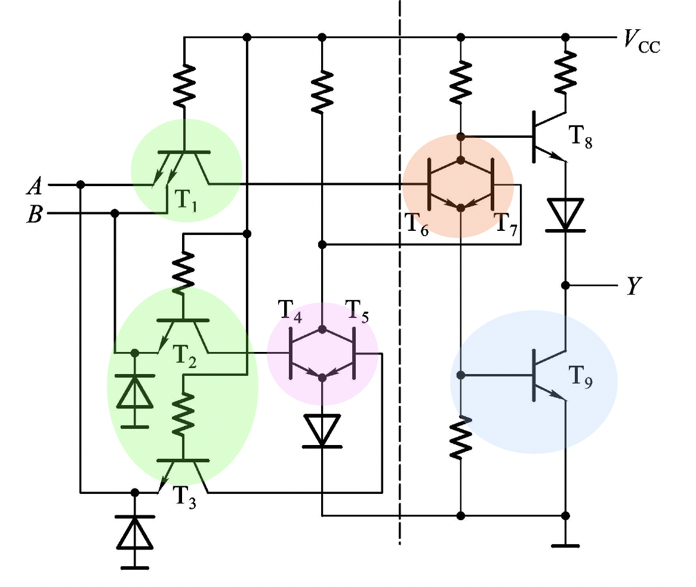

**电路结构**：
- TTL 异或门由两级 TTL 门电路构成
- 输入级采用多发射极晶体管，中间级实现 $(A + B)$ 和 $\overline{A \cdot B}$ 的与运算
- 输出级采用图腾柱推挽结构

**逻辑表达式**：

$$Y = A \oplus B = A\overline{B} + \overline{A}B = (A + B) \cdot \overline{A \cdot B}$$

**工作原理**：
- 当 $A = B = 0$ 时，$A + B = 0$，$Y = 0$
- 当 $A = B = 1$ 时，$\overline{A \cdot B} = 0$，$Y = 0$
- 当 $A \neq B$ 时，$A + B = 1$ 且 $\overline{A \cdot B} = 1$，$Y = 1$

**真值表**：

| A | B | Y |
|---|---|---|
| 0 | 0 | 0 |
| 0 | 1 | 1 |
| 1 | 0 | 1 |
| 1 | 1 | 0 |

**特点**：
- 异或门是数字电路中常用的基本门，用于比较器、加法器、校验码等
- 74LS86 是常见的四路二输入 TTL 异或门芯片
- 异或门也可以由与非门组合实现：$Y = \overline{A \cdot B} \cdot \overline{\overline{A} \cdot \overline{B}}$

### 4.12 TTL 同或门

TTL 同或门（XNOR Gate）实现同或逻辑功能，当两个输入相同时输出高电平。

**逻辑表达式**：

$$Y = \overline{A \oplus B} = A \odot B = AB + \overline{A}\overline{B}$$

**实现方式**：
- 方式一：异或门后接反相器
- 方式二：直接由门电路组合实现

**特点**：
- 同或门与异或门互为互补关系
- 常用于数字比较器中的相等判断

## 5. CMOS 逻辑门电路

CMOS 逻辑门使用 NMOS 和 PMOS 两种类型的 MOSFET 管构成互补逻辑电路。下图展示了 NMOS 和 PMOS 的横截面结构。

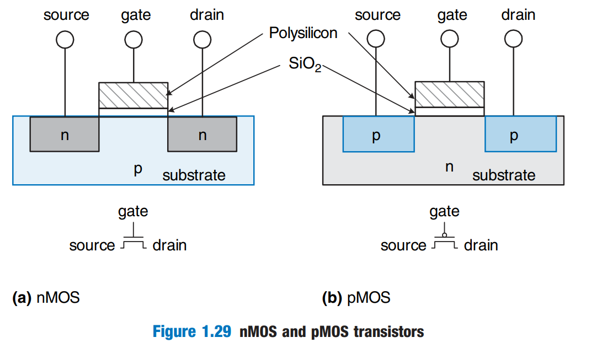

NMOS 与 PMOS 的主要特性总结对比如下。

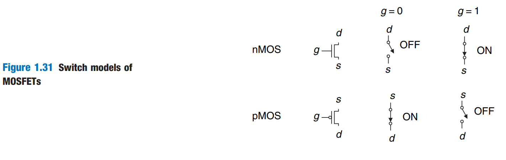

### 5.1 CMOS 反相器

CMOS 反相器由 PMOS 管（上拉网络）和 NMOS 管（下拉网络）组成。

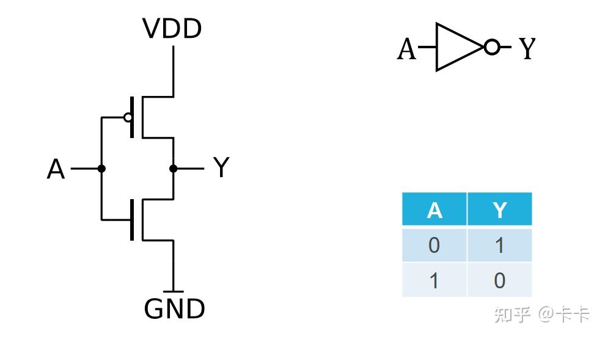

**工作原理**：
- $V_{IN} = V_{DD}$（高电平）：NMOS 导通，PMOS 截止，$V_{OUT} = 0V$
- $V_{IN} = 0V$（低电平）：PMOS 导通，NMOS 截止，$V_{OUT} = V_{DD}$

**电压传输特性**：
- 理想特性：在 $V_{DD}/2$ 处发生跳变
- 实际特性：有较陡峭的过渡区

### 5.2 CMOS 与非门

CMOS 与非门由两个串联的 NMOS 管和两个并联的 PMOS 管组成。

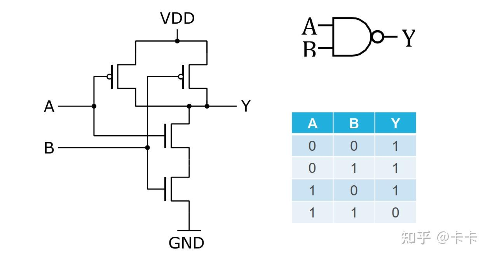

**电路结构**：
- 下拉网络：两个 NMOS 管串联
- 上拉网络：两个 PMOS 管并联

$$Y = \overline{A \cdot B}$$

### 5.3 CMOS 或非门

CMOS 或非门由两个并联的 NMOS 管和两个串联的 PMOS 管组成。

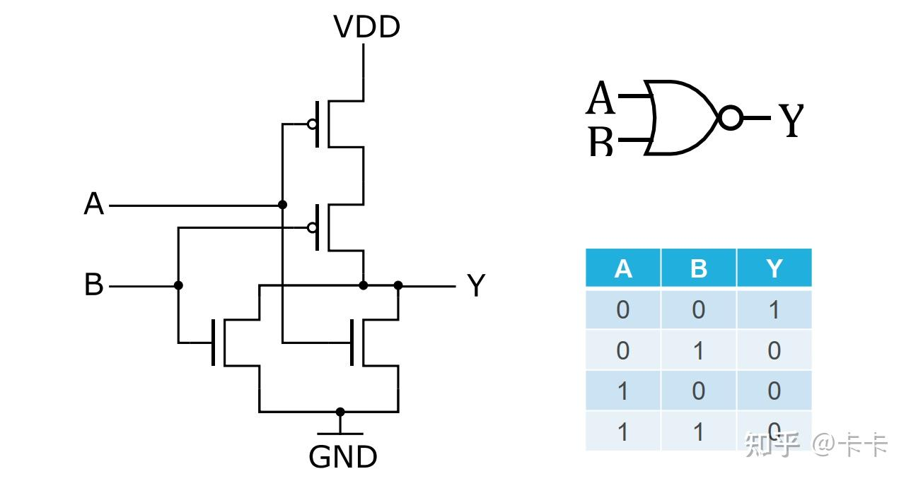

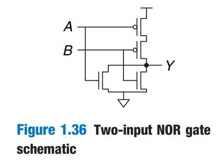

$$Y = \overline{A + B}$$

### 5.4 CMOS 传输门

CMOS 传输门（Transmission Gate, TG）由一对互补的 NMOS 和 PMOS 管并联构成。

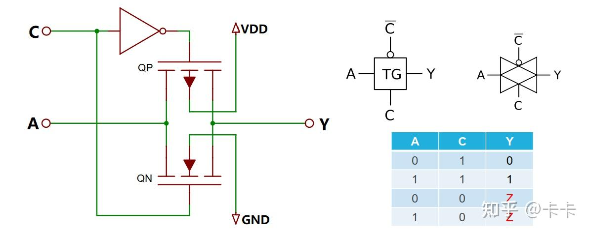

**工作原理**：
- 控制信号 $C = 1$，$\overline{C} = 0$：传输门导通，$v_O = v_I$
- 控制信号 $C = 0$，$\overline{C} = 1$：传输门截止，高阻态

**特点**：
- 双向传输特性
- 导通电阻小（NMOS 和 PMOS 互补）
- 适合模拟信号传输

### 5.5 CMOS 与门

CMOS 与门由 CMOS 与非门后接一个 CMOS 反相器构成，实现与逻辑功能。

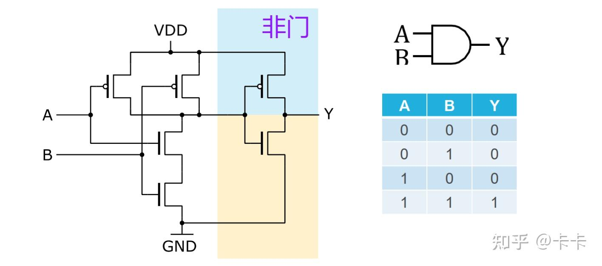

**电路结构**：
- 第一级：CMOS 与非门（两个串联 NMOS + 两个并联 PMOS），实现 $Y_1 = \overline{A \cdot B}$
- 第二级：CMOS 反相器（PMOS + NMOS 互补对），对 $Y_1$ 取反

**工作原理**：
- 当 $A$ 和 $B$ 均为高电平时，NMOS 串联导通，PMOS 并联截止，输出 $Y_1 = 0$，经反相器后 $Y = 1$
- 当 $A$ 或 $B$ 为低电平时，NMOS 串联截止，PMOS 并联导通，输出 $Y_1 = 1$，经反相器后 $Y = 0$

$$Y = \overline{\overline{A \cdot B}} = A \cdot B$$

**特点**：
- CMOS 与门也可用传输门逻辑实现，但标准结构为与非门加反相器
- 静态功耗极低，与所有 CMOS 电路的共同特点一致

### 5.6 CMOS 或门

CMOS 或门由 CMOS 或非门后接一个 CMOS 反相器构成，实现或逻辑功能。

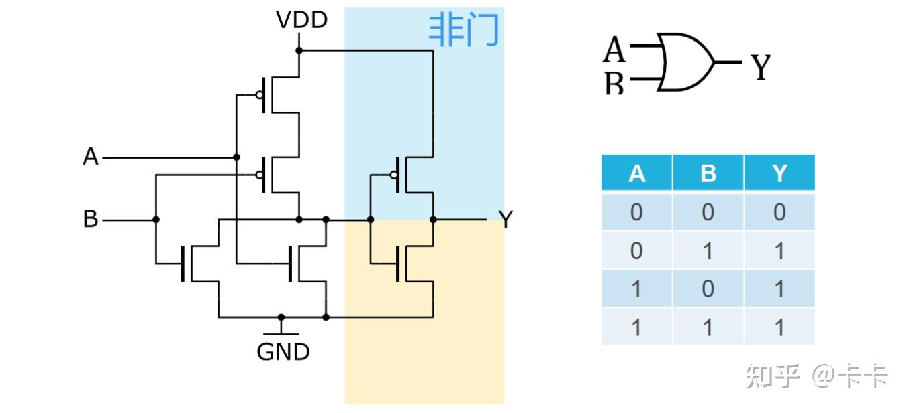

**电路结构**：
- 第一级：CMOS 或非门（两个并联 NMOS + 两个串联 PMOS），实现 $Y_1 = \overline{A + B}$
- 第二级：CMOS 反相器，对 $Y_1$ 取反

**工作原理**：
- 当 $A$ 或 $B$ 为高电平时，NMOS 并联导通，PMOS 串联截止，输出 $Y_1 = 0$，经反相器后 $Y = 1$
- 只有当 $A$ 和 $B$ 均为低电平时，NMOS 并联截止，PMOS 串联导通，输出 $Y_1 = 1$，经反相器后 $Y = 0$

$$Y = \overline{\overline{A + B}} = A + B$$

**特点**：
- 与 CMOS 与门对称，结构互补
- 两级结构增加了传输延迟，但逻辑功能完整

### 5.7 CMOS 异或门

CMOS 异或门（XOR Gate）利用传输门和反相器组合实现，也可用互补 CMOS 逻辑门组合实现。

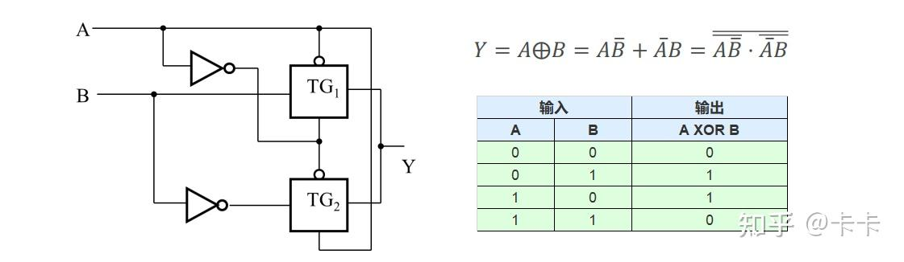

**电路结构**（传输门实现方式）：
- 利用两个 CMOS 传输门和反相器构成
- 当 $A = 0$ 时，传输门 TG1 导通，$Y = B$
- 当 $A = 1$ 时，传输门 TG2 导通，$Y = \overline{B}$

**逻辑表达式**：

$$Y = A \oplus B = A\overline{B} + \overline{A}B$$

**工作原理**：
- 当 $A = 0$ 时，$Y = B$（输入信号直通）
- 当 $A = 1$ 时，$Y = \overline{B}$（输入信号取反后输出）

**特点**：
- 传输门实现方式结构紧凑，晶体管数量少
- CMOS 异或门也可由互补 CMOS 逻辑门直接构成
- 传输门实现方式利用了 CMOS 传输门的双向导通特性

### 5.8 CMOS 同或门

CMOS 同或门（XNOR Gate）实现同或逻辑功能，是异或门的互补输出。

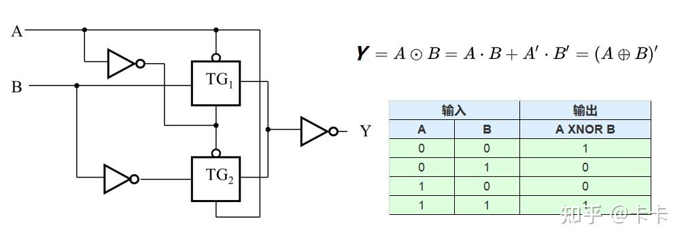

**逻辑表达式**：

$$Y = \overline{A \oplus B} = A \odot B = AB + \overline{A}\overline{B}$$

**实现方式**：
- 方式一：CMOS 异或门后接 CMOS 反相器
- 方式二：利用传输门直接实现，当 $A = 0$ 时输出 $\overline{B}$，当 $A = 1$ 时输出 $B$

**特点**：
- 同或门与异或门互为互补关系
- 在数字比较器中用于判断两数是否相等

## 6. ECL 与 I²L 逻辑门电路

除了 TTL 与 CMOS 之外，历史上还出现过多种其他逻辑系列，这里概述其中的 ECL 与 I²L 两种。

### 6.1 ECL（发射极耦合逻辑）

ECL（Emitter-Coupled Logic）采用差动放大器结构，利用两只三极管之间的电流分配实现逻辑运算，三极管只工作在线性放大区与截止区之间，**不进入饱和区**。

- **结构与速度**：无饱和存储时间，传播延迟可低至纳秒（ns）量级以下，是所有逻辑系列中速度最快的一种；但由于输出级需有恒流源常通，静态功耗较大，且需负电源供电
- **输出特点**：可同时提供原码与反码两种互补输出，驱动能力强
- **应用定位**：主要用于高速计算机、高速数据通信等对速度要求极高的场合

### 6.2 I²L（集成注入逻辑）

I²L（Integrated Injection Logic）利用多集电极 NPN 晶体管与恒流注入源构成，**电路中不需要电阻元件**。

- **结构与功耗**：无需电阻，工艺简单、结构紧凑，静态功耗很低，但翻转速度较慢
- **集成度高**：因器件尺寸小、无需电阻，在早期大规模、超大规模集成电路中优势明显，曾广泛用于数字手表、计算器等芯片
- **应用定位**：I²L 属于早期的高集成度实现方式，后逐渐被性能更优的 CMOS 工艺取代

## 7. TTL 与 CMOS 电平匹配

### 7.1 电平标准

| 参数 | TTL | CMOS（5V） |
|------|-----|-----------|
| $V_{OH(min)}$ | 2.4V | 4.9V |
| $V_{OL(max)}$ | 0.4V | 0.1V |
| $V_{IH(min)}$ | 2.0V | 3.5V |
| $V_{IL(max)}$ | 0.8V | 1.5V |

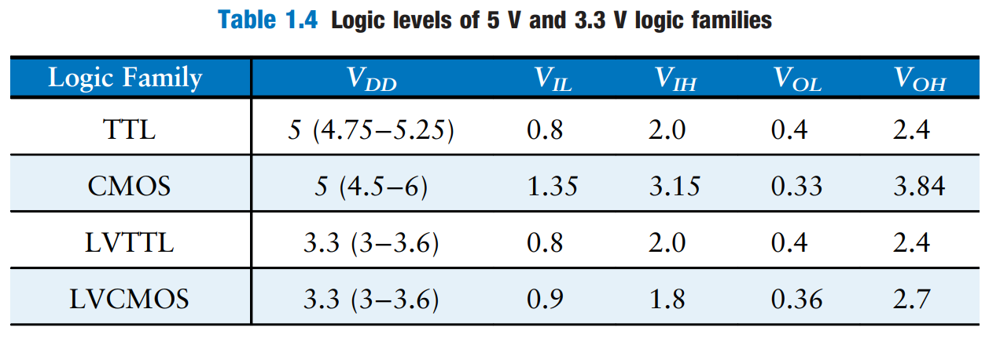

### 7.2 TTL 驱动 CMOS

当 TTL 输出高电平时，$V_{OH} \approx 2.4V$，低于 CMOS 要求的 $V_{IH} \approx 3.5V$。解决方法：
- 在 TTL 输出端加上拉电阻至 $V_{DD}$
- 使用电平转换芯片

### 7.3 CMOS 驱动 TTL

CMOS 输出电平可以直接满足 TTL 输入要求，但 CMOS 驱动能力较弱，需检查扇出系数。

## 8. CMOS 逻辑门电路设计原理

### 8.1 开关模型与逻辑构建

CMOS 逻辑门的基本构建思路是使用 NMOS 和 PMOS 作为互补开关：

- **NMOS 开关**：栅极电压为高（V_DD）时导通，低（0）时关断
  - 传递强 0（导通到 GND），传递弱 1（阈值电压损失）
- **PMOS 开关**：栅极电压为低（0）时导通，高（V_DD）时关断
  - 传递强 1（导通到 V_DD），传递弱 0（阈值电压损失）

### 8.2 上拉网络与下拉网络（PDN/PUN）

任何 CMOS 逻辑门都包含两个互补的网络：

- **下拉网络（Pull-Down Network, PDN）**：由 NMOS 管构成，连接输出端与 GND
  - NMOS 串联实现 AND 逻辑（只有所有串联 NMOS 都导通，下拉路径才导通）
  - NMOS 并联实现 OR 逻辑（只要任一并联 NMOS 导通，下拉路径就导通）
- **上拉网络（Pull-Up Network, PUN）**：由 PMOS 管构成，连接输出端与 V_DD
  - PMOS 串联实现 OR 逻辑（只有所有串联 PMOS 都导通，上拉路径才导通）
  - PMOS 并联实现 AND 逻辑（只要任一并联 PMOS 导通，上拉路径就导通）

**互补原则**：PUN 是 PDN 的对偶电路。对偶关系为：
- PDN 中的串联对应 PUN 中的并联
- PDN 中的并联对应 PUN 中的串联
- NMOS 对应 PMOS（互补）

**逻辑函数实现**：给定逻辑函数 Y = f(A, B, ...)，PDN 实现 f 的取反，即：
- PDN 导通条件：Y = 0（输出为低）
- PUN 导通条件：Y = 1（输出为高）
- 由于 PDN 和 PUN 互补，可将逻辑函数写为：Y = ¬(PDN_expression)

**示例**：CMOS 与非门 Y = ¬(A·B)
- PDN（NMOS）：A 和 B 串联（实现 AND）
- PUN（PMOS）：A 和 B 并联（对偶，实现 OR）
- 输出取反，得到与非逻辑

CMOS 反相门的通用形式如下图所示，由互补的 PDN 和 PUN 网络构成。

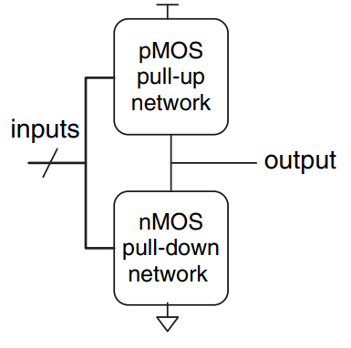

### 8.3 晶体管尺寸设计（Transistor Sizing）

CMOS 逻辑门中，晶体管尺寸直接影响驱动能力和速度。

**迁移率差异**：空穴迁移率 μ_p 约为电子迁移率 μ_n 的一半（μ_n ≈ 2 μ_p）。因此，PMOS 需要约 2 倍的宽度才能达到与 NMOS 相同的导通电阻。

**标准比例**：为使 CMOS 反相器的上升和下降时间对称，PMOS 宽度应为 NMOS 的 2 倍：
$$W_p : W_n = 2 : 1$$

**标准反相器尺寸**：
- INV1X（单位反相器）：W_n = 1 单位，W_p = 2 单位
- INV2X（2 倍反相器）：W_n = 2 单位，W_p = 4 单位
- INV4X（4 倍反相器）：W_n = 4 单位，W_p = 8 单位

**复合门的尺寸设计**：
- 当多个 NMOS 串联时，等效导通电阻增加，需要增大每个管子的宽度
- 例如，2 输入与非门中两个 NMOS 串联，每个 NMOS 宽度应为单位反相器的 2 倍
- 规则：串联的晶体管数量为 N，则每个晶体管宽度应乘以 N

### 8.4 传播延迟分析

CMOS 门的传播延迟主要取决于负载电容的充放电时间：

$$t_p ≈ 0.69 · R_{eq} · C_L$$

其中 R_eq 是导通时的等效电阻，C_L 是负载电容。

**延迟与输入模式相关**：不同输入组合下，导通的晶体管路径不同，延迟也不同：
- 当多个 NMOS 并联时，导通电阻最小，延迟最小
- 当多个 NMOS 串联时，导通电阻最大，延迟最大

**延迟优化技巧**：
- 将最晚到达（时序最紧）的信号对应的晶体管放在靠近输出端的位置
- 这样可以减少该信号到达前已部分充放电的影响
- 增大晶体管尺寸可降低导通电阻，但会增加栅电容

### 8.5 扇入与扇出

- **扇入（Fan-in）**：逻辑门的输入端口数
  - 扇入越大，串联晶体管越多，延迟越大
  - 大扇入门通常拆分为多级小扇入门实现

- **扇出（Fan-out）**：逻辑门驱动的负载门数
  - 扇出越大，负载电容越大，延迟越大
  - 可用缓冲器（反相器链）驱动大扇出

## 9. 传输管逻辑与电平恢复

### 9.1 传输管逻辑（Pass Transistor Logic, PTL）

传输管逻辑使用单个 NMOS 或 PMOS 管作为开关来传递信号，而非构建互补的 PDN/PUN 网络。

**NMOS 传输管**：
- 栅极接控制信号，源/漏极接数据信号
- 当控制信号为高时，NMOS 导通，数据通过
- 传递逻辑 0 时，输出为 0（强 0）
- 传递逻辑 1 时，输出为 V_DD - V_TH（弱 1，阈值电压损失）

**PMOS 传输管**：
- 当控制信号为低时，PMOS 导通，数据通过
- 传递逻辑 1 时，输出为 V_DD（强 1）
- 传递逻辑 0 时，输出为 V_TH（弱 0，阈值电压损失）

**传输管逻辑的优点**：
- 晶体管数量少，面积小
- 适合实现某些特定逻辑（如异或、多路选择器）

**传输管逻辑的缺点**：
- 信号电平退化（弱 1 或弱 0）
- 噪声容限降低
- 级联时信号质量进一步恶化

### 9.2 传输门（Transmission Gate）

传输门由 NMOS 和 PMOS 并联构成，互补控制，解决了传输管逻辑的阈值损失问题。

**结构**：
- NMOS 管栅极接控制信号 C
- PMOS 管栅极接控制信号的反相 C'
- 输入和输出端在 NMOS 和 PMOS 的源/漏之间并联

**工作原理**：
- 当 C=1, C'=0 时：两个管子同时导通
  - NMOS 传递强 0，PMOS 传递强 1
  - 两者互补，输出为满摆幅（0 到 V_DD）
- 当 C=0, C'=1 时：两个管子同时截止，高阻态

**应用**：传输门广泛用于多路选择器、异或门、D 触发器等电路中。

### 9.3 电平恢复电路（Level Restoration）

传输管逻辑中，当 NMOS 传递逻辑 1 时，输出为 V_DD - V_TH（弱 1），后续门可能无法正确识别。

**电平恢复原理**：使用一个弱 PMOS 管（反馈晶体管）将弱 1 节点拉回满 V_DD。

**电路结构**：
- 输入信号通过 NMOS 传输管连接到内部节点 X
- 内部节点 X 连接到一个反相器的输入
- 反相器的输出通过一个弱 PMOS 管（始终弱导通）反馈到节点 X
- 当节点 X 为弱 1 时，反相器输出为 0，弱 PMOS 导通，将节点 X 拉高到 V_DD
- 当节点 X 为 0 时，反相器输出为 1，弱 PMOS 截止，不影响节点 X

**设计要点**：
- 恢复 PMOS 必须是弱管（长沟道或小宽度），避免干扰下拉路径
- 恢复 PMOS 的驱动能力必须远弱于传输管的下拉能力

### 9.4 传输管逻辑的应用示例

**NMOS 多路选择器**：用单个 NMOS 管实现 2 选 1 选择器，但输出电平有损失。

**XOR 门**：用传输管逻辑实现 XOR 门，只需 4 个晶体管（互补 CMOS 需要 8-12 个）。
- 结构：A=0 时，传输 B 到输出；A=1 时，传输 B' 到输出

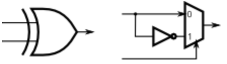

**应用场景**：传输管逻辑在低功耗设计和面积受限的设计中广泛使用，但通常需要结合电平恢复电路使用。

## 10. 逻辑门动态特性

### 10.1 传输延迟

信号通过逻辑门需要时间，包括：
- $t_{PLH}$：输出从低电平到高电平的延迟
- $t_{PHL}$：输出从高电平到低电平的延迟

### 10.2 上升时间和下降时间

- **上升时间** $t_r$：输出从 10% 上升到 90% 所需时间
- **下降时间** $t_f$：输出从 90% 下降到 10% 所需时间

### 10.3 功耗与速度的权衡

- CMOS 电路的静态功耗极低，但动态功耗随频率增加而增加
- 动态功耗公式：$P = f \cdot C_L \cdot V_{DD}^2$
- 高速电路通常需要更多功耗，存在功耗-速度折衷

## 本章要点

- 二极管逻辑门电路
- 三极管非门
- 缓冲器
- TTL 逻辑门电路
- CMOS 逻辑门电路
- ECL 与 I²L 逻辑门电路

## 自测清单

1. 「二极管逻辑门电路」要解决的核心问题是什么？关键结论或公式是什么？
2. 「三极管非门」与上一节之间是什么关系？
3. 「缓冲器」在什么场景下会用到？如果条件改变，结论会如何变化？
4. 能否不看正文，写出「TTL 逻辑门电路」的关键流程或结构？
5. 「CMOS 逻辑门电路」最容易混淆的点是什么？

---

**下一章**：[3.4 组合逻辑电路](3.4-组合逻辑电路.md)
